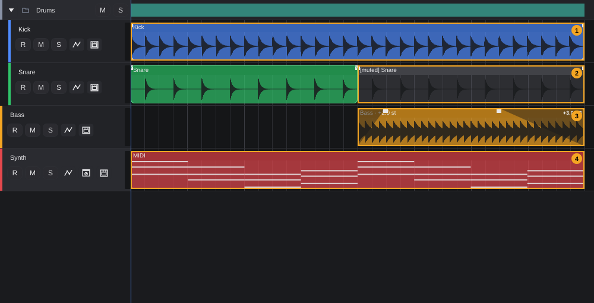
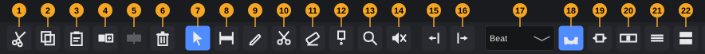
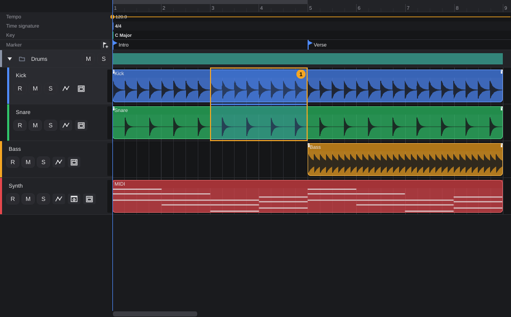
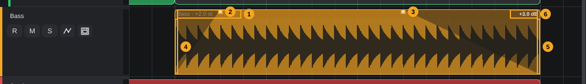
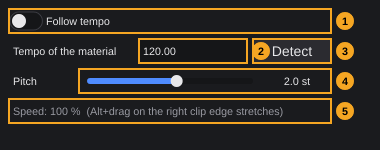
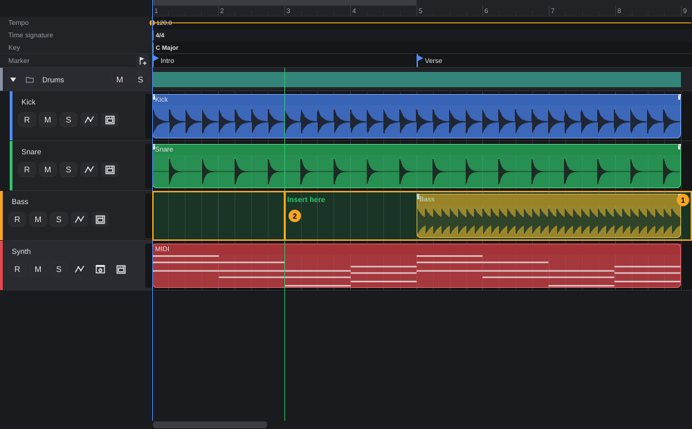

# Arranging

Arranging means building the song from clips: you place audio and MIDI clips on the tracks, move, copy, trim, split and glue them, cut out or insert whole sections, set fades and clip gain, and change tempo and pitch of audio clips. All of this happens in the **event display**, the area with the clips in the middle of the project window, with the tools from the toolbar.

**In this chapter**

1. [The arrangement at a glance](#1-the-arrangement-at-a-glance)
2. [Editing buttons and tools](#2-editing-buttons-and-tools)
3. [Grid and snap](#3-grid-and-snap)
4. [Zooming and scrolling](#4-zooming-and-scrolling)
5. [Selecting clips](#5-selecting-clips)
6. [Moving clips](#6-moving-clips)
7. [Cut, copy, paste and duplicate](#7-cut-copy-paste-and-duplicate)
8. [Trimming clips](#8-trimming-clips)
9. [Splitting and gluing](#9-splitting-and-gluing)
10. [Range editing](#10-range-editing)
11. [Deleting and muting clips](#11-deleting-and-muting-clips)
12. [Fades and crossfades](#12-fades-and-crossfades)
13. [Clip gain and normalizing](#13-clip-gain-and-normalizing)
14. [Reverse and invert phase](#14-reverse-and-invert-phase)
15. [Tempo and pitch (time stretch)](#15-tempo-and-pitch-time-stretch)
16. [Takes](#16-takes)
17. [The clip context menu](#17-the-clip-context-menu)
18. [Creating MIDI clips](#18-creating-midi-clips)
19. [Importing audio and MIDI files](#19-importing-audio-and-midi-files)
20. [Opening clips in an editor](#20-opening-clips-in-an-editor)
21. [Baked tracks](#21-baked-tracks)
22. [Undo and error messages](#22-undo-and-error-messages)
23. [Quick reference](#23-quick-reference)

---

## 1. The arrangement at a glance

The arrangement area is described in [The project window §7](project-window.md#7-arrangement-area): overview bar, ruler, signature track, marker track, track list and event display. This chapter is about the **event display**, where every track shows its clips along the timeline.

In the picture, the demo project shows these kinds of clips:

| # | Clip | How you recognise it | Details |
|---|---|---|---|
| 1 | **Selected clip** (*Kick*) | Light outline around the clip | [§5](#5-selecting-clips) |
| 2 | **Muted clip** (second half of *Snare*) | Grey instead of the track colour, name starts with **[muted]** | [§11](#11-deleting-and-muting-clips) |
| 3 | **Audio clip with fades, clip gain and pitch** (*Bass*) | Dark ramps at the start and end, **+3.0 dB** at the right of the title bar, **· +2.0 st** after the name | [§12](#12-fades-and-crossfades), [§13](#13-clip-gain-and-normalizing), [§15](#15-tempo-and-pitch-time-stretch) |
| 4 | **MIDI clip** (*Synth*) | Small bars for the notes instead of a waveform | [§18](#18-creating-midi-clips) |

**What a clip shows**

- Every clip is a rounded block in the colour of its track, with a darker **title bar** at the top. The title bar shows the clip name. Clips have no colour or name of their own: the colour always follows the track, and the name comes from the imported file (audio and MIDI files), is **MIDI** for new, empty MIDI clips, or comes from the first clip when you glue ([§9](#9-splitting-and-gluing)).
- **Audio clips** show the waveform of the part of the file they play. **MIDI clips** show a miniature piano roll: every note is a small bar, high notes at the top.
- The title bar adds information about the clip, separated by **·**:
  - **Take** *n*/*m* when the clip has several takes, for example *Vocals · Take 2/4* ([§16](#16-takes)),
  - **Tempo** *n* **BPM** when the clip follows the project tempo, otherwise *n* **% length** when the clip is stretched ([§15](#15-tempo-and-pitch-time-stretch)),
  - *n* **st** when the pitch is changed, for example **+2.0 st**.
- Audio clips always have two small light squares at the top edge: the **fade handles** ([§12](#12-fades-and-crossfades)). The clip gain appears at the right of the title bar as soon as it is not 0 dB ([§13](#13-clip-gain-and-normalizing)).
- While a track records, a red block labelled **Recording...** grows from the record start to the playhead; the clip itself appears when recording stops (see the chapter *Recording audio and MIDI*).
- On a baked track, all clips are dimmed and a hint is shown ([§21](#21-baked-tracks)).

Behind the clips, every track draws vertical grid lines: bars stronger, beats and grid steps fainter ([§3](#3-grid-and-snap)). The playhead runs as a vertical line across all tracks.

---

## 2. Editing buttons and tools

The middle part of the toolbar holds everything for editing clips. Every button has an icon and a tooltip with its key.

<!-- FIX F-204: tool order (7–14) may follow the keys 1–8 -->
| # | Button | What it does | Key | Details |
|---|---|---|---|---|
| 1 | Cut | Cut the selected clips | **Ctrl+X** | [§7](#7-cut-copy-paste-and-duplicate) |
| 2 | Copy | Copy the selected clips | **Ctrl+C** | [§7](#7-cut-copy-paste-and-duplicate) |
| 3 | Paste | Paste the clips at the playhead on the selected track | **Ctrl+V** | [§7](#7-cut-copy-paste-and-duplicate) |
| 4 | Duplicate | Copy the selected clips right after themselves | **Ctrl+D** | [§7](#7-cut-copy-paste-and-duplicate) |
| 5 | Glue | Glue the selected clips of a track into one | **Ctrl+J** | [§9](#9-splitting-and-gluing) |
| 6 | Delete | Delete the selected clips | **Del** | [§11](#11-deleting-and-muting-clips) |
| 7 | **Select** tool | Select, move, trim, fade | **1** | [§2.1](#21-the-tools-in-detail) |
| 8 | **Range** tool | Draw a time range across tracks | **2** | [§10](#10-range-editing) |
| 9 | **Pencil** | Draw an empty MIDI clip on an instrument track | **8** | [§18](#18-creating-midi-clips) |
| 10 | **Split** tool | Cut a clip in two at the click | **3** | [§9](#9-splitting-and-gluing) |
| 11 | **Eraser** | Delete the clicked clip | **5** | [§11](#11-deleting-and-muting-clips) |
| 12 | **Glue** tool | Join the clicked clip with the next one on its right | **4** | [§9](#9-splitting-and-gluing) |
| 13 | **Zoom** tool | Click zooms in, **Alt**+click zooms out | **6** | [§4](#4-zooming-and-scrolling) |
| 14 | **Mute** tool | Mute the clicked clip or make it audible again | **7** | [§11](#11-deleting-and-muting-clips) |
| 15 | Nudge left | Move the selected clips one grid step left | **Ctrl+Left Arrow** | [§6.3](#63-nudging) |
| 16 | Nudge right | Move the selected clips one grid step right | **Ctrl+Right Arrow** | [§6.3](#63-nudging) |
| 17 | **Grid** | Grid for snap, nudge and display; default **Beat** | — | [§3](#3-grid-and-snap) |
| 18 | Snap | Lock to the grid; on by default | — | [§3](#3-grid-and-snap) |
| 19 | Zoom | Menu with zoom commands, bar zooms and your zoom presets | — | [§4](#4-zooming-and-scrolling) |
| 20 | Overview bar | Overview bar on/off | — | [The project window §7](project-window.md#7-arrangement-area) |
| 21 | Tracks smaller | Track height −16 pixels | — | [§4](#4-zooming-and-scrolling) |
| 22 | Tracks larger | Track height +16 pixels | — | [§4](#4-zooming-and-scrolling) |

The same numbers continue the toolbar numbering of [The project window §4](project-window.md#4-toolbar) (there: 16–37).

- Buttons 1, 2, 4, 6, 15 and 16 are greyed out while no clip is selected. **Paste** (3) is greyed out until something has been cut or copied. **Glue** (5) needs at least two selected clips.
- The tools (7–14) work like radio buttons: exactly one is active. The **Select** tool is active when the window opens. Pick a tool by clicking its button or by pressing its key **1**–**8**.
- Switching to any tool other than **Range** removes a range selection ([§10](#10-range-editing)).

### 2.1 The tools in detail

The table shows what each tool does with the left mouse button. **Right-click** on a clip opens the clip context menu with every tool except the Range tool ([§17](#17-the-clip-context-menu)); with the Range tool, right-click opens the range menu ([§10](#10-range-editing)).

| Tool | Click on a clip | Drag on a clip | Click or drag on empty space |
|---|---|---|---|
| **Select** (1) | Selects the clip ([§5](#5-selecting-clips)) | In the middle: move ([§6](#6-moving-clips)). At the left or right edge: trim ([§8](#8-trimming-clips)); **Alt** at the right edge: stretch ([§15](#15-tempo-and-pitch-time-stretch)). On a fade handle: fade ([§12](#12-fades-and-crossfades)) | Click: clears the selection. Drag: selection rectangle (lasso) |
| **Range** (2) | Starts a range there (clips are not selected) | Draws a range, also across clips | Draws a range; a click without dragging removes the range ([§10](#10-range-editing)) |
| **Pencil** (8) | Nothing changes (the selection stays as it is) | Moves the clip (or the whole selection, if the clip is selected); no trimming | On an instrument or MIDI track: draws an empty MIDI clip, a click makes one bar ([§18](#18-creating-midi-clips)). On other tracks: error message |
| **Split** (3) | Splits the clip at the click | — | Nothing |
| **Eraser** (5) | Deletes this clip (only this one, even if others are selected) | — | Nothing |
| **Glue** (4) | Joins this clip with the next clip on its right ([§9](#9-splitting-and-gluing)) | — | Nothing |
| **Zoom** (6) | Zooms in; **Alt**+click zooms out. Works over clips too | — | Same as on a clip |
| **Mute** (7) | Mutes this clip, or makes it audible if it was muted | — | Nothing |

<!-- FIX F-702: a double-click on empty space may create a MIDI clip only with the Select tool or the Pencil -->
**Double-click** works the same with every tool: on a clip it opens the clip in its editor ([§20](#20-opening-clips-in-an-editor)); on empty space of an instrument or MIDI track it creates an empty one-bar MIDI clip ([§18](#18-creating-midi-clips)). Note that each click of the double-click also does what the tool does (for example, with the Zoom tool a double-click on empty space zooms in twice and creates a MIDI clip).

**Mouse pointer and tooltip (Select tool).** Over the middle of a clip, the pointer is a **hand** and the tooltip reads *Drag: move. Right-click: menu (tempo and pitch, normalize, ...)*. At the left and right edges it is a **left-right arrow** with the tooltip *Drag: trim. Alt+drag on the right edge: stretch (time stretch)*. Over the fade handles the pointer stays normal.

---

## 3. Grid and snap

The **grid** controls three things at once: where clips, edges, ranges and the playhead snap to, how far **Nudge** moves clips, and which lines the ruler and tracks draw.

**To choose the grid:** open the **Grid** list (17). It offers, from top to bottom:

| Entry | Grid step |
|---|---|
| **Bar** | One bar of the current time signature |
| **Beat** (default) | One beat of the time signature: a quarter note in 4/4, an eighth note in 6/8 |
| **1/1**, **1/1.**, **1/1T**, **1/2**, **1/2.**, **1/2T** … **1/128**, **1/128.**, **1/128T** | A note value; **.** = dotted (1.5 times as long), **T** = triplet (two thirds as long) |
| **Seconds** | One second |
| **Samples** | One sample at the sample rate of the audio device (48 000 Hz if no device is running) |

Separators divide the list into the musical grids (**Bar**, **Beat**), the note values and the time grids (**Seconds**, **Samples**).

**Snap** (18) is on by default (the button is lit). While it is on, these positions snap to the **nearest** grid line:

- the start of a clip you move ([§6](#6-moving-clips)),
- the edge of a clip you trim or stretch ([§8](#8-trimming-clips)),
- the split position of the Split tool ([§9](#9-splitting-and-gluing)),
- the start and end of a MIDI clip drawn with the Pencil or created by double-click ([§18](#18-creating-midi-clips)),
- both ends of a range ([§10](#10-range-editing)),
- the drop position of imported files ([§19](#19-importing-audio-and-midi-files)),
- clicks and drags in the ruler (playhead and loop range, see [Transport §6](transport.md#6-locators-and-loop)).

Switch Snap off to place things freely. With the Range tool you can also hold **Shift** while dragging to ignore the grid for that one range. Fades never snap ([§12](#12-fades-and-crossfades)).

**Nudge** ([§6.3](#63-nudging)) always uses the grid step, also when Snap is off.

**Grid lines.** Bars are drawn as strong lines, the other grid steps as faint lines. If the lines would be closer together than a few pixels, only every n-th line is drawn; bar lines always stay. With **Seconds** or **Samples**, the lines still show beats, so the display stays readable in musical terms. The ruler numbers the bars when they are far enough apart.

> **Note:** The grid and Snap are settings of the window, not of the project. After a restart the grid is **Beat** and Snap is on.

---

## 4. Zooming and scrolling

### 4.1 Horizontal zoom

| Way | What happens |
|---|---|
| **Ctrl**+mouse wheel | Zooms in or out by 20 % per wheel step. The position under the mouse pointer stays where it is. |
| **Zoom** tool (13) | Click: zoom in by a factor of 1.6 around the click. **Alt**+click: zoom out by the same factor. |
| **H** / **G** (**View › Zoom in** / **Zoom out**) | Zoom in / out by a factor of 1.6 around the playhead. If the playhead is not visible, around the middle of the visible section. |
| **Shift+F** (**View › Show whole project**) | All clips fit into the width, with 2 % space after the last clip. Without clips: the first 16 bars. |
| **Alt+S** (**View › Zoom to selection**) | Shows the range selection, or else the selected clips, with 5 % space on both sides. Without a selection the message *Nothing selected: select clips or a range first.* appears. |
| Zoom menu (19) | See below. |
| Overview bar | Drag the edges of its frame. See [The project window §7](project-window.md#7-arrangement-area). |

The zoom has limits: at most 2000 pixels per second, at least 2 pixels per second. A new window starts at 20 pixels per second.

**The Zoom menu** (19):

| Entry | What it does |
|---|---|
| **Whole project** | Same as **Shift+F** |
| **To selection** | Same as **Alt+S** |
| **Zoom in** / **Zoom out** | Same as **H** / **G** |
| **Bars**: **1 bar**, **4 bars**, **16 bars**, **64 bars** | Shows that many bars, starting at the bar line at or before the left edge of the visible section |
| **Custom presets** | Your saved zooms. Without presets: *(none yet, "Save current zoom" creates one)* |
| **Save current zoom...** | Asks for a name (*Name for the current zoom (n seconds visible):*, suggested name *Zoom n s*) and stores how many seconds are visible. A preset with the same name is replaced. |
| **Delete preset** › | Removes one of your presets (only shown when there are presets) |

A preset changes only the scale; the left edge of the visible section stays where it is. Presets are stored in the program settings and are available in every project.

### 4.2 Vertical zoom (track height)

Click **Tracks smaller** (21) or **Tracks larger** (22) to change the height of all tracks by 16 pixels. The height goes from 56 to 160 pixels; the default is 72. Folder rows and automation lanes keep their own height. Expanded take lanes make a track taller ([§16](#16-takes)).

### 4.3 Scrolling

| Action | Result |
|---|---|
| Mouse wheel | Scrolls the tracks up and down |
| **Shift**+mouse wheel, or a horizontal wheel/touchpad movement | Scrolls left and right (one wheel step moves about half the visible width) |
| Scroll bar below the tracks | Scrolls left and right |
| Vertical scroll bar at the right | Scrolls the tracks up and down |
| Overview bar | Drag its frame or click beside it |

You can scroll to the right up to 30 seconds past the end of the last clip (or of the playhead, whichever is later), at least to 60 seconds.

<!-- FIX F-404: the arrangement may follow the playhead -->
> **Note:** The view does not scroll along with the playhead during playback. See [Transport §3](transport.md#3-playing-and-stopping).

---

## 5. Selecting clips

Most editing functions work on the **selected clips**. Selected clips have a light outline.

| Action (Select tool) | Result |
|---|---|
| Click a clip | Selects only this clip. If the clip is already selected, the selection stays as it is (so you can drag several selected clips together). |
| **Shift**+click a clip | Adds the clip to the selection |
| **Ctrl**+click a clip | Adds the clip, or removes it if it was selected |
| Click empty space | Clears the selection (not with **Ctrl** or **Shift** held) |
| Drag a rectangle on empty space | Selects every clip the rectangle touches, on all tracks it covers; replaces the selection. The mouse must move more than 3 pixels. |
| **Shift** or **Ctrl** while dragging the rectangle | Adds the touched clips to the selection |
| Right-click a clip that is not selected | Selects only this clip, then opens the context menu ([§17](#17-the-clip-context-menu)) |
| **Ctrl+A** (**Edit › Select all clips**) | Selects every clip on the visible tracks (not on hidden tracks or inside collapsed folders) |

The selection rectangle is drawn as a light frame while you drag.

Clicking a track's lane (with any tool) also **selects the track**: its header lights up and the Inspector shows it. The selected track is where **Paste** ([§7](#7-cut-copy-paste-and-duplicate)) and **File › Import audio or MIDI file...** ([§19](#19-importing-audio-and-midi-files)) put clips.

Deleted clips drop out of the selection automatically.

---

## 6. Moving clips

### 6.1 Moving on the same track

1. Select the **Select** tool (or the **Pencil**).
2. Point at the middle of a clip (the pointer becomes a hand).
3. Drag left or right. The clip follows the mouse; its **start** snaps to the nearest grid line when Snap is on.
4. Release the mouse button.

If the clip you grab is selected, **all selected clips** move by the same distance, also those on other tracks. A move only counts once the mouse has moved more than 2 pixels, so a simple click never moves a clip.

Clips never move before the project start: if one clip of the selection would go below 0, the whole selection stops at the point where the earliest clip reaches the start.

### 6.2 Moving to another track

Drag the clip up or down into another track. While you drag, the target track is highlighted in green with the label **Move here**. Release the mouse button over the target track.

- All selected clips move the same number of tracks up or down.
<!-- FIX F-703: the track distance may count only visible tracks -->
- The target must fit the clip: audio clips go on audio tracks, MIDI clips on instrument and MIDI tracks. If one clip of the selection does not fit, or there is no track that far up or down, nothing moves and a message explains why (*Audio clips only fit on audio tracks.*, *MIDI clips only fit on instrument tracks.*, *There is no track there.*). The clips jump back to where they were.
- If you release the mouse over a folder row or outside the tracks, the clips only move in time.

<!-- FIX F-706: Alt+drag may copy clips like in the Key Editor -->
> **Note:** Dragging always moves. To copy clips, use **Copy** and **Paste** or **Duplicate** ([§7](#7-cut-copy-paste-and-duplicate)). (In the Key Editor, **Alt**+drag copies notes; in the arrangement it does not copy clips.)

### 6.3 Nudging

Nudging moves the selected clips by exactly one grid step, without the mouse:

- Click **Nudge left** (15) or **Nudge right** (16), or
- press **Ctrl+Left Arrow** / **Ctrl+Right Arrow**, or
- choose **Edit › One grid step left** / **One grid step right**.

The step is the grid step from the **Grid** list (17) at the start of the earliest selected clip; with tempo changes it can differ from place to place. With **Seconds** a nudge moves by one second, with **Samples** by one sample. Nudging works even when Snap is off. **Nudge left** stops at the project start.

<!-- FIX F-705: the Edit menu entries may be greyed out without a selection like the buttons -->
The nudge buttons are greyed out without a selection. The two **Edit** menu entries are always available while a project is open; without a selection they do nothing.

Each nudge is one undo step (*Move clips*).

---

## 7. Cut, copy, paste and duplicate

These functions work on the selected clips. They are in the toolbar (1–4), in the **Edit** menu, in the clip context menu ([§17](#17-the-clip-context-menu)) and on keys.

| Function | Key | What it does |
|---|---|---|
| **Cut** | **Ctrl+X** | Copies the selected clips to the clipboard and deletes them. |
| **Copy** | **Ctrl+C** | Copies the selected clips to the clipboard. The project does not change. |
| **Paste at playhead** | **Ctrl+V** | Inserts the clipboard at the playhead on the selected track. The pasted clips become the selection. |
| **Duplicate** | **Ctrl+D** | Inserts a copy of the selected clips directly after the end of the selection. The copies become the selection. |

**Several clips, several tracks.** The clipboard remembers how the clips lie relative to each other: their distance in time from the earliest clip and their distance in tracks from the topmost track. When you paste, the earliest clip lands at the playhead and the topmost track's clips on the selected track; all other clips keep their distances, on the tracks below. **Duplicate** places the whole block so that it starts where the last clip of the selection ends, on the same tracks.

- If there are not enough tracks below the selected track, nothing is pasted: *There are not enough tracks below the target track for the copy.*
- If a clip does not fit its target track (audio on an instrument track or the other way round), nothing is pasted: *Audio clips only fit on audio tracks.* or *MIDI clips only fit on instrument tracks.*
- The clipboard lives as long as FK Audio Suite runs. It works only inside FK Audio Suite, not with other programs.

> **Tip:** Press **Ctrl+D** several times to repeat a pattern: because the copy becomes the selection, each **Ctrl+D** appends the next repetition.

> **Example:** To repeat bars 1–4 of the drums at bar 9: select the *Kick* and *Snare* clips, press **Ctrl+C**, click the *Kick* track to select it, put the playhead on bar 9 (click in the ruler), press **Ctrl+V**. The *Snare* copy lands on the track below *Kick*, as in the original.

---

## 8. Trimming clips

Trimming moves the start or end of a clip without moving the material: you hide or reveal part of the recording.

1. Select the **Select** tool.
2. Point at the **left** or **right** edge of a clip. The pointer becomes a left-right arrow. The grab zone is 6 pixels wide; on narrow clips at most a third of the clip width.
3. Drag the edge. The edge snaps to the grid when Snap is on.
4. Release the mouse button.

| Edge | Rules |
|---|---|
| **Left** | The clip starts later or earlier; the material stays where it is in the song. You cannot drag the left edge before the beginning of the material or before the project start. The clip stays at least 0.05 seconds long. |
| **Right** | The clip ends earlier or later. The clip stays at least 0.05 seconds long. |

Trimming works on **one clip** at a time, the one you grab, also when several are selected. It works for audio and MIDI clips.

> **Tip:** The fade handles sit in the top corners of an audio clip ([§12](#12-fades-and-crossfades)). Grab the edge a little lower than the top to trim instead of fading.

**Alt** while dragging the **right** edge of an audio clip stretches the clip instead of trimming it ([§15](#15-tempo-and-pitch-time-stretch)).

---

## 9. Splitting and gluing

### 9.1 Splitting a clip

1. Select the **Split** tool (10) or press **3**.
2. Click the clip where you want to cut it. The cut snaps to the nearest grid line when Snap is on.

The clip becomes two clips that touch. Only the clicked clip is split, not the rest of the selection. If the snapped position lies outside the clip (possible near the clip edges with a coarse grid), nothing happens.

To split all clips on several tracks at the same positions, draw a range and use **Split at the boundaries** ([§10](#10-range-editing)).

### 9.2 Gluing clips

Gluing joins clips of one track into a single clip.

**With the Glue button or key:**

1. Select at least two clips **on the same track** (for example with **Shift**+click).
2. Click **Glue** (5), press **Ctrl+J**, or choose **Edit › Glue**.

**With the Glue tool:**

1. Select the **Glue** tool (12) or press **4**.
2. Click a clip. It is joined with the **next clip on its right** on the same track (the clip with the next start position). If there is none, the message *There is no clip to the right of this one that it can be glued to.* appears.

The glued clip reaches from the start of the earliest clip to the end of the latest. Gaps between the clips become part of the new clip.

<!-- FIX F-306: the file name of glued audio may be English ("glued") -->
| Clips | What happens |
|---|---|
| **MIDI** | The notes of all clips are combined into one MIDI clip. |
| **Audio** | The clips are rendered, with their clip gain and fades but without plugins, into a new 24-bit WAV file in the project's **Audio/** folder, named after the first clip plus *geklebt*. The new clip plays this file and replaces the originals. The old files stay in the folder. |

You cannot glue clips from different tracks (*Only clips on the same track can be glued.*) or audio with MIDI clips (*Audio and MIDI clips cannot be joined.*). With fewer than two clips selected: *Select at least two clips to glue.*

> **Note:** Gluing audio clips stops playback while the new file is written.

---

## 10. Range editing

The **Range** tool selects a stretch of **time** on one or more tracks, independent of where clips begin and end. You can then delete it, remove it and close the gap, insert silence, split at its edges or loop it.

### 10.1 Drawing a range

1. Select the **Range** tool (8) or press **2**.
2. Press the mouse button at the start time on the first track, drag to the end time and up or down across the tracks you want.
3. Release the mouse button. The range (1 in the picture) stays visible as a light, outlined area on each track it covers.

- Both ends snap to the grid when Snap is on. Hold **Shift** while dragging to place them freely.
- The range covers every track between the track where you started and the track where you released, and the full height of each.
- A click without dragging (3 pixels or less) removes the range. So does switching to another tool.
- You can drag over clips; the Range tool never moves or selects clips.

### 10.2 Range functions

Use the range menu (**right-click** with the Range tool anywhere in the event display), the **Edit › Range (range tool, key 2)** submenu, or the keys:

<!-- FIX F-201: the keys in the range menu and the submenu title may follow your own key assignments -->
<!-- FIX F-211: "Loop the range" and "Loop to the range" may get one wording -->
| Right-click menu | **Edit › Range** | Key | What it does |
|---|---|---|---|
| **Delete (leave gap)** | **Delete (leave gap)** | **Del** | Deletes the material inside the range on the covered tracks. Clips that reach into the range are cut at its edges; later clips stay where they are. |
| **Remove (close gap)** | **Remove (close gap)** | **Shift+Del** | Deletes the material like above, then moves every later clip on the covered tracks to the left by the length of the range. |
| **Insert silence** | **Insert silence** | — | Moves everything from the range start onward on the covered tracks to the right by the length of the range. A clip that crosses the range start is split there first. Other tracks stay where they are. |
| **Split at the boundaries** | **Split at the boundaries** | — | Splits every clip that crosses the start or the end of the range. |
| **Loop to the range** | **Loop the range** | — | Sets the left and right locators to the range and switches loop on ([Transport §6](transport.md#6-locators-and-loop)). |
| **Clear selection** | — | — | Removes the range. |

The heading of the right-click menu shows the range as bar positions, for example *Range: 003.01.000 to 005.01.000*. Without a range it says *No range: drag one with the range tool* and all entries are greyed out. In the **Edit** menu, the **Range** entries are greyed out without a range.

The range stays after **Delete**, **Remove**, **Insert silence** and **Split**, so you can apply several functions in a row.

> **Note:** **Del** and **Shift+Del** work on the range whenever there is one, even if clips are selected as well. Without a range, **Del** deletes the selected clips and **Shift+Del** does nothing.

> **Example:** To cut out bars 9–12 of the whole song: select the Range tool, drag from bar 9 to bar 13 across all tracks, press **Shift+Del**. Everything after bar 13 moves four bars to the left.

The markers, the tempo and the time signature are not moved by **Remove (close gap)** and **Insert silence**; adjust them in the marker track and the signature track if needed.

---

## 11. Deleting and muting clips

### 11.1 Deleting

| Way | What is deleted |
|---|---|
| **Del** or **Backspace**, Delete button (6), **Edit › Delete clips**, context menu **Delete selection** | All selected clips (if there is a range, **Del** deletes the range instead, see [§10](#10-range-editing)) |
| **Eraser** (11): click a clip | Only the clicked clip |
| **Cut** (**Ctrl+X**) | The selected clips, which go to the clipboard ([§7](#7-cut-copy-paste-and-duplicate)) |

Deleting a clip does not delete its audio file from the project folder; **Undo** brings the clip back.

### 11.2 Muting

A muted clip stays in place but does not play. It is drawn grey and its name starts with **[muted]**.

| Way | What happens |
|---|---|
| **Mute** tool (14): click a clip | Switches only the clicked clip: muted → audible, audible → muted |
| **Shift+M**, **Edit › Mute / unmute**, context menu **Mute** / **Unmute** | Works on the whole selection like a switch: if at least one selected clip is audible, all selected clips are muted; if all are muted, all become audible |

The context menu entry reads **Mute** or **Unmute** depending on the clip you right-clicked.

To mute a whole track instead, use the **M** button in its track header (see the chapter *Tracks*).

---

## 12. Fades and crossfades

### 12.1 Fade-in and fade-out

Every **audio** clip can fade in at its start and fade out at its end. MIDI clips have no fades.

| # | Element | What it does |
|---|---|---|
| 1 | Title bar | Clip name and the stretch and pitch information ([§1](#1-the-arrangement-at-a-glance)) |
| 2 | **Fade-in handle** | Drag right to lengthen the fade-in, left to shorten it |
| 3 | **Fade-out handle** | Drag left to lengthen the fade-out, right to shorten it |
| 4 | Left edge | Trim the start ([§8](#8-trimming-clips)) |
| 5 | Right edge | Trim the end; **Alt**+drag: stretch ([§15](#15-tempo-and-pitch-time-stretch)) |
| 6 | Clip gain | Shown when it is not 0 dB ([§13](#13-clip-gain-and-normalizing)) |

**To set a fade:**

1. Select the **Select** tool.
2. Point at the small light square at the top edge of the clip: the fade-in handle (2) sits where the fade-in ends (without a fade, at the top-left corner), the fade-out handle (3) where the fade-out begins (without a fade, at the top-right corner). The handle is 8 pixels wide; you can grab it up to 3 pixels beside it.
3. Drag the handle horizontally. The fade is shown as a dark ramp over the clip while you drag.
4. Release the mouse button.

- Fades follow the mouse freely; they do not snap to the grid.
- Fade-in and fade-out together can never be longer than the clip.
- Each drag is one undo step (*Drag fade*).

**To remove both fades** of a clip, right-click it and choose **Reset fades**. The entry is greyed out when the clip has no fades.

### 12.2 Automatic crossfades

When two audio clips on the same track overlap (for example after moving or trimming one over the other), they can fade into each other in the overlapping area instead of cutting hard. This is the project setting **Automatic crossfades on overlapping audio clips** in **File › Project settings...** (**Shift+S**), on by default. See [Projects §13](projects.md#13-project-settings).

<!-- FIX F-301: the crossfade setting may be remembered when the project is reopened -->
<!-- FIX F-704: automatic crossfades may be drawn in the overlapping area -->
- The crossfade covers exactly the overlapping area and needs no handles.
- Crossfades are **not drawn** in the event display: where clips overlap, one clip is simply drawn over the other. You hear the crossfade, but you do not see it.
- See the note in [Projects §13](projects.md#13-project-settings) about the setting being on again after reopening.

---

## 13. Clip gain and normalizing

**Clip gain** changes the volume of one audio clip. It does not change the audio file.

**To set the clip gain:**

1. Right-click an audio clip and choose **Clip Gain...**.
2. A small window with a slider appears next to the mouse. Drag the slider or type a value into its box: from **−24 dB** to **+24 dB** in steps of 0.1 dB. Double-click the slider to go back to **0 dB** (tooltip: *Clip gain, double-click: 0 dB*).
3. The change is audible immediately. Click outside the small window to close it.

All changes made while the window is open are **one** undo step (*Clip gain*). As soon as the gain is not 0 dB, the clip shows it at the right of its title bar, for example **+3.0 dB** or **−6.0 dB**.

**Clip Gain...** is only available for audio clips and only for the clip you right-clicked.

### Normalizing

**Normalize** sets the clip gain so that the loudest sample of the clip reaches **0 dBFS**. Like clip gain, it does not change the file.

1. Select one or more audio clips.
2. Choose **Edit › Audio › Normalize (peak 0 dBFS)**, or right-click and choose **Normalize (peak 0 dBFS)**.

- The clip gain is **replaced**, not added to: normalizing a clip twice gives the same result.
- The gain is limited to ±24 dB, so very quiet clips may stay below 0 dBFS.
- Completely silent clips and MIDI clips in the selection are skipped. If nothing is left: *No audible audio clips in the selection.*
- Undo step: *Normalize*.

---

## 14. Reverse and invert phase

Both work on the selected **audio** clips; MIDI clips in the selection are skipped. In the context menu they are greyed out for MIDI clips.

| Function | Where | What it does |
|---|---|---|
| **Reverse** | **Edit › Audio › Reverse (backwards) on/off**; context menu **Reverse** / **Undo reverse** | The clip plays backwards. Works like a switch on the selection: if at least one selected audio clip plays forwards, all are reversed; otherwise all play forwards again. The original file stays unchanged. |
| **Invert phase** | **Edit › Audio › Invert phase**; context menu **Invert phase** | Writes the audible part of each clip, with inverted polarity, into a new 32-bit WAV file in **Audio/** (name: clip name plus *Phase*) and lets the clip play it. The old file stays in the folder; **Undo** makes the clip play it again. |

The context menu entry reads **Undo reverse** when the clip you right-clicked plays backwards.

> **Note:** **Invert phase** is not possible on reversed clips (*Not possible on reversed clips. Turn off "Reverse" first.*) or on clips that follow the project tempo (*Not possible while the clip follows the project tempo. Turn off "Follow tempo" first.*).

> **Note:** After **Invert phase**, the new file contains only the part that was audible. The left edge can no longer be dragged out to reveal material that was hidden before.

Further processing of audio material (silence, gain, fades and more on a section of a clip) is done in the Sample Editor: see the chapter *Sample Editor*.

---

## 15. Tempo and pitch (time stretch)

Audio clips can be played faster or slower without changing pitch, follow tempo changes of the project, or change pitch without changing length.

### 15.1 Stretching with the mouse

1. Select the **Select** tool.
2. Hold **Alt** and drag the **right edge** of an audio clip.
3. Release the mouse button. The clip now has the new length and still contains **all** of its material, played faster or slower; the pitch stays the same.

- The new end snaps to the grid when Snap is on.
- The speed can be between a quarter and four times the original: the clip can become at most four times as long or as short as a quarter. Beyond that: *Stretching works from a quarter up to four times the length.*
- Not possible while the clip follows the project tempo (*The clip follows the project tempo, so the tempo determines its length. Turn off "Follow tempo" first.*).
- The title bar shows the result, for example *Guitar · 200 % length* for a clip stretched to twice its length.
- Undo step: *Stretch clip*.

### 15.2 The Tempo and Pitch window

Right-click an audio clip and choose **Tempo and Pitch...**. A small window opens next to the mouse:

| # | Element | What it does |
|---|---|---|
| 1 | **Follow tempo** | When ticked, the clip follows the project tempo: tempo changes stretch the material along (tooltip: *Music mode: tempo changes in the project stretch the material along. Needs the tempo of the material.*). |
| 2 | **Tempo of the material** | The original tempo of the recording in BPM. Click into the field to type it (a comma works as decimal point). Tooltip: *Tempo in BPM; leave empty and click "Detect"*. |
| 3 | **Detect** | Estimates the tempo of the material from its rhythm and writes it into field 2. Needs at least 4 seconds with clear beats. |
| 4 | **Pitch** | Pitch change in semitones, from −24 to +24 **st** in steps of 0.1; the length stays. Double-click: 0. |
| 5 | Speed | *Speed: n %  (Alt+drag on the right clip edge stretches)*, or *Length follows the project tempo.* while **Follow tempo** is on. |

Every change takes effect immediately and is its own undo step (*Follow project tempo*, *Original tempo*, *Pitch*). Click outside the window to close it.

**To make a loop follow the project tempo:**

1. Right-click the clip, choose **Tempo and Pitch...**.
2. Type the tempo of the loop into **Tempo of the material**, or click **Detect**.
3. Tick **Follow tempo**. The clip length changes so that the material fits the project tempo at this position; the title bar shows **Tempo** *n* **BPM**.
4. Change the project tempo (see the chapter *Signature track*): the clip stretches along.

- If you tick **Follow tempo** with an empty tempo field, the tempo is detected automatically.
- Detection accepts tempos from 29 to 200 BPM. If none is found: *No tempo detected (too short or no clear rhythm). Please enter the tempo.* Enter the tempo by hand then.
- Changing the tempo field while **Follow tempo** is ticked applies the new tempo immediately.
- Untick **Follow tempo** to play the clip at its original speed again; its length changes so that it contains the same material as before.

**Pitch:** drag the slider, use the arrow keys, or type a value. The title bar shows the change, for example **+2.0 st**.

> **Note:** Tempo, stretch and pitch apply to the one clip you right-clicked, not to the whole selection.

---

## 16. Takes

When you record in a loop, each pass becomes a **take** of the same clip (see the chapter *Recording audio and MIDI*). A clip with several takes shows *name* **· Take** *n*/*m* in its title bar.

Right-click the clip and open **Takes** ›:

| Entry | What it does |
|---|---|
| The takes by name | The ticked one plays. Click another one to play that take for the whole clip. |
| **Show take lanes (drag a range = comping)** | Shows one lane per take under the clip (ticked while shown). Needs at least two takes. |
| **Distribute takes to the tracks below** | Puts each take as its own clip on the tracks below (missing tracks are created). The clip itself keeps its current take. Needs at least two takes. |
| **Delete unused takes** | Removes all takes except the current one (audio clips only; the files stay in the folder). Needs at least two takes. |
| **Add take from file...** | Adds an audio file (WAV, FLAC, AIFF, OGG, MP3) as a further take (audio clips only). |

**Comping with take lanes:** with the take lanes shown, each lane is 18 pixels high and shows the take's name; the current take is highlighted.

- **Click** a take lane: the whole clip switches to this take.
- **Drag** across a take lane: only that time section uses this take. The clip is split at the edges of the section (on the grid when Snap is on), and the middle part plays the chosen take. Every part keeps all takes, so you can change your choice later.

---

## 17. The clip context menu

Right-click a clip (with any tool except the Range tool). If the clip is not selected, it becomes the only selected clip first. The entries with an icon work on the **whole selection**; **Clip Gain...**, **Tempo and Pitch...**, **Reset fades** and **Takes** work on the clicked clip.

<!-- FIX F-201: the keys shown in the context menu may follow your own key assignments -->
<!-- FIX F-203: "Paste at cursor" may use the word of the Edit menu ("playhead") -->
| Entry | What it does | Details |
|---|---|---|
| **Cut** (Ctrl+X) | Cut the selection | [§7](#7-cut-copy-paste-and-duplicate) |
| **Copy** (Ctrl+C) | Copy the selection | [§7](#7-cut-copy-paste-and-duplicate) |
| **Paste at cursor** (Ctrl+V) | Paste at the playhead on the selected track; greyed out with an empty clipboard | [§7](#7-cut-copy-paste-and-duplicate) |
| **Duplicate** (Ctrl+D) | Duplicate the selection | [§7](#7-cut-copy-paste-and-duplicate) |
| **Glue (selection into one clip)** (Ctrl+J) | Glue the selected clips | [§9](#9-splitting-and-gluing) |
| **Normalize (peak 0 dBFS)** | Clip gain to peak 0 dBFS; audio only | [§13](#13-clip-gain-and-normalizing) |
| **Reverse** / **Undo reverse** | Play backwards on/off; audio only | [§14](#14-reverse-and-invert-phase) |
| **Invert phase** | Invert polarity into a new file; audio only | [§14](#14-reverse-and-invert-phase) |
| **Mute** / **Unmute** (Shift+M) | Mute or unmute the selection | [§11](#11-deleting-and-muting-clips) |
| **Clip Gain...** | Gain slider for this clip; audio only | [§13](#13-clip-gain-and-normalizing) |
| **Tempo and Pitch...** | Stretch and pitch window for this clip; audio only | [§15](#15-tempo-and-pitch-time-stretch) |
| **Reset fades** | Remove both fades; audio clips with fades only | [§12](#12-fades-and-crossfades) |
| **Takes** › | Choose, show, distribute, clean up and add takes | [§16](#16-takes) |
| **Delete selection** (Del) | Delete the selected clips | [§11](#11-deleting-and-muting-clips) |

The **Edit** menu offers the selection functions as well ([The project window §3.2](project-window.md#32-edit)), including **Audio** › with **Normalize (peak 0 dBFS)**, **Reverse (backwards) on/off** and **Invert phase**.

---

## 18. Creating MIDI clips

MIDI clips live on **instrument tracks** and **MIDI tracks** (for external devices). There are four ways to create an empty one:

| Way | Result |
|---|---|
| **Pencil** (9): click on empty space | One-bar clip starting at the click (snapped to the grid) |
| **Pencil**: drag on empty space | Clip from where you pressed to where you release (both snapped); you can drag to the left as well. A semi-transparent block shows the clip while you drag. If you end up where you started, the clip is one bar long. |
| Double-click on empty space (any tool) | One-bar clip starting at the double-click (snapped) |
| **Track › Insert empty MIDI clip at playhead** | One-bar clip at the playhead on the selected track, which then opens in the editor. Without a selected instrument or MIDI track: *Please select an instrument or MIDI track first.* |

New MIDI clips are called **MIDI**. "One bar" means one bar of the time signature at that position.

With the **Pencil** on an audio, group or FX track, nothing is created and this message appears: *The pencil creates MIDI clips and needs an instrument track for that. Create an "Instrument" track above.* A double-click there does nothing.

Double-click the new clip to fill it with notes in the [Key Editor](key-editor.md).

---

## 19. Importing audio and MIDI files

You can bring **audio files** (WAV, AIFF, FLAC, OGG, MP3) and **MIDI files** (`.mid`, `.midi`) into the arrangement in three ways.

### 19.1 Drag and drop

Drag one or more files from your file manager, or from the **Media** tab of the lower zone (see the chapter *Media browser and content*), onto the event display.

While you drag, the arrangement shows where the file will land:

| # | Element | Meaning |
|---|---|---|
| 1 | Green track | The track that receives the first file, labelled **Insert here** |
| 2 | Green line | The time where the clip will start (snapped to the grid when Snap is on) |

If the track under the mouse does not fit the file (or there is no track under the mouse), the bottom of the track area is highlighted and labelled **New audio track** or **New instrument track**: a new track will be created.

Which track fits:

- **Audio files** go on **audio tracks**.
- **MIDI files** go on **instrument tracks** and **MIDI tracks**.

Release the mouse button to import. Files of other types are ignored; if none of the dragged files can be imported, the arrangement does not react to the drag.

### 19.2 File › Import audio or MIDI file...

1. Click a track to select it (optional).
2. Choose **File › Import audio or MIDI file...**.
3. Select one or more files in the dialog *Import audio or MIDI file*.

The files are placed **at the playhead** (with Snap on, at the grid line nearest to it) on the selected track if it fits; otherwise on a new track.

### 19.3 From the media browser

In the **Media** tab, the import function of the browser places files at the playhead on the selected track, the same as **File › Import** (see the chapter *Media browser and content*).

### 19.4 Where the files land

- The **first** file goes on the target track. Every **further** file goes on the next track below that fits; if there is none, a new track is created at the bottom.
- A **MIDI file with several tracks** (with notes) becomes one clip per track of the file, on consecutive tracks in the same way.
- New tracks are named after the file (for MIDI files from the second track of the file on, with a number: *Song 2*, *Song 3* …). New audio tracks are stereo. New instrument tracks use **FK Synth**; if it is not available: *No instrument track: FK Synth not found (plugin manager).*
- After the import, the track that received the last file is selected.
- Audio files from outside the project folder are copied into its **Audio/** folder first ([Projects §15](projects.md#15-importing-audio-and-midi-files)). An audio clip is as long as its file and named after it.

### 19.5 MIDI files with their own tempo

If the (first) MIDI file has a tempo or time signature that differs from the project at the drop position, FK Audio Suite asks:

> **MIDI file with its own tempo**
> *file* has its own tempo (*n* BPM) or a different time signature. Adopt it in the project?
> Adopting replaces tempo and time signature from the insert position. Keeping places the notes in beats at the current tempo.

| Button | Effect |
|---|---|
| **Adopt tempo** | The tempo and time signature of the file are written into the signature track from the insert position; then the notes are imported. |
| **Keep project tempo** | The project tempo stays; the notes keep their positions in beats, so they play at the project tempo. |

---

## 20. Opening clips in an editor

Double-click a clip (with any tool):

| Clip | Opens |
|---|---|
| MIDI clip | The [Key Editor](key-editor.md) in the lower zone. If the track uses a drum map, the Drum Editor instead (see the chapter *Drum Editor*). The List Editor always shows the same clip as well (see the chapter *List Editor*). |
| Audio clip | The Sample Editor in the lower zone (see the chapter *Sample Editor*). |

If the lower zone is hidden, it opens. See also [The project window §8](project-window.md#8-lower-zone).

---

## 21. Baked tracks

A **baked** track (see the chapter *Track bake (freeze)*) locks its clips. Its clips are dimmed, and the lane shows **Baked: unbake to edit**, or **Baked into group "*name*"** when the track feeds a baked group.

No clip on such a track can be moved, trimmed, split, glued, deleted, muted, faded or processed, and nothing can be pasted, imported or drawn onto it. Functions from the toolbar, the **Edit** menu, the keys and the context menu show a message instead:

- *"name" is baked. To edit it, unbake it first (track header or inspector).*
- *"name" is baked into the group "group". To edit it, unbake it there.*

<!-- FIX F-701: refused mouse edits may show the same message -->
> **Note:** Mouse edits directly on the clips (trimming, fading, stretching, and the Split, Eraser, Mute and Glue tools) are refused silently: nothing happens and no message appears.

---

## 22. Undo and error messages

Every change in the arrangement is one undo step, also when it affects many clips. Undo with **Ctrl+Z**, redo with **Ctrl+Y** (or **Ctrl+Shift+Z**); **Edit › History...** lists the steps by name. **Copy**, selecting, zooming and scrolling do not change the project and are not undo steps.

| Undo step | Created by |
|---|---|
| *Move clips*, *Move clips to another track* | Dragging and nudging clips |
| *Trim clip*, *Stretch clip* | Dragging an edge, **Alt**+dragging the right edge |
| *Split clip*, *Split at range* | Split tool, **Split at the boundaries** |
| *Glue MIDI clips*, *Glue audio clips* | Glue button/key/tool |
| *Delete clip*, *Delete clips*, *Cut clips* | Eraser, **Del**, **Cut** |
| *Paste clips*, *Duplicate clips* | **Paste**, **Duplicate** |
| *Delete range*, *Remove range*, *Insert silence* | Range functions |
| *Mute clips*, *Unmute clips* | Mute tool, **Shift+M** |
| *Drag fade*, *Reset fades* | Fade handles, **Reset fades** |
| *Clip gain*, *Normalize* | **Clip Gain...**, **Normalize** |
| *Reverse*, *Unreverse*, *Invert phase* | Reverse, Invert phase |
| *Follow project tempo*, *Original tempo*, *Pitch* | **Tempo and Pitch...** window |
| *Add MIDI clip* | Pencil, double-click, **Insert empty MIDI clip at playhead** |
| *Import audio file*, *Import MIDI file* | Drag and drop, **File › Import** |
| *Select take*, *Take for range*, *Distribute takes*, *Clean up takes*, *Add take* | Takes |

**Error messages.** When an action from the toolbar, a menu, a key or a window is refused, a window titled **Error** explains why. Besides the messages already named in the sections above:

| Message | When |
|---|---|
| *The range is empty.* | A range function on a range of (almost) zero length |
| *Gluing needs a saved project.* | Gluing audio clips in a project without a folder |
| *Gluing failed: …* | Writing the glued audio file failed |
| *The audio file is not readable: …* | Import, normalize or glue with a missing or damaged audio file |
| *The MIDI file is not readable or has no notes: …* | Importing a MIDI file without notes |
| *Could not copy the file into the project: …* | Import; copying into **Audio/** failed |
| *Could not write the file: …* | **Invert phase**; the new file could not be written |
| *Tempo detection is only available for audio clips.*, *Pitch is only available for audio clips.*, *Fades are only available for audio clips.*, *Clip gain is only available for audio clips.* | The function was applied to a MIDI clip |
| *No audio clips in the selection.* | **Invert phase** or **Follow tempo** with only MIDI clips |

---

## 23. Quick reference

| What | How |
|---|---|
| Tools | **1** Select, **2** Range, **3** Split, **4** Glue, **5** Eraser, **6** Zoom, **7** Mute, **8** Pencil |
| Select clips | Click; **Shift**+click adds; **Ctrl**+click toggles; drag a rectangle on empty space |
| Select all clips | **Ctrl+A** |
| Move | Drag the middle of a clip (also to another track) |
| Nudge | **Ctrl+Left Arrow** / **Ctrl+Right Arrow** (one grid step) |
| Trim | Drag the left or right edge |
| Stretch (time stretch) | **Alt**+drag the right edge of an audio clip |
| Fade in/out | Drag the small squares at the top corners |
| Split | Split tool click; or range + **Split at the boundaries** |
| Glue | Select clips of one track, **Ctrl+J**; or Glue tool click |
| Cut / copy / paste / duplicate | **Ctrl+X** / **Ctrl+C** / **Ctrl+V** / **Ctrl+D** |
| Delete | **Del** or **Backspace**; Eraser click |
| Delete range / close gap | Range tool, then **Del** / **Shift+Del** |
| Mute / unmute | **Shift+M**; Mute tool click |
| Clip gain, tempo and pitch, takes | Right-click the clip |
| Normalize, reverse, invert phase | **Edit › Audio** or right-click |
| New MIDI clip | Pencil click or drag; double-click on an instrument track |
| Open in editor | Double-click the clip |
| Import | Drag files in; **File › Import audio or MIDI file...** |
| Zoom | **Ctrl**+wheel; **H** / **G**; **Shift+F** whole project; **Alt+S** selection |
| Scroll | Wheel up/down; **Shift**+wheel left/right |
| Track height | Tracks smaller / larger buttons (56–160 pixels) |
| Snap on/off | Snap button; **Shift** while drawing a range |
