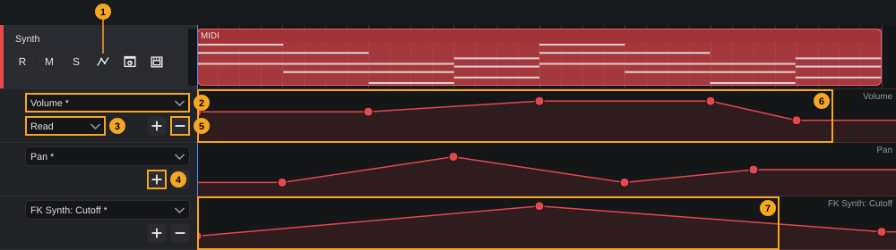
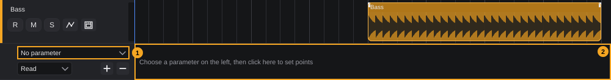
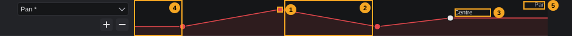

# Automation

Automation lets a track change its settings by itself while the song plays: the volume rises in the chorus, the sound moves from left to right, a filter opens over four bars. Each change is stored as a curve of points over time. You draw the curves with the mouse in automation lanes below the track, or you record them by moving faders and knobs during playback.

**In this chapter**

1. [What can be automated](#1-what-can-be-automated)
2. [Automation lanes at a glance](#2-automation-lanes-at-a-glance)
3. [Showing and hiding automation lanes](#3-showing-and-hiding-automation-lanes)
4. [Choosing the parameter, adding and removing lanes](#4-choosing-the-parameter-adding-and-removing-lanes)
5. [Reading the lane](#5-reading-the-lane)
6. [Drawing and editing points](#6-drawing-and-editing-points)
7. [Automation modes](#7-automation-modes)
8. [Read and write for the whole project](#8-read-and-write-for-the-whole-project)
9. [Recording automation](#9-recording-automation)
10. [MIDI Learn and automation](#10-midi-learn-and-automation)
11. [Automation and editing clips and tracks](#11-automation-and-editing-clips-and-tracks)
12. [What is saved, and undo](#12-what-is-saved-and-undo)
13. [Quick reference](#13-quick-reference)

---

## 1. What can be automated

Every track in the track list can be automated: audio, instrument, MIDI, group and FX tracks and the channels of a rack instrument ([Tracks §2](tracks.md#2-track-types-at-a-glance)). Folder rows have no automation.

The parameters of a track are, in this order:

| Parameter | Name in the list | Range |
|---|---|---|
| Track volume | **Volume** | The fader range of the track, shown in dB |
| Track pan | **Pan** | From left to right; the middle of the lane is the centre |
| Parameters of the plugins on the track | *Plugin*: *Parameter*, for example **FK Synth: Cutoff** | The range of the plugin parameter |

- **Volume** and **Pan** always come first. After them come the parameters of all plugins of the track in the order of the plugin chain: the instrument, the inserts, and the sends.
- A send to an FX track is a parameter as well: **Send level**, listed under the name of its FX bus with **S:** in front, for example **S:FX 1: Send level**.
<!-- FIX F-1309: the send entry may follow a renamed FX track -->
- The bus name is the name the FX track had when it was created. If you rename the FX track later, the entry keeps the old name.

A plugin parameter appears as soon as the plugin is on the track. If you remove the plugin, its parameters and their curves disappear with it.

> **Note:** Automation is set per track. There is no automation for the master output in the track list.

---

## 2. Automation lanes at a glance

Automation lanes sit directly below their track, one lane per parameter. Each lane has a **lane header** on the left (in line with the track headers) and the **curve** on the right (in line with the clips).

<!-- FIX F-1305: the automation mode may also be visible outside the first lane -->

<!-- FIX F-1306: the tooltips may say "automation lane" instead of "automation track" -->
| # | Element | What it does | Details |
|---|---|---|---|
| 1 | Automation button (curve) in the track header | Shows or hides all automation lanes of the track. Lit while they are shown. Tooltip: *Automation track on/off* | [§3](#3-showing-and-hiding-automation-lanes) |
| 2 | Parameter list | Chooses which parameter the lane shows. Tooltip: *Parameter whose curve the automation track shows* | [§4](#4-choosing-the-parameter-adding-and-removing-lanes) |
| 3 | Automation mode | **Read**, **Touch**, **Latch** or **Write** for the whole track. Only in the first lane of a track. | [§7](#7-automation-modes) |
| 4 | **+** | Adds another lane below the last lane of this track. Tooltip: *Another automation track for this track* | [§4](#4-choosing-the-parameter-adding-and-removing-lanes) |
| 5 | **−** | Removes this lane. The curve stays. Tooltip: *Remove this automation track* | [§4](#4-choosing-the-parameter-adding-and-removing-lanes) |
| 6 | Lane with the curve (here **Volume**) | Shows the curve; click, drag, double-click and right-click edit the points | [§5](#5-reading-the-lane), [§6](#6-drawing-and-editing-points) |
| 7 | Lane of a plugin parameter (here **FK Synth: Cutoff**) | Same as 6, for a parameter of the instrument | [§1](#1-what-can-be-automated) |

The tooltip of the lane itself is *Click: add a point. Drag: move. Double-click or right-click: remove*.

- Every lane is 60 pixels high, whatever the track height is ([Tracks §10](tracks.md#10-track-height)).
- Lanes of a track inside a folder are indented like the track header.
- A click in a lane header or in a lane selects the track ([Tracks §6](tracks.md#6-selecting-tracks)).

---

## 3. Showing and hiding automation lanes

**To show the automation of a track:**

1. Click the automation button (the curve symbol, 1 in the picture of [§2](#2-automation-lanes-at-a-glance)) in the track header.
2. The lanes of the track open below it and the button lights up.

If the track has no lane yet, the first click creates one empty lane. This is an editing step (**Add automation lane** in **Edit › History...**):

| # | Element | What you see |
|---|---|---|
| 1 | Parameter list | **No parameter** |
| 2 | Lane | *Choose a parameter on the left, then click here to set points* |

Choose a parameter in the list (1) and the lane is ready ([§4](#4-choosing-the-parameter-adding-and-removing-lanes)).

**To hide the lanes,** click the automation button again. Hiding only hides: the lanes, their parameters and the curves stay, and the curves keep playing.

- Showing and hiding are not editing steps, and whether the lanes of a track are shown is not saved with the project. After opening a project, all lanes are hidden.
- If you remove the last lane of a track with **−**, the lane area closes and the automation button goes out.

> **Note:** There is no menu entry and no key to show automation lanes; use the button in the track header.

---

## 4. Choosing the parameter, adding and removing lanes

### Choosing the parameter

1. Click the parameter list (2) in the lane header.
2. Choose an entry. The lane now shows the curve of this parameter.

The list contains:

- **No parameter** at the top: the lane is empty and shows the hint *Choose a parameter on the left, then click here to set points*.
- **Volume**, **Pan** and all plugin parameters of the track ([§1](#1-what-can-be-automated)). Plugin parameters are written *Plugin*: *Parameter*.
- An entry that already has automation points is marked with an asterisk, for example **Pan \***. This shows you which parameters are automated, even if no lane shows them.

Changing the parameter is an editing step (**Automation parameter**). It only changes what the lane shows; no points are added, moved or deleted.

> **Tip:** You can choose the same parameter in two lanes. Both show the same curve; an edit in one appears in the other.

### Adding a lane

Click **+** (4) in any lane header of the track. A new lane with **No parameter** appears at the bottom of the track's lanes. History: **Add automation lane**.

### Removing a lane

Click **−** (5) in the header of the lane. History: **Remove automation lane**.

Removing a lane does **not** delete its curve. The parameter keeps its points and is still automated during playback; its entry in the parameter list keeps the asterisk. To bring the curve back into view, add a lane and choose the parameter again.

<!-- FIX F-1301: a function to delete all points of a parameter may be added -->
> **Note:** There is no function that deletes all points of a parameter at once. To remove a curve, delete its points one by one ([§6](#6-drawing-and-editing-points)).

If you remove the plugin a lane shows, the lane shows **No parameter** and the hint.

---

## 5. Reading the lane

| # | Element | Meaning |
|---|---|---|
| 1 | Point | A value at a moment in time. Points are filled circles in the track colour. |
| 2 | Line between two points | The value changes evenly from one point to the next (a ramp). |
| 3 | Value while dragging | The value of the point you drag, in the unit of the parameter (for example dB for **Volume**). |
| 4 | Before the first point | The value of the first point holds from the start of the project. |
| 5 | Parameter name | The parameter the lane shows, at the top right. Plugin parameters with their plugin name. |

- **Height = value.** The bottom of the lane is the lowest value of the parameter, the top the highest (with a small margin above and below). For **Pan** the middle is the centre.
- **After the last point** the value of the last point holds until the end of the song.
- **Without points** the lane draws a straight line at the parameter's current value (for example where the fader stands). The parameter is not automated then.
- The area below the curve is filled in a light shade of the track colour.
- The time axis is the same as the arrangement above: zooming and scrolling move the lanes together with the clips ([Arranging §4](arranging.md#4-zooming-and-scrolling)).
- When you point at a point, it turns white and the pointer becomes a hand. The point you drag also stays white.

<!-- FIX F-1301: the value may also be shown when pointing at a point, and may become editable -->
The value of a point is only shown while you drag it. There is no way to type a value.

<!-- FIX F-1302: curves may become adjustable and drawn as they sound -->
> **Note:** Lines between points are always straight. There are no curved or stepped connections you can choose.

---

## 6. Drawing and editing points

All editing happens with the mouse in the lane. The editing tool of the arrangement (Select, Range, Pencil …) does not matter here. Without a parameter (**No parameter**), clicks in the lane do nothing except select the track.

<!-- FIX F-1308: mouse handling may be aligned with the controller lanes of the Key Editor -->
| Action | Result | History |
|---|---|---|
| Click on empty space | Adds a point at the mouse: the time where you clicked, the value at the height you clicked | **Set automation point** |
| Click on empty space and drag before releasing | Adds the point and moves it with the mouse, in the same step | **Set automation point** |
| Drag a point | Moves it in time and value | **Move automation point** |
| Double-click a point | Deletes it | **Remove automation point** |
| Right-click a point | Deletes it | **Remove automation point** |
| Right-click on empty space | Nothing | — |

A point counts as hit when you click within about 9 pixels of its centre. Where points lie on top of each other, the later one is hit.

**To draw a fade-in of the volume over four bars:**

1. Show the automation of the track and choose **Volume** in the parameter list.
2. Click near the bottom of the lane at bar 1. A point appears.
3. Click near the top of the lane at bar 5. A second point appears; the line rises between them.
4. Play the song: the volume fader of the track follows the curve (if automation read is on, [§8](#8-read-and-write-for-the-whole-project)).

**Snapping.** When **Snap** is on in the arrangement toolbar, the time of a new or dragged point snaps to the nearest line of the **Grid** ([Arranging §3](arranging.md#3-grid-and-snap)). With Snap off, points go exactly where you click. The value never snaps.

**Limits while you drag:**

- A point cannot pass its neighbours: if you drag it beyond the next point to the right or left, it stops at that point's time. The order of the points never changes.
- No point goes before the start of the project (0).
- The value stays within the range of the parameter: dragging above or below the lane sets the highest or lowest value.

<!-- FIX F-1308: double-click on empty space may no longer add and remove a point -->
> **Note:** A double-click on empty space first adds a point (first click) and then deletes it again (double-click). Nothing remains, but the history has the steps **Set automation point** and **Remove automation point**.

<!-- FIX F-1301: selection, copy and paste of points may be added -->
> **Note:** Points cannot be selected, so you cannot move, copy, paste or delete several points at once. Each point is edited on its own.

> **Tip:** Unlike the controller lanes of the Key Editor ([Key Editor §16](key-editor.md#16-controller-lanes)), dragging over empty space does not draw a series of points. To draw many points by hand, click them one after another, or record the movement ([§9](#9-recording-automation)).

If an edit fails (for example because the parameter has just been removed), nothing changes and no message appears.

---

## 7. Automation modes

The automation mode decides whether and when a track **records** automation while the song plays with automation write switched on ([§8](#8-read-and-write-for-the-whole-project)). It is set **per track** and applies to all parameters of that track.

**To set the mode:**

1. Show the automation lanes of the track ([§3](#3-showing-and-hiding-automation-lanes)).
2. In the header of the **first** lane, open the mode list (3 in the picture of [§2](#2-automation-lanes-at-a-glance)).
3. Choose **Read**, **Touch**, **Latch** or **Write**.

The tooltip of the list sums up the modes: *Read: play back only. Touch: writes while the control is touched. Latch: writes until stop. Write: writes from play start*

| Mode | Records … | Stops recording … |
|---|---|---|
| **Read** (default for new tracks) | never | — |
| **Touch** | from the moment you touch a control (press the mouse button on a fader or knob) | when you release the control |
| **Latch** | from the moment you first touch a control | when playback stops |
| **Write** | from the start of playback, for every parameter of the track that already has automation points; other parameters from the moment you touch them | when you release a control you moved, otherwise when playback stops |

In all modes, the curves **play back** wherever nothing is being recorded.

<!-- FIX F-1307: Write may stay Write after a pass -->
> **Note:** After a pass in **Write** has ended, the track switches to **Latch** by itself. The mode list then shows **Latch**. Set it back to **Write** before the next pass if you want to overwrite again from the start.

<!-- FIX F-1305: the automation mode may also be visible outside the first lane -->
The mode list is only in the header of the first lane of a track and only visible while the lanes are shown. If you remove the first lane, the next lane becomes the first and gets the list. A track without lanes keeps its mode, but you cannot see it.

Changing the mode is an editing step (**Automation mode**). The mode is saved with the project.

---

## 8. Read and write for the whole project

Two switches in the transport bar turn automation on and off for the whole project, independent of the track modes. They are described in [Transport §13](transport.md#13-automation-read-and-write):

| Switch | Tooltip | When on |
|---|---|---|
| **Automation read** (green when on) | *Automation read: curves control the faders* | Curves move faders, pans and plugin parameters during playback. When off, all curves are ignored. |
| **Automation write** (red when on) | *Automation write: record fader movements during playback (mode per track)* | Tracks in **Touch**, **Latch** or **Write** record during playback. When off, nothing is recorded, whatever the track modes are. |

The same switches are in the **Track** menu as **Read automation** and **Write automation** (ticked when on).

<!-- FIX F-409: automation write may be off in a new project -->
In a new project both switches are on. New tracks are in **Read**, so nothing is recorded until you set a track to **Touch**, **Latch** or **Write**.

The two switches are not editing steps and have no key ([Transport §15](transport.md#15-keyboard-shortcuts)). They are saved with the project.

---

## 9. Recording automation

Instead of drawing, you can play the song and move the controls; FK Audio Suite records the movements as a curve.

**To record a volume ride on one track:**

1. Make sure **Automation write** and **Automation read** are on in the transport bar ([§8](#8-read-and-write-for-the-whole-project)).
2. Show the automation lanes of the track and set its mode to **Touch** (or **Latch**) ([§7](#7-automation-modes)).
3. Start playback.
4. Move the volume fader of the track, in the Inspector ([Tracks §5](tracks.md#5-the-track-in-the-inspector)) or in the MixConsole (see the chapter [MixConsole](mixconsole.md)). The movement is recorded while you hold the fader (**Touch**) or until you stop playback (**Latch**).
5. Stop playback. The new points appear in the lane; to see them, choose **Volume** in a lane.

What can be recorded:

- **Volume** and **Pan** from the faders and pan controls in the Inspector and the MixConsole.
- Plugin parameters from the plugin window (see the chapter [Instruments and effects](instruments-and-effects.md)).
- Every parameter you control with a hardware controller via MIDI Learn ([§10](#10-midi-learn-and-automation)).

After recording, the recorded stretch is thinned out: points that do not change the shape of the curve noticeably are removed, so the curve stays easy to edit.

While automation plays, the faders and pan controls in the Inspector and the MixConsole follow the curves, except the one you are holding.

> **Tip:** **Touch** is the safest mode for corrections: only what you touch is overwritten, the rest of the curve stays.

<!-- FIX F-1310: a recording pass may get a named undo step -->
> **Note:** A recording pass is not given an editing step of its own name. Check **Edit › History...** before you undo, so you know which step removes the recorded points.

---

## 10. MIDI Learn and automation

With MIDI Learn you control a parameter with a knob, fader or pad of a MIDI controller. The movements of the hardware control set the parameter just like the mouse, so with automation write on they are recorded like any other control movement ([§9](#9-recording-automation)).

**To link a hardware control:**

1. Choose **Studio › MIDI Learn**, or click the MIDI Learn button in the toolbar (tooltip *MIDI Learn: switch on, then touch a control in the DAW and move the hardware control*). The button lights up and the toolbar shows *Touch a control in the DAW (plugin or mixer)*.
2. Touch the control in FK Audio Suite, for example a fader in the mixer or a knob in a plugin window. The hint changes to *Now move the hardware knob or pad*.
3. Move the hardware control. The link is made.

Links are saved with the project. **Studio › MIDI mappings...** lists them (for example **CC 74 Sound Brightness (channel 1)**); there you can remove one link (**Remove this mapping**) or all of them (**Remove all**). Both are editing steps (**Remove MIDI mapping**, **Remove all MIDI mappings**). Details follow in the chapter [Studio connections and settings](studio-and-settings.md).

---

## 11. Automation and editing clips and tracks

Automation belongs to the **track**, not to the clips. Points stay at their time when you edit clips:

<!-- FIX F-1303: automation may follow clip moves and range edits consistently -->
| Edit | What happens to the automation |
|---|---|
| Move, copy, paste, duplicate clips ([Arranging §6](arranging.md#6-moving-clips), [§7](arranging.md#7-cut-copy-paste-and-duplicate)) | Nothing; the curve stays where it is and is not copied. |
| **Delete (leave gap)** with the Range tool ([Arranging §10.2](arranging.md#102-range-functions)) | Nothing; the curve in the range stays. |
| **Remove (close gap)** | Only the clips move left. The curve stays where it is, so from the range on it no longer lines up with the clips. |
| **Insert silence** | The curves of the covered tracks move right together with the clips, from the range start on. |
| **Duplicate track** ([Tracks §8.1](tracks.md#81-duplicating-a-track)) | The copy gets the same curves and the same automation mode. |
| **Delete track** | The automation of the track is deleted with it. |

<!-- FIX F-1304: the lanes of a duplicated track may show their parameters -->
> **Note:** The lanes of a duplicated track show **No parameter**, although the copy has the curves. Choose the parameters again; the asterisk in the list shows which ones are automated.

> **Tip:** Before you remove a stretch with **Remove (close gap)**, check the automated parameters of the covered tracks. Move or redraw the points after the range afterwards.

---

## 12. What is saved, and undo

| What | Saved | History entry |
|---|---|---|
| Points (drawn or recorded) | With the project | **Set automation point**, **Move automation point**, **Remove automation point**; recording: see [§9](#9-recording-automation) |
| Lanes of a track and their parameters | With the project | **Add automation lane**, **Remove automation lane**, **Automation parameter** |
| Automation mode of a track | With the project | **Automation mode** |
| Lanes shown or hidden | Not saved | Not an editing step (except the first empty lane, **Add automation lane**) |
| Automation read / write | With the project | Not an editing step |
| MIDI Learn links | With the project | **Remove MIDI mapping**, **Remove all MIDI mappings** |

All editing steps can be undone with **Edit › Undo** and redone with **Edit › Redo** ([The project window §3.2](project-window.md#32-edit)). The names in the *History entry* column are the entries in **Edit › History...**. Undo also brings back lanes and points, and updates the lanes on screen.

---

## 13. Quick reference

| What | How |
|---|---|
| Show / hide automation lanes | Automation button (curve) in the track header |
| Choose the parameter of a lane | Parameter list in the lane header |
| See which parameters are automated | Entries with **\*** in the parameter list |
| Add a lane | **+** in a lane header |
| Remove a lane (curve stays) | **−** in the lane header |
| Add a point | Click on empty space in the lane |
| Add and place a point in one go | Click and drag on empty space |
| Move a point | Drag it (time snaps when **Snap** is on) |
| Delete a point | Double-click or right-click it |
| Set the automation mode | Mode list in the first lane header: **Read**, **Touch**, **Latch**, **Write** |
| Curves on / off for the whole project | **Automation read** in the transport bar, or **Track › Read automation** |
| Recording on / off for the whole project | **Automation write** in the transport bar, or **Track › Write automation** |
| Record a movement | Write on, track in **Touch**/**Latch**/**Write**, play, move the control |
| Control a parameter from hardware | **Studio › MIDI Learn**, touch the control, move the hardware control |
