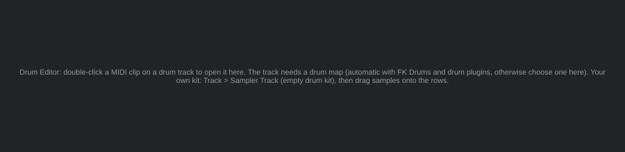
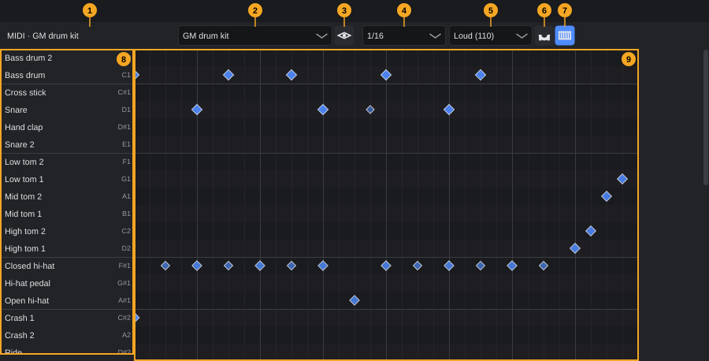
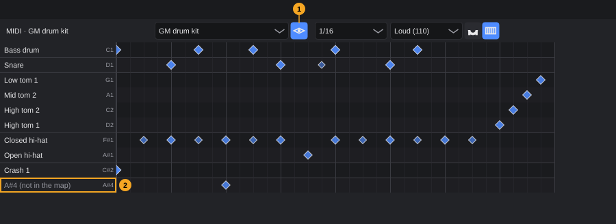
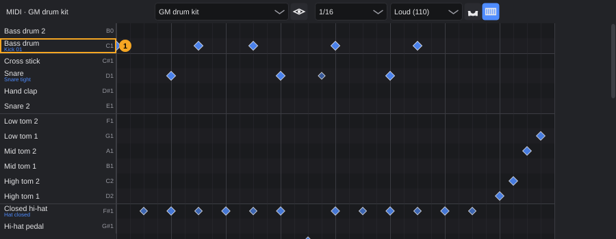

# Drum Editor

The Drum Editor is where you write and edit drum parts. Instead of a piano keyboard it shows one row per drum instrument (bass drum, snare, hi-hat …), named by the track's **drum map**. Each hit is a diamond: its position is the timing, its size and colour show the velocity. The length of a hit does not matter for drums, so the editor does not show it.

**In this chapter**

1. [Opening the Drum Editor](#1-opening-the-drum-editor)
2. [The editor at a glance](#2-the-editor-at-a-glance)
3. [Drum maps](#3-drum-maps)
4. [Reading the drum grid](#4-reading-the-drum-grid)
5. [Placing hits](#5-placing-hits)
6. [Deleting hits](#6-deleting-hits)
7. [Velocity](#7-velocity)
8. [Grid and quantizing](#8-grid-and-quantizing)
9. [Showing only the instruments in use](#9-showing-only-the-instruments-in-use)
10. [Auditioning](#10-auditioning)
11. [Your own drum kit with FK Sampler](#11-your-own-drum-kit-with-fk-sampler)
12. [Zooming and scrolling](#12-zooming-and-scrolling)
13. [What the Drum Editor does not do](#13-what-the-drum-editor-does-not-do)
14. [Undo and messages](#14-undo-and-messages)
15. [Quick reference](#15-quick-reference)

---

## 1. Opening the Drum Editor

The Drum Editor lives in the **lower zone** of the project window, next to the Key Editor. Which of the two editors opens a MIDI clip depends on the clip's **track**: if the track uses a drum map, its clips open in the Drum Editor; otherwise they open in the [Key Editor](key-editor.md).

A track uses a drum map automatically if its instrument is a drum instrument (see [§3.1](#31-which-map-a-track-uses)). Tracks created with **Track › Sampler track (empty drum kit)** get the **GM drum kit** map right away.

**To edit a drum clip:**

1. In the arrangement, double-click the MIDI clip.
2. The lower zone opens (if it was closed) and switches to the **Drum Editor** tab with the clip loaded.

**Track › Insert empty MIDI clip at playhead** also opens the new clip in the Drum Editor when the track uses a drum map.

The List Editor always shows the same clip as well (see the chapter [List Editor](list-editor.md)). The Key Editor keeps the clip it showed before.

**To show the Drum Editor without opening a clip,** use any of these:

- Press **F8**.
- Choose **View › Drum Editor**.
- Click the lower-zone button in the toolbar and select the **Drum Editor** tab.

As long as no clip is loaded, the editor shows a hint instead of the grid:

<!-- FIX F-909: the menu path in the hint may change to "Track › Sampler track (empty drum kit)" -->


<!-- FIX F-904: a drum map may become assignable outside the Drum Editor (Inspector or track menu) -->
> **Note:** The hint says you can choose a drum map "here", but the map list ([§2](#2-the-editor-at-a-glance), number 2) only appears once a clip is loaded. A track whose instrument does not get a map automatically (for example FK Synth, or a MIDI track to an external drum machine) therefore always opens its clips in the Key Editor. See [§3.1](#31-which-map-a-track-uses).

The editor always shows one clip at a time. If you delete the clip or open another project, the editor empties itself.

---

## 2. The editor at a glance



| # | Element | What it does | Details |
|---|---|---|---|
| 1 | **Heading** | Clip name and the drum map in use, for example *MIDI · GM drum kit*; *MIDI · no drum map* if the track has none | [§3](#3-drum-maps) |
| 2 | **Drum map** | Drum map of the track: names and order of the rows | [§3.2](#32-choosing-a-map) |
| 3 | **Show only used instruments** (eye) | Hides rows without hits in this clip; off by default | [§9](#9-showing-only-the-instruments-in-use) |
| 4 | **Grid** | Where new hits snap to, and the target for quantizing; default **1/16** | [§8](#8-grid-and-quantizing) |
| 5 | **Velocity** | Velocity of new hits; default **Loud (110)** | [§7](#7-velocity) |
| 6 | **Quantize** | Moves all hits of the clip onto the grid | [§8](#8-grid-and-quantizing) |
| 7 | **Audition** (keyboard symbol) | Placing a hit or clicking a name plays the instrument; on by default | [§10](#10-auditioning) |
| 8 | **Instrument names** | One row per instrument, with its note on the right; click to audition | [§4](#4-reading-the-drum-grid), [§10](#10-auditioning) |
| 9 | **Drum grid** | The hits of the clip; click to add or delete, drag a diamond to change velocity | [§5](#5-placing-hits)–[§7](#7-velocity) |

Unlike the Key Editor, the Drum Editor has no tools to choose from: a click always places or deletes a hit, a vertical drag always changes the velocity. Hover over an element to see its tooltip, for example *Click: add or delete a hit. Drag a diamond vertically: change velocity.* over the grid.

---

## 3. Drum maps

A **drum map** says which MIDI note plays which drum instrument, and in which order the instruments appear in the editor. A drum plugin might play the bass drum on note 36 and the closed hi-hat on note 42; the map turns these numbers into rows named **Bass drum** and **Closed hi-hat**, and sorts them like a drum kit (kick, snare, toms, hi-hat, cymbals, percussion) instead of by pitch.

The map belongs to the **track**: all clips on that track use it. It only changes what the editor shows. The notes in the clip and what the instrument plays stay the same.

### 3.1 Which map a track uses

Every instrument and MIDI track starts on **Automatic (by instrument)**. The map is then chosen from the instrument loaded on the track:

| Instrument on the track | Map |
|---|---|
| A name containing **FK Drums** | **FK Drums** |
| A name containing *drum*, *kit*, *percussion* or *schlagzeug* (upper or lower case) | **GM drum kit** |
| Anything else, or no instrument (for example a MIDI track to an external device) | none: clips open in the Key Editor |

Audio, group, FX and folder tracks never have a drum map.

If you choose a map yourself ([§3.2](#32-choosing-a-map)), the track keeps it, whatever instrument you load later.

<!-- FIX F-904: a drum map may become assignable outside the Drum Editor (Inspector or track menu) -->
> **Note:** There is currently no way to give a drum map to a track that does not get one automatically: the map list is only reachable in the Drum Editor, and such a track opens its clips in the Key Editor. Use an FK Sampler drum kit ([§11](#11-your-own-drum-kit-with-fk-sampler)) or a drum instrument whose name matches the table above.

### 3.2 Choosing a map

1. Open a clip of the track in the Drum Editor.
2. Open the **Drum map** list (2).
3. Choose one of these entries:

| Entry | Effect |
|---|---|
| **Automatic (by instrument)** | Back to the automatic choice from [§3.1](#31-which-map-a-track-uses) |
| **None (Key Editor)** | The track has no drum map. From now on its clips open in the Key Editor again. |
| **GM drum kit** | The General MIDI drum layout, used by most drum plugins and drum machines |
| **FK Drums** | All articulations of FK Drums (snare edge, rimshot, hi-hat openings, cymbal chokes …) |
| Your own maps | One entry per map file in your drum map folder ([§3.4](#34-your-own-drum-maps)) |

The editor redraws at once with the new names and order. The choice is saved with the project and can be undone (**Assign drum map**).

When you choose **None (Key Editor)**, the Drum Editor keeps the clip on screen: the heading says *no drum map* and only notes that occur in the clip are listed, each marked *(not in the map)*. Double-click the clip again to open it in the Key Editor.

<!-- FIX F-906: the track may keep a copy of its own drum map -->
> **Note:** For your own maps, the track only remembers the map's file name. If you open the project on a computer without that file, or rename the file, the track falls back to **Automatic (by instrument)** without a message. Expression maps behave differently: the track keeps a copy ([Key Editor §17](key-editor.md#17-articulations)).

### 3.3 Built-in maps

<!-- FIX F-001: octave naming may change to C4 or become a setting -->
The editor shows each instrument's note on the right of its name. The Drum Editor names middle C (MIDI note 60) **C3**, so the bass drum on note 36 reads **C1**. The tables list the MIDI note number and the name the editor shows. Instruments are listed in the editor's order; a line separates the groups.

**GM drum kit** (41 instruments):

| Group | Instruments (note) |
|---|---|
| Kick | Bass drum 2 (35, B0), Bass drum (36, C1) |
| Snare | Cross stick (37, C#1), Snare (38, D1), Hand clap (39, D#1), Snare 2 (40, E1) |
| Toms | Low tom 2 (41, F1), Low tom 1 (43, G1), Mid tom 2 (45, A1), Mid tom 1 (47, B1), High tom 2 (48, C2), High tom 1 (50, D2) |
| Hi-hat | Closed hi-hat (42, F#1), Hi-hat pedal (44, G#1), Open hi-hat (46, A#1) |
| Cymbals | Crash 1 (49, C#2), Crash 2 (57, A2), Ride (51, D#2), Ride 2 (59, B2), Ride bell (53, F2), China (52, E2), Splash (55, G2) |
| Percussion | Tambourine (54, F#2), Cowbell (56, G#2), Vibraslap (58, A#2), High bongo (60, C3), Low bongo (61, C#3), Muted high conga (62, D3), Open high conga (63, D#3), Low conga (64, E3), High timbale (65, F3), Low timbale (66, F#3), High agogo (67, G3), Low agogo (68, G#3), Cabasa (69, A3), Maracas (70, A#3), Claves (75, D#4), High wood block (76, E4), Low wood block (77, F4), Muted triangle (80, G#4), Open triangle (81, A4) |

**FK Drums** (48 instruments):

| Group | Instruments (note) |
|---|---|
| Kick | Bass drum (36, C1), Bass drum 2 (35, B0), Bass drum beater on head (34, A#0) |
| Snare | Snare center (38, D1), Snare off-center (39, D#1), Snare edge (33, A0), Snare rimshot (40, E1), Snare cross stick (37, C#1), Snare rim (31, G0) |
| Toms | Tom 1 center (50, D2), Tom 1 edge (48, C2), Tom 1 rimshot (71, B3), Tom 2 center (47, B1), Tom 2 edge (45, A1), Tom 2 rimshot (72, C4), Tom 3 center (43, G1), Tom 3 edge (65, F3), Tom 3 rimshot (73, C#4), Tom 4 center (41, F1), Tom 4 edge (66, F#3), Tom 4 rimshot (74, D4) |
| Hi-hat | Hi-hat closed tip (42, F#1), Hi-hat closed edge (22, A#-1), Hi-hat slightly open (23, B-1), Hi-hat half open (24, C0), Open hi-hat (25, C#0), Hi-hat fully open (46, A#1), Hi-hat pedal (44, G#1), Hi-hat foot splash (21, A-1) |
| Crash | Crash 1 edge (49, C#2), Crash 1 bow (76, E4), Crash 1 bell (77, F4), Crash 1 choke (78, F#4), Crash 2 edge (57, A2), Crash 2 bow (79, G4), Crash 2 bell (80, G#4), Crash 2 choke (81, A4) |
| Ride | Ride bow (51, D#2), Ride bow inner (82, A#4), Ride edge (59, B2), Ride bell (53, F2), Ride choke (83, B4) |
| FX cymbals | FX edge (52, E2), FX bow (55, G2), FX bell (84, C5), FX choke (85, C#5) |
| Percussion | Perc open (56, G#2), Perc muted (54, F#2) |

The built-in maps cannot be changed or deleted.

### 3.4 Your own drum maps

<!-- FIX F-905: import, export and delete may get buttons or menu entries -->
You can add maps for other drum plugins or drum machines. There are no buttons for this yet: a map is a small text file in JSON format that you put into the drum map folder.

**Folder:**

| System | Folder |
|---|---|
| Linux | `~/.config/FKAudioSuite/DrumMaps/` |
| Windows | `%APPDATA%\FKAudioSuite\DrumMaps\` |

Create the folder if it does not exist yet ([Getting started §7](getting-started.md#7-where-fk-audio-suite-keeps-its-files) explains the program data folder).

**To add a map:**

1. Write a file with the extension `.json`, for example `My drum machine.json`:

   ```json
   {
     "name": "My drum machine",
     "entries": [
       { "note": 36, "name": "Kick",        "group": "Kick" },
       { "note": 38, "name": "Snare",       "group": "Snare" },
       { "note": 39, "name": "Clap",        "group": "Snare" },
       { "note": 42, "name": "Closed hat",  "group": "Hi-hat" },
       { "note": 46, "name": "Open hat",    "group": "Hi-hat" }
     ]
   }
   ```

2. Save it in the drum map folder.
3. Open a clip in the Drum Editor (or open the same clip again). The **Drum map** list now shows the map under its `name`.

**Rules for the file:**

| Field | Meaning |
|---|---|
| `name` | Name in the **Drum map** list. Without it, the map is called *Drum-Map*. |
| `entries` | The rows, top to bottom, in the order of the file. At least one entry. |
| `note` | MIDI note number 0–127. Required. |
| `name` (entry) | Name of the row. |
| `group` | Any word. Where the group changes from one entry to the next, the editor draws a separating line. The group name itself is not shown. |

- Give every note only once. A note that appears twice gets two rows, but its hits are only drawn in the first one.
<!-- FIX F-905: invalid files may be reported instead of skipped -->
- A file that is not valid JSON, has no entries or contains a note outside 0–127 is skipped without a message: it simply does not appear in the list.
- Only files directly in the folder count, not in subfolders.
- The list is read again each time the editor loads a clip, so you don't need to restart.
- To remove a map, delete its file. Tracks that used it fall back to **Automatic (by instrument)**.

> **Tip:** To start from a built-in map, copy the rows from the tables in [§3.3](#33-built-in-maps) into your file and change the names.

---

## 4. Reading the drum grid

- Every row is one instrument of the map. The name column (8) shows its name and, on the right, its note (see [§3.3](#33-built-in-maps) for the octave naming). Every second row is slightly shaded, and a line separates the groups of the map (kick, snare, toms …).
- Notes that the map does not know still appear, at the bottom, in grey, named after the note, for example *A#4 (not in the map)*. Nothing in the clip stays invisible.
- The rows have no mute, solo or level controls; the Drum Editor only edits the clip's notes.
- Each hit is a **diamond** at its start. The louder the hit, the bigger and the more opaque the diamond.
- Vertical lines mark every grid step (thin) and every beat (stronger). The grid ends at the end of the clip.
- A red vertical line shows the playhead whenever its position lies inside the clip, during playback and when stopped.

---

## 5. Placing hits

1. Choose the grid in **Grid** (4), for example **1/16**.
2. Choose the velocity in **Velocity** (5).
3. Click into the row of the instrument at the time you want.

The hit lands on the **nearest** grid step (not on the step left of the mouse, as in the Key Editor). It is one grid step long and has the chosen velocity. Hits cannot be placed outside the clip: a click near the end of the clip lands on the last grid step inside it. If **Audition** (7) is on, you hear the instrument.

Dragging after the click does nothing; to place the next hit, click again.

<!-- FIX F-903: a click that snaps onto an existing hit may delete it or do nothing -->
> **Note:** A click deletes a hit only if it is within about 8 pixels of the diamond ([§6](#6-deleting-hits)). If you click a little farther away but still closer to the same grid step, a **second hit** is placed exactly on top of the first one. You cannot see it, and deleting the visible diamond leaves the other one behind. At high zoom or with a coarse grid this happens more easily. If a hit seems impossible to delete, click it again.

---

## 6. Deleting hits

Click a diamond and release the mouse button without moving it. The hit is deleted.

The click counts when it is within about 8 pixels left or right of the diamond's centre, in the same row. If two hits are that close, the nearer one is deleted.

<!-- FIX F-901: Delete/Backspace may act on the Drum Editor or do nothing there -->
> **Caution:** **Delete** and **Backspace** do **not** delete hits. The Drum Editor does not take the keyboard, so these keys go to the project window and delete the **clips selected in the arrangement**. After a double-click that is usually the very clip you are editing. If that happens, press **Ctrl+Z**.

---

## 7. Velocity

### Velocity of new hits

**Velocity** (5) sets how loud new hits are. The same value is used when you click a name to audition.

| Entry | Velocity |
|---|---|
| **Soft (40)** | 40 |
| **Medium (80)** | 80 |
| **Loud (110)** (default) | 110 |
| **Full (127)** | 127 |

### Changing the velocity of a hit

1. Point at the diamond.
2. Press the mouse button and drag **up** (louder) or **down** (softer). Every pixel changes the velocity by 1, within 1–127. The diamond grows or shrinks while you drag.
3. Release the mouse button.

<!-- FIX F-911: a value display while dragging may be added -->
The editor does not show the number while you drag; the size of the diamond is the only feedback. The drag starts only after the mouse moved 3 pixels: if you move less and release, the hit is **deleted** instead ([§6](#6-deleting-hits)).

> **Example:** A hit with velocity 100: drag 20 pixels up for 120, drag 60 pixels down for 40.

To set exact values, use the List Editor (**F9**), which shows the same clip (see the chapter [List Editor](list-editor.md)).

---

## 8. Grid and quantizing

### Grid

<!-- FIX F-910: the grid list may get the Dotted/Triplet submenus of the Key Editor -->
**Grid** (4) offers all note values in one long list, from **1/1** to **1/128**, each followed by its dotted and triplet form: **1/1**, **1/1 dotted**, **1/1 triplet**, **1/2**, **1/2 dotted** … **1/128 triplet**. The default is **1/16**.

The grid decides:

- where new hits land ([§5](#5-placing-hits)),
- how long new hits are (one grid step),
- where Quantize moves hits to,
- how dense the grid lines are.

The grid of the Drum Editor is separate from the grid of the Key Editor.

### Quantizing

1. Choose the target in **Grid** (4), for example **1/16**.
2. Click **Quantize** (6).

<!-- FIX F-910: Quantize may use the Key Editor's quantize options (strength, swing, groove) -->
**All hits of the clip** move to the nearest grid step, fully (100 %). The Drum Editor has no selection, so you cannot quantize only some hits. The quantize options of the Key Editor (strength, swing, groove; [Key Editor §12](key-editor.md#12-quantizing)) do not apply here.

> **Tip:** To quantize with swing or a groove, temporarily set the track's map to **None (Key Editor)** ([§3.2](#32-choosing-a-map)), double-click the clip, quantize in the Key Editor, then choose the map again in the Drum Editor (**F8**).

---

## 9. Showing only the instruments in use

A GM map has 41 rows; most patterns use a handful. Click **Show only used instruments** (3, the eye) to hide every row that has no hit in this clip. Click it again to show all rows.



With the button on (1 in the picture), only rows with hits remain, still in the order of the map. Notes the map does not know (2) are always shown.

> **Note:** While the button is on, you can only place hits on instruments that already occur in the clip. To add a new instrument, switch the button off first.

The setting applies to the editor, not to a track or project, and is not saved.

---

## 10. Auditioning

With **Audition** (7) switched on (default), the instrument sounds through the track:

- when you **click a name** in the name column (8), with the velocity chosen in **Velocity** (5),
- when you **place a hit**, with the same velocity.

Clicking or dragging an existing diamond does not play it. Switch Audition off to work silently. Auditioning also works while playback is stopped.

<!-- FIX F-902: the sound may stop when the mouse button is released -->
> **Note:** Unlike in the Key Editor, the sound is not stopped when you release the mouse button. Drum sounds ring out by themselves; but an instrument with sustained sounds keeps playing the note until you audition the same row again.

---

## 11. Your own drum kit with FK Sampler

With FK Sampler you can build a drum kit from your own samples, directly in the Drum Editor: every row of the map takes one sample.



**To build a kit:**

1. Choose **Track › Sampler track (empty drum kit)**. A track named **Drum kit** with FK Sampler and the **GM drum kit** map appears ([Tracks §3.2](tracks.md#32-instrument-tracks)).
2. Create a MIDI clip on it, for example with **Track › Insert empty MIDI clip at playhead**, or by double-clicking an empty place in the track ([Arranging §18](arranging.md#18-creating-midi-clips)). Double-click the clip; it opens in the Drum Editor.
3. Drag an audio file onto the row of the instrument, for example a kick sample onto **Bass drum**. You can drag from your file manager or from the **Media** tab (**F6**, see the chapter [Media browser and content](media-browser.md)). Drop it anywhere in the row, on the name or in the grid.
4. The name of the sample appears in small letters under the instrument name (1 in the picture). Click the name to hear it.
5. Repeat for the other instruments, then place hits ([§5](#5-placing-hits)).

**What to know:**

- Accepted formats: WAV, AIF, AIFF, FLAC, OGG, MP3. Drag **one** file at a time; the editor does not accept several files at once.
- The sample is **copied into the project folder** (folder **Audio**), so the project keeps working if you move or delete the original. A file that is already in that folder is used directly.
- Dropping onto a row that already has a sample **replaces** it.
- Each sample plays from start to end however long the hit is (one-shot), so the hit length does not matter.
- Rows without a sample are silent.
- The kit is saved with the project. FK Sampler plays it from a file that FK Audio Suite writes into the project folder **Sampler** whenever you drop a sample.
<!-- FIX F-908: samples may become removable from a row -->
- A sample cannot be removed from a row; you can only replace it with another one.
<!-- FIX F-909: the menu path in this message may change -->
- Samples can only be dropped on tracks with FK Sampler. On any other track a window titled **Error** says *Samples can be dropped on tracks with FK Sampler. Track > Sampler track creates one.*

> **Tip:** The map decides which note each row plays. With **FK Drums** as the map ([§3.2](#32-choosing-a-map)), a sampler kit gets the 48 rows of FK Drums, for example separate rows for the snare centre, edge and rimshot.

---

## 12. Zooming and scrolling

| Action | Result |
|---|---|
| **Ctrl**+mouse wheel | Zoom horizontally, in steps of 20 % |
| Mouse wheel over the grid | Scroll |
| Scroll bars | Scroll vertically through all rows and horizontally through the clip |

<!-- FIX F-912: the mouse wheel over the name column may scroll the rows -->
The name column follows the vertical scrolling of the grid. The mouse wheel over the name column itself does not scroll; use it over the grid. The row height is fixed. The zoom is not shared with the Key Editor.

---

## 13. What the Drum Editor does not do

<!-- FIX F-911: selection, moving, copying and keyboard commands may be added -->
Compared with the Key Editor, the Drum Editor is a quick pattern editor. It currently has:

- no selection: no selection rectangle, no **Ctrl+A**;
- no moving or copying of hits by dragging, and no transposing to another row;
- no keyboard commands of its own (see the caution in [§6](#6-deleting-hits));
- no velocity lane, controller lanes, MIDI functions or step input.

For these jobs, use the List Editor (**F9**), which always shows the same clip, or switch the map to **None (Key Editor)** for a moment and edit the clip in the [Key Editor](key-editor.md) ([§3.2](#32-choosing-a-map)). Your choice of map can be restored afterwards.

---

## 14. Undo and messages

Every change in the Drum Editor is one undo step: **Insert note** (placing a hit), **Delete note**, **Change velocity**, **Quantize**, **Assign drum map** and **Assign sample**. Use **Edit › Undo** (**Ctrl+Z**) and **Edit › Redo** (**Ctrl+Y** or **Ctrl+Shift+Z**).

<!-- FIX F-907: the editor may refresh after undo, and undoing a sample may restore the sound -->
> **Note:** After undoing **Assign drum map** or **Assign sample**, the Drum Editor still shows the map or sample you just undid until it reloads (for example when you place a hit or open the clip again). Undoing **Assign sample** may not change what FK Sampler plays: drop the previous sample again to be sure.

If a change is not possible, for example because the clip is locked by a track bake, the project window shows a message and nothing changes. Other messages:

<!-- FIX F-909: the menu path in the sampler message may change -->
| Message | Cause |
|---|---|
| *Drum map not found.* | The chosen map file was deleted or renamed in the meantime |
| *Samples can be dropped on tracks with FK Sampler. Track > Sampler track creates one.* | Sample dropped on a track without FK Sampler |
| *Sample not found: …* / *Could not copy the sample: …* | The dropped file is gone or the project folder is not writable |
| *Could not write the SFZ file: …* | The project folder **Sampler** is not writable |

---

## 15. Quick reference

| What | How |
|---|---|
| Open the Drum Editor | Double-click a MIDI clip on a track with a drum map, or **F8** |
| Choose the drum map | **Drum map** list in the toolbar; **None (Key Editor)** switches the track back to the Key Editor |
| Own drum map | JSON file in the folder `DrumMaps` of the program data |
| Place a hit | Click into the instrument's row (snaps to the nearest grid step) |
| Delete a hit | Click the diamond without moving |
| Change velocity | Drag the diamond up or down (1 per pixel) |
| Velocity of new hits | **Velocity** list (default **Loud (110)**) |
| Quantize | **Quantize** button: all hits of the clip, to the **Grid** |
| Hide unused rows | Eye button |
| Audition | Click a name; **Audition** button switches it on and off |
| Kit from samples | **Track › Sampler track (empty drum kit)**, then drag one audio file onto each row |
| Zoom | **Ctrl**+mouse wheel |
| Undo | **Ctrl+Z** |
