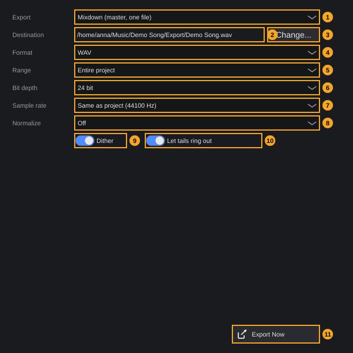
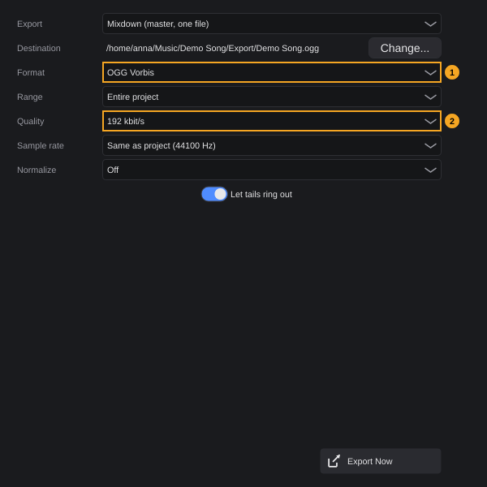
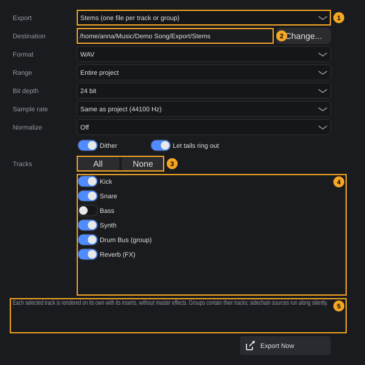
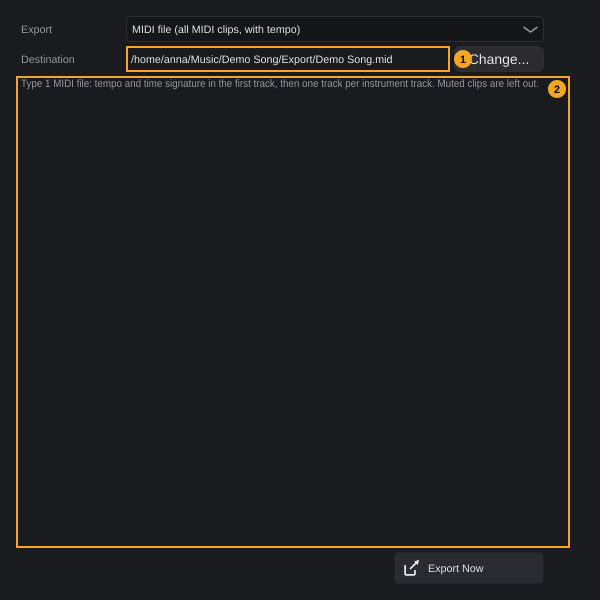

# Exporting

Exporting turns your project into files for other people and other programs: a **mixdown** (the whole song as one audio file), **stems** (one audio file per track or group, for mixing elsewhere) or a **MIDI file** (notes and tempo). Everything happens in one dialog.

**In this chapter**

1. [Opening the export dialog](#1-opening-the-export-dialog)
2. [The export dialog at a glance](#2-the-export-dialog-at-a-glance)
3. [What to export](#3-what-to-export)
4. [Destination: file name and folder](#4-destination-file-name-and-folder)
5. [Format](#5-format)
6. [Range](#6-range)
7. [Bit depth, sample rate and dither](#7-bit-depth-sample-rate-and-dither)
8. [Normalize](#8-normalize)
9. [Let tails ring out](#9-let-tails-ring-out)
10. [Lossy formats: OGG and MP3](#10-lossy-formats-ogg-and-mp3)
11. [Exporting a mixdown](#11-exporting-a-mixdown)
12. [Exporting stems](#12-exporting-stems)
13. [Exporting a MIDI file](#13-exporting-a-midi-file)
14. [What ends up in the file](#14-what-ends-up-in-the-file)
15. [Progress and cancelling](#15-progress-and-cancelling)
16. [Messages](#16-messages)
17. [Quick reference](#17-quick-reference)

---

## 1. Opening the export dialog

A project must be open. There are three ways:

- **File › Export (mixdown, stems, MIDI)...**
- The **Export** button in the toolbar ([The project window §4](project-window.md#4-toolbar), number 7). Its tooltip is *Export: mixdown (WAV, FLAC, AIFF, OGG, MP3), stems or MIDI file*. In a narrow window the button shows only its icon.
- The command **Export Project** (category **File**). It has no default key; you can assign one in **Edit › Keyboard shortcuts...** ([The project window §11](project-window.md#11-keyboard-shortcuts-in-the-project-window)).

Without a project, the menu entry and the button are greyed out.

The dialog opens as a window titled **Export**, 560 × 600 pixels, not resizable. While it is open, the project window does not react; close the dialog with its close button or **Esc**. The dialog stays open after an export, so you can export several versions one after the other.

<!-- FIX F-1809: the dialog may remember the last settings -->
Every time you open the dialog, all fields start at their defaults (see the table in [§2](#2-the-export-dialog-at-a-glance)). Your last choices are not remembered.

---

## 2. The export dialog at a glance

The picture shows the dialog as it opens for the demo project *Demo Song*: **Mixdown**, **WAV**, default settings. The folder before *Demo Song* depends on where your project lies.

<!-- FIX F-1805: Range, Bit depth, the destination and the track list may get tooltips -->
| # | Element | What it does | Default | Details |
|---|---|---|---|---|
| 1 | **Export** | What to export: **Mixdown (master, one file)**, **Stems (one file per track or group)**, **MIDI file (all MIDI clips, with tempo)** | **Mixdown (master, one file)** | [§3](#3-what-to-export) |
| 2 | **Destination** | Full path of the file (stems: of the folder) that will be written | *project folder*/**Export**/*project name*.wav | [§4](#4-destination-file-name-and-folder) |
| 3 | **Change...** | Choose another file or folder. Tooltip: *Choose file or folder* | — | [§4](#4-destination-file-name-and-folder) |
| 4 | **Format** | **WAV**, **FLAC (lossless, smaller)**, **AIFF**, **OGG Vorbis**, **MP3** | **WAV** | [§5](#5-format) |
| 5 | **Range** | **Entire project** or **Loop range** | **Entire project** | [§6](#6-range) |
| 6 | **Bit depth** | **16 bit (CD)**, **24 bit**, **32 bit float**. Only for WAV, FLAC and AIFF | **24 bit** | [§7](#7-bit-depth-sample-rate-and-dither) |
| 7 | **Sample rate** | **Same as project (48000 Hz)** (with the rate of your project), **44100 Hz**, **48000 Hz**, **88200 Hz**, **96000 Hz** | **Same as project** | [§7](#7-bit-depth-sample-rate-and-dither) |
| 8 | **Normalize** | Raise or lower the finished file to a peak or loudness target | **Off** | [§8](#8-normalize) |
| 9 | **Dither** | Fine noise when reducing the bit depth. Only for WAV, FLAC and AIFF | on | [§7](#7-bit-depth-sample-rate-and-dither) |
| 10 | **Let tails ring out** | Reverb and echo keep sounding after the end, up to 10 seconds | on | [§9](#9-let-tails-ring-out) |
| 11 | **Export Now** | Starts the export. Tooltip: *Start export* | — | [§11](#11-exporting-a-mixdown)–[§13](#13-exporting-a-midi-file) |

Below the fields there is a hint line in grey. For a mixdown it is empty, unless MP3 is unavailable on your computer: then it reads *MP3 is off: the libmp3lame library is missing (install the package libmp3lame0).* ([§10](#10-lossy-formats-ogg-and-mp3)). For stems and MIDI files it explains what the export contains ([§12](#12-exporting-stems), [§13](#13-exporting-a-midi-file)).

**The dialog changes with your choices:**

| Choice | Fields shown |
|---|---|
| **Mixdown** with WAV, FLAC or AIFF | All fields of the picture |
| **Mixdown** with OGG Vorbis or MP3 | **Quality** instead of **Bit depth**; no **Dither** ([§10](#10-lossy-formats-ogg-and-mp3)) |
| **Stems** | Like **Mixdown**, plus the track list with **All** and **None** ([§12](#12-exporting-stems)) |
| **MIDI file** | Only **Export**, **Destination**, **Change...**, the hint and **Export Now** ([§13](#13-exporting-a-midi-file)) |

There are no settings for mono or stereo (audio files are always **stereo**), for real-time export, for a selection or for embedding metadata.

---

## 3. What to export

Choose in the **Export** field (1). Its tooltip explains the three targets: *Mixdown: the sum as you hear it. Stems: each selected track on its own, without master effects, for mixing elsewhere. MIDI: notes and tempo as a standard MIDI file.*

| Entry | Result | Section |
|---|---|---|
| **Mixdown (master, one file)** | One stereo audio file of everything that reaches the master, including the master fader | [§11](#11-exporting-a-mixdown) |
| **Stems (one file per track or group)** | One stereo audio file per selected track, in one folder, without the master | [§12](#12-exporting-stems) |
| **MIDI file (all MIDI clips, with tempo)** | One standard MIDI file (type 1) | [§13](#13-exporting-a-midi-file) |

Changing the target sets a new destination ([§4](#4-destination-file-name-and-folder)) and shows or hides fields ([§2](#2-the-export-dialog-at-a-glance)).

---

## 4. Destination: file name and folder

The **Destination** line (2) shows the full path that will be written. The dialog suggests the **Export** folder inside the project folder ([Projects §2](projects.md#2-the-project-folder)):

| Target | Suggested destination |
|---|---|
| Mixdown | *project folder*/**Export**/*project name* + extension of the format, for example `Export/Demo Song.wav` |
| Stems | The folder *project folder*/**Export**/**Stems** |
| MIDI file | *project folder*/**Export**/*project name*`.mid` |

The **Export** folder (and **Stems** inside it) is created during the first export; before that it does not exist.

**To choose another file or folder:**

1. Click **Change...** (3).
2. For a mixdown or a MIDI file, a **Save as** window opens with the current name and only files of the current type (for example `*.wav`). If the file exists, your system asks before it is replaced. For stems, a **Choose folder for the stems** window opens; choose or create a folder.
3. Confirm. The **Destination** line shows the new path.

**Rules for names and extensions:**

- The extension always matches the format. If you type a name with another extension, it is replaced (for example `Mix.mp3` becomes `Mix.wav` when the format is WAV). A MIDI file always gets `.mid`.
- When you change the **Format** of a mixdown, only the extension of the destination changes, as long as the file lies in the project's **Export** folder.

<!-- FIX F-1804: a destination chosen with Change... may survive a change of format or target -->
- When you change the format of a mixdown whose destination lies **outside** the project's **Export** folder, or when you change the target (**Export** field), the destination goes back to the suggestion of the table above. Choose **Change...** again afterwards if you want your own place.

<!-- FIX F-1803: mixdown and MIDI export may ask before replacing a file -->
- **A mixdown or MIDI file replaces an existing file of the same name without asking.** Exporting twice with the suggested name therefore overwrites the first file. Use **Change...** to give each version its own name, or rename the old file first.
- **Stems never replace files.** If a file with the name of a stem already exists in the folder, the new stem gets a number: `Kick.wav` → `Kick2.wav`, `Kick3.wav` and so on. If the track name ends in a digit, an underscore comes first: `Tom 1.wav` → `Tom 1_2.wav`. Stem file names are explained in [§12](#12-exporting-stems).

---

## 5. Format

The **Format** field (4) has the tooltip *WAV/AIFF/FLAC are lossless; OGG and MP3 are lossy and small. MP3 needs the libmp3lame system library.*

| Entry | Extension | Kind | Settings |
|---|---|---|---|
| **WAV** | `.wav` | Lossless | **Bit depth** 16, 24 or 32 bit float; **Dither** |
| **FLAC (lossless, smaller)** | `.flac` | Lossless, compressed | **Bit depth** 16 or 24 bit; **Dither** |
| **AIFF** | `.aiff` | Lossless | **Bit depth** 16 or 24 bit; **Dither** |
| **OGG Vorbis** | `.ogg` | Lossy | **Quality** ([§10](#10-lossy-formats-ogg-and-mp3)) |
| **MP3** | `.mp3` | Lossy | **Quality** ([§10](#10-lossy-formats-ogg-and-mp3)); only if available |

<!-- FIX F-1802: the dialog may only offer bit depths and sample rates the format can write -->
> **Note:** FLAC and AIFF cannot be written with **32 bit float**, although the field offers it. The export then stops at once with *Export not possible: flac doesn't support 32 bit. Supported bit depths: 16, 24* (for AIFF: *aiff doesn't support 32 bit. Supported bit depths: 8, 16, 24*). Choose **24 bit** for these formats.

**MP3** is greyed out in the list when it cannot be written on your computer ([§10](#10-lossy-formats-ogg-and-mp3)).

---

## 6. Range

The **Range** field (5) decides which part of the project is exported. It applies to mixdowns and stems.

| Entry | Exports | If there is nothing to export |
|---|---|---|
| **Entire project** | From the project start (bar 1) to the end of the last clip | *The project contains no clips yet.* |
| **Loop range** | The range between the left and the right locator (**L** and **R**, [Transport §6](transport.md#6-locators-and-loop)), whether loop is switched on or not | *No loop range is set.* |

- **Entire project** always starts at the project start, even if the first clip starts later. Silence before the first clip is part of the file.
- Set the locators before you export a part of the song, for example the chorus. The file then starts at **L** and ends at **R** (plus the tail, [§9](#9-let-tails-ring-out)).

---

## 7. Bit depth, sample rate and dither

**Bit depth** (6) is shown for WAV, FLAC and AIFF:

| Entry | Use |
|---|---|
| **16 bit (CD)** | Audio CD and most players. Switch **Dither** on. |
| **24 bit** (default) | Mastering and further processing |
| **32 bit float** | Further processing without any loss; WAV only (see the note in [§5](#5-format)) |

**Sample rate** (7) has the tooltip *44100 Hz for CD and most streaming services, 48000 Hz for video. The project is rendered directly at the target rate.*

- **Same as project (48000 Hz)** (default) uses the sample rate from the project settings ([Projects §13](projects.md#13-project-settings)); the number in brackets is the rate of your project.
- **44100 Hz**, **48000 Hz**, **88200 Hz** and **96000 Hz** render the project directly at that rate. There is no separate conversion step afterwards; the length of the song does not change.

<!-- FIX F-1802: the dialog may only offer sample rates the format can write -->
> **Note:** MP3 can only be written at 32000, 44100 or 48000 Hz. With **88200 Hz** or **96000 Hz** (or **Same as project** in a project with such a rate) the MP3 export stops with *Export not possible: mp3 doesn't support a sample rate of 96000. Supported rates: 32000, 44100, 48000*. AIFF needs at least 22050 Hz.

**Dither** (9) has the tooltip *Fine noise when reducing to 16 or 24 bit; prevents distortion in quiet tails. Always switch on for 16 bit.* It is on by default. With **32 bit float** the box is greyed out, because no bit depth is reduced. For OGG and MP3 the box is hidden.

---

## 8. Normalize

**Normalize** (8) raises or lowers the whole finished file so that it reaches a target. Its tooltip: *Peak: loudest point to the value. Loudness: measured loudness (LUFS) to the value, the peak stays below -1 dBTP.*

| Entry | What happens |
|---|---|
| **Off** (default) | The file has the level of the mix. |
| **Peak 0 dBFS** | The loudest sample is set to 0 dBFS (full scale). |
| **Peak -1 dBFS** | The loudest sample is set to −1 dBFS. |
| **Loudness -14 LUFS (Streaming)** | The integrated loudness is set to −14 LUFS. |
| **Loudness -16 LUFS (Podcast)** | The integrated loudness is set to −16 LUFS. |
| **Loudness -23 LUFS (Broadcast, EBU R128)** | The integrated loudness is set to −23 LUFS. |

- Normalizing changes only the volume of the whole file; it does not compress or limit.
- **Loudness** keeps the true peak below −1 dBTP. If reaching the loudness target would push the peak higher, the file stays quieter than the target.
- With stems, every stem is normalized on its own. The stems then no longer have the level relation of the mix; leave **Normalize** at **Off** for stems you want to put together again.

---

## 9. Let tails ring out

**Let tails ring out** (10) has the tooltip *Let reverb and echo keep running after the end until silence (10 seconds at most).* It is on by default.

- On: after the end of the range, the export keeps running until the sound has died away, at most 10 seconds. The file ends as soon as it is silent.
- Off: the file ends exactly at the end of the range; a reverb tail is cut off.
- With **Loop range**, the tail never reaches into the next clip after **R**, and there is no tail at all if a clip plays across **R**. A part of the song therefore never picks up the start of the next section.

---

## 10. Lossy formats: OGG and MP3

When you choose **OGG Vorbis** or **MP3**, the dialog shows **Quality** instead of **Bit depth**, and **Dither** disappears:

| # | Element | What it does |
|---|---|---|
| 1 | **Format** | **OGG Vorbis** chosen |
| 2 | **Quality** | Bit rate of the file. Tooltip: *Higher bitrate = better sound, larger file. 320 kbit/s for MP3 is practically indistinguishable from the original.* |

**Quality choices:**

| Format | Entries | Default |
|---|---|---|
| **OGG Vorbis** | **64 kbit/s**, **80 kbit/s**, **96 kbit/s**, **112 kbit/s**, **128 kbit/s**, **160 kbit/s**, **192 kbit/s**, **224 kbit/s**, **256 kbit/s**, **320 kbit/s**, **500 kbit/s** | **192 kbit/s** |
| **MP3** | Variable bit rate **VBR quality 0 (best)** to **VBR quality 9 (smallest)** (with **VBR quality 4 (normal)** in between), then constant bit rate **32 kbit/s CBR** to **320 kbit/s CBR** (32, 40, 48, 56, 64, 80, 96, 112, 128, 160, 192, 224, 256, 320) | **320 kbit/s CBR** |

Each time you change the format, **Quality** goes back to the default of that format.

**When is MP3 available?** FK Audio Suite does not contain an MP3 encoder. It uses the LAME library of your system when it finds it:

| System | Library looked for |
|---|---|
| Linux | `libmp3lame.so.0` (package **libmp3lame0** on Debian and Ubuntu) |
| Windows | `libmp3lame.dll` next to the program or on the system path |
| macOS | `libmp3lame.dylib` |

If the library is missing, FK Audio Suite falls back to the `lame` command-line program (on Linux `/usr/bin/lame`). If neither is there, **MP3** is greyed out in the **Format** list and, for mixdowns, the hint *MP3 is off: the libmp3lame library is missing (install the package libmp3lame0).* appears.

<!-- FIX F-1808: the hint may name the right package or file per system and also appear for stems -->
**To switch MP3 on (Linux):** install the package (for example `sudo apt install libmp3lame0`), then restart FK Audio Suite. FK Audio Suite checks for the library only once per session. The installation chapter mentions this as well ([Getting started §1](getting-started.md#1-before-you-begin)).

> **Note:** MP3 is limited to 32000, 44100 and 48000 Hz ([§7](#7-bit-depth-sample-rate-and-dither)).

---

## 11. Exporting a mixdown

A mixdown is the song as you hear it from the master: all tracks, groups and FX tracks, with their inserts, faders, pans, sends and automation, the master fader included.

**To export a mixdown:**

1. Choose **File › Export (mixdown, stems, MIDI)...**.
2. Leave **Export** at **Mixdown (master, one file)**.
3. Check **Destination**; click **Change...** for another name or place ([§4](#4-destination-file-name-and-folder)).
4. Choose **Format**, **Range**, **Bit depth** or **Quality**, **Sample rate**, **Normalize**, **Dither** and **Let tails ring out**.
5. Click **Export Now**.
6. A progress window appears ([§15](#15-progress-and-cancelling)). When it is done, a message shows *Written:* and the full path of the file.

Example: a 16-bit WAV for a CD: **Format** **WAV**, **Bit depth** **16 bit (CD)**, **Sample rate** **44100 Hz**, **Dither** on.

Example: an MP3 for a streaming service: **Format** **MP3**, **Quality** **320 kbit/s CBR**, **Sample rate** **44100 Hz**, **Normalize** **Loudness -14 LUFS (Streaming)**.

---

## 12. Exporting stems

Stems are separate audio files of individual tracks, for example to mix the song in another program or to send it to a mixing engineer.

| # | Element | What it does |
|---|---|---|
| 1 | **Export** | **Stems (one file per track or group)** chosen |
| 2 | **Destination** | The folder for the stems, by default *project folder*/**Export**/**Stems** |
| 3 | **All** / **None** | Tick all tracks (*Select all tracks*) or none (*Select no tracks*) |
| 4 | **Tracks** | One box per track. Ticked tracks get a stem. All are ticked when the dialog opens; in the picture **Bass** is unticked. The list scrolls when there are more tracks. |
| 5 | Hint | *Each selected track is rendered on its own with its inserts, without master effects. Groups contain their tracks; sidechain sources run along silently.* |

<!-- FIX F-1807: the track list may leave out or mark tracks that give no audio -->
**The track list** contains every track of the project in project order, including hidden tracks: audio, instrument, group and FX tracks, the outputs of rack instruments and MIDI tracks for external devices. Group tracks are marked **(group)**, FX tracks **(FX)**, for example **Drum Bus (group)** and **Reverb (FX)**. Folder tracks are not listed; their tracks are.

**To export stems:**

1. Open the export dialog and choose **Stems (one file per track or group)** in **Export**.
2. Tick the tracks you want. **All** and **None** help with long lists.
3. Check the folder in **Destination**, or click **Change...** and choose another folder.
4. Set format, range and the other options as for a mixdown. They apply to every stem.
5. Click **Export Now**. If no track is ticked, the message *No track selected for stems.* appears and nothing is exported.
6. The stems are rendered one after the other; the progress bar covers all of them. When it is done, a message shows *1 stem written to:* or *n stems written to:* and the folder.

**What a stem contains:**

- The track's clips, instrument, inserts, fader, pan and automation, exactly as in the mix.
- **Not** the master fader and not the master channel.
- **Group tracks** contain all tracks that run into the group, with the group's own inserts and fader. Export the group and leave its tracks unticked if you want one stem for the whole group (for example all drums in one file); tick the tracks as well if you also want them separately.
- **FX tracks** contain the effect return of everything that is sent to them; the sending tracks are not audible in the FX stem.
- **Sends** of a track are not in its stem. The reverb of a shared FX track is only in the FX track's stem.
- **Sidechain sources** run along silently, so that a compressor keyed from another track works as in the mix ([MixConsole §13](mixconsole.md#13-sidechain)).

<!-- FIX F-1806: stems may ignore mute and solo, or warn about them -->
> **Note:** Stems follow **mute** and **solo** like playback does ([MixConsole §11](mixconsole.md#11-mute-and-solo)). A muted track gives a silent stem, and while any track is soloed, the stems of all tracks that are not soloed are silent. Switch off mute and solo before you export stems.

**File names.** Each stem is named after its track, for example `Kick.wav`, `Synth.wav`, `Drum Bus.wav`. Characters that are not allowed in file names (`" # @ , ; : < > * ^ | ? \ /`) are removed. Two tracks with the same name give `Bass.wav` and `Bass 2.wav`. Existing files are never replaced ([§4](#4-destination-file-name-and-folder)).

---

## 13. Exporting a MIDI file

A MIDI file takes your notes and the tempo to another program, a notation program or a hardware sequencer.

| # | Element | What it does |
|---|---|---|
| 1 | **Destination** | The MIDI file, by default *project folder*/**Export**/*project name*`.mid` |
| 2 | Hint | *Type 1 MIDI file: tempo and time signature in the first track, then one track per instrument track. Muted clips are left out.* |

Format, range and all audio options are hidden: a MIDI file always contains the whole project.

**To export a MIDI file:**

1. Open the export dialog and choose **MIDI file (all MIDI clips, with tempo)** in **Export**.
2. Check **Destination**, or click **Change...** for another name or place.
3. Click **Export Now**. When it is done, a message shows *Written:* and the path.

**What the file contains:**

| Part | Content |
|---|---|
| File type | Standard MIDI file, type 1, 960 ticks per quarter note |
| First track | Named after the file. All time signatures and all tempo points of the signature track ([Signature track §8](signature-track.md#8-midi-files-export-and-tempo-detection)). A tempo ramp is written as a jump to the tempo at its start. |
| One track per project track with MIDI clips | Named after the track. Notes, velocities and the controller data of the clips, as they play: clip borders, looped clips and groove are taken into account. |

- Tracks without MIDI clips (audio, group, FX tracks) get no track in the file. MIDI tracks for external devices are included like instrument tracks.
- **Muted clips** are left out. Muted tracks are **not** left out; their clips are written.
- Instruments, effects, MIDI effects (for example **FK Arpeggiator**) and automation are not part of the file: only the notes and controller data in the clips.
- If the project has no MIDI clip (or only muted ones), the export stops with *The project contains no MIDI clips.*

---

## 14. What ends up in the file

| Topic | Mixdown | Stems |
|---|---|---|
| Mute and solo | Respected, as in playback | Respected: muted or non-soloed tracks give silent stems ([§12](#12-exporting-stems)) |
| Track inserts, fader, pan, automation | Yes | Yes, per track |
| Sends and FX tracks | Yes | Only in the FX track's own stem |
| Group tracks | Yes | A group stem contains its tracks |
| Master fader | Yes | No |
| Channels | Stereo | Stereo |
| Baked tracks | Calculated live from their instrument and effects, not taken from the bake file ([Track bake §14](track-bake.md#14-saving-templates-and-export)) | Same |
| Plugins | All plugins take part | All plugins of the stem's tracks take part |

- The export is calculated offline, not in real time: you hear nothing while it runs, and it usually takes less time than the song lasts.
- If the project is playing when you start the export, playback stops.
- The project itself is not changed by an export. There is no undo step, and nothing needs to be saved afterwards.

---

## 15. Progress and cancelling

After **Export Now**, a window **Exporting...** with a progress bar and a **Cancel** button appears. You cannot work in FK Audio Suite while it is shown. For stems, the bar runs once over all stems together. A MIDI file is written almost at once.

<!-- FIX F-1801: Cancel may stop the export at once and remove the unfinished file -->
**Cancel** does not stop the calculation cleanly. After you click it, FK Audio Suite can stop responding for up to 10 seconds; then the progress window closes, the export is broken off by force and *Export cancelled.* appears. The message also appears if the export happened to finish in the meantime. The destination can therefore hold an unfinished file, or a complete one.

> **Tip:** Avoid **Cancel**. Check the settings before you click **Export Now**, and save the project before long exports. If you did cancel, delete the file in the destination and export again.

---

## 16. Messages

All messages except *No project open.* appear in a window titled **Export**.

| Message | When | What to do |
|---|---|---|
| *Written:* + path | Mixdown or MIDI file done | — |
| *1 stem written to:* / *n stems written to:* + folder | Stems done | — |
| *Export cancelled.* | You clicked **Cancel** | See [§15](#15-progress-and-cancelling) |
| *No track selected for stems.* | **Stems** without a ticked track | Tick at least one track |
| *No project open.* | Export started without a project (shown by the project window) | Open a project |
| *The project contains no clips yet.* | **Entire project** in an empty project | Add clips |
| *No loop range is set.* | **Loop range** while L and R are at the same position | Set the locators |
| *The project contains no MIDI clips.* | MIDI file without (unmuted) MIDI clips | — |
| *MP3 needs the LAME library (package libmp3lame0), which is not installed.* | MP3 without LAME | [§10](#10-lossy-formats-ogg-and-mp3) |
| *Export not possible:* + reason | The format cannot write the chosen bit depth or sample rate, for example *flac doesn't support 32 bit. Supported bit depths: 16, 24* | Choose a supported value ([§5](#5-format), [§7](#7-bit-depth-sample-rate-and-dither)) |
| *Stem not possible:* + reason | The same for a stem | Same |
| *Could not create the folder:* + reason | The stem folder cannot be created (no permission, full disk) | Choose another folder |
| *Export failed:* + reason | Writing the audio file failed | Check the disk space and the folder permissions |
| *Export did not produce a file:* + path | The export ran but no file appeared | Same |
| *Could not write the MIDI file:* + path | The MIDI file cannot be written | Same |
| *Could not create the render task.* | Internal error | Try again; report it with **Help › Export diagnostic report...** |
| *Track not found:* + ID | A ticked track no longer exists in the project | Close and reopen the dialog |

---

## 17. Quick reference

| What | How |
|---|---|
| Open the export dialog | **File › Export (mixdown, stems, MIDI)...**, **Export** button in the toolbar, or command **Export Project** (no default key) |
| Close the dialog | **Esc** or the close button |
| Mixdown | **Export** › **Mixdown (master, one file)**, **Export Now** |
| Stems | **Export** › **Stems (one file per track or group)**, tick tracks (**All** / **None**), **Export Now** |
| MIDI file | **Export** › **MIDI file (all MIDI clips, with tempo)**, **Export Now** |
| Default destination | *project folder*/**Export**/ (stems: **Export/Stems/**) |
| Another file or folder | **Change...** |
| Formats | WAV, FLAC, AIFF (16/24 bit; WAV also 32 bit float), OGG Vorbis, MP3 (needs LAME) |
| Defaults | WAV, Entire project, 24 bit, Same as project, Normalize Off, Dither on, Let tails ring out on; OGG 192 kbit/s, MP3 320 kbit/s CBR |
| Export only a part | Set **L** and **R**, **Range** › **Loop range** |
| Tail after the end | **Let tails ring out** (up to 10 s, stops at silence) |
| Loudness for streaming | **Normalize** › **Loudness -14 LUFS (Streaming)** |
| Cancel | **Cancel** in the progress window ([§15](#15-progress-and-cancelling)) |
