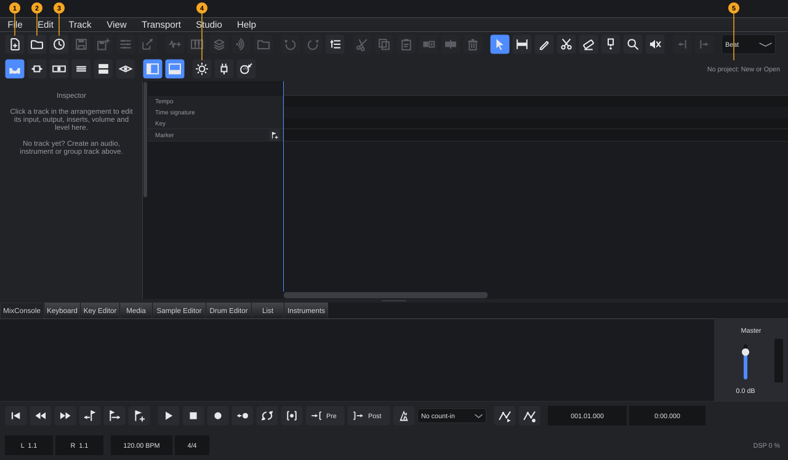
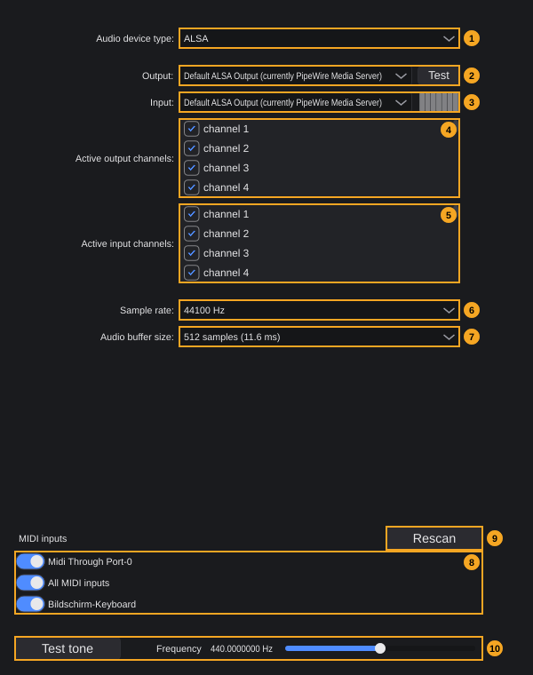
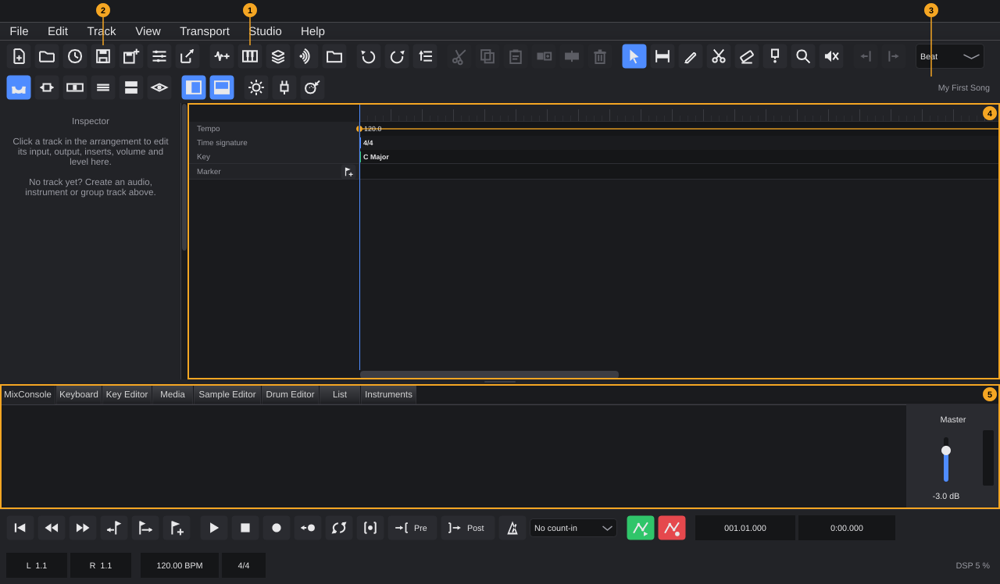
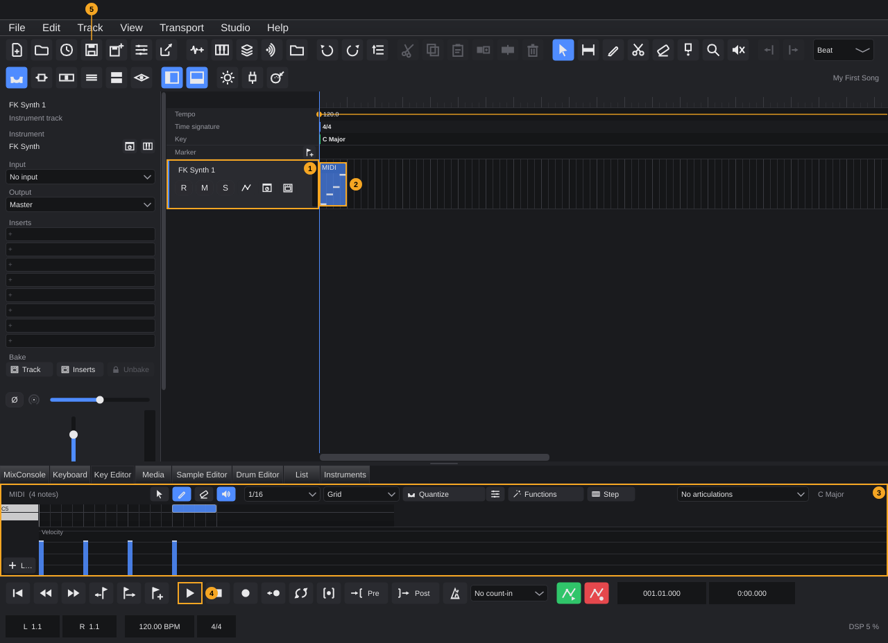

# Getting started

This chapter takes you from the download to your first saved song: installing FK Audio Suite on Linux or Windows, what happens when it starts, how to set up your audio interface and MIDI keyboard, and a short guided tour through a first project. The later chapters explain every area in depth; this one links to them where you need more.

**In this chapter**

1. [Before you begin](#1-before-you-begin)
2. [Installing on Linux](#2-installing-on-linux)
3. [Installing on Windows](#3-installing-on-windows)
4. [Starting FK Audio Suite](#4-starting-fk-audio-suite)
5. [Audio and MIDI setup](#5-audio-and-midi-setup)
6. [Your first project](#6-your-first-project)
7. [Where FK Audio Suite keeps its files](#7-where-fk-audio-suite-keeps-its-files)
8. [When something goes wrong](#8-when-something-goes-wrong)
9. [Quick reference](#9-quick-reference)

---

## 1. Before you begin

FK Audio Suite runs on **Linux** and **Windows**, both on 64-bit x86 processors (x64).

| | Linux | Windows |
|---|---|---|
| Package | `FK-Audio-Suite-<version>-linux-x64.AppImage`, one file | `FK-Audio-Suite-<version>-windows-x64-setup.exe` (installer) or `FK-Audio-Suite-<version>-windows-x64.zip` (portable) |
| System | A distribution with glibc 2.35 or newer (for example Ubuntu 22.04 or later) and X11 | 64-bit Windows |
| Audio drivers | ALSA and JACK (also PipeWire through its JACK interface) | Windows Audio (WASAPI), DirectSound, ASIO |
| Included plugin | **FK Rig Lite** (VST3) | **FK Rig Lite** (VST3) |

Each package comes with a `.sha256` file that holds its checksum, so you can check that the download is complete.

**What else you need:**

- An audio output: the built-in sound card works, an audio interface is better for recording and low latency.
- Optional: a MIDI keyboard to play instruments. Without one, you can draw notes with the mouse or play the on-screen keyboard.
- On Linux, ALSA, JACK, PipeWire and X11 come from your system; the AppImage brings everything else. For MP3 export FK Audio Suite uses the `libmp3lame` library if it is installed on your system.

---

## 2. Installing on Linux

The AppImage needs no installation: it is the program.

1. Download `FK-Audio-Suite-<version>-linux-x64.AppImage` and, if you like, the matching `.sha256` file into the same folder.
2. Optional: check the download. In a terminal in that folder:
   ```bash
   sha256sum -c FK-Audio-Suite-<version>-linux-x64.AppImage.sha256
   ```
   The result must be `OK`.
3. Make the file executable:
   ```bash
   chmod +x FK-Audio-Suite-<version>-linux-x64.AppImage
   ```
4. Start it, by double-clicking it in your file manager or from the terminal:
   ```bash
   ./FK-Audio-Suite-<version>-linux-x64.AppImage
   ```

**The included plugin.** At the first start of a new version, FK Audio Suite copies **FK Rig Lite** to `~/.vst3/FK Rig.vst3` and adds it to its plugin list. In this folder other audio programs find it, too. If you installed a version of the plugin yourself in the same place, FK Audio Suite leaves it untouched.

**PipeWire.** FK Audio Suite talks to PipeWire through PipeWire's JACK interface. If your system's JACK library points to classic JACK and no JACK server runs, FK Audio Suite falls back to ALSA. That works, but the program does not appear in the PipeWire graph. To use PipeWire, either start FK Audio Suite with `pw-jack` in front of the command:

```bash
pw-jack ./FK-Audio-Suite-<version>-linux-x64.AppImage
```

or let your system use the PipeWire JACK library permanently (needs administrator rights; on Ubuntu):

```bash
sudo cp /usr/share/doc/pipewire/examples/ld.so.conf.d/pipewire-jack-x86_64-linux-gnu.conf /etc/ld.so.conf.d/
sudo ldconfig
```

**To update,** download the new AppImage and start it instead of the old one. **To remove** FK Audio Suite, delete the AppImage. Your settings and `~/.vst3/FK Rig.vst3` stay until you delete them ([§7](#7-where-fk-audio-suite-keeps-its-files)).

---

## 3. Installing on Windows

There are two packages; choose one.

### With the installer

1. Download `FK-Audio-Suite-<version>-windows-x64-setup.exe` and start it.
   > **Note:** If the installer is not digitally signed, Windows SmartScreen may warn before it starts. Open the details of the warning and choose to run the installer anyway.
2. Choose the language of the installer: **English** or **German**.
3. Accept the licence (GNU GPL version 3).
4. Choose the folder. The default is `C:\Program Files\FK Audio Suite`.
5. Choose whether you want a desktop icon (ticked by default). A Start menu entry **FK Audio Suite** is always created.
6. On the last page, you can start FK Audio Suite right away.

The installer puts **FK Rig Lite** into the shared VST3 folder `C:\Program Files\Common Files\VST3`, where every audio program finds it. If a newer version of the plugin is already installed there, it is not replaced.

**To update,** run the installer of the new version. **To remove** FK Audio Suite, uninstall it in the Windows settings. Your settings and presets stay. FK Rig Lite is only removed if no other installer still needs it.

### Portable (zip)

1. Download `FK-Audio-Suite-<version>-windows-x64.zip` and unpack it to any folder, for example on a USB drive.
2. Start `FK Audio Suite.exe` in the unpacked folder.

The portable version uses FK Rig Lite from the `VST3` folder next to the program and does not install anything into Windows folders. Your settings are still stored in your user profile ([§7](#7-where-fk-audio-suite-keeps-its-files)).

---

## 4. Starting FK Audio Suite

When FK Audio Suite starts, it opens the project window without a project:



| # | Element | What it does |
|---|---|---|
| 1 | **New** | Create a project: **Empty project...** or one of your templates |
| 2 | **Open** | Open a saved project (`.tracktionedit` file) |
| 3 | Recent | The projects you opened last |
| 4 | Audio settings | Choose and test your audio interface ([§5](#5-audio-and-midi-setup)) |
| 5 | Project name | Says **No project: New or Open** until a project is open |

All buttons that need a project are greyed out until you create or open one. The window is 1280 × 720 pixels large and centred on the screen; its layout is described in [The project window](project-window.md).

**What happens at every start:**

- **Language.** The user interface is in **English** or **German**. FK Audio Suite uses the language you chose under **Studio › Language**. If you never chose one, it follows the language of your system, and English for every other system language. A new choice takes effect at the next start.
- **Audio device.** The first time, FK Audio Suite opens the default audio device of your system. After that, it opens the device and settings you chose last ([§5](#5-audio-and-midi-setup)).
- **Included plugins.** At the first start of a new version, the included plugins are made known ([§2](#2-installing-on-linux), [§3](#3-installing-on-windows)). Later starts skip this step.
- **Update check.** If **Help › Check for updates at startup** is ticked (the default), FK Audio Suite asks the update server in the background whether a newer version exists. You only hear from it when there is one (see below).
- **Log file.** Every start writes its own log file ([§8](#8-when-something-goes-wrong)).

FK Audio Suite itself needs no activation. The entries **FK plugins: buy Pro...** and **Activate Pro key (instructions)...** in the **Help** menu concern the separate FK plugins. **Help › About FK Audio Suite** shows the version, release channel, build, platform and licence.

### When a new version is available

If the update check finds a newer version, this window appears:

> **New version**
> FK Audio Suite *version* is available (from *date*). Installed version: *installed version*.

| Button | Effect |
|---|---|
| **Download** | Opens the download page in your web browser. FK Audio Suite does not install anything by itself. |
| **Later** | Closes the window. You are reminded again at the next start. |

To check by hand, choose **Help › Check for updates...**. If you are up to date, it says **FK Audio Suite is up to date.**; if the server cannot be reached, an error explains why. At startup, the check stays silent when it fails. To stop the automatic check, untick **Help › Check for updates at startup**. In builds without an update address (developer builds), the entry reads **Check for updates (developer build without update address)** and is greyed out.

---

## 5. Audio and MIDI setup

Before you play or record, choose the audio interface FK Audio Suite plays through and check that you hear it. The settings apply to all projects and are kept between starts.

### 5.1 Opening the audio settings

Use any of these:

- Click the **Audio settings** button in the toolbar (number 4 in the picture above).
- Choose **Studio › Audio and MIDI settings...**.

<!-- FIX F-203: the window title may match the menu entry ("Audio and MIDI settings") -->
A window titled **Audio settings** opens. It works without an open project. You can resize it; changes take effect immediately, there is no OK button. Close the window with the close button in its title bar.

### 5.2 The window at a glance



<!-- FIX F-104: the two test-tone controls (2 and 10) may be merged into one -->
| # | Element | What it does |
|---|---|---|
| 1 | **Audio device type:** | The driver family, for example **ALSA** or **JACK** on Linux, **Windows Audio**, **DirectSound** or **ASIO** on Windows. Only shown if more than one type is available. |
| 2 | **Output:** and **Test** | The device that plays the sound. **Test** plays a short test sound on it. For device types that have one device for both directions, the field is called **Device:** and there is no separate input field. |
| 3 | **Input:** with level meter | The device you record from. The meter on the right shows its incoming level. |
| 4 | **Active output channels:** | One tick box per output channel of the device. Only ticked channels can be used. |
| 5 | **Active input channels:** | One tick box per input channel. Only ticked channels appear as track inputs. |
| 6 | **Sample rate:** | Samples per second, for example **48000 Hz** ([§5.4](#54-sample-rate)). |
| 7 | **Audio buffer size:** | Samples per processing block, with the resulting time in milliseconds, for example **256 samples (5.3 ms)** ([§5.5](#55-buffer-size-and-latency)). |
| 8 | **MIDI inputs** | One switch per MIDI input ([§5.7](#57-midi-inputs)). |
| 9 | **Rescan** | Looks for MIDI devices right away. |
| 10 | **Test tone** and **Frequency** | Switches a continuous sine tone on or off; the slider sets its pitch ([§5.6](#56-testing-the-output)). |

Which of the fields 1–7 you see depends on your device and driver: without an open device, only the device type and **Output:** with **<< none >>** are shown. For devices with their own settings program (typically ASIO), two more buttons appear: **Control Panel** opens the device's own control panel, and **Reset Device** resets the interface, which is *sometimes needed after changing a device's properties in its custom control panel*.

If a device cannot be opened, the window **Error when trying to open audio device!** explains why.

### 5.3 Choosing the driver and the device

1. Under **Audio device type:**, choose the driver family.
2. Under **Output:** (or **Device:**), choose your audio interface.
3. Under **Input:**, choose the device you record from (if it has a separate input field).
4. Tick the input and output channels you want to use.

**Which driver to choose:**

| System | Driver | Notes |
|---|---|---|
| Linux | **JACK** | Use this with a running JACK server or with PipeWire's JACK interface ([§2](#2-installing-on-linux)). The server decides the sample rate. FK Audio Suite appears in the JACK or PipeWire graph and can be connected there. |
| Linux | **ALSA** | Talks to the sound card directly, without a server. FK Audio Suite also uses ALSA when no JACK server runs. |
| Windows | **ASIO** | Appears when an ASIO driver is installed, typically the one that comes with your audio interface. |
| Windows | **Windows Audio** | The standard Windows driver (WASAPI). Variants such as **Windows Audio (Exclusive Mode)** and **Windows Audio (Low Latency Mode)** may be listed as well. |
| Windows | **DirectSound** | The older Windows audio interface. |

**Inputs and outputs in your tracks.** FK Audio Suite offers every active input channel on its own (for mono audio tracks) and every pair of channels (for stereo audio tracks). Outputs are used in pairs. Under PipeWire, the extra *monitor* channels that PipeWire reports as inputs are left out.

### 5.4 Sample rate

The sample rate belongs to the audio device, but every project also remembers its own rate (**File › Project settings...**, **Shift+S**).

- A **new project** takes the rate the device is running at (48000 Hz if no device is open).
- When you **open a project** whose rate differs from the device, FK Audio Suite asks once whether to switch the device or, if the device cannot switch, the project. See [The project window §10](project-window.md#10-messages-and-status).
- Under **JACK** and PipeWire, the server decides the rate; FK Audio Suite cannot change it.

### 5.5 Buffer size and latency

The buffer size decides how much audio FK Audio Suite computes at once. The time shown in brackets is how long one buffer lasts at the current sample rate.

- **Smaller buffer:** the sound follows your playing faster (lower latency), which matters when you play an instrument or listen to yourself while recording. It needs more processing power.
- **Larger buffer:** more headroom for many tracks and plugins, but a longer delay.

Watch the audio load display at the right end of the transport bar (**DSP** *n* **%**). If it often turns red or shows **Overload: sound muted**, choose a larger buffer. See [The project window §5](project-window.md#5-transport-bar).

### 5.6 Testing the output

1. Click **Test tone** (10). The button stays pressed and a sine tone plays on the selected outputs.
2. Drag **Frequency** to change the pitch: from **50 Hz** to **2000 Hz**, default **440 Hz**.
3. Click **Test tone** again to stop it. Closing the window also stops it.

The tone is deliberately quiet. If you hear nothing, check the device, the ticked output channels and your speakers or headphones. The **Test** button next to the output (2) plays a short test sound instead.

### 5.7 MIDI inputs

The list **MIDI inputs** shows every MIDI device FK Audio Suite has found, each with a switch.

- **On** means tracks can choose this input; the tooltip reads *Hardware input: on = tracks can choose it*.
- Switch off devices you do not want to use.
- The list also contains inputs of FK Audio Suite itself; their tooltip reads *Virtual device of the DAW*. One of them is the on-screen keyboard (tab **Keyboard**, **F4**).
- FK Audio Suite notices when you plug a MIDI device in or out, and the list updates itself. **Rescan** (9) looks again right away.
- Without any device, the list says: *No MIDI device found. Connect a keyboard or interface, then click "Rescan".*

<!-- FIX F-103: the on-screen keyboard device may get an English (translated) name -->
> **Note:** The on-screen keyboard appears in this list and in the track inputs as **Bildschirm-Keyboard**, also in the English user interface.

New instrument tracks listen to **All MIDI inputs**, so any switched-on keyboard plays them right away ([§6](#6-your-first-project)).

### 5.8 Naming inputs and outputs

<!-- FIX F-106: dialog title and hint may use the same wording as the Studio menu -->
<!-- FIX F-107: Studio connections may also open without a project -->
With **Studio › Studio connections...** you give the channels of your interface your own names, for example *Guitar DI* instead of the driver's name. The window **Studio Connections** lists **Inputs** and **Outputs**, each with the driver name on the left and a field for your name on the right. Leave a field empty to use the driver's name. The names apply to all projects and appear wherever you choose an input or output. The entry needs an open project. If no audio device is active, the window says so and points you to the audio settings. Details: see the chapter *Studio connections and settings*.

---

## 6. Your first project

This tour creates a project, adds an instrument, writes a few notes, plays them and saves the result. It takes about five minutes. Each step links to the chapter that explains it fully.

### Step 1: Create a project

1. Click **New** in the toolbar and choose **Empty project...** (or choose **File › New empty project...**).
2. The dialog *New project: name and location* opens in your **Music** folder. Choose the folder where the project should go, type a name, for example *My First Song*, and confirm.
3. FK Audio Suite creates a folder with the project's name. Inside are the project file *My First Song*`.tracktionedit` and a folder **Audio** for recordings. The new project is saved right away.

<!-- FIX F-209: New project may get a default key (Ctrl+N) -->
If a folder with that name already exists, you see *A folder "…" already exists.* and nothing is created; choose another name. If you cancel the dialog, nothing changes.



| # | Element | What you see |
|---|---|---|
| 1 | **Instrument** | Adds an instrument track (Step 2) |
| 2 | **Save** | Saves the project (Step 6) |
| 3 | Project name | The name of the open project |
| 4 | Arrangement area | Empty: a new project has no tracks |
| 5 | Lower zone | The **MixConsole** tab |

A new project runs at **120 BPM** in **4/4**, with the sample rate of your audio device. Change tempo and time signature in the transport bar; see the chapter *Signature track*. Projects in depth: see the chapter *Projects*.

### Step 2: Add an instrument track

1. Click **Instrument** (1). A menu with all instruments opens: **Favorites** at the top (if you marked any), then one submenu per category, and **By vendor** with the same instruments sorted by manufacturer.
2. Choose **Instrument › FK Synth**. FK Synth is built in and needs no files.

The new track **FK Synth 1** appears in the arrangement and is selected, and the Inspector on the left shows its settings. Its input is **All MIDI inputs**: if you have a MIDI keyboard, play it now and you hear the synth. You do not need to arm the track to hear it.

Other ways to add an instrument track: **Track › Instrument track ›**, or double-click an instrument in the **Instruments** tab of the lower zone (**F10**). Plugins you have installed yourself show up in the menu after a scan in the plugin manager. Tracks and instruments in depth: see the chapters *Tracks* and *Instruments and effects*.

### Step 3: Create a MIDI clip

With the new track selected, choose **Track › Insert empty MIDI clip at playhead**. FK Audio Suite inserts an empty clip, one bar long, at the playhead (at the start of a new project), and opens it in the **Key Editor** in the lower zone.

Other ways:

- Double-click an empty place in the track's lane in the arrangement. This makes a one-bar clip there; double-click the clip to open it.
- Choose the **Pencil** tool (key **8**) and click in the track's lane (one bar), or drag for a longer clip.

If no instrument track is selected, **Insert empty MIDI clip at playhead** answers: *Please select an instrument or MIDI track first.*

### Step 4: Write notes, or record them

**To draw notes:**

1. In the Key Editor, the **Pencil** is the active tool.
2. Click into the note grid at the pitch and time you want. Each click makes a note with the length set in **Length** and a velocity of 100.
3. Draw a few notes, for example C, E, G and the next C, one after the other.
4. Made a mistake? **Ctrl+Z** undoes it.

All ways to enter and edit notes are in the chapter [Key Editor](key-editor.md), for example [§5 Entering notes](key-editor.md#5-entering-notes).

**To record from a MIDI keyboard instead:**

<!-- FIX F-105: the R, M and S buttons and the input field may get tooltips -->
1. In the track header, click **R** (record enable). It turns red.
2. Optional: switch on the metronome (**C**) and choose a count-in in the transport bar.
3. Press **Num \*** (or click the Record button in the transport bar) and play.
4. Press **Space** to stop.

Recording in depth (count-in, punch, takes, MIDI record modes): see the chapter *Recording audio and MIDI*.

### Step 5: Listen

1. Press **Home** to move the playhead to the start.
2. Press **Space** to play. The Play button turns green.
3. Press **Space** again to stop.

To repeat a section, drag across it in the ruler and press **Num /** to switch the loop on. All transport functions: see the chapter *Transport*.

### Step 6: Save

Press **Ctrl+S**, or click **Save** (2). The project is saved in its folder.

When you quit (**File › Quit** or the close button of the window) or open another project while there are unsaved changes, FK Audio Suite asks *The project "My First Song" has unsaved changes. Save first?* with **Save**, **Don't save** and **Cancel**. See [The project window §1](project-window.md#1-opening-and-closing-the-window).

**The result:**



| # | Element | What it is |
|---|---|---|
| 1 | Track header | **FK Synth 1** with its input, **R** (record enable), **M** (mute), **S** (solo) and the button that opens the instrument's window |
| 2 | MIDI clip | The clip from Step 3 with the notes in miniature |
| 3 | Key Editor | The notes of the clip (Step 4) |
| 4 | Play | Starts playback (Step 5) |
| 5 | **Save** | Saves the project (Step 6) |

### Step 7: Open it again

Next time, click **Open** and choose the `.tracktionedit` file in the project folder, or click the Recent button and pick the project from the list of recently opened projects. If FK Audio Suite was not closed properly and an automatic backup is newer than the saved file, you are asked whether to restore it. See the chapter *Projects*.

**Where to go from here:** [The project window](project-window.md) explains every area of the window. The chapters *Tracks*, *Recording audio and MIDI* and *Arranging* follow the next steps of making a song.

---

## 7. Where FK Audio Suite keeps its files

**Your projects** live where you create them, each in its own folder: the project file *name*`.tracktionedit` and the folder **Audio** with recordings. The dialogs for new and opened projects start in your **Music** folder.

<!-- FIX F-101: all settings may move into one folder -->
<!-- FIX F-102: folder and file names may become English -->
**Settings and program data** are stored in two folders in your user profile:

| Folder | Linux | Windows |
|---|---|---|
| Program data | `~/.config/FKAudioSuite/` | `%APPDATA%\FKAudioSuite\` |
| Audio engine settings | `~/.config/FK Audio Suite/` | `%APPDATA%\FK Audio Suite\` |

`%APPDATA%` is the folder `C:\Users\<your name>\AppData\Roaming`.

Contents of **FKAudioSuite**:

| File or folder | What it holds |
|---|---|
| `Logs` | One log file per start, named *FK Audio Suite* plus date and time. The 20 newest are kept. |
| `Haenger` | Reports about hangs (see [§8](#8-when-something-goes-wrong)) |
| `Absturz` | Reports about crashes (see [§8](#8-when-something-goes-wrong)) |
| `Vorlagen` | Your project templates |
| `DrumMaps`, `ExpressionMaps` | Your drum maps and expression maps |
| `Content` | Instrument libraries downloaded with the Content Manager |
| `common.json` | Settings shared by all FK programs and plugins, such as the language |
| `Updates.txt` | Whether the update check at startup is on |

The folder **FK Audio Suite** holds `Settings.xml` with the audio and MIDI device settings, the list of known plugins and the recently opened projects.

**Included plugin:** `~/.vst3/FK Rig.vst3` on Linux; `C:\Program Files\Common Files\VST3\FK Rig.vst3` with the Windows installer; the `VST3` folder next to the program with the portable zip.

---

## 8. When something goes wrong

FK Audio Suite keeps a record of what happens so problems can be explained afterwards. Nothing is sent anywhere automatically.

- **Log files.** Every start writes a log with the version, the operating system and the events of the session. **Help › Show log folder** opens the folder.
- **Hangs.** If the user interface stops responding for more than **4 seconds**, FK Audio Suite writes a report once per hang: where every part of the program was at that moment, the audio load and whether the audio stream was still running.
- **Crashes.** If FK Audio Suite crashes, it writes a crash report showing where in the program the crash happened.

<!-- FIX F-108: the next start may point out new hang or crash reports -->
These reports are written silently; FK Audio Suite does not mention them at the next start.

**To send a problem report:**

1. Choose **Help › Export diagnostic report...**.
2. Choose where to save the ZIP file. The suggested name is *FK-Diagnose* with date and time, on your desktop.
3. The ZIP holds a system description, the latest logs and the hang and crash reports. Attach it to your message.

**Common problems:**

| Problem | What to do |
|---|---|
| No sound | Open the audio settings ([§5.3](#53-choosing-the-driver-and-the-device)), check the device and the ticked output channels, and play the **Test tone**. |
| Crackles or dropouts | Choose a larger buffer ([§5.5](#55-buffer-size-and-latency)). |
| The MIDI keyboard does nothing | Check that its switch under **MIDI inputs** is on ([§5.7](#57-midi-inputs)) and that the track's input is **All MIDI inputs** or your keyboard. |
| Linux: FK Audio Suite does not show up in the PipeWire graph | Start it with `pw-jack` ([§2](#2-installing-on-linux)). |
| A project asks about the sample rate | See [§5.4](#54-sample-rate). |
| An instrument plugin is missing from the menu | Scan for plugins in the plugin manager (**Studio › Plugin manager...**); see the chapter *Instruments and effects*. |

---

## 9. Quick reference

| What | How |
|---|---|
| Audio and MIDI settings | **Studio › Audio and MIDI settings...** or the Audio settings button |
| Name interface channels | **Studio › Studio connections...** (needs a project) |
| New project | **New › Empty project...** or **File › New empty project...** |
| Add an instrument track | **Instrument** button, **Track › Instrument track ›** |
| Empty MIDI clip at the playhead | **Track › Insert empty MIDI clip at playhead** |
| Key Editor | **F5** |
| On-screen keyboard | **F4** |
| Play / Stop | **Space** |
| Go to start | **Home** |
| Record | **Num \*** |
| Metronome | **C** |
| Loop on/off | **Num /** |
| Undo | **Ctrl+Z** |
| Save | **Ctrl+S** |
| Project settings (sample rate) | **Shift+S** |
| Language | **Studio › Language** (takes effect at the next start) |
| Update check | **Help › Check for updates...**, **Help › Check for updates at startup** |
| Logs and problem report | **Help › Show log folder**, **Help › Export diagnostic report...** |
