# Instruments and effects

Instruments turn MIDI notes into sound; effects change the sound (or, for MIDI effects, the notes) of a track. FK Audio Suite comes with its own instruments and effects and can use VST3 and LV2 plugins installed on your computer. This chapter explains how FK Audio Suite finds plugins, how you organise them in the Plugin Manager, how to pick instruments in the instrument browser, how presets work, and every control of the built-in instruments and effects.

How effects are placed in insert slots, bypassed, removed and fed with a sidechain is described in the [MixConsole](mixconsole.md) chapter; this chapter links there instead of repeating it.

**In this chapter**

1. [Plugin formats and plugin folders](#1-plugin-formats-and-plugin-folders)
2. [Opening the Plugin Manager](#2-opening-the-plugin-manager)
3. [My Plugins](#3-my-plugins)
4. [Search and Scan](#4-search-and-scan)
5. [Plugin menus](#5-plugin-menus)
6. [The instrument browser](#6-the-instrument-browser)
7. [Choosing and replacing an instrument](#7-choosing-and-replacing-an-instrument)
8. [Instruments with several outputs](#8-instruments-with-several-outputs)
9. [Adding effects and MIDI effects](#9-adding-effects-and-midi-effects)
10. [Plugin windows and controls](#10-plugin-windows-and-controls)
11. [Presets](#11-presets)
12. [MIDI Learn for plugin parameters](#12-midi-learn-for-plugin-parameters)
13. [Latency, crashes and missing plugins](#13-latency-crashes-and-missing-plugins)
14. [Built-in instruments and effects](#14-built-in-instruments-and-effects)
15. [Undo and messages](#15-undo-and-messages)
16. [Quick reference](#16-quick-reference)

---

## 1. Plugin formats and plugin folders

FK Audio Suite uses three kinds of plugins. In menus and lists, the kind is called the **format**:

| Format | What it is | How FK Audio Suite finds it |
|---|---|---|
| **FK** | The instruments and effects built into FK Audio Suite ([§14](#14-built-in-instruments-and-effects)). Their vendor is **FK Audio Suite**. | Always there, no scan needed. |
| **VST3** | VST3 plugins (`.vst3`) | Scan in the Plugin Manager ([§4](#4-search-and-scan)) |
| **LV2** | LV2 plugins (`.lv2` bundles) | Scan in the Plugin Manager ([§4](#4-search-and-scan)) |

Other formats (VST 2, LADSPA, CLAP) are not supported.

**Default folders.** A scan offers these folders to start with:

| Format | Linux | Windows |
|---|---|---|
| VST3 | `~/.vst3/`, `/usr/local/lib/vst3/`, `/usr/lib/vst3/` (on 64-bit systems that have `lib64` folders: `~/.vst3/`, `/usr/local/lib64/vst3/`, `/usr/lib64/vst3/`) | `%LOCALAPPDATA%\Programs\Common\VST3`, `C:\Program Files\Common Files\VST3` |
| LV2 | `~/.lv2`, `/usr/local/lib/lv2`, `/usr/lib/lv2` (with `lib64` folders: `~/.lv2`, `/usr/local/lib64/lv2`, `/usr/lib64/lv2`) | `%APPDATA%\LV2`, `%COMMONPROGRAMFILES%\LV2` |

If the environment variable `VST3_PATH` or `LV2_PATH` is set, its folders come first in the list of that format. You can add more folders before each scan ([§4.2](#42-scanning-for-new-plugins)).

**Included plugin.** The FK Audio Suite package includes **FK Rig** (a guitar amp plugin in its Lite edition) as a VST3 plugin. At the first start of a new version, FK Audio Suite copies it to its VST3 folder and adds it to the plugin list without a scan ([Getting started §7](getting-started.md#7-where-fk-audio-suite-keeps-its-files) names the folder). FK Rig has its own documentation; for FK Audio Suite it is a VST3 plugin like any other.

<!-- FIX F-101: all settings may move into one folder -->
**Where the list is kept.** The list of known plugins, your favourites, hidden plugins and categories are saved in `Settings.xml` in the folder **FK Audio Suite** of your user profile ([Getting started §7](getting-started.md#7-where-fk-audio-suite-keeps-its-files)). They apply to all projects.

> **Tip:** Starting the program with the option `--scan-plugins` scans all default folders without opening a window, prints the result to the console and quits. This is meant for scripts and troubleshooting.

---

## 2. Opening the Plugin Manager

The Plugin Manager is a window of its own with two tabs: **My Plugins** organises the plugins you have, **Search and Scan** finds new ones.

**To open the Plugin Manager,** use either of these:

- Choose **Studio › Plugin manager...**.
- Click the plugin manager button in the toolbar (tooltip *Plugin manager: scan and manage plugins*).

There is no default shortcut.

- The window is titled **Plugin Manager**, opens in the middle of the screen at 820 × 520 pixels and can be resized.
- It does not block the rest of the program: you can keep it open while you work.
- There is only one Plugin Manager. Opening it again brings the open window to the front.
- Close it with the close button in its title bar.

---

## 3. My Plugins

**My Plugins** lists every plugin FK Audio Suite knows, including hidden ones. Here you mark favourites, hide plugins you never use and choose the category under which a plugin appears in the menus.

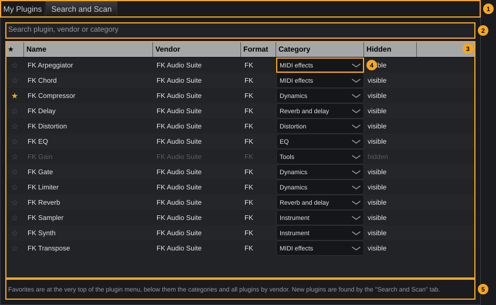

| # | Element | What it does | Details |
|---|---|---|---|
| 1 | Tabs | **My Plugins** and **Search and Scan** | Switching back to **My Plugins** re-reads the list, so plugins found by a scan appear at once. |
| 2 | Search field | Shows only matching plugins | Placeholder *Search plugin, vendor or category*. Matches anywhere in the name, vendor, category or format, regardless of upper and lower case. Empty = all plugins. |
| 3 | Plugin table | One row per plugin | Tooltip *Click ★: favorite (at the top of the plugin menu). Click Hidden: missing from the menus, but stays in projects that use it.* Columns below. |
| 4 | Category | Category of this plugin in the plugin menus | One list per row. Tooltip *Category in the plugin menu. "automatic" uses the vendor's own information.* |
| 5 | Hint | *Favorites are at the very top of the plugin menu, below them the categories and all plugins by vendor. New plugins are found by the "Search and Scan" tab.* | If a change fails, the error message replaces this text. |

**Columns of the table:**

| Column | Content | Click |
|---|---|---|
| **★** | A filled yellow star for favourites, an empty grey star for the others | Makes the plugin a favourite, or no longer a favourite |
| **Name** | Plugin name | – |
| **Vendor** | Manufacturer | – |
| **Format** | **FK**, **VST3** or **LV2** | – |
| **Category** | The category list (element 4) | Opens the list |
| **Hidden** | **visible** or **hidden**. Hidden plugins are shown in grey text in the whole row. | Hides the plugin, or shows it again |

The rows are sorted with the FK plugins first, then by vendor and name. The order cannot be changed.

### 3.1 Favourites

Favourites appear at the top of every plugin menu, in a section **Favorites** ([§5](#5-plugin-menus)). A favourite instrument is also a favourite in the instrument browser and vice versa: both use the same mark ([§6](#6-the-instrument-browser)).

**To mark a favourite:** click the star in its row. Click again to remove the mark.

### 3.2 Hiding plugins

A hidden plugin is left out of all plugin menus and out of the instrument browser. Projects that already use it are not affected: the plugin keeps working there and its window still opens.

**To hide a plugin:** click **visible** in its row; it changes to **hidden**. Click **hidden** to show the plugin again.

> **Tip:** Hide the plugins of a bundle you never use (for example many variants of the same effect) to keep the menus short.

### 3.3 Categories

Every plugin belongs to exactly one category. The plugin menus show one submenu per category, in this order:

**MIDI effects**, **Dynamics**, **EQ**, **Filter**, **Reverb and delay**, **Modulation**, **Distortion**, **Tools**, **Other**, **Instrument**

**Automatic category.** As long as you do not choose one, FK Audio Suite derives the category from the plugin's own information (its category and its name):

| Rule (checked in this order) | Category |
|---|---|
| The plugin is an instrument | **Instrument** |
| Its category contains "MIDI" | **MIDI effects** |
| A word in its category or name is *dynamics*, *compressor*, *limiter*, *gate*, *expander*, *deesser* (also the German words *dynamik*, *kompressor*) | **Dynamics** |
| … *eq*, *equalizer*, *equaliser* | **EQ** |
| … *reverb*, *hall*, *delay*, *echo* | **Reverb and delay** |
| … *distortion*, *saturation*, *saturator*, *overdrive*, *amp*, *fuzz*, *rig* (also *verzerrung*) | **Distortion** |
| … *modulation*, *chorus*, *flanger*, *phaser*, *tremolo*, *vibrato* | **Modulation** |
| … *filter* | **Filter** |
| … *analyzer*, *analyser*, *tools*, *utility*, *meter*, *spatial*, *pitch*, *trim* | **Tools** |
| none of these | **Other** |

Words longer than four letters also match as the start of a longer word (for example *compressors*).

**To choose a category yourself:**

1. Click the **Category** list in the plugin's row.
2. Choose a category.

To return to the automatic category, choose **automatic**.

<!-- FIX F-1504: the list may show "automatic" while the automatic category applies -->
> **Note:** The list always shows the category that currently applies. Whether it was chosen automatically or by you cannot be seen; choosing **automatic** is the way to be sure.

<!-- FIX F-1502: the search may match the category names as shown -->
> **Note:** The search (element 2) compares with the internal, German names of the categories (*Dynamik*, *Hall und Delay*, *Verzerrung*, *Werkzeuge*, *Sonstige*, *MIDI-Effekte*). In the English interface, typing *Dynamics* therefore does not find FK Compressor; *Dynamik* does. Searching for names, vendors and formats works as expected.

Favourites, hidden plugins and categories are saved immediately and cannot be undone with **Ctrl+Z**. Possible messages: *Plugin not found.*, *Unknown category:* *name*.

---

## 4. Search and Scan

**Search and Scan** shows the list of known plugins as the scanner sees it, and starts scans for new plugins.

<!-- FIX F-1501: the FK plugins may be missing from this list or protected against removal -->
<!-- FIX F-1502: the Category column may show the category names of the menus -->
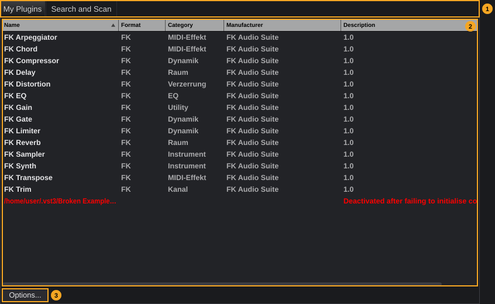

| # | Element | What it does |
|---|---|---|
| 1 | Tabs | **My Plugins** and **Search and Scan** |
| 2 | Plugin list | All known plugins with the columns **Name**, **Format**, **Category**, **Manufacturer** and **Description**. Plugins on the red list are shown in red at the end (here: *Broken Example.vst3*, [§4.3](#43-crashing-plugins-during-a-scan)). |
| 3 | **Options...** | Menu with the scan and clean-up commands ([§4.2](#42-scanning-for-new-plugins), [§4.4](#44-removing-plugins-from-the-list)) |

### 4.1 The list

- **Sorting:** click a column header to sort by it; click again to reverse the order. **Description** cannot be sorted. The order here does not change the order in **My Plugins** or in the menus.
- **Selecting:** click a row; **Ctrl**+click and **Shift**+click select several.
- **Right-click** a row for **Remove plug-in from list** and **Show folder containing plug-in** (opens the plugin's folder in your file manager; greyed out if the file does not exist).
- **Del** removes the selected rows from the list.
- The **Category** column shows the plugin's own category information, not the menu category of [§3.3](#33-categories); a missing category is shown as **-**.

<!-- FIX F-1502: internal names and FK Trim may disappear from this list -->
> **Note:** The FK plugins are in this list too, with internal category names such as *Dynamik*, *Raum*, *Utility* or *MIDI-Effekt*. The list also shows **FK Trim**, the plugin behind the trim knob and phase button of every channel ([MixConsole §7](mixconsole.md#7-trim-and-phase)); it never appears in menus.

### 4.2 Scanning for new plugins

1. Click **Options...**.
2. Choose **Scan for new or updated VST3 plug-ins** or **Scan for new or updated LV2 plug-ins**.
3. The window **Select folders to scan...** lists the folders that will be searched ([§1](#1-plugin-formats-and-plugin-folders)). Adjust the list if needed:
   - **+** adds a folder (a folder dialog opens).
   - **-** removes the selected folder.
   - **change...** replaces the selected folder with another one.
   - The arrow buttons move the selected folder up or down.
4. Click **Scan** (or press **Return**). **Cancel** (or **Esc**) closes the window without scanning.
5. If a folder looks unsuitable (for example a system folder), a window **Plugin Scanning** warns that scanning folders with other files can take long and cause crashes, and asks *Are you sure you want to scan the folder "*folder*"?*. Click **Scan** to go on or **Cancel** to stop.
6. The window **Scanning for plug-ins...** shows a progress bar and the plugin being tested (*Testing:* name). **Cancel** stops the scan; the plugins found so far stay in the list.

When the scan is done, new plugins appear in the list, in **My Plugins** and in all plugin menus. Only new files and files that changed since the last scan are tested; known plugins are skipped.

<!-- FIX F-1503: folders added here may be remembered for the next scan -->
> **Note:** Folders you add in step 3 are used for this scan only. The next scan starts again with the default folders, so add your own folders again each time. Plugins found in them stay known.

**If plugins fail.** If plugins could not be loaded, a window **Scan complete** lists them under *The following files encountered fatal errors during validation* and/or *The following files appeared to be plugin files, but failed to load correctly*. Without problems, no window appears.

**Other ways to add plugins:** drag plugin files from your file manager onto the list; they are tested and added at once.

### 4.3 Crashing plugins during a scan

Each plugin is tested in a separate helper process, one at a time. If a plugin crashes while it is tested, only the helper process ends; FK Audio Suite stays open and the scan continues with a fresh helper (a crashing plugin gets a second chance). Plugins that still cannot be loaded are named in the window **Scan complete** and are tested again at the next scan.

FK Audio Suite also notes which plugin is being tested. Should the whole program end during a scan, that plugin is put on the red list the next time you open the Plugin Manager. Red entries carry the description *Deactivated after failing to initialise correctly* and are skipped by all later scans.

**To give a red plugin another chance** (for example after updating it): right-click its row, choose **Remove plug-in from list**, then scan again.

If the helper process cannot be started at all, a message says *There are some problems in launching a child-process to scan for plugins.* and suggests temporarily disabling a virus checker or firewall.

### 4.4 Removing plugins from the list

**Options...** offers:

| Entry | What it does |
|---|---|
| **Clear list** | Removes all plugins from the list |
| **Remove all VST3 plug-ins**, **Remove all LV2 plug-ins** | Removes all plugins of one format (greyed out if there are none) |
| **Remove selected plug-in from list** | Removes the selected rows (greyed out without selection) |
| **Remove any plug-ins whose files no longer exist** | Removes plugins whose files were deleted or moved |
| **Show folder containing selected plug-in** | Opens the folder of the selected plugin |

A removed plugin disappears from the menus. Projects that already use it keep it. A scan finds it again as long as its file exists.

<!-- FIX F-1501: these commands may leave the FK plugins alone -->
> **Caution:** **Clear list** and **Remove any plug-ins whose files no longer exist** also remove all **FK** plugins, and you can remove single FK plugins with **Remove plug-in from list**. A scan does not bring them back. They are missing from all menus and the instrument browser until you restart FK Audio Suite; meanwhile sampler tracks cannot be created (*FK Sampler is not registered.*) and trim and phase may fail (*FK Trim is not registered.*). Use **Remove all VST3 plug-ins** or **Remove all LV2 plug-ins** instead of **Clear list**.

Changes in this tab cannot be undone with **Ctrl+Z**.

---

## 5. Plugin menus

Wherever you choose a plugin, FK Audio Suite shows the same kind of menu:

| Part of the menu | Content |
|---|---|
| **Favorites** | Your favourites ([§3.1](#31-favourites)); the section only appears if there are any |
| Category submenus | One submenu per category in the order of [§3.3](#33-categories); empty categories are left out |
| **By vendor** | All plugins of the menu again, one submenu per manufacturer, sorted alphabetically; plugins without a manufacturer under **No vendor** |

- Within a submenu, FK plugins come first, then the others by vendor and name.
- FK plugins appear with their name only (**FK Synth**). Other plugins show their format after two spaces, for example *Name  (VST3)*.
- Hidden plugins are not listed ([§3.2](#32-hiding-plugins)).
- If the menu has nothing to offer, it only shows the greyed-out entry **No plugins found (Plugin Manager: Search and Scan)**.

There are two menus: one with instruments only, one with effects only (audio and MIDI effects).

| Where | Menu |
|---|---|
| **Instrument** button in the toolbar (tooltip *Add instrument track*) | Instruments: new instrument track ([Tracks §3.2](tracks.md#32-instrument-tracks)) |
| **Track › Instrument track** | Instruments: new instrument track |
| **Track › Rack instrument (multi-out, several MIDI tracks)** | Instruments: new rack instrument ([§8](#8-instruments-with-several-outputs)) |
| Inspector, **Replace instrument** button | Instruments: replace the instrument of the track ([§7](#7-choosing-and-replacing-an-instrument)) |
| Empty insert slot (**+**) in the MixConsole or the Inspector | Effects: add an effect ([§9](#9-adding-effects-and-midi-effects)) |

<!-- FIX F-1511: menus with many instruments may create the chosen instrument -->
> **Note:** In the **Track** menu, only the first 500 instruments can be chosen correctly. With more than 500 instrument plugins, choosing one further down in **Track › Instrument track** creates a rack instrument with a different instrument instead, and one further down in **Track › Rack instrument** may open a recently used project. The **Instrument** button in the toolbar is not affected.

---

## 6. The instrument browser

The instrument browser is a searchable list of everything that can play on an instrument track: instrument plugins, instruments from downloaded libraries and your own instrument presets. A double-click creates a new track with the entry.

**To show the instrument browser,** use any of these:

- Press **F10**.
- Choose **View › Instrument browser**.
- Click the **Instruments** tab of the lower zone ([The project window §8](project-window.md#8-lower-zone)).

**F10** and the menu entry also open the lower zone if it is hidden. The list is read again each time the tab is shown.

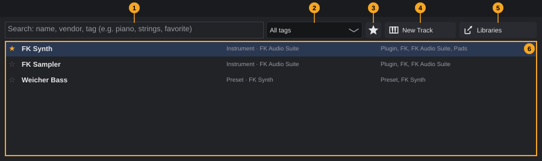

| # | Element | What it does | Details |
|---|---|---|---|
| 1 | Search field | Filters the list as you type | Placeholder *Search: name, vendor, tag (e.g. piano, strings, favorite)*. See [§6.2](#62-searching-and-filtering). |
| 2 | Tag filter | Shows only entries with this tag | Tooltip *Filter by tag*. **All tags** (default), then every tag that occurs, alphabetically. |
| 3 | Favourites only | Shows only favourites while switched on | Tooltip *Show favorites only*. A toggle: click again to show all. |
| 4 | **New Track** | Creates a track with the selected entry | Tooltip *New track with the selected entry (or double-click)* |
| 5 | **Libraries** | Opens the Content Manager | Tooltip *Content Manager: download free libraries*. Libraries you install there appear in the list right away (chapter [Media browser and content](media-browser.md)). |
| 6 | List | One row per entry | Tooltip *Double-click: new track. Star: favorite. Right-click: tags.* |

### 6.1 The list

Each row shows, from left to right:

- a **star**: filled and yellow for favourites, empty and grey for the others;
- the **name** in bold;
- the **kind** and the **source**, for example *Instrument · FK Audio Suite*;
- the **tags**, separated by commas.

| Kind | Entries | Source | Automatic tags |
|---|---|---|---|
| **Instrument** | Every instrument plugin that is not hidden ([§3.2](#32-hiding-plugins)) | Vendor | **Plugin**, the format (**FK**, **VST3**, **LV2**), the vendor |
| **Library** | Every instrument of the libraries installed with the Content Manager | Library | **Library**, the library name, the names of the sub-folders the instrument sits in (for example *Strings*) |
| **Preset** | Your own presets of instrument plugins ([§11](#11-presets)) | Plugin | **Preset**, the plugin name |

Favourites come first, then all entries by name.

<!-- FIX F-1505: the hint may name a way to save instrument presets -->
If nothing matches, the list shows *Nothing found. The Content Manager downloads libraries, your own presets are made by right-clicking an insert > Presets.*

### 6.2 Searching and filtering

- Type one or more words into the search field. An entry is shown if **every** word occurs somewhere in its name, source or tags, regardless of upper and lower case. Example: *fk synth* finds **FK Synth**, *strings* finds all entries with the tag *Strings*.
- Put words in double quotes to search for them as one phrase: *"grand piano"*.
- The tag filter, the favourites button and the search work together.

<!-- FIX F-1508: the placeholder may no longer suggest "favorite" as a search word -->
> **Note:** The search does not know whether an entry is a favourite: typing *favorite* finds only entries with that word in their name or tags. Use the favourites button (3) instead.

### 6.3 Creating a track

**To create a track with an entry,** do one of these:

- Double-click the entry.
- Select it and click **New Track**.
- Right-click it and choose **New track with this**.

Without a selection, **New Track** shows *Select an entry in the list first.*

| Kind | Result |
|---|---|
| **Instrument** | An instrument track with this plugin, named like the plugin (for example **FK Synth**) |
| **Library** | An FK Sampler track that plays the library instrument, named after the instrument; the same as **Track › Instrument from library** ([Tracks §3.2](tracks.md#32-instrument-tracks)) |
| **Preset** | An instrument track with the preset's plugin, named after the preset; then the preset is loaded |

<!-- FIX F-1506: tracks from the browser may get a number like tracks from the menu -->
> **Note:** Tracks created from the browser get no number. **Track › Instrument track** would name the same track **FK Synth 5**.

The new track is added like any instrument track ([Tracks §3](tracks.md#3-adding-tracks)). If it cannot be created, a window **Error** explains why, for example *Instrument not found.*

<!-- FIX F-506: creating a track may become a single editing step -->
Creating a track is undone with **Ctrl+Z**; a track with a preset needs one more **Ctrl+Z** (the preset is loaded as a separate step *Load preset*).

### 6.4 Favourites and tags

**To mark a favourite,** click the star at the left of the row, or right-click the row and choose **Mark as favorite**. To remove the mark, click the star again or choose **Remove favorite**.

For instrument plugins, this is the same favourite as in the Plugin Manager ([§3.1](#31-favourites)): the plugin also moves to the top of the instrument menus.

**To add your own tag:**

1. Right-click the entry and choose **Add tag...**.
2. In the window **Tag** (*New tag for this entry:*), type the tag.
3. Click **OK** (or press **Return**). **Cancel** (or **Esc**) adds nothing.

The tag appears in the row and in the tag filter. Spaces at the start and end are removed; an empty tag is refused (*Empty tag.*). An entry never shows the same tag twice.

**To remove one of your tags:** right-click the entry and choose **Remove own tag** › the tag.

<!-- FIX F-1507: the submenu may list only your own tags -->
> **Note:** **Remove own tag** lists all tags of the entry, including the automatic ones. Choosing an automatic tag shows *Only your own tags can be removed.*

<!-- FIX F-102: folder and file names may become English -->
Tags and the favourites of library and preset entries are stored in the file `Bibliothek.json` in the folder **FKAudioSuite** of your user profile ([Getting started §7](getting-started.md#7-where-fk-audio-suite-keeps-its-files)); favourites of instrument plugins are stored with the plugin list ([§1](#1-plugin-formats-and-plugin-folders)). They apply to all projects and cannot be undone with **Ctrl+Z**.

---

## 7. Choosing and replacing an instrument

Every instrument track has exactly one instrument. You choose it when you create the track ([Tracks §3.2](tracks.md#32-instrument-tracks), [§6](#6-the-instrument-browser)).

**To open the instrument's window:** click the open button of the instrument in the Inspector or in the track header, or double-click the instrument name in the Inspector ([Tracks §5.1](tracks.md#51-instrument-tracks)).

**To replace the instrument:**

1. Select the track.
2. In the Inspector, click the replace button next to the instrument name (tooltip *Replace instrument: another instrument on this track*).
3. Choose the new instrument in the instrument menu ([§5](#5-plugin-menus)).

- The new instrument takes the old one's place, in front of the inserts. Inserts, input, output, sends and clips stay as they are.
- The new instrument starts with its default settings; the settings of the old one are gone (save a preset first if you want to keep them, [§11](#11-presets)).
- Replacing is an editing step (*Replace instrument*); **Ctrl+Z** brings back the old instrument.

The replace button is greyed out while the track is baked. Rack instruments cannot be replaced ([§8](#8-instruments-with-several-outputs)). Messages:

| Message | Cause |
|---|---|
| *Instrument not found:* *id* | The chosen instrument is no longer known |
| *Could not load the instrument:* *name* | The plugin failed to load |
| *The track plays a rack instrument; the instrument belongs to the rack, not the track.* | The track belongs to a rack instrument |
| *"*Track*" is baked. To edit it, unbake it first (track header or inspector).* | The track is baked |

---

## 8. Instruments with several outputs

Some instruments have more than one stereo output (multi-out), for example to send each drum of a kit to its own mixer channel. **FK Sampler** has eight stereo outputs ([§14.2](#142-fk-sampler)); **FK Synth** has one.

- **On an instrument track**, only the first output (1+2) plays. FK Audio Suite switches the other outputs off when it creates the track or replaces its instrument, and the setting is saved with the project. What a plugin sends to the other outputs is not heard (FK Sampler plays it on output 1+2 instead).
- **As a rack instrument**, each output can get its own channel in the mixer. Create it with **Track › Rack instrument (multi-out, several MIDI tracks)** and switch outputs on with the **Outputs** button in the Inspector. Details: [Tracks §3.3](tracks.md#33-rack-instruments-several-midi-tracks-one-instrument) and [Tracks §5.2](tracks.md#52-rack-instruments).

The instrument of a rack opens with the open button in the Inspector of any of its tracks. It cannot be replaced; create a new rack instrument instead.

---

## 9. Adding effects and MIDI effects

Effects go into the insert slots of a track: click an empty slot (**+**) in the MixConsole or in the Inspector and choose an effect ([MixConsole §4.1](mixconsole.md#41-adding-an-effect)).

- Audio effects always go behind the last insert of the track.
- **MIDI effects** (category **MIDI effects**: **FK Transpose**, **FK Chord**, **FK Arpeggiator** and plugins whose own category contains "MIDI") go in front of the instrument, behind any MIDI effects already there. They change the notes before the instrument plays them, so they only make sense on instrument tracks and on the MIDI tracks of a rack instrument. Audio passes through them unchanged.

<!-- FIX F-1409: inserts may be reordered by dragging and replaced via the context menu -->
Inserts cannot be reordered or replaced; see [MixConsole §4.3](mixconsole.md#43-changing-the-order-or-replacing-an-effect). Bypass, remove and sidechain: [MixConsole §4.2](mixconsole.md#42-the-context-menu-of-an-insert) and [§13](mixconsole.md#13-sidechain).

---

## 10. Plugin windows and controls

Clicking a used insert slot opens the plugin's window; how these windows behave (one per insert, closing by themselves, error messages) is described in [MixConsole §5](mixconsole.md#5-plugin-windows). Instrument windows open from the Inspector or the track header ([§7](#7-choosing-and-replacing-an-instrument)).

**Windows of the FK plugins** all look alike: a header with the plugin name, below it the controls in framed sections with a title. The window has a fixed size. The controls work like this:

| Control | Looks like | How to use it | Tooltip |
|---|---|---|---|
| Knob | Round knob, name above, value with unit below | Drag up/right to increase, down/left to decrease. **Double-click** sets the default value. **Ctrl**+drag for fine adjustment. Click the value below the knob to type a new value. | *name (double-click: default value, Ctrl+drag: fine)*, or *name*: *explanation* on knobs with an explanation |
| Switch | Toggle button with the name | Click to switch on or off | *name on/off*, or *name*: *explanation* |
| List | Drop-down field | Click and choose a value | The parameter name, or *name*: *explanation* |
| **GR** meter | Vertical bar filling from the top | Shows the current gain reduction (scale 0–24 dB) | **GR** |
| Status line | Dark display field | Shows information, cannot be changed | – |
| Button | Button with a label (**Load...**) | Click | – |

All knobs, switches and lists are plugin parameters: they can be automated ([Automation](automation.md)) and linked to a MIDI controller ([§12](#12-midi-learn-for-plugin-parameters)).

**Plugins without their own window** get a plain window with one control per parameter.

The built-in plugins have no Lite or Pro edition: all their functions are always available.

---

## 11. Presets

A preset stores all settings of a plugin under a name, so you can use them again on any track and in any project.

**Where you save and load presets:** right-click a used insert slot (MixConsole or Inspector) and open **Presets**. The submenu offers **Save current settings as preset...**, your presets under **Own presets**, **Delete preset** › *name* and, for plugins that bring their own programs, **Factory presets of the plugin** › … . The entries are explained in [MixConsole §4.2](mixconsole.md#42-the-context-menu-of-an-insert).

**How presets behave:**

- Presets belong to the **plugin**, not to the track or the project: every instance of the same plugin, in every project, offers them.
- A preset can only be loaded into the plugin it was saved from. Another plugin, even one with a similar name, refuses it (*The preset belongs to a different plugin.*).
- Characters that are not allowed in file names are removed from the name. Saving under an existing name replaces that preset without asking. An empty name is refused (*The preset needs a name.*).
- Presets are listed in natural order (*Preset 2* before *Preset 10*).
- Loading a preset (*Load preset*) or a factory program (*Load program*) is an editing step. Saving and deleting change files only and cannot be undone; deleting does not ask.
- The FK plugins have no factory programs; their **Presets** submenu has no **Factory presets of the plugin** entry.

<!-- FIX F-101: all settings may move into one folder -->
**Where presets are stored.** Each preset is a file *name*`.fkpreset` in a folder per plugin, named *vendor* `-` *plugin*:

| System | Folder |
|---|---|
| Linux | `~/.config/FK Audio Suite/Presets/`*vendor* `-` *plugin*`/` |
| Windows | `%APPDATA%\FK Audio Suite\Presets\`*vendor* `-` *plugin*`\` |

Example: `~/.config/FK Audio Suite/Presets/FK Audio Suite - FK Compressor/Vocal.fkpreset`. To use your presets on another computer, copy these folders.

<!-- FIX F-1505: instruments may get a preset menu -->
**Instrument presets.** The instrument of a track does not sit in an insert slot, so there is currently no menu to save, load or delete presets of an instrument, and its factory programs can only be chosen in the plugin's own window (if it offers them). Instrument presets that already exist in the preset folder appear in the instrument browser as **Preset** entries; double-clicking one creates a track with the instrument and loads the preset ([§6.3](#63-creating-a-track)).

---

## 12. MIDI Learn for plugin parameters

Every knob, switch and list of a plugin can be controlled by a knob, fader or pad of a MIDI controller.

1. Choose **Studio › MIDI Learn**, or click the MIDI Learn button in the toolbar (tooltip *MIDI Learn: switch on, then touch a control in the DAW and move the hardware control*). The toolbar shows *Touch a control in the DAW (plugin or mixer)*.
2. In the plugin window, move the control you want to link. The hint changes to *Now move the hardware knob or pad*.
3. Move the hardware control.

The link is saved with the project. **Studio › MIDI mappings...** lists and removes links. More: [Automation §10](automation.md#10-midi-learn-and-automation) and the chapter [Studio connections and settings](studio-and-settings.md).

---

## 13. Latency, crashes and missing plugins

**Latency.** Some plugins delay the signal while they work. **FK Limiter** looks 5 ms ahead and **FK Distortion** works at double sample rate; both report their delay to FK Audio Suite like other plugins do, and FK Audio Suite plays all tracks in time. There is no display of plugin latency.

**Crashes while you work.** Only the scan runs in a separate process ([§4.3](#43-crashing-plugins-during-a-scan)). During normal work, plugins run inside FK Audio Suite: a plugin that crashes takes the program with it. A crash report is written ([Getting started §8](getting-started.md#8-when-something-goes-wrong)); unsaved changes may be recovered from the automatic backup (chapter [Projects](projects.md)).

<!-- FIX F-307: opening a project may list missing files and plugins -->
**Missing plugins.** If a project uses a plugin that is not installed on this computer, the project still opens, without a message. The insert keeps its place and its settings in the project, but stays silent; clicking it shows *Plugin is not loaded:* *name*. Install the plugin, scan ([§4](#4-search-and-scan)) and open the project again.

---

## 14. Built-in instruments and effects

FK Audio Suite includes these plugins. They are always available (format **FK**, vendor **FK Audio Suite**):

| Plugin | Kind | Menu category | Section |
|---|---|---|---|
| **FK Synth** | Instrument | Instrument | [§14.1](#141-fk-synth) |
| **FK Sampler** | Instrument | Instrument | [§14.2](#142-fk-sampler) |
| **FK EQ** | Effect | EQ | [§14.3](#143-fk-eq) |
| **FK Compressor** | Effect, sidechain input | Dynamics | [§14.4](#144-fk-compressor) |
| **FK Limiter** | Effect | Dynamics | [§14.5](#145-fk-limiter) |
| **FK Gate** | Effect, sidechain input | Dynamics | [§14.6](#146-fk-gate) |
| **FK Distortion** | Effect | Distortion | [§14.7](#147-fk-distortion) |
| **FK Delay** | Effect | Reverb and delay | [§14.8](#148-fk-delay) |
| **FK Reverb** | Effect | Reverb and delay | [§14.9](#149-fk-reverb) |
| **FK Gain** | Effect | Tools | [§14.10](#1410-fk-gain) |
| **FK Transpose** | MIDI effect | MIDI effects | [§14.11](#1411-fk-transpose) |
| **FK Chord** | MIDI effect | MIDI effects | [§14.12](#1412-fk-chord) |
| **FK Arpeggiator** | MIDI effect | MIDI effects | [§14.13](#1413-fk-arpeggiator) |

All of them work in stereo. The numbers in the pictures mark the sections of each window; the tables list every control of a section with its range and default value. The tooltip explanations of the controls are quoted where a control has one.

### 14.1 FK Synth

A classic subtractive synthesizer: two oscillators, a resonant low-pass filter and one envelope each for the filter and the volume. It plays up to 16 notes at the same time.

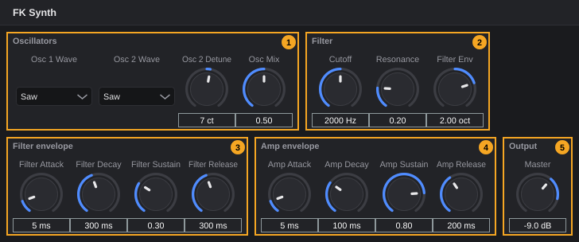

| # | Section | Control | Range | Default | What it does |
|---|---|---|---|---|---|
| 1 | **Oscillators** | **Osc 1 Wave** | **Sine**, **Saw**, **Square**, **Triangle** | **Saw** | Waveform of oscillator 1 |
| | | **Osc 2 Wave** | as Osc 1 | **Saw** | Waveform of oscillator 2 |
| | | **Osc 2 Detune** | −100 to +100 ct | 7 ct | Tunes oscillator 2 against oscillator 1, in cents (1/100 semitone); a few cents give a wider sound |
| | | **Osc Mix** | 0 to 1 | 0.5 | Balance: 0 = only oscillator 1, 1 = only oscillator 2 |
| 2 | **Filter** | **Cutoff** | 20 to 20000 Hz | 2000 Hz | Frequency above which the low-pass filter removes the highs |
| | | **Resonance** | 0 to 1 | 0.2 | Emphasis around the cutoff frequency |
| | | **Filter Env** | −4 to +4 oct | 2 oct | How far the filter envelope moves the cutoff, in octaves; negative values move it down |
| 3 | **Filter envelope** | **Filter Attack** | 1 to 5000 ms | 5 ms | Time to open the filter fully after a key is pressed |
| | | **Filter Decay** | 1 to 5000 ms | 300 ms | Time to fall to the sustain level |
| | | **Filter Sustain** | 0 to 1 | 0.3 | Level held while the key is down |
| | | **Filter Release** | 1 to 5000 ms | 300 ms | Time to fall back after the key is released |
| 4 | **Amp envelope** | **Amp Attack** | 1 to 5000 ms | 5 ms | Fade-in time of the volume |
| | | **Amp Decay** | 1 to 5000 ms | 100 ms | Time to fall to the sustain level |
| | | **Amp Sustain** | 0 to 1 | 0.8 | Volume held while the key is down |
| | | **Amp Release** | 1 to 5000 ms | 200 ms | Fade-out time after the key is released |
| 5 | **Output** | **Master** | −36 to +6 dB | −9 dB | Overall volume |

**Playing:**

- The velocity sets the volume of each note.
- The **pitch bend** wheel bends all notes by up to ±2 semitones.
- The **modulation wheel** (CC 1) adds vibrato: fully up, the pitch moves by ±50 cents, 5.5 times per second.
- Left and right carry the same signal.

### 14.2 FK Sampler

A sampler for instruments in the SFZ format: an `.sfz` file describes which audio files play on which keys and velocities. FK Sampler plays up to 64 voices. It is also the instrument behind library instruments, sampler tracks from audio files and drum kits ([Tracks §3.2](tracks.md#32-instrument-tracks), [Drum Editor](drum-editor.md)).

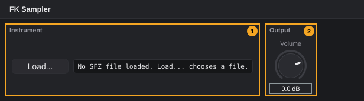

| # | Section | Control | Range | Default | What it does |
|---|---|---|---|---|---|
| 1 | **Instrument** | **Load...** | – | – | Opens the file dialog **Choose SFZ instrument** (only `.sfz` files). It starts in the folder of the loaded file. |
| | | Status line | – | – | Without a file: *No SFZ file loaded. Load... chooses a file.* With a file: *file name* \| *n* **regions** \| *n* **voices** (regions in the file, notes sounding right now) |
| 2 | **Output** | **Volume** | −36 to +12 dB | 0 dB | Overall volume |

**To load an SFZ instrument:**

1. Click **Load...**.
2. Choose an `.sfz` file and click **Open**.

The status line shows the file name and the number of regions. While the file loads, the sampler is silent for a moment.

- FK Sampler reacts to notes, controllers (CC), pitch bend, channel and polyphonic aftertouch, and *All notes off*. What they do depends on the SFZ file.
- The project stores the **full path** of the SFZ file. If the file or its samples are moved or deleted, the track stays silent after the project is opened again.
- **Outputs:** FK Sampler has eight stereo outputs (**Output 1+2** to **Output 15+16**). An SFZ file chooses them per region with `output=0` to `output=7`. On a normal instrument track all regions play on output 1+2. Use a rack instrument to mix the outputs separately ([§8](#8-instruments-with-several-outputs)).

<!-- FIX F-1509: loading errors may be shown in a message -->
> **Note:** If a file cannot be loaded, no message appears; the status line keeps showing the previous state. The reason is only written to the log file: *SFZ file not found:* *path* or *SFZ file contains no playable regions:* *file*.

### 14.3 FK EQ

A parametric equalizer with a high-pass filter and four bands: low shelf, two bell bands, high shelf. A graph shows the frequency response and the spectrum of the output.

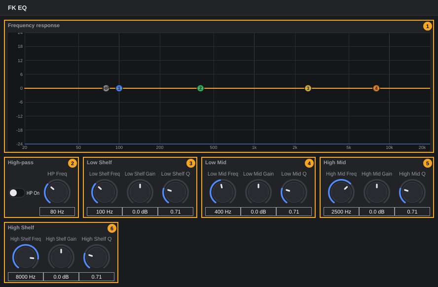

| # | Section | Control | Range | Default | What it does |
|---|---|---|---|---|---|
| 1 | **Frequency response** | Graph | 20 Hz to 20 kHz, −24 to +24 dB | – | The curve shows the sum of all bands, behind it the spectrum of the output signal. Coloured round handles: **HP** for the high-pass and **1** to **4** for the bands. |
| 2 | **High-pass** | **HP On** | on/off | off | Switches the high-pass filter on |
| | | **HP Freq** | 20 to 1000 Hz | 80 Hz | Below this frequency the high-pass removes the lows (12 dB per octave) |
| 3 | **Low Shelf** | **Low Shelf Freq** | 20 to 20000 Hz | 100 Hz | Raises or lowers everything below this frequency |
| | | **Low Shelf Gain** | −18 to +18 dB | 0 dB | Amount |
| | | **Low Shelf Q** | 0.1 to 10 | 0.707 | Steepness of the transition |
| 4 | **Low Mid** | **Low Mid Freq** | 20 to 20000 Hz | 400 Hz | Centre of a bell-shaped boost or cut |
| | | **Low Mid Gain** | −18 to +18 dB | 0 dB | Amount |
| | | **Low Mid Q** | 0.1 to 10 | 0.707 | Width: higher = narrower |
| 5 | **High Mid** | **High Mid Freq**, **High Mid Gain**, **High Mid Q** | as Low Mid | 2500 Hz, 0 dB, 0.707 | Second bell band |
| 6 | **High Shelf** | **High Shelf Freq**, **High Shelf Gain**, **High Shelf Q** | as Low Shelf | 8000 Hz, 0 dB, 0.707 | Raises or lowers everything above the frequency |

**Working in the graph** (tooltip *Drag band: frequency and gain. Mouse wheel: Q. Double-click: gain to 0 dB*):

- **Drag a handle:** left and right change the frequency, up and down the gain. The **HP** handle only moves left and right.
- **Mouse wheel over a handle:** changes Q (the HP handle has none).
- **Double-click a handle:** sets its gain back to 0 dB.

The knobs below always show the same values as the handles. Bands with 0 dB gain do not change the sound.

### 14.4 FK Compressor

A compressor lowers the level when the signal gets louder than the threshold. With a sidechain, another track can control it ([MixConsole §13](mixconsole.md#13-sidechain)).

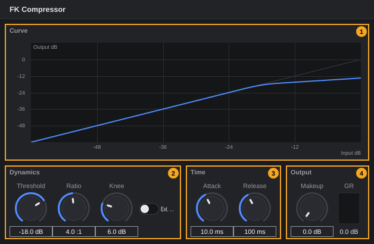

| # | Section | Control | Range | Default | What it does |
|---|---|---|---|---|---|
| 1 | **Curve** | Graph | **Input dB** −60 to 0, **Output dB** −60 to +12 | – | The curve shows the output level for every input level with the current settings. While signal arrives, a dot marks the current input level on the curve. |
| 2 | **Dynamics** | **Threshold** | −60 to 0 dB | −18 dB | Level above which compression starts |
| | | **Ratio** | 1:1 to 20:1 | 4:1 | Strength: at 4:1, 4 dB more input above the threshold give 1 dB more output |
| | | **Knee** | 0 to 24 dB | 6 dB | Range around the threshold in which compression sets in gradually; 0 = abrupt |
| | | **Ext. Sidechain** | on/off | off | *Measure the level of another track (e.g. the kick ducks the bass). Source: right-click the insert slot, then Sidechain source*. Switched on and off automatically when you set or remove a sidechain source. |
| 3 | **Time** | **Attack** | 0.1 to 200 ms | 10 ms | How fast the compressor reacts when the level rises |
| | | **Release** | 5 to 2000 ms | 100 ms | How fast it lets go when the level falls |
| 4 | **Output** | **Makeup** | 0 to 24 dB | 0 dB | Raises the output to make up for the reduction |
| | | **GR** meter | 0 to 24 dB | – | Current gain reduction. The insert slot shows it too ([MixConsole §4](mixconsole.md#4-insert-slots)). |

### 14.5 FK Limiter

A limiter keeps the level below a ceiling, for example on the sum of a mix. It looks 5 ms ahead so it can react before a peak arrives.

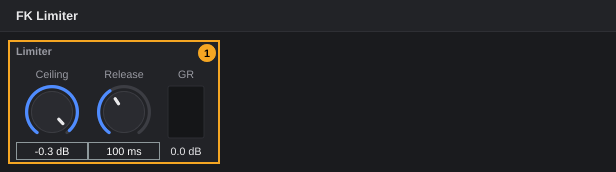

| # | Section | Control | Range | Default | What it does |
|---|---|---|---|---|---|
| 1 | **Limiter** | **Ceiling** | −12 to 0 dB | −0.3 dB | Maximum output level |
| | | **Release** | 10 to 1000 ms | 100 ms | How fast the limiter lets go after a peak |
| | | **GR** meter | 0 to 24 dB | – | Current gain reduction; also shown in the insert slot |

### 14.6 FK Gate

A gate lowers the signal while it is quieter than a threshold, for example to silence the noise between drum hits. With a sidechain, another track opens it ([MixConsole §13](mixconsole.md#13-sidechain)).

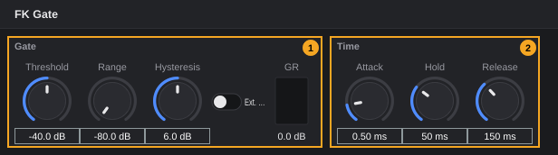

| # | Section | Control | Range | Default | What it does (tooltip) |
|---|---|---|---|---|---|
| 1 | **Gate** | **Threshold** | −80 to 0 dB | −40 dB | *The gate closes below this level* |
| | | **Range** | −80 to 0 dB | −80 dB | *How far it attenuates: -80 dB = closed, -10 dB = just quieter* |
| | | **Hysteresis** | 0 to 12 dB | 6 dB | *Closes only this far below the threshold: prevents chattering* |
| | | **Ext. Sidechain** | on/off | off | *Open by another track (e.g. the bass opens with the kick). Source: right-click the insert slot, then Sidechain source*. Switched automatically with the sidechain source. |
| | | **GR** meter | 0 to 24 dB | – | Current attenuation. The insert slot shows no bar for FK Gate. |
| 2 | **Time** | **Attack** | 0.05 to 50 ms | 0.5 ms | *How fast it opens: short = the attack stays crisp* |
| | | **Hold** | 0 to 500 ms | 50 ms | *Stays open this long after the level drops below the threshold* |
| | | **Release** | 5 to 2000 ms | 150 ms | *How slowly it closes: long = natural decay* |

The gate listens to the average of the left and right channel (of its own track, or of the sidechain source).

### 14.7 FK Distortion

Saturation and distortion with three characters, a tone filter and a dry/wet mix. It works internally at double sample rate, which keeps the added overtones clean.

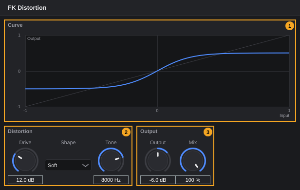

| # | Section | Control | Range | Default | What it does |
|---|---|---|---|---|---|
| 1 | **Curve** | Graph | **Input** −1 to 1, **Output** −1 to 1 | – | Shows how the current **Drive**, **Shape** and **Output** bend the waveform |
| 2 | **Distortion** | **Drive** | 0 to 40 dB | 12 dB | How hard the signal is driven into the distortion |
| | | **Shape** | **Soft**, **Hard**, **Tube** | **Soft** | Character: soft rounding, hard clipping or tube-like |
| | | **Tone** | 500 to 20000 Hz | 8000 Hz | Low-pass filter on the distorted signal: lower = darker |
| 3 | **Output** | **Output** | −24 to +12 dB | −6 dB | Level of the distorted signal |
| | | **Mix** | 0 to 100 % | 100 % | Share of the distorted signal; the rest is the unchanged input |

### 14.8 FK Delay

An echo with tempo sync, ping-pong and filters in the feedback.

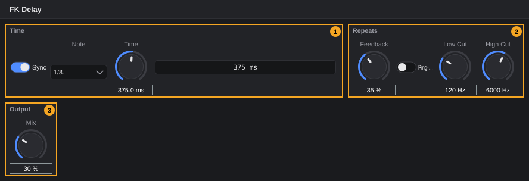

| # | Section | Control | Range | Default | What it does (tooltip) |
|---|---|---|---|---|---|
| 1 | **Time** | **Sync** | on/off | on | *Time in the project's tempo (note value) instead of milliseconds* |
| | | **Note** | **1/32**, **1/16T**, **1/16**, **1/16.**, **1/8T**, **1/8**, **1/8.**, **1/4T**, **1/4**, **1/4.**, **1/2**, **1/1** | **1/8.** | *Note value when synced: . = dotted, T = triplet* |
| | | **Time** | 1 to 2000 ms | 375 ms | *Time in milliseconds when Sync is off* |
| | | Status line | – | – | The delay time in effect, in ms. Before the first playback it is calculated at 120 BPM. |
| 2 | **Repeats** | **Feedback** | 0 to 95 % | 35 % | *How much of the echo is fed back: more = more repeats* |
| | | **Ping-Pong** | on/off | off | *Echoes alternate between left and right* |
| | | **Low Cut** | 20 to 2000 Hz | 120 Hz | *Each repeat gets thinner: keeps the bass clean* |
| | | **High Cut** | 1000 to 20000 Hz | 6000 Hz | *Each repeat gets duller, like a tape echo* |
| 3 | **Output** | **Mix** | 0 to 100 % | 30 % | *Amount of echo. On an FX track (send) use 100 %* |

With **Sync** on, the delay follows the project tempo, including tempo changes.

### 14.9 FK Reverb

An algorithmic reverb for rooms from small to large.

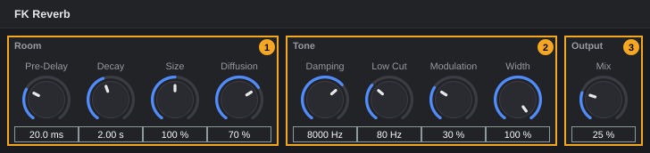

| # | Section | Control | Range | Default | What it does (tooltip) |
|---|---|---|---|---|---|
| 1 | **Room** | **Pre-Delay** | 0 to 250 ms | 20 ms | *Gap before the first reflections: separates the voice from the room* |
| | | **Decay** | 0.2 to 20 s | 2 s | *Reverb time: how long until the tail has decayed by 60 dB* |
| | | **Size** | 50 to 150 % | 100 % | *Room size: spacing of the reflections* |
| | | **Diffusion** | 0 to 100 % | 70 % | *Density: low = single echoes, high = smooth cloud* |
| 2 | **Tone** | **Damping** | 1000 to 20000 Hz | 8000 Hz | *Highs decay faster: lower = darker, warmer* |
| | | **Low Cut** | 20 to 1000 Hz | 80 Hz | *Keeps bass out of the reverb so it does not boom* |
| | | **Modulation** | 0 to 100 % | 30 % | *Slight movement against a metallic sound* |
| | | **Width** | 0 to 100 % | 100 % | *Stereo width of the reverb* |
| 3 | **Output** | **Mix** | 0 to 100 % | 25 % | *Amount of reverb. On an FX track (send) use 100 %* |

> **Tip:** For a reverb shared by several tracks, put FK Reverb on an FX track, set **Mix** to 100 % and send the tracks to it ([MixConsole §15.2](mixconsole.md#152-a-shared-reverb-on-an-fx-track)).

### 14.10 FK Gain

Changes the level, for example to balance a loud plugin. Changes are smoothed over 20 ms, so turning the knob does not click.

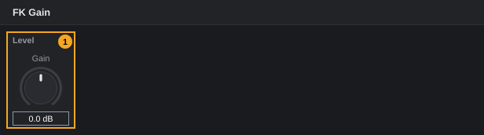

| # | Section | Control | Range | Default | What it does |
|---|---|---|---|---|---|
| 1 | **Level** | **Gain** | −24 to +24 dB | 0 dB | Level change |

### 14.11 FK Transpose

Transposes all notes and shifts their velocity before they reach the instrument.

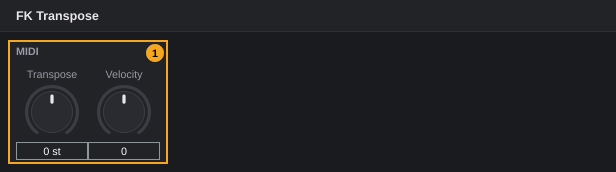

| # | Section | Control | Range | Default | What it does (tooltip) |
|---|---|---|---|---|---|
| 1 | **MIDI** | **Transpose** | −24 to +24 st | 0 st | *Semitones, +/-2 octaves* |
| | | **Velocity** | −64 to +64 | 0 | *Shift the velocity of all notes* |

- Notes that would fall below the lowest or above the highest MIDI note (0–127) are left out.
- The velocity stays between 1 and 127.
- Moving **Transpose** while notes are held does not leave hanging notes: each note ends on the pitch it started with.

### 14.12 FK Chord

Plays a chord for every note you play: the played note is the root.

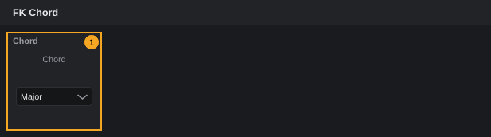

| # | Section | Control | Range | Default | What it does (tooltip) |
|---|---|---|---|---|---|
| 1 | **Chord** | **Chord** | see below | **Major** | *A chord above every played note* |

| Chord | Notes above the root (semitones) |
|---|---|
| **Major** | 4, 7 |
| **Minor** | 3, 7 |
| **Sus4** | 5, 7 |
| **Maj7** | 4, 7, 11 |
| **Min7** | 3, 7, 10 |
| **Dom7** | 4, 7, 10 |
| **Power** | 7, 12 |
| **Octave** | 12 |

All chord notes get the velocity of the played note. Notes above the highest MIDI note (127) are left out.

### 14.13 FK Arpeggiator

Plays the held notes one after another in a rhythm.

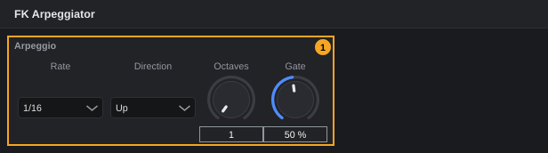

<!-- FIX F-1510: the note values may be listed in order of length -->
| # | Section | Control | Range | Default | What it does (tooltip) |
|---|---|---|---|---|---|
| 1 | **Arpeggio** | **Rate** | **1/4**, **1/8**, **1/8 Triplet**, **1/16**, **1/16 Triplet**, **1/32**, **1/2** (in this order) | **1/16** | *Note value of the steps, in the project tempo* |
| | | **Direction** | **Up**, **Down**, **Up and down**, **Random**, **As played** | **Up** | *Order of the held notes* |
| | | **Octaves** | 1 to 4 | 1 | *Over how many octaves* |
| | | **Gate** | 5 to 100 % | 50 % | *How long each note sounds, in % of the step* |

- **Up** and **Down** play the held notes sorted by pitch; **Up and down** goes up and back down without repeating the top and bottom note; **Random** picks a held note at random for each step; **As played** keeps the order in which you pressed the keys.
- With **Octaves** above 1, the pattern is repeated one octave higher each time.
- During playback the steps follow the bars and beats of the project; when the transport is stopped, the arpeggiator runs on its own clock in the project tempo, so you can play it live.
- Controllers and pitch bend pass through unchanged.

---

## 15. Undo and messages

**Undoable with Ctrl+Z** (name in the undo history):

| Action | Undo step |
|---|---|
| Adding an effect | *Insert plugin* |
| Removing an effect | *Remove plugin* |
| Replacing an instrument | *Replace instrument* |
| Loading a preset / a factory program | *Load preset* / *Load program* |
| Setting a sidechain source | *Sidechain source* |
| Creating a rack instrument, adding a MIDI track to it, changing its MIDI channel, switching an output | *Add rack instrument*, *MIDI track to rack*, *MIDI channel*, *Enable output* |

**Not undoable:** scans and changes to the plugin list, favourites, hidden plugins, categories and tags, saving and deleting presets, loading a file into FK Sampler with **Load...**.

**Messages** (in a window titled **Error**, in the hint line of **My Plugins**, or in the log):

| Message | Where | Cause |
|---|---|---|
| *No plugins found (Plugin Manager: Search and Scan)* | Plugin menu | No plugin of this kind is known ([§4](#4-search-and-scan)) |
| *Plugin not found.* | My Plugins | The plugin was removed from the list in the meantime |
| *Unknown category:* *name* | My Plugins | Internal error with the category list |
| *Select an entry in the list first.* | Instrument browser | **New Track** without a selection |
| *Instrument not found.*, *Unknown entry.* | Instrument browser | The entry is no longer available |
| *Entry not found.*, *Empty tag.*, *Only your own tags can be removed.* | Instrument browser | Favourites and tags ([§6.4](#64-favourites-and-tags)) |
| *Instrument not found:* *id*, *Could not load the instrument:* *name* | Replacing or creating an instrument | [§7](#7-choosing-and-replacing-an-instrument) |
| *The track plays a rack instrument; the instrument belongs to the rack, not the track.* | Replacing an instrument | [§8](#8-instruments-with-several-outputs) |
| *Plugin not found:* *id*, *Could not insert the plugin:* *name* | Adding an effect | [MixConsole §17](mixconsole.md#17-undo-and-messages) |
| *Plugin is not loaded:* *name*, *Could not create the plugin window.* | Opening a plugin window | [§13](#13-latency-crashes-and-missing-plugins), [MixConsole §5](mixconsole.md#5-plugin-windows) |
| *The preset needs a name.*, *The preset belongs to a different plugin.*, *The preset is damaged.*, *Preset not found.*, *Could not read the preset:* *path*, *Could not write the preset:* *path* | Presets | [§11](#11-presets) |
| *FK Sampler is not registered.*, *FK Trim is not registered.* | Sampler tracks, trim | FK plugins were removed from the list ([§4.4](#44-removing-plugins-from-the-list)); restart FK Audio Suite |
| *SFZ file not found:* *path*, *SFZ file contains no playable regions:* *file* | Log only | [§14.2](#142-fk-sampler) |
| *There are some problems in launching a child-process to scan for plugins.* | Scan | [§4.3](#43-crashing-plugins-during-a-scan) |

---

## 16. Quick reference

| What | How |
|---|---|
| Open the Plugin Manager | **Studio › Plugin manager...** or the plugin manager button in the toolbar |
| Scan for new plugins | Plugin Manager › **Search and Scan** › **Options...** › **Scan for new or updated VST3 plug-ins** (or LV2) |
| Retry a red (failed) plugin | Right-click it › **Remove plug-in from list**, then scan again |
| Mark a favourite | **My Plugins**: click **★**; instrument browser: click the star |
| Hide a plugin from the menus | **My Plugins**: click **visible** |
| Change the menu category | **My Plugins**: **Category** list; **automatic** to reset |
| Show the instrument browser | **F10**, **View › Instrument browser**, or the **Instruments** tab |
| New track from the browser | Double-click an entry, or select it and click **New Track** |
| Add a tag | Instrument browser: right-click › **Add tag...** |
| Replace the instrument | Inspector: replace button next to the instrument name |
| Use more than one output | **Track › Rack instrument (multi-out, several MIDI tracks)**, then **Outputs** in the Inspector |
| Add an effect | Click an empty insert slot (**+**) |
| Save or load a preset | Right-click an insert slot › **Presets** |
| Reset a knob of an FK plugin | Double-click it |
| Fine adjustment | **Ctrl**+drag |
| Type a value | Click the value below the knob |
| EQ band in the graph | Drag: frequency and gain; mouse wheel: Q; double-click: 0 dB |
| Link a hardware control | **Studio › MIDI Learn**, move the plugin control, move the hardware control |
