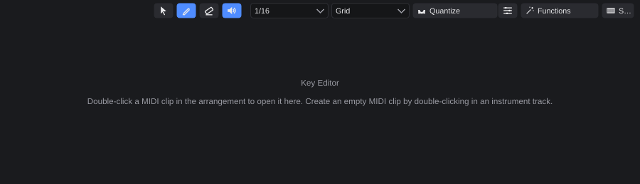
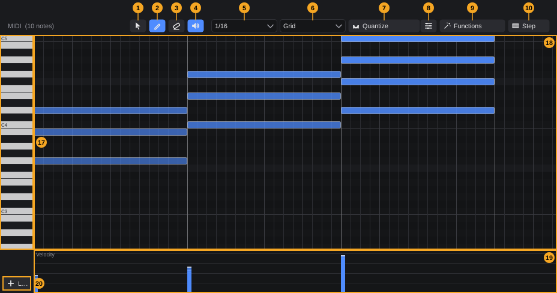
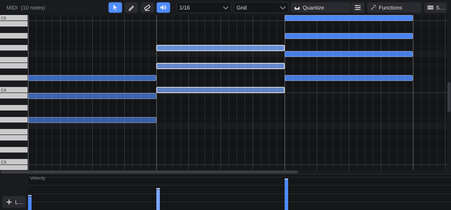
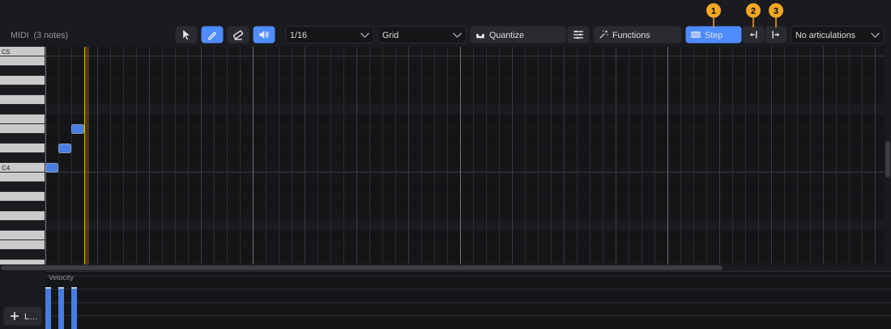
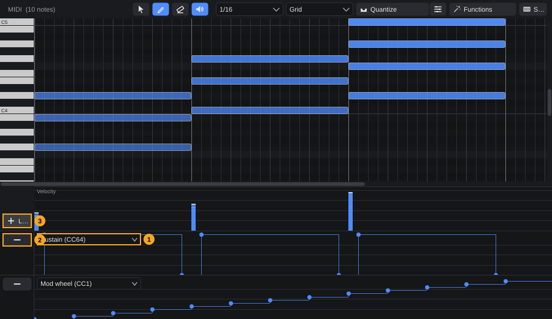
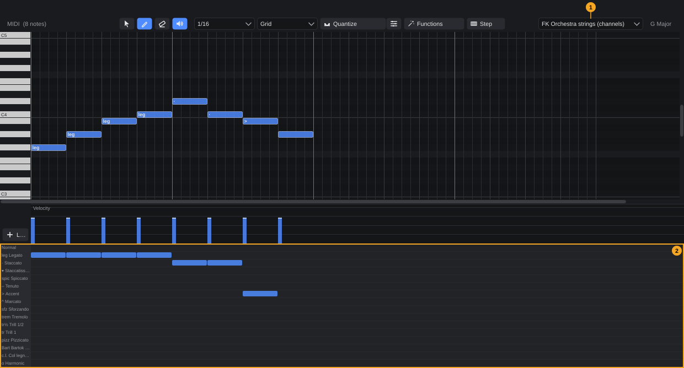

# Key Editor

The Key Editor (often called a *piano roll*) is where you write and edit the notes of a MIDI clip. Each note is a bar: its vertical position is the pitch and its horizontal position and length are the timing. Below the notes you edit velocity, controller data (sustain pedal, mod wheel, pitch bend and so on) and articulations.

**In this chapter**

1. [Opening the Key Editor](#1-opening-the-key-editor)
2. [The editor at a glance](#2-the-editor-at-a-glance)
3. [Tools](#3-tools)
4. [Grid and note length](#4-grid-and-note-length)
5. [Entering notes](#5-entering-notes)
6. [Selecting notes](#6-selecting-notes)
7. [Moving, copying and trimming notes](#7-moving-copying-and-trimming-notes)
8. [Deleting notes](#8-deleting-notes)
9. [Keyboard commands in the note grid](#9-keyboard-commands-in-the-note-grid)
10. [Auditioning notes](#10-auditioning-notes)
11. [Velocity](#11-velocity)
12. [Quantizing](#12-quantizing)
13. [MIDI functions](#13-midi-functions)
14. [Step input](#14-step-input)
15. [Key and chords](#15-key-and-chords)
16. [Controller lanes](#16-controller-lanes)
17. [Articulations](#17-articulations)
18. [Zooming and scrolling](#18-zooming-and-scrolling)
19. [Undo](#19-undo)
20. [Quick reference](#20-quick-reference)

---

## 1. Opening the Key Editor

The Key Editor lives in the **lower zone** of the project window, the area below the arrangement.

**To edit a MIDI clip:**

1. In the arrangement, double-click the MIDI clip.
2. The lower zone opens (if it was closed) and switches to the **Key Editor** tab with the clip loaded.

> **Note:** If the clip's track uses a drum map, double-clicking opens the **Drum Editor** instead. The List Editor always shows the same clip as well.

**To create a new, empty MIDI clip:** double-click an empty place in an instrument track. Then double-click the new clip to open it.

**To show the Key Editor without opening a clip,** use any of these:

- Press **F5**.
- Choose **View › Key Editor**.
- Click the lower-zone button in the toolbar and select the **Key Editor** tab.

As long as no clip is loaded, the editor shows a short hint instead of the note grid:

The editor always shows one clip at a time. If you delete the clip or open another project, the editor empties itself.

---

## 2. The editor at a glance

The heading at the top left shows the clip name and the number of notes, for example *MIDI (10 notes)*. The numbers in the picture mean:

| # | Element | What it does | Details |
|---|---|---|---|
| 1 | **Select** tool | Select, move, copy and trim notes | [§3](#3-tools) |
| 2 | **Pencil** tool (default) | Draw notes | [§3](#3-tools) |
| 3 | **Eraser** tool | Delete notes by clicking | [§3](#3-tools) |
| 4 | **Audition** (speaker) | Notes sound while you play keys, place or drag them; on by default | [§10](#10-auditioning-notes) |
| 5 | **Grid** | Snap value for placing and dragging, target for quantizing | [§4](#4-grid-and-note-length) |
| 6 | **Length** | Length of new notes | [§4](#4-grid-and-note-length) |
| 7 | **Quantize** | Move note starts onto the grid | [§12](#12-quantizing) |
| 8 | **Quantize options** (gear) | Strength, swing, groove | [§12](#12-quantizing) |
| 9 | **Functions** | Transpose, length, legato, humanize, velocity, delete duplicates | [§13](#13-midi-functions) |
| 10 | **Step** | Step input on/off | [§14](#14-step-input) |
| 11 | **Expression map** | Articulation set of the track | [§17](#17-articulations) |
| 12 | **Key** | Key at the clip start (from the signature track) | [§15](#15-key-and-chords) |
| 13 | **Degree** | Scale degree I–VII with the resulting chord | [§15](#15-key-and-chords) |
| 14 | **Chord type** | Triad or seventh chord | [§15](#15-key-and-chords) |
| 15 | **Inversion** | Root position, 1st or 2nd inversion | [§15](#15-key-and-chords) |
| 16 | **Chord** | Insert the chosen chord at the end of the clip | [§15](#15-key-and-chords) |
| 17 | **Piano keys** | Pitch of every row; click to audition | [§10](#10-auditioning-notes) |
| 18 | **Note grid** | The notes of the clip | [§5](#5-entering-notes)–[§9](#9-keyboard-commands-in-the-note-grid) |
| 19 | **Velocity lane** | One bar per note, height = velocity | [§11](#11-velocity) |
| 20 | **Lane** (+) | Add a controller lane | [§16](#16-controller-lanes) |

**Reading the note grid**

<!-- FIX F-001: octave naming may change to C3 or become a setting -->
- Every row is one semitone. The piano keys on the left label each C with its octave; middle C (MIDI note 60) is **C4**.
- Rows that are not part of the current key are dimmed, and black-key rows are slightly darker, so you can see at a glance which notes fit the scale.
- Vertical lines show bars (strong), beats (medium) and grid steps (fine). At coarse zoom with a fine grid, only every n-th grid line is drawn. A strong line marks the end of the clip.
- A note's colour gets stronger the higher its velocity. Selected notes are brighter and have a light outline.
- When playback runs inside the clip, a vertical line shows the playhead.

When you open a clip, the view scrolls so that **C5** is at the top edge.

<!-- FIX F-005: toolbar may wrap or get an overflow menu; Lane button label -->
> **Tip:** If the window is narrow, the right end of the toolbar is cut off. The **Lane** button (20) sits below the piano keys so you can always reach it.

---

## 3. Tools

Pick a tool with the three buttons at the left of the toolbar. Exactly one is active at a time.

| Tool | Click on empty space | Click on a note | Drag |
|---|---|---|---|
| **Select** | Clears the selection | Selects the note | On empty space: selection rectangle. On a note: move, copy or trim |
| **Pencil** | Places a note | Selects the note (like the Select tool) | On empty space: places a note and stretches it to the mouse. On a note: move, copy or trim |
| **Eraser** | Nothing | Deletes the note; if the note is selected, deletes the whole selection | — |

The **Pencil** is active when the editor opens.

The mouse pointer shows what a drag will do: a **hand** in the middle of a note (move), a **left-right arrow** at the edges of a note (trim).

---

## 4. Grid and note length

**Grid** (5) sets the step that notes snap to when you place, move or trim them. Quantize uses it as its target too. The default is **1/16**.

**Length** (6) sets how long new notes are. The default is **Grid**, which means a new note is exactly one grid step long. If you choose a fixed value, new notes keep that length when you change the grid.

Both lists offer the same note values:

- **Straight:** 1/1, 1/2, 1/4, 1/8, 1/16, 1/32, 1/64, 1/128 (directly in the list)
- **Dotted** submenu: the same values, 1.5 times as long (for example *1/8 dotted*)
- **Triplet** submenu: the same values, two thirds as long (for example *1/8 triplet*)

The grid also controls controller lanes ([§16](#16-controller-lanes)): drawn points land on grid steps.

---

## 5. Entering notes

### With the Pencil

1. Select the **Pencil** (2).
2. Click into the note grid at the pitch and time you want. The note starts at the grid step to the left of the mouse and has the length set in **Length**.
3. To make the note longer, keep the mouse button pressed and drag to the right. The end snaps to the grid. The note never gets shorter than the set length.
4. Release the mouse button.

New notes have a velocity of **100**.

### With the Select tool

With the **Select** tool, **double-click** an empty place to insert a note there (same start, length and velocity as with the Pencil).

### Chords with one click

With the **Pencil**, hold **Alt** and click an empty place to insert the chord selected in the chord section ([§15](#15-key-and-chords)). The chord starts at the nearest grid step, is one bar long, and is built in the octave of the row you clicked.

### By playing

- **Step input** writes one note per key you press on your MIDI keyboard ([§14](#14-step-input)).
- To record in real time, use the transport's record function in the arrangement (see the chapter on recording).

---

## 6. Selecting notes

Most functions work on the **selection**. If no note is selected, Quantize and the MIDI functions work on **all notes in the clip**.

| Action | Result |
|---|---|
| Click a note | Selects only this note |
| **Shift**+click a note | Adds the note to the selection |
| **Ctrl**+click a note | Adds the note, or removes it if it was already selected |
| Click a note that is part of a larger selection (without dragging) | Selects only this note |
| Drag a rectangle on empty space (Select tool) | Selects every note the rectangle touches; replaces the previous selection |
| **Shift** or **Ctrl** while dragging the rectangle | Adds the touched notes to the existing selection |
| Click empty space (Select tool) | Clears the selection |
| **Ctrl+A** | Selects all notes in the clip |

The velocity lane and the articulation lane highlight the selected notes too.

---

## 7. Moving, copying and trimming notes

All three work with the **Select** tool and the **Pencil**. If the note you grab is selected, the action applies to **all selected notes**.

### Move

1. Grab a note in its middle (the pointer becomes a hand).
2. Drag it. Horizontally, the grabbed note snaps to the grid and all others move by the same distance. Vertically, the notes move in semitone steps.
3. Release the mouse button.

While you drag to another row, you hear the new pitch (if Audition is on). Notes cannot be moved before the clip start or outside the MIDI range 0–127.

### Copy

Hold **Alt** when you start dragging. The originals stay where they are and the copies follow the mouse. The copies are drawn slightly transparent until you release.

### Trim

1. Point at the left or right edge of a note (the pointer becomes a left-right arrow). The grab zone is 6 pixels wide, on very short notes at most a third of the note.
2. Drag the **left edge** to change where the note starts; its end stays put.
3. Drag the **right edge** to change where the note ends; its start stays put.

Both edges snap to the grid. A note never gets shorter than one grid step when you trim the end.

A drag only counts once the mouse moved more than 2 pixels; a simple click never moves a note by accident.

---

## 8. Deleting notes

- Select notes and press **Delete** or **Backspace**.
- With the **Eraser**, click a note. If it is part of the selection, the whole selection is deleted.
- With the **Select** tool, double-click a note.

---

## 9. Keyboard commands in the note grid

These work after you have clicked into the note grid (it then has the keyboard focus). They apply to the selected notes.

| Key | Action |
|---|---|
| **Delete** / **Backspace** | Delete selected notes |
| **Ctrl+A** | Select all notes |
| **Up** / **Down** | Transpose by one semitone |
| **Shift+Up** / **Shift+Down** | Transpose by one octave |
| **Left** / **Right** | Move by one grid step (never before the clip start) |

---

## 10. Auditioning notes

With **Audition** (4) switched on (default), notes sound through the track's instrument:

- when you click a key on the **piano keys** (17); drag over the keys to play one after the other,
- when you place a note with the Pencil,
- when you click or grab a note, and whenever a moved note reaches a new row.

The sound stops when you release the mouse button. Switch Audition off to work silently.

---

## 11. Velocity

The **velocity lane** (19) shows one bar per note, at the note's start. The higher the bar, the louder the note (1–127). Guide lines mark 32, 64, 96 and 127.

**To change the velocity of one note:** drag its bar up or down. The value is shown next to the bar while you drag.

<!-- FIX F-004: editing stacked chord notes in the lane may change -->
**To change several notes at once:** select them first, then drag the bar of one of them. All selected notes change by the same amount, so their differences stay the same.

**Directly in the note grid:** hold **Ctrl+Shift** and drag a note up or down. Every 2 pixels change the velocity by 1. If the note is selected, all selected notes change.

For fixed values or a percentage change, use **Functions › Velocity** ([§13](#13-midi-functions)).

---

## 12. Quantizing

Quantizing moves note starts onto the grid. The note lengths stay as they are.

1. Choose the target in **Grid** (5), for example 1/16.
2. Select the notes to quantize. Without a selection, all notes in the clip are quantized.
3. Click **Quantize** (7).

### Quantize options

Click the gear button (8) next to Quantize. The settings apply every time you click Quantize until you change them. They are not saved with the project.

| Option | Values | Meaning |
|---|---|---|
| **Strength** | 100 %, 75 %, 50 %, 25 % | How far notes move toward the grid. 100 % puts them exactly on the grid, 50 % halfway, which keeps some of the feel of the original timing. |
| **Swing** | 0 %, 25 %, 50 %, 75 %, 100 % | Moves every second grid step later. 100 % gives a triplet feel. |
| **Groove from clip** | *No groove* or any other MIDI clip of the project | Takes the timing feel of one bar of that clip (at the current grid) and applies it while quantizing. The menu then shows *Groove: name*. |

> **Tip:** To take the groove of a drummer's take and apply it to a bass line, open the bass clip, choose the drum clip under **Groove from clip**, then click **Quantize**.

---

## 13. MIDI functions

Click **Functions** (9). The menu heading shows what will be affected: *N selected notes*, or *All notes in the clip* if nothing is selected.

| Menu | Entry | Effect |
|---|---|---|
| **Transpose** | +12 (octave), +7, +5, +1, −1, −5, −7, −12 (octave) | Shift pitch by that many semitones |
| **Length** | Length = grid | All affected notes get the length of one grid step |
| | Length = note length | All affected notes get the length set in **Length** |
| | Legato (up to the next note) | Every note is extended to the start of the next note |
| **Humanize** | Timing subtle (±1/64) | Moves starts randomly by up to a 1/64 note |
| | Timing strong (±1/32) | Moves starts randomly by up to a 1/32 note |
| | Velocity subtle (±8) | Changes velocities randomly by up to 8 |
| | Velocity strong (±20) | Changes velocities randomly by up to 20 |
| **Velocity** | Fixed 127, 100, 80, 64, 40 | Sets all affected notes to that velocity |
| | Louder (+10 %) / Softer (−10 %) | Scales velocities by 10 % |
| — | Delete duplicate notes | Removes notes with the same pitch as another note that start at (almost) the same time (closer than 1/128 beat); the first one is kept |

Humanize produces a different result every time you use it. Undo it if you don't like it and try again.

---

## 14. Step input

Step input writes notes one after another without playing in time: you press a key, the note is placed and a cursor jumps forward.

1. Set **Length** (6) to the length of each step, for example 1/8.
2. Optional: put the playhead where you want to start inside the clip. Otherwise step input starts at the clip start.
3. Click **Step** (1 in the picture). A green **step cursor** appears, rounded to the grid. Two more buttons appear next to Step.
4. Play a key on your MIDI keyboard (or on the on-screen keyboard, **F4**). The note is placed at the cursor with the length from **Length** and the velocity you played; the cursor moves one step forward.
5. To enter a **chord**, hold the keys down together. All notes land on the same position; the cursor moves on when you release.
6. To enter a **rest**, click **Rest** (3): the cursor moves one step without a note.
7. To go back, click **Step back** (2).
8. Click **Step** again to finish.

Step input listens to every MIDI input that plays the clip's track. Changing **Length** while step input is on changes the step size from the next note onward. Opening another clip ends step input.

---

## 15. Key and chords

### Key

The **Key** label (12) shows the key that applies at the start of the clip. It comes from the **signature track** in the arrangement; change the key there. Rows outside the key are dimmed in the note grid.

### Inserting chords

The chord section builds chords that fit the key:

1. In **Degree** (13), choose the scale degree. Each entry shows the degree and the resulting chord, for example *IV  C* in G major.
2. In **Chord type** (14), choose **Triad** or **Seventh chord**. The degree list updates its chord names.
3. In **Inversion** (15), choose **Root position**, **1st inversion** or **2nd inversion**.
4. Insert the chord in one of two ways:
   - Click **Chord** (16): the chord is placed **after the last note**, at the start of the next bar (in an empty clip, at the clip start), in octave 4 and one bar long.
   - With the **Pencil**, **Alt**+click in the note grid: the chord is placed at the mouse position ([§5](#5-entering-notes)).

All chord notes get velocity 100.

> **Example:** In G major, choosing I, IV and V with *Seventh chord* for the last one and clicking **Chord** three times writes G – C – D7, one bar each.

---

## 16. Controller lanes

Controller lanes show and edit continuous MIDI data under the velocity lane. You can add as many as you need.

### Adding and removing lanes

- Click **Lane** (+, number 3 in the picture) below the piano keys. The first lane shows **Sustain**, the second **Mod wheel**, the third **Pitch bend**, every further one **Aftertouch**. Newer lanes appear at the bottom.
- Change what a lane shows with its list (1): **Sustain (CC64)**, **Sostenuto (CC66)**, **Soft (CC67)**, **Mod wheel (CC1)**, **Pitch bend**, **Aftertouch**, or any other controller CC0–CC127 under **More CCs**.
- Remove a lane with its **−** button (2). This only hides the lane; the data stays in the clip.

<!-- FIX F-003: lanes may become persistent per track -->
Lanes are not saved with the project: they are a view. When you open the editor again, add the lanes you need.

### Editing controller data

| Action | Result |
|---|---|
| Click on empty space | Sets a point at the grid step left of the mouse, with the value at the mouse height |
| Drag on empty space to the right | Draws one point per grid step, following the mouse; existing points in that range are replaced |
| Drag a point | Moves it (time snaps to the grid) and changes its value |
| Right-click a point | Deletes it |

The current value is shown at the left while you drag. A value holds until the next point, so the line between points is drawn as steps. A lane without data says *No data: click or drag to set points*.

> **Tip:** For finer controller curves, choose a finer **Grid** (for example 1/32) before drawing.

---

## 17. Articulations

Articulations tell an instrument *how* to play a note: legato, staccato, accent, pizzicato and so on. Which articulations exist and how they reach the instrument (MIDI channel, keyswitch or controller) is defined in an **expression map**.

### Choosing the expression map

In the **Expression map** list (1), choose the map for the track:

- **No articulations**: no map, no articulation lane.
- **FK Orchestra strings (channels)**: articulations of the FK Orchestra string section, switched via MIDI channels.
- **Keyswitches from C0 (generic)**: sends keyswitches starting at C0, for third-party libraries.
- Your own maps, if you have imported any.

The map belongs to the **track**: all clips on that track use it. The track keeps a copy, so the project still plays correctly on another computer.

### Setting articulations

With a map chosen, the **articulation lane** (2) appears above the velocity lane. It has one row per articulation, named on the left, and shows a bar for every note that uses it.

1. Click into the row of the articulation you want, above the note.
2. The note gets this articulation. If the note is selected, all selected notes get it.
3. Click again in the same row to remove the articulation (when all affected notes already have it).

<!-- FIX F-005: articulation names in the lane header are cut off -->
In the note grid, notes with an articulation show its symbol at the start of the bar, for example *leg*, *·* (staccato) or *>* (accent).

---

## 18. Zooming and scrolling

| Action | Result |
|---|---|
| **Ctrl**+mouse wheel | Zoom horizontally (in steps of 20 %) |
| Mouse wheel | Scroll |
| Scroll bars | Scroll vertically through all 128 pitches and horizontally through the clip |

The velocity, articulation and controller lanes always scroll and zoom together with the note grid.

---

## 19. Undo

Every change in the Key Editor is one undo step, named after what you did (*Insert note*, *Move notes*, *Trim notes*, *Copy notes*, *Change velocity*, *Transpose* …). Use **Edit › Undo** (**Ctrl+Z**) and **Edit › Redo** (**Ctrl+Y** or **Ctrl+Shift+Z**). A drag of several notes is one step.

If a change is not possible, for example because the clip is locked by a track bake, the project window shows a message and nothing changes.

---

## 20. Quick reference

| What | How |
|---|---|
| Open the Key Editor | Double-click a MIDI clip, or **F5** |
| Place a note | Pencil: click; Select tool: double-click |
| Place a chord | Pencil: **Alt**+click; or **Chord** button |
| Select | Click; **Shift**+click adds; **Ctrl**+click toggles; drag a rectangle (Select tool) |
| Select all | **Ctrl+A** |
| Move | Drag the middle of a note |
| Copy | **Alt**+drag |
| Trim | Drag the left or right edge |
| Change velocity | Drag in the velocity lane, or **Ctrl+Shift**+drag the note |
| Transpose | **Up**/**Down**, with **Shift** by an octave |
| Nudge | **Left**/**Right** by one grid step |
| Delete | **Delete**/**Backspace**, Eraser click, or double-click with the Select tool |
| Zoom | **Ctrl**+mouse wheel |
