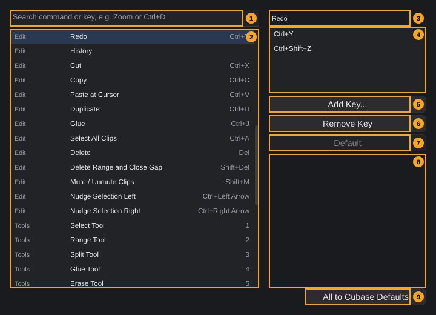
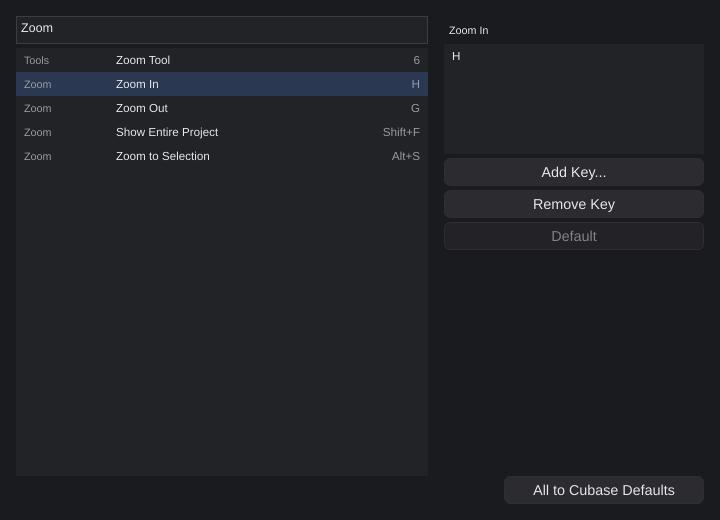
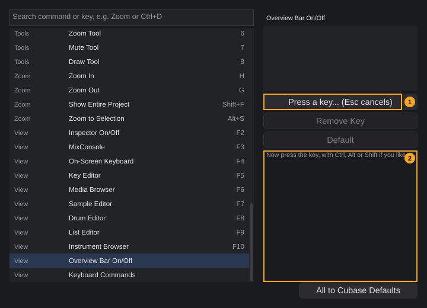
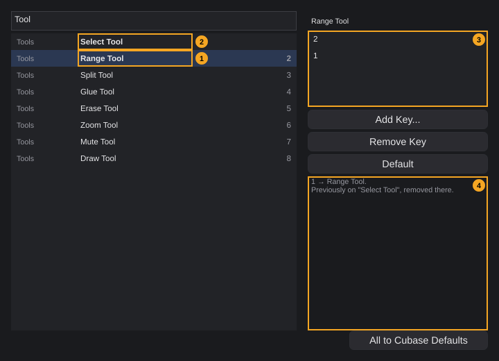

# Keyboard shortcuts

Almost everything in the project window can be done with a key as well as with the mouse. This chapter shows how to change the keys in the shortcut editor, lists every command with its default key, and collects the fixed keys and mouse modifiers that work inside individual areas.

**In this chapter**

1. [Opening the shortcut editor](#1-opening-the-shortcut-editor)
2. [The shortcut editor at a glance](#2-the-shortcut-editor-at-a-glance)
3. [Finding a command](#3-finding-a-command)
4. [Assigning a key](#4-assigning-a-key)
5. [When the key is already taken](#5-when-the-key-is-already-taken)
6. [Several keys for one command](#6-several-keys-for-one-command)
7. [Removing a key](#7-removing-a-key)
8. [Back to the default keys](#8-back-to-the-default-keys)
9. [Where your keys are stored](#9-where-your-keys-are-stored)
10. [Where shortcuts work](#10-where-shortcuts-work)
11. [All commands and their default keys](#11-all-commands-and-their-default-keys)
12. [Fixed keys inside individual areas](#12-fixed-keys-inside-individual-areas)
13. [Mouse modifiers](#13-mouse-modifiers)
14. [Quick reference](#14-quick-reference)

---

## 1. Opening the shortcut editor

Choose **Edit › Keyboard shortcuts...**. The entry is available even when no project is open.

<!-- FIX F-203: command names in the shortcut editor may be aligned with the menus -->
The window that opens is titled **Keyboard Commands**. In the list of commands it appears as **Keyboard Commands** in the category **View**, without a default key. If you give it a key ([§4](#4-assigning-a-key)), that key opens the window too.

The window is a dialog: while it is open you cannot work in the project window, and the project window's keys do not work. You can resize it with the mouse.

**To close it:** click the close button in the title bar, or press **Esc**. **Esc** does not close the window while it waits for a key (there it cancels, see [§4](#4-assigning-a-key)) or while the text cursor is in the search field (the field uses **Esc** itself); click the command list first.

There is no **OK** or **Cancel**: every change takes effect and is saved the moment you make it ([§9](#9-where-your-keys-are-stored)). Changes to keys are not editing steps; **Edit › Undo** does not undo them.

---

## 2. The shortcut editor at a glance

The left side lists the commands, the right side shows the keys of the selected command. When the window opens, the first command (**Play / Stop**) is selected.

| # | Element | What it does | Details |
|---|---|---|---|
| 1 | **Search field** | Filters the list by command name, category or key. Empty, it shows *Search command or key, e.g. Zoom or Ctrl+D* | [§3](#3-finding-a-command) |
| 2 | **Command list** | All commands. Each row shows the category (left, grey), the command name and its **first** key (right). A **bold** name means the command no longer has its default keys. Tooltip: *Double-click: record a new key for this command* | [§11](#11-all-commands-and-their-default-keys) |
| 3 | **Command name** | Name of the selected command. *No command selected* if the search hides the selection | |
| 4 | **Key list** | **All** keys of the selected command, one per row; click a key to select it | [§6](#6-several-keys-for-one-command) |
| 5 | **Add Key...** | Waits for the next key you press and adds it to the command. Tooltip: *Then press the key you want (with Ctrl, Alt, Shift); Esc cancels* | [§4](#4-assigning-a-key) |
| 6 | **Remove Key** | Removes the selected key from the command. Tooltip: *Remove the selected key from this command*. Greyed out when the command has no key | [§7](#7-removing-a-key) |
| 7 | **Default** | Gives the selected command its default keys again. Tooltip: *Reset this command to its Cubase key*. Greyed out when the command already has its default keys | [§8](#8-back-to-the-default-keys) |
| 8 | **Message area** | Says what the last action did, for example which command lost a key. Empty when the window opens | [§5](#5-when-the-key-is-already-taken) |
| 9 | **All to Cubase Defaults** | Discards all your changes. Tooltip: *Discard all custom changes and load the Cubase layout* | [§8](#8-back-to-the-default-keys) |

In the picture, **Redo** is selected: the list shows its first key **Ctrl+Y**, the key list both default keys **Ctrl+Y** and **Ctrl+Shift+Z**. **Default** is greyed out because Redo still has its default keys.

**Keys in the lists.** Keys are written the way they are printed on the keyboard, with the modifiers in the order **Ctrl+**, **Alt+**, **Shift+**: for example **Ctrl+Shift+S**, **Num 1** (number pad), **Del**, **Backspace**, **Space**, **Insert**, **Home**, **Left Arrow**, **F5**.

**Moving through the lists with the keyboard.** When the command list has the keyboard focus (click it once), **Up Arrow** / **Down Arrow** select the previous / next command, **Page Up** / **Page Down** move by one page, **Home** / **End** select the first / last command. The key list on the right works the same way.

---

## 3. Finding a command

Type into the search field (1). The list immediately shows only the commands where the text appears in

- the **command name** (for example *Marker* finds **Add Marker**, **Previous Marker**, **Next Marker**),
- the **category** (*Zoom* also finds **Show Entire Project**, which belongs to the category **Zoom**), or
- **any** key of the command, written as in the lists (*Ctrl+D* finds **Duplicate**; *Num* finds every command on the number pad; *F5* finds **Key Editor**).

Upper and lower case do not matter. Spaces at the start and end of the search are ignored. Delete the text to see all commands again.

The picture shows the search *Zoom*: the four commands of the category **Zoom** and the **Zoom Tool** of the category **Tools**.

- If the selected command is still in the filtered list, it stays selected. If the search hides it, nothing is selected: the name (3) reads *No command selected*, and **Add Key...** and **Default** are greyed out.
- The list always keeps the order of [§11](#11-all-commands-and-their-default-keys); it cannot be sorted.

---

## 4. Assigning a key

1. Select the command in the list.
2. Click **Add Key...** (1 in the picture), or double-click the command in the list.
3. The button now reads *Press a key... (Esc cancels)*, and the message area (2) says *Now press the key, with Ctrl, Alt or Shift if you like.*
4. Press the key, together with **Ctrl**, **Alt** and/or **Shift** if you want.

The key is added to the command's keys; keys the command already had stay ([§6](#6-several-keys-for-one-command)). The message area confirms it, for example *Ctrl+O → Overview Bar On/Off.* The button reads **Add Key...** again.

- **Esc** cancels: nothing changes, the message reads *Cancelled.* For this reason **Esc** cannot be assigned to a command.
- Pressing a modifier (**Ctrl**, **Alt**, **Shift**) alone does nothing yet; the window waits for the key you press together with it.
- Every other key can be assigned, including **Space**, **Enter**, **Tab**, letters and digits without a modifier, function keys and the keys of the number pad. The number pad keys are separate keys: **Num 1** and **1** are two different keys.
- If the command already has this key, nothing changes; the message reads, for example, *Ctrl+O already belongs to this command.*
- If you select another command in the list before you press a key, waiting stops without a change.
- Clicking **Add Key...** again while it waits starts waiting again.

The picture shows **Overview Bar On/Off**, which has no default key: the key list is empty and **Remove Key** is greyed out.

**Where the new key appears right away:** in the menus (the key is written at the right of the menu entry) and in the tooltips of the toolbar buttons (for example *Copy (Ctrl+C)*). Menus and tooltips always show the **first** key of a command.

<!-- FIX F-201: the transport bar, the zoom button, the lower zone button and the Range submenu may show your own keys -->
> **Note:** Some places name a fixed key in their text and do not follow your changes: the tooltips of the transport bar, the tooltip of the zoom button, the lower zone button, the tooltip of the Range tool, the **Range (range tool, key 2)** submenu, the right-click menus of clips and ranges, and the **+** of the marker track. They always name the default keys.

<!-- FIX F-2005: the File menu entry for export may show the key of "Export Project" -->
> **Note:** If you give **Export Project** a key, the menu entry **File › Export (mixdown, stems, MIDI)...** does not show it; the key works nevertheless and also appears in the tooltip of the export button.

---

## 5. When the key is already taken

A key belongs to **one** command at a time. If you assign a key that another command already has, the key moves: it is removed from the other command and added to the selected one. Nothing asks first.

**Example:** you want the **Range** tool on the key **1**.

1. Type *Tool* into the search field. The list shows the eight tools.
2. Select **Range Tool** and click **Add Key...**.
3. Press **1**.

The picture shows the result:

| # | What you see |
|---|---|
| 1 | **Range Tool** is shown in bold (no longer its default keys); its first key is still **2** |
| 2 | **Select Tool** has no key any more and is shown in bold too |
| 3 | The key list of **Range Tool** shows **2** and **1** |
| 4 | The message area reads *1 → Range Tool.* and below it *Previously on "Select Tool", removed there.* |

The message area is the only place that tells you about the move. Check the other command afterwards: if it had only this one key, it now has none, and you can give it a new key in the same way.

---

## 6. Several keys for one command

A command can have any number of keys; each of them triggers it. Several commands have two keys by default:

| Command | Default keys |
|---|---|
| **Record** | **Num \***, **\*** |
| **Loop On/Off** | **Num /**, **/** |
| **Redo** | **Ctrl+Y**, **Ctrl+Shift+Z** |
| **Delete** | **Del**, **Backspace** |
| **Delete Range and Close Gap** | **Shift+Del**, **Shift+Backspace** |

**To add a key**, use **Add Key...** ([§4](#4-assigning-a-key)); the existing keys stay. **To replace a key**, add the new one and remove the old one ([§7](#7-removing-a-key)).

The key list (4 in [§2](#2-the-shortcut-editor-at-a-glance)) shows all keys in the order they were added. The command list, the menus and the tooltips show only the first of them.

**Punctuation keys.** Keys such as **\*** and **/** lie on different places depending on the keyboard layout; on many layouts they need **Shift**. A command whose key is a punctuation character without modifiers is also triggered when you type that character with **Shift** (for example **\*** on a German keyboard, where it is **Shift** plus the **+** key). This applies only to punctuation, not to letters and digits.

---

## 7. Removing a key

1. Select the command.
2. In the key list, click the key you want to remove.
3. Click **Remove Key**.

The message area confirms it, for example *Ctrl+Y is now free.* A removed key belongs to no command afterwards; you can assign it elsewhere.

<!-- FIX F-2003: Remove Key may be greyed out until a key is selected in the key list -->
> **Caution:** If no key is selected in the key list, **Remove Key** removes the **first** key of the command. Check the message area to see which key was removed.

A command without keys stays in the list and keeps working from its button or menu entry. Its name is shown in bold if it has a default key.

---

## 8. Back to the default keys

The default keys follow the key layout of Cubase, as far as the command exists there. The window calls them **Cubase** keys in its buttons and messages.

**One command:** select it and click **Default**. The command gets its default keys again, and the message reads, for example, *Range Tool: default restored.* **Default** is greyed out while the command still has its default keys.

<!-- FIX F-2001: Default may take the key away from the other command, or warn, like Add Key... -->
> **Caution:** **Default** does not check whether one of the default keys now belongs to another command. Example: you gave **1** to the **Range Tool** ([§5](#5-when-the-key-is-already-taken)), then you select **Select Tool** and click **Default**. Now both commands list the key **1**, but pressing **1** triggers only one of them, without notice (the one that comes first in the list of [§11](#11-all-commands-and-their-default-keys), here **Select Tool**). Remove the key from the other command afterwards ([§7](#7-removing-a-key)), or use **All to Cubase Defaults**.

**All commands:** click **All to Cubase Defaults**. All your changes are discarded at once, without asking. The message reads *All commands are back to the Cubase layout.*

<!-- FIX F-2004: key layouts may be saved, loaded, exported and imported -->
**Presets.** There is exactly one layout to return to: the default (Cubase) layout. You cannot save your own layouts under a name, switch between layouts, or export, import or print the key list. To move your keys to another computer, see [§9](#9-where-your-keys-are-stored).

---

## 9. Where your keys are stored

Your keys are part of the program settings: they apply to **all projects** and are not stored in the project file. Every change is written to disk immediately; there is nothing to save.

Only your **changes** are stored, per command: which keys the command has instead of its default keys (possibly none). Commands you never changed always have their current default keys.

<!-- FIX F-101: all settings may move into one folder -->
The changes are stored in the file `Settings.xml` in the folder of the audio engine settings, in the entry whose name ends in `fkShortcuts`:

| Linux | Windows |
|---|---|
| `~/.config/FK Audio Suite/Settings.xml` | `%APPDATA%\FK Audio Suite\Settings.xml` |

The same file holds the audio and MIDI settings, the list of known plugins and the recently opened projects (see [Getting started §7](getting-started.md#7-where-fk-audio-suite-keeps-its-files)). So do not delete the file to reset the keys; use **All to Cubase Defaults** instead.

---

## 10. Where shortcuts work

The keys in [§11](#11-all-commands-and-their-default-keys) work while the project window is the active window. A key first goes to the part of the window that has the **keyboard focus** (usually the last thing you clicked). Only if that part does not use the key does it reach the commands. In practice:

- **Text fields** (a name, the tempo, a value you type in) use all keys for typing, including **Space**, **Del**, **Backspace**, the arrow keys and **Ctrl+Z**/**Ctrl+C**/**Ctrl+V**/**Ctrl+A** for the text. Press **Enter** to apply or **Esc** to cancel; after that the keys work as commands again.
- In the **Key Editor**, after you click into the note grid, the grid uses **Del**, **Backspace**, **Ctrl+A** and the arrow keys itself (also **Ctrl+Left Arrow** / **Ctrl+Right Arrow**, which then move notes, not clips). All other keys reach the commands ([§12.1](#121-key-editor-note-grid)).
- **Lists** (List Editor, media browser, instrument browser, the lists of this window) use the arrow keys, **Page Up**, **Page Down**, **Home** and **End** to move the selection ([§12](#12-fixed-keys-inside-individual-areas)).
- **Drop-down lists** (for example **Grid** in the toolbar) keep the focus after you chose an entry: the arrow keys without modifiers then select the previous or next entry, and **Enter** opens the list.
- **Buttons** keep the focus after you click them: **Enter** clicks the button again. Other keys reach the commands.

<!-- FIX F-2002: tool keys may switch the Key Editor's own tools while the Key Editor has the focus -->
> **Note:** The keys **1** to **8** always switch the tools of the **arrangement**, also while you work in the Key Editor. The Key Editor's own three tools (**Select**, **Pencil**, **Eraser**) have no keys; click their buttons.

<!-- FIX F-901: Delete/Backspace may act on the Drum Editor or do nothing there -->
<!-- FIX F-1002: Delete/Backspace without a selected row may do nothing in the List Editor -->
<!-- FIX F-1102: the Sample Editor may handle Delete, Ctrl+A and Esc itself -->
> **Caution:** The **Drum Editor** and the **Sample Editor** do not take the keyboard focus, and the **List Editor** uses **Del**/**Backspace** only when a row is selected. In these cases **Del** and **Backspace** reach the command **Delete** and delete the **clips selected in the arrangement** (or the selected range); **Ctrl+A** selects all clips. After a double-click to open a clip, that clip is usually selected. Use **Ctrl+Z** if this happened. Details: [Drum Editor §6](drum-editor.md#6-deleting-hits), [List Editor §6](list-editor.md#6-deleting-notes), [Sample Editor §8](sample-editor.md#8-what-the-sample-editor-does-not-do).

<!-- FIX F-1602: Space in the media browser may audition the selected file -->
> **Note:** In the media browser, **Space** starts and stops the project (command **Play / Stop**), not the preview, although the tooltip of the preview button mentions it ([Media browser §5](media-browser.md#5-auditioning-audio-files)).

- While the **Keyboard Commands** window is open, the project window's keys do not work.

---

## 11. All commands and their default keys

The commands are listed exactly as in the shortcut editor: in its order, grouped by its categories **Transport**, **File**, **Edit**, **Tools**, **Zoom** and **View**. *Command* is the name in the shortcut editor, *Menu entry* the name of the same function in the menus (where it has one). "—" means no default key or no menu entry.

<!-- FIX F-203: command names in the shortcut editor may be aligned with the menus -->
Several command names differ from the menu entries for the same function, for example **Left Locator to Cursor** and **Transport › Set left locator to playhead**. The tables give both names.

### 11.1 Transport

<!-- FIX F-209: Loop, Metronome and Retrospective Record may get entries in the Transport menu -->
<!-- FIX F-405: a "Go to End" command may be added -->
| Command | Default key(s) | Menu entry | What it does | Details |
|---|---|---|---|---|
| **Play / Stop** | **Space** | **Transport › Play / Stop** | Starts playback at the playhead, or stops it | [Transport §3](transport.md#3-playing-and-stopping) |
| **Record** | **Num \***, **\*** | **Transport › Record** | Starts recording on the armed tracks | [Transport §7](transport.md#7-recording-from-the-transport) |
| **Retrospective Record** | **Shift+Num \*** | — | Turns the MIDI of the last 30 seconds on armed tracks into clips | [Transport §10](transport.md#10-retrospective-record) |
| **Loop On/Off** | **Num /**, **/** | — | Switches loop on or off | [Transport §6.3](transport.md#63-loop-on-and-off) |
| **Rewind (One Bar)** | **Num -** | **Transport › Rewind (one bar)** | Moves the playhead to the previous bar line | [Transport §4](transport.md#4-moving-the-playhead) |
| **Forward (One Bar)** | **Num +** | **Transport › Forward (one bar)** | Moves the playhead to the next bar line | [Transport §4](transport.md#4-moving-the-playhead) |
| **Go to Start** | **Home** | **Transport › Go to start** | Moves the playhead to the project start | [Transport §4](transport.md#4-moving-the-playhead) |
| **Go to Left Locator** | **Num 1** | **Transport › Go to left locator** | Moves the playhead to the left locator | [Transport §6.1](transport.md#61-the-locator-displays) |
| **Go to Right Locator** | **Num 2** | **Transport › Go to right locator** | Moves the playhead to the right locator | [Transport §6.1](transport.md#61-the-locator-displays) |
| **Left Locator to Cursor** | **Ctrl+Num 1** | **Transport › Set left locator to playhead** | Sets the left locator to the playhead | [Transport §6.2](transport.md#62-setting-the-locators) |
| **Right Locator to Cursor** | **Ctrl+Num 2** | **Transport › Set right locator to playhead** | Sets the right locator to the playhead | [Transport §6.2](transport.md#62-setting-the-locators) |
| **Punch In/Out** | **I** | **Transport › Punch In/Out** | Switches punch in/out on or off | [Transport §8](transport.md#8-punch-inout-pre-roll-and-post-roll) |
| **Add Marker** | **Insert** | **Transport › Add marker** | Adds a marker at the playhead | [Transport §11](transport.md#11-markers) |
| **Previous Marker** | **Shift+B** | **Transport › Previous marker** | Moves the playhead to the previous marker | [Transport §11](transport.md#11-markers) |
| **Next Marker** | **Shift+N** | **Transport › Next marker** | Moves the playhead to the next marker | [Transport §11](transport.md#11-markers) |
| **Metronome On/Off** | **C** | — | Switches the metronome on or off | [Transport §9](transport.md#9-metronome-and-count-in) |

### 11.2 File

| Command | Default key(s) | Menu entry | What it does | Details |
|---|---|---|---|---|
| **Save** | **Ctrl+S** | **File › Save** | Saves the project | [Projects §6](projects.md#6-saving) |
| **Save As** | **Ctrl+Shift+S** | **File › Save as...** | Saves a copy of the project under a new name | [Projects §7](projects.md#7-save-as-copying-a-project) |
| **Project Settings** | **Shift+S** | **File › Project settings...** | Opens the project settings | [Projects §13](projects.md#13-project-settings) |
| **Export Project** | — | **File › Export (mixdown, stems, MIDI)...** | Opens the export dialog | [Exporting §1](exporting.md#1-opening-the-export-dialog) |

<!-- FIX F-209: New, Open, Quit and Import may get commands -->
**File › New empty project...**, **Open project...**, **Quit** and **Import audio or MIDI file...** are not commands and cannot get a key.

### 11.3 Edit

| Command | Default key(s) | Menu entry | What it does | Details |
|---|---|---|---|---|
| **Undo** | **Ctrl+Z** | **Edit › Undo** | Undoes the last editing step | [Projects §16](projects.md#16-undo-and-error-messages) |
| **Redo** | **Ctrl+Y**, **Ctrl+Shift+Z** | **Edit › Redo** | Redoes the last undone step | [Projects §16](projects.md#16-undo-and-error-messages) |
| **History** | — | **Edit › History...** | Opens the list of all editing steps | [The project window §3.2](project-window.md#32-edit) |
| **Cut** | **Ctrl+X** | **Edit › Cut** | Cuts the selected clips | [Arranging §7](arranging.md#7-cut-copy-paste-and-duplicate) |
| **Copy** | **Ctrl+C** | **Edit › Copy** | Copies the selected clips | [Arranging §7](arranging.md#7-cut-copy-paste-and-duplicate) |
| **Paste at Cursor** | **Ctrl+V** | **Edit › Paste at playhead** | Pastes the clips at the playhead on the selected track | [Arranging §7](arranging.md#7-cut-copy-paste-and-duplicate) |
| **Duplicate** | **Ctrl+D** | **Edit › Duplicate** | Places a copy of the selected clips right after them | [Arranging §7](arranging.md#7-cut-copy-paste-and-duplicate) |
| **Glue** | **Ctrl+J** | **Edit › Glue** | Joins the selected clips of a track into one | [Arranging §9.2](arranging.md#92-gluing-clips) |
| **Select All Clips** | **Ctrl+A** | **Edit › Select all clips** | Selects every clip on the visible tracks | [Arranging §5](arranging.md#5-selecting-clips) |
| **Delete** | **Del**, **Backspace** | **Edit › Delete clips**; **Edit › Range (range tool, key 2) › Delete (leave gap)** | With a range drawn by the Range tool: deletes the material in the range. Otherwise: deletes the selected clips | [Arranging §11.1](arranging.md#111-deleting), [§10.2](arranging.md#102-range-functions) |
| **Delete Range and Close Gap** | **Shift+Del**, **Shift+Backspace** | **Edit › Range (range tool, key 2) › Remove (close gap)** | With a range: deletes the material and moves everything after it to the left. **Without a range it deletes the selected clips, like Delete** | [Arranging §10.2](arranging.md#102-range-functions) |
| **Mute / Unmute Clips** | **Shift+M** | **Edit › Mute / unmute** | Mutes the selected clips, or makes them audible again | [Arranging §11.2](arranging.md#112-muting) |
| **Nudge Selection Left** | **Ctrl+Left Arrow** | **Edit › One grid step left** | Moves the selected clips one grid step to the left | [Arranging §6.3](arranging.md#63-nudging) |
| **Nudge Selection Right** | **Ctrl+Right Arrow** | **Edit › One grid step right** | Moves the selected clips one grid step to the right | [Arranging §6.3](arranging.md#63-nudging) |

**Keyboard Commands** (this window) is listed under **View**, although its menu entry is **Edit › Keyboard shortcuts...** ([§11.6](#116-view)).

<!-- FIX F-504: track commands may be added -->
There are no commands for tracks (add, delete, duplicate, mute, solo, record enable of the selected track); see [Tracks §1](tracks.md#1-where-to-find-the-track-functions).

### 11.4 Tools

The tools of the arrangement. The buttons are in the toolbar; there are no menu entries.

<!-- FIX F-204: the toolbar order may follow the keys -->
| Command | Default key | Tool | Details |
|---|---|---|---|
| **Select Tool** | **1** | Select, move and trim clips | [Arranging §2.1](arranging.md#21-the-tools-in-detail) |
| **Range Tool** | **2** | Draw a time range | [Arranging §10](arranging.md#10-range-editing) |
| **Split Tool** | **3** | Split clips with a click | [Arranging §9.1](arranging.md#91-splitting-a-clip) |
| **Glue Tool** | **4** | Join a clip with the next one | [Arranging §9.2](arranging.md#92-gluing-clips) |
| **Erase Tool** | **5** | Delete clips with a click (the button is called **Eraser**) | [Arranging §2.1](arranging.md#21-the-tools-in-detail) |
| **Zoom Tool** | **6** | Zoom in with a click, out with **Alt**+click | [Arranging §4.1](arranging.md#41-horizontal-zoom) |
| **Mute Tool** | **7** | Mute clips with a click | [Arranging §11.2](arranging.md#112-muting) |
| **Draw Tool** | **8** | Draw MIDI clips (the button is called **Pencil**) | [Arranging §18](arranging.md#18-creating-midi-clips) |

The keys are the digits of the main keyboard, not of the number pad.

### 11.5 Zoom

| Command | Default key | Menu entry | What it does | Details |
|---|---|---|---|---|
| **Zoom In** | **H** | **View › Zoom in** | Zooms in by a factor of 1.6 around the playhead | [Arranging §4.1](arranging.md#41-horizontal-zoom) |
| **Zoom Out** | **G** | **View › Zoom out** | Zooms out by a factor of 1.6 | [Arranging §4.1](arranging.md#41-horizontal-zoom) |
| **Show Entire Project** | **Shift+F** | **View › Show whole project** | Fits all clips into the width | [Arranging §4.1](arranging.md#41-horizontal-zoom) |
| **Zoom to Selection** | **Alt+S** | **View › Zoom to selection** | Shows the range or the selected clips. Without a selection the message *Nothing selected: select clips or a range first.* appears | [Arranging §4.1](arranging.md#41-horizontal-zoom) |

The same four functions are in the zoom menu of the toolbar (**Whole project**, **To selection**, **Zoom in**, **Zoom out**).

### 11.6 View

The keys **F3** to **F10** show the lower zone with the chosen tab; if the lower zone is hidden, they open it first.

<!-- FIX F-209: the lower zone may get a command to switch it off -->
| Command | Default key | Menu entry | What it does | Details |
|---|---|---|---|---|
| **Inspector On/Off** | **F2** | **View › Inspector** | Shows or hides the Inspector | [The project window §6](project-window.md#6-inspector) |
| **MixConsole** | **F3** | **View › MixConsole** | Lower zone with the MixConsole | [MixConsole](mixconsole.md) |
| **On-Screen Keyboard** | **F4** | **View › On-screen keyboard** | Lower zone with the on-screen keyboard | [Recording §5](recording.md#5-the-on-screen-keyboard) |
| **Key Editor** | **F5** | **View › Key Editor** | Lower zone with the Key Editor | [Key Editor](key-editor.md) |
| **Media Browser** | **F6** | **View › Media browser** | Lower zone with the media browser | [Media browser](media-browser.md) |
| **Sample Editor** | **F7** | **View › Sample Editor** | Lower zone with the Sample Editor | [Sample Editor](sample-editor.md) |
| **Drum Editor** | **F8** | **View › Drum Editor** | Lower zone with the Drum Editor | [Drum Editor](drum-editor.md) |
| **List Editor** | **F9** | **View › List Editor** | Lower zone with the List Editor | [List Editor](list-editor.md) |
| **Instrument Browser** | **F10** | **View › Instrument browser** | Lower zone with the instrument browser | [Instruments and effects §6](instruments-and-effects.md#6-the-instrument-browser) |
| **Overview Bar On/Off** | — | **View › Overview bar** | Shows or hides the overview bar above the tracks | [The project window §7](project-window.md#7-arrangement-area) |
| **Keyboard Commands** | — | **Edit › Keyboard shortcuts...** | Opens this window | [§1](#1-opening-the-shortcut-editor) |

The keys **F3** to **F10** only open: pressing **F3** while the MixConsole is already shown does nothing. To close the lower zone, use **View › Lower zone** or its button ([The project window §9](project-window.md#9-showing-hiding-and-resizing-zones)).

**Not assigned by default** (without modifiers): **F1**, **F11**, **F12**, **End**, **Page Up**, **Page Down**, all letters except **C**, **G**, **H** and **I**, the digits **9** and **0**, and **Num 0**, **Num 3** to **Num 9** and **Num .**. You can give them to any command.

---

## 12. Fixed keys inside individual areas

These keys belong to a particular area and cannot be changed in the shortcut editor. They work only while that area has the keyboard focus ([§10](#10-where-shortcuts-work)).

### 12.1 Key Editor (note grid)

Click into the note grid first. The keys work on the selected notes.

| Key | What it does |
|---|---|
| **Del** / **Backspace** | Delete the selected notes |
| **Ctrl+A** | Select all notes of the clip |
| **Up Arrow** / **Down Arrow** | Transpose by one semitone |
| **Shift+Up Arrow** / **Shift+Down Arrow** | Transpose by one octave |
| **Left Arrow** / **Right Arrow** | Move by one grid step (never before the clip start) |

The arrow keys work the same with **Ctrl** or **Alt** held (only **Shift** changes them). So **Ctrl+Left Arrow** and **Ctrl+Right Arrow** move notes here and do not reach **Nudge Selection Left/Right**. Without an open clip the grid passes all keys on. Details: [Key Editor §9](key-editor.md#9-keyboard-commands-in-the-note-grid).

### 12.2 List Editor and other lists

In the List Editor table, the media browser and the instrument browser:

| Key | What it does |
|---|---|
| **Up Arrow** / **Down Arrow** | Select the previous / next row |
| **Page Up** / **Page Down** | Move the selection by one page |
| **Home** / **End** | Select the first / last row |
| **Shift**+ one of these keys | Extend the selection (lists that allow several selected rows, such as the List Editor) |
| **Ctrl+A** | Select all rows (lists that allow several selected rows) |
| **Del** / **Backspace** | List Editor: delete the selected notes, only when a row is selected |

In the List Editor, editing a cell: **Enter** applies the value, **Esc** cancels ([List Editor §10](list-editor.md#10-keyboard-commands)).

The media browser's file tree also uses **Left Arrow** and **Right Arrow** (close / open the selected folder, or move to the parent / into the folder) and **Enter** (open or close the selected folder); see [Media browser §4](media-browser.md#4-selecting-files).

### 12.3 Text fields, drop-down lists and buttons

| Where | Key | What it does |
|---|---|---|
| Any text field | All keys | Typing and text editing; **Ctrl+Z**, **Ctrl+C**, **Ctrl+X**, **Ctrl+V**, **Ctrl+A** work on the text, not on the project |
| Name or value you type in | **Enter** / **Esc** | Apply / cancel |
| Drop-down list with the focus | **Up Arrow**, **Left Arrow** / **Down Arrow**, **Right Arrow** | Previous / next entry |
| Drop-down list with the focus | **Enter** | Open the list |
| Button with the focus | **Enter** | Click the button |

### 12.4 Keyboard Commands window

| Key | What it does |
|---|---|
| **Esc** | While waiting for a key: cancel. In the search field: used by the field. Otherwise: close the window |
| Any other key while waiting | Becomes the new key of the selected command ([§4](#4-assigning-a-key)) |
| Arrow keys, **Page Up**, **Page Down**, **Home**, **End** | Move through the command list or key list ([§2](#2-the-shortcut-editor-at-a-glance)) |

---

## 13. Mouse modifiers

Keys you hold while clicking, dragging or turning the mouse wheel. None of them can be changed.

| Area | Modifier and mouse | What it does | Details |
|---|---|---|---|
| Arrangement | **Ctrl**+mouse wheel | Zoom horizontally around the mouse pointer (20 % per step) | [Arranging §4.1](arranging.md#41-horizontal-zoom) |
| Arrangement | **Shift**+mouse wheel | Scroll left and right | [Arranging §4.3](arranging.md#43-scrolling) |
| Arrangement, Select tool | **Shift**+click a clip | Add the clip to the selection | [Arranging §5](arranging.md#5-selecting-clips) |
| Arrangement, Select tool | **Ctrl**+click a clip | Add the clip, or remove it if it was selected | [Arranging §5](arranging.md#5-selecting-clips) |
| Arrangement, Select tool | **Ctrl** or **Shift** + click or drag on empty space | Keep the selection; a rectangle adds the touched clips | [Arranging §5](arranging.md#5-selecting-clips) |
| Arrangement, Select tool | **Alt**+drag the right edge of an audio clip | Change the length with time stretch | [Arranging §15.1](arranging.md#151-stretching-with-the-mouse) |
| Arrangement, Range tool | **Shift** while dragging | Range ends do not snap to the grid | [Arranging §10.1](arranging.md#101-drawing-a-range) |
| Arrangement, Zoom tool | **Alt**+click | Zoom out | [Arranging §4.1](arranging.md#41-horizontal-zoom) |
| Marker track | **Shift** while dragging a marker | Move it without snapping | [Transport §11](transport.md#11-markers) |
| Key Editor | **Ctrl**+mouse wheel | Zoom horizontally (20 % per step) | [Key Editor §18](key-editor.md#18-zooming-and-scrolling) |
| Key Editor | **Shift**+click a note | Add the note to the selection | [Key Editor §6](key-editor.md#6-selecting-notes) |
| Key Editor | **Ctrl**+click a note | Add the note, or remove it if it was selected | [Key Editor §6](key-editor.md#6-selecting-notes) |
| Key Editor, Select tool | **Ctrl** or **Shift** while dragging a rectangle | Add the touched notes to the selection | [Key Editor §6](key-editor.md#6-selecting-notes) |
| Key Editor | **Alt**+drag a note | Copy the note (or the selection) | [Key Editor §7](key-editor.md#7-moving-copying-and-trimming-notes) |
| Key Editor | **Ctrl+Shift**+drag a note up or down | Change the velocity | [Key Editor §11](key-editor.md#11-velocity) |
| Key Editor, Pencil | **Alt**+click on empty space | Insert the chord chosen in the chord section | [Key Editor §5](key-editor.md#5-entering-notes) |
| Drum Editor | **Ctrl**+mouse wheel | Zoom horizontally (20 % per step) | [Drum Editor §12](drum-editor.md#12-zooming-and-scrolling) |
| Sample Editor | **Ctrl**+mouse wheel | Zoom around the mouse pointer | [Sample Editor §3](sample-editor.md#3-zooming-and-scrolling) |
| List Editor, media browser | **Shift**+click / **Ctrl**+click a row | Select a run of rows / add or remove a row | [List Editor §4](list-editor.md#4-selecting-rows), [Media browser §4](media-browser.md#4-selecting-files) |
| Faders, knobs and sliders (MixConsole, Inspector) | **Ctrl**+drag or **Alt**+drag | Fine adjustment | [MixConsole §9](mixconsole.md#9-volume-fader) |

<!-- FIX F-706: Alt+drag may copy clips in the arrangement too -->
> **Note:** **Alt**+drag copies notes in the Key Editor, but in the arrangement dragging always moves clips; **Alt** only matters at the right edge of an audio clip (time stretch).

---

## 14. Quick reference

| What | How |
|---|---|
| Open the shortcut editor | **Edit › Keyboard shortcuts...** |
| Find a command | Type its name, category or key into the search field |
| Add a key | Select the command, **Add Key...** (or double-click), press the key |
| Cancel waiting for a key | **Esc** |
| Remove a key | Select it in the key list, **Remove Key** |
| One command back to default | **Default** |
| Everything back to default | **All to Cubase Defaults** |
| Close the window | **Esc** or the close button |
| Play / Stop, Record | **Space**, **Num \*** |
| Undo / Redo | **Ctrl+Z** / **Ctrl+Y** |
| Save | **Ctrl+S** |
| Tools | **1** Select, **2** Range, **3** Split, **4** Glue, **5** Eraser, **6** Zoom, **7** Mute, **8** Pencil |
| Lower zone tabs | **F3** MixConsole … **F10** Instrument browser |
| Zoom | **H** / **G**, **Shift+F**, **Alt+S**, **Ctrl**+mouse wheel |
