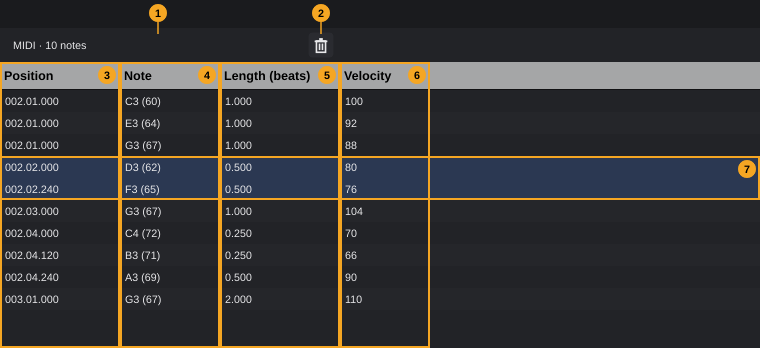
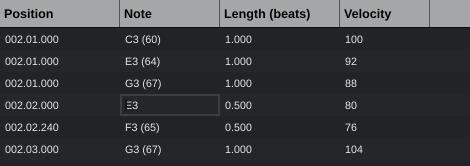

# List Editor

The List Editor shows the notes of a MIDI clip as a table, one row per note, and lets you type exact values for position, pitch, length and velocity. Use it when the mouse is not precise enough, for example to put a note on an exact tick or to give it a velocity of exactly 64.

**In this chapter**

1. [Opening the List Editor](#1-opening-the-list-editor)
2. [The editor at a glance](#2-the-editor-at-a-glance)
3. [Reading the list](#3-reading-the-list)
4. [Selecting rows](#4-selecting-rows)
5. [Editing values](#5-editing-values)
6. [Deleting notes](#6-deleting-notes)
7. [Adding notes and other events](#7-adding-notes-and-other-events)
8. [Columns: width, order, visibility, sorting](#8-columns-width-order-visibility-sorting)
9. [Working with the Key Editor and Drum Editor](#9-working-with-the-key-editor-and-drum-editor)
10. [Keyboard commands](#10-keyboard-commands)
11. [Undo and error messages](#11-undo-and-error-messages)
12. [Quick reference](#12-quick-reference)

---

## 1. Opening the List Editor

The List Editor lives in the **lower zone** of the project window, the area below the arrangement ([The project window, §8](project-window.md#8-lower-zone)).

**To load a MIDI clip into the List Editor:**

1. In the arrangement, double-click the MIDI clip.
2. The clip opens in the [Key Editor](key-editor.md) (or in the Drum Editor if its track uses a drum map) and is loaded into the List Editor at the same time.
3. Switch to the List Editor with one of the ways below.

**Track › Insert empty MIDI clip at playhead** also loads the new clip into the List Editor ([Arranging, §18](arranging.md#18-creating-midi-clips)).

**To show the List Editor,** use any of these:

- Press **F9**.
- Choose **View › List Editor**.
<!-- FIX F-202: the tab may be renamed "List Editor" to match the View menu -->
- Click the **List** tab in the lower zone.

If the lower zone is hidden, **F9** and the menu open it.

Showing the List Editor does not load a clip by itself: it shows the clip you opened last. As long as no clip is loaded, the editor shows this hint instead of the table:

*List Editor: double-clicking a MIDI clip opens it here as well. One row per note, edit values by double-clicking.*

The editor shows one clip at a time. If the clip is deleted, the editor shows the hint again. It also follows every change made elsewhere, for example in the Key Editor, by recording or by undo, and updates the table immediately.

---

## 2. The editor at a glance

| # | Element | What it does | Details |
|---|---|---|---|
| 1 | **Heading** | Clip name and number of notes, for example *MIDI · 10 notes* | — |
| 2 | **Delete** (trash can) | Deletes the selected notes | [§6](#6-deleting-notes) |
| 3 | **Position** column | Where the note starts, in bars, beats and ticks of the project | [§3](#3-reading-the-list), [§5](#5-editing-values) |
| 4 | **Note** column | Pitch as note name and MIDI note number | [§3](#3-reading-the-list), [§5](#5-editing-values) |
| 5 | **Length (beats)** column | Note length in beats (quarter notes) | [§3](#3-reading-the-list), [§5](#5-editing-values) |
| 6 | **Velocity** column | How hard the note is played, 1–127 | [§3](#3-reading-the-list), [§5](#5-editing-values) |
| 7 | Selected rows | Selected notes are highlighted | [§4](#4-selecting-rows) |

Rows alternate between two shades of background so you can follow a row across the table. The tooltip of the table reminds you of the input formats: *Double-click a cell to edit it. Position as bar.beat.tick, note as C3 or 60, length in beats (0.25 = sixteenth).*

<!-- FIX F-201: the tooltip of the Delete button may follow your own key assignment -->
The tooltip of the **Delete** button (2) is *Delete selected notes (Del)*.

---

## 3. Reading the list

<!-- FIX F-1005: the list may also show controllers, pitch bend, aftertouch and articulations -->
The List Editor shows **notes only**. Controller data (sustain pedal, mod wheel, pitch bend, aftertouch) and articulations are not listed; edit them in the controller and articulation lanes of the [Key Editor](key-editor.md#16-controller-lanes).

**Order of the rows.** Rows are sorted by start position, earliest first. Notes that start at the same time (a chord) are sorted by pitch, lowest first. When you change a note's position, its row moves to its new place at once.

### Position (3)

The start of the note on the project timeline, written as **bar.beat.tick** with leading zeros, for example **002.01.000** for the first beat of bar 2. This is the position in the **project**, not inside the clip: a note at the very start of a clip that begins in bar 2 shows **002.01.000**.

- A beat has **480 ticks**, so **002.01.240** is half a beat after the first beat of bar 2.
- The conversion uses the tempo and time signature of the project (see the chapter *Signature track*).

### Note (4)

<!-- FIX F-001: octave naming may change to C4 or become a setting -->
The pitch as a note name followed by the MIDI note number in brackets, for example **C3 (60)**. Middle C (MIDI note 60) is **C3** here. Black keys are always written with a sharp: **F#2 (54)**, never Gb2.

> **Note:** The Key Editor and the on-screen keyboard call MIDI note 60 **C4**. The same note is **C3** in the List Editor and the Drum Editor.

### Length (beats) (5)

The length of the note in beats, where one beat is a quarter note, always with three decimals:

| Shown | Note value |
|---|---|
| **4.000** | whole note |
| **2.000** | half note |
| **1.000** | quarter note |
| **0.500** | eighth note |
| **0.250** | sixteenth note |
| **0.125** | thirty-second note |
| **0.333** | eighth-note triplet |
| **1.500** | dotted quarter note |

### Velocity (6)

How hard the note is played, from **1** (softest) to **127** (hardest).

---

## 4. Selecting rows

Selected rows are needed for deleting ([§6](#6-deleting-notes)). Editing a value does not need a selection.

<!-- FIX F-1001: clicking a value may select its row as well -->
> **Important:** A click on a value in the table does **not** select the row. Click in the row **to the right of the last column** (**Velocity**), where the row has no values, or use the keyboard.

| Action | Result |
|---|---|
| Click a row to the right of the columns | Selects only this row |
| **Shift**+click | Selects all rows from the last selected row to this one |
| **Ctrl**+click | Adds the row to the selection, or removes it if it was selected |
| **Up** / **Down** | Selects the previous / next row. If nothing is selected, the first row is selected |
| **Shift+Up** / **Shift+Down** | Extends the selection by one row |
| **Page Up** / **Page Down** | Moves the selection by one screen page |
| **Home** / **End** | Selects the first / last row |
| **Ctrl+A** | Selects all rows |

The keys work once the table has the keyboard focus: click anywhere into the table first (a click on a value is enough for that).

<!-- FIX F-1003: the selection may stay with the selected notes instead of the row numbers -->
> **Note:** The selection belongs to the **row numbers**, not to the notes. If the order of the rows changes, because you edited a position or because notes were added or removed in another editor, the highlighted rows can show different notes than the ones you selected. Opening another clip keeps the selected row numbers too. Check the selection before you delete.

---

## 5. Editing values

Every cell of the four columns can be edited.

1. **Double-click** the cell. A text field opens with the current value, fully selected.
2. Type the new value (see the formats below).
3. Press **Enter**, or click somewhere else. Both apply the value.

Press **Esc** instead to cancel; the cell keeps its old value.

The new value applies to this one note, even if several rows are selected. If you leave the text unchanged, nothing happens.

<!-- FIX F-1006: invalid input may show a message instead of being discarded silently -->
**Invalid input** is discarded without a message: the cell simply shows the old value again. The rules per column:

### Position

| You type | Meaning |
|---|---|
| **3.2.240** | Bar 3, beat 2, tick 240 |
| **3.2** | Bar 3, beat 2, tick 0 |
| **3** | Bar 3, beat 1 |
| **003.02.240** | Same as 3.2.240 (leading zeros are allowed) |
| **3:2:240** | Same as 3.2.240 (colon instead of point) |

- Bar and beat start at **1**, ticks run from **0** to **479**. Only digits and the separators are allowed; anything else, bar 0, beat 0 or a tick of 480 or more is refused.
- A beat number larger than the number of beats in the bar is not refused.
- The position is measured on the project timeline, like the display ([§3](#3-reading-the-list)).
- A position **before the start of the clip** puts the note at the clip start.
- A position **after the end of the clip** is accepted; the note then lies after the end of the clip.
- The note keeps its length, pitch and velocity. Its row moves to the new place in the list.

### Note

You can type a note name or a MIDI note number:

| You type | Result |
|---|---|
| **60** | MIDI note 60 (C3) |
| **C3** | 60 |
| **F#2** | 54 |
| **Bb2** | 58 |
| **c3** | 60 (lower-case letters work) |
| **C-2** | 0, the lowest note |
| **G8** | 127, the highest note |
| **C3 (60)** | 60: anything after the first space is ignored, so the displayed text itself is valid input |

- Note letters are **C D E F G A B**. A sharp is written **#**, a flat is a lower-case **b** after the letter. Only one sharp or flat is allowed.
- The octave follows directly after the letter (and the sharp or flat), without a space. Middle C is octave 3.
- Numbers must be between **0** and **127**, names between **C-2** and **G8**. Everything outside is refused.

### Length (beats)

- Type the length in beats: **1** is a quarter note, **0.5** an eighth, **0.25** a sixteenth ([§3](#3-reading-the-list)).
- A comma works as decimal separator as well: **0,75** is the same as **0.75**.
- **0**, negative values and text without a leading number are refused.
- The shortest possible length is a 1/128 triplet (about **0.021** beats); shorter values are raised to it.
- The note keeps its start; only its end moves.

<!-- FIX F-1006: fractions and trailing characters may be refused or understood -->
> **Note:** Only the number at the beginning of the text counts. **1/8** is read as **1** (a quarter note), **2x** as **2**. Type decimal numbers, not fractions.

### Velocity

- Type a whole number. Only digits are allowed, so **-5**, **+10** or **64.5** are refused.
- **0** becomes **1**; values above **127** become **127**.

---

## 6. Deleting notes

1. Select the rows of the notes ([§4](#4-selecting-rows)).
2. Click **Delete** (2), or press **Delete** or **Backspace** while the table has the keyboard focus.

All selected notes are deleted in one step and the selection is cleared. Without a selection, the **Delete** button does nothing.

<!-- FIX F-1002: Delete/Backspace without a selected row may do nothing in the List Editor -->
> **Caution:** If **no row** is selected, **Delete** and **Backspace** are not handled by the List Editor but by the project window: they delete the **clips selected in the arrangement** (or the selected range). After a double-click to open a clip, that clip is usually still selected in the arrangement. Make sure a row is selected before you press **Delete**; if something went wrong, use **Edit › Undo** (**Ctrl+Z**).

---

## 7. Adding notes and other events

<!-- FIX F-1005: the List Editor may get a way to insert notes and events -->
The List Editor cannot insert new notes or other events. Add notes in the [Key Editor](key-editor.md#5-entering-notes) (or the Drum Editor); they appear in the list at once. Then type exact values in the List Editor.

---

## 8. Columns: width, order, visibility, sorting

The column headings behave like those of most tables:

- **Width:** drag the border between two headings.
- **Order:** drag a heading to the left or right to move the column.
- **Hide or show a column:** right-click a heading. The menu lists the four columns with a check mark for each visible one; choose a column to hide or show it.

The menu also offers **Auto-size this column** and **Auto-size all columns**.

<!-- FIX F-1004: header clicks may sort the list; auto-size may fit the columns to their content -->
> **Note:** Clicking a heading shows a small sort arrow, but the order of the rows does **not** change: the list is always sorted by position ([§3](#3-reading-the-list)). **Auto-size this column** and **Auto-size all columns** have no effect.

Column widths, order and hidden columns are not saved with the project or the settings.

---

## 9. Working with the Key Editor and Drum Editor

- The List Editor always shows the clip that was opened **last** by a double-click in the arrangement (or by **Track › Insert empty MIDI clip at playhead**), no matter whether it opened in the Key Editor or the Drum Editor.
- Every change in one editor appears in the others immediately: a value typed in the List Editor moves the note in the Key Editor, and a note drawn in the Key Editor appears as a new row.
<!-- FIX F-1005: selections may be shared between the editors -->
- The **selection is separate**: selecting rows in the List Editor does not select the notes in the Key Editor, and the other way round.
- The note names differ: the Key Editor calls MIDI note 60 **C4**, the List Editor **C3** ([§3](#3-reading-the-list)).

---

## 10. Keyboard commands

These work after you have clicked into the table (it then has the keyboard focus).

| Key | Action |
|---|---|
| **Up** / **Down** | Select the previous / next row |
| **Shift+Up** / **Shift+Down** | Extend the selection |
| **Page Up** / **Page Down** | Move the selection by one page |
| **Home** / **End** | Select the first / last row |
| **Ctrl+A** | Select all rows |
| **Delete** / **Backspace** | Delete the selected notes (see the caution in [§6](#6-deleting-notes)) |

While a cell is being edited:

| Key | Action |
|---|---|
| **Enter** | Apply the value |
| **Esc** | Cancel, keep the old value |

> **Note:** Unlike in the Key Editor's note grid, **Up** and **Down** do not transpose here; they move the selection. **Enter** on a selected row does not open a cell for editing; double-click the cell.

The global shortcuts of the project window (for example **Ctrl+Z** for Undo or **F5** for the Key Editor) work as usual while the table has the focus and no cell is being edited. **Ctrl+A** is an exception: in the table it selects all rows, not all clips.

---

## 11. Undo and error messages

<!-- FIX F-1007: the undo step may be named after the change (e.g. "Change velocity") -->
Every value you change is one undo step named **List Editor**. Deleting is one step named **Delete note** or **Delete notes**. Use **Edit › Undo** (**Ctrl+Z**) and **Edit › Redo** (**Ctrl+Y** or **Ctrl+Shift+Z**). While you type in a cell, **Ctrl+Z** undoes your typing in the text field instead.

If a change is not possible, a window titled **Error** explains why and the cell keeps its old value. For example:

- The track is baked: *"{track}" is baked. To edit it, unbake it first (track header or inspector).* If it is baked into a group: *"{track}" is baked into the group "{group}". To edit it, unbake it there.* (see [Arranging, §21](arranging.md#21-baked-tracks) and the chapter *Track bake*).
- The clip or the note no longer exists: *MIDI clip not found.* or *Note not found.*

---

## 12. Quick reference

| What | How |
|---|---|
| Open the List Editor | **F9**, **View › List Editor**, or the **List** tab |
| Load a clip | Double-click a MIDI clip in the arrangement |
| Edit a value | Double-click the cell, type, **Enter** (**Esc** cancels) |
| Position | **bar.beat.tick**, ticks 0–479, for example **3.2.240** |
| Note | Name (**C3**, **F#2**, **Bb2**; middle C = C3) or number **0**–**127** |
| Length | Beats: **1** = quarter, **0.5** = eighth, **0.25** = sixteenth |
| Velocity | **1**–**127** |
| Select a row | Click right of the last column; **Shift**/**Ctrl**+click; **Up**/**Down** |
| Select all | **Ctrl+A** |
| Delete | Select rows, then **Delete** button, **Delete** or **Backspace** |
| Insert notes | Not possible here; use the Key Editor |
| Hide or show columns | Right-click a column heading |
| Undo | **Ctrl+Z** |
