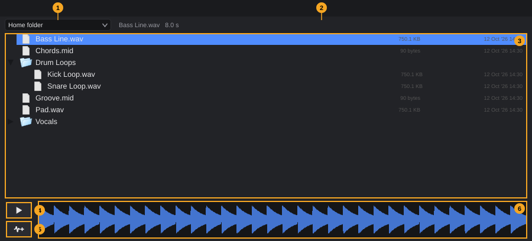
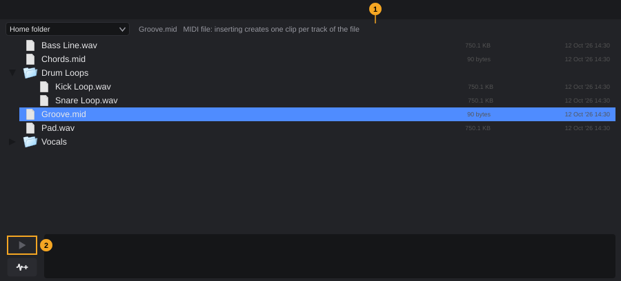
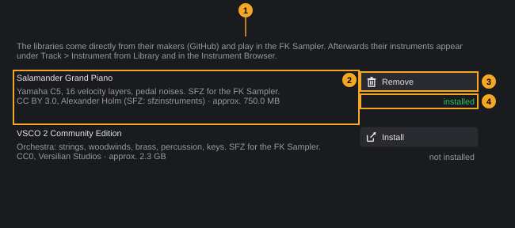

# Media browser and content

The media browser finds audio and MIDI files on your computer, lets you listen to audio files before you use them, and brings files into the project with a click, a double-click or by dragging. The Content Manager downloads free instrument libraries, which you then play with the built-in FK Sampler.

**In this chapter**

1. [Opening the media browser](#1-opening-the-media-browser)
2. [The media browser at a glance](#2-the-media-browser-at-a-glance)
3. [Browsing folders](#3-browsing-folders)
4. [Selecting files](#4-selecting-files)
5. [Auditioning audio files](#5-auditioning-audio-files)
6. [MIDI files](#6-midi-files)
7. [Inserting files at the playhead](#7-inserting-files-at-the-playhead)
8. [Dragging files](#8-dragging-files)
9. [The Content Manager](#9-the-content-manager)
10. [Playing library instruments](#10-playing-library-instruments)
11. [Undo and error messages](#11-undo-and-error-messages)
12. [Quick reference](#12-quick-reference)

---

## 1. Opening the media browser

The media browser is the **Media** tab of the **lower zone**, the area below the arrangement ([The project window §8](project-window.md#8-lower-zone)).

Use any of these:

- Press **F6**.
- Choose **View › Media browser**. The entry has a tick while the tab is shown.
- Click the lower-zone button in the toolbar and select the **Media** tab.

If the lower zone is hidden, **F6** and the menu entry open it. Pressing **F6** again while the tab is shown changes nothing; to hide the lower zone, use the lower-zone button ([The project window §9](project-window.md#9-showing-hiding-and-resizing-zones)).

<!-- FIX F-202: tab name and menu entry may be unified -->
> **Note:** The tab is called **Media**, the menu entry **Media browser** and the command in **Edit › Keyboard shortcuts…** **Media Browser**. All three mean the same thing.

The browser keeps its folder, selection and opened folders while you switch tabs.

---

## 2. The media browser at a glance

| # | Element | What it does | Details |
|---|---|---|---|
| 1 | **Start folder** | Chooses the folder the file list starts from: **Home folder**, **Music** or **Desktop** | [§3](#3-browsing-folders) |
| 2 | **Info line** | Without a selection a short hint; with a selection the file name and length (audio) or a note on MIDI files | [§4](#4-selecting-files) |
| 3 | **File list** | Folders and the audio and MIDI files in them, as a tree | [§3](#3-browsing-folders), [§4](#4-selecting-files) |
| 4 | **Audition** (play symbol) | Plays the selected audio file, or stops the playback | [§5](#5-auditioning-audio-files) |
| 5 | **Insert** | Inserts the selected files at the playhead on the selected track | [§7](#7-inserting-files-at-the-playhead) |
| 6 | **Waveform** | Waveform of the selected audio file; a line shows the playback position while you audition | [§5](#5-auditioning-audio-files) |

Hover over an element to see its tooltip, for example *Start folder of the file tree* over the start folder or *Insert at the cursor on the selected track (double-click)* over the insert button.

Before you select anything, the info line reads: *Choose a file (audio or MIDI): waveform and audition appear here. Dragging drops the file into the arrangement.*

---

## 3. Browsing folders

<!-- FIX F-1606: own folders, favourites, a remembered folder and a search field may be added -->
**To choose where the list starts,** open the **start folder** list (1) and choose one of:

| Entry | Folder |
|---|---|
| **Home folder** (default) | Your user folder, for example `/home/<your name>` on Linux or `C:\Users\<your name>` on Windows |
| **Music** | The music folder of your system |
| **Desktop** | The desktop folder of your system |

If the chosen folder does not exist, the list shows your home folder instead. Each time FK Audio Suite starts, the list begins with **Home folder** again. There are no other locations, no favourites and no search field: to reach a folder somewhere else, open it from one of these three.

**To open or close a folder** in the file list:

- Click the small arrow in front of it, or
- double-click the folder, or
- select it and press **Return** (opens or closes), **Right** (opens, or moves into it) or **Left** (closes, or moves up to the parent folder).

The contents of a folder are read in the background the first time you open it; with many files this can take a moment.

**What the list shows:**

- All folders, except hidden ones.
- Files with the endings **.wav**, **.aif**, **.aiff**, **.flac**, **.ogg**, **.mp3** (audio) and **.mid**, **.midi** (MIDI). All other files are not shown; in the picture above, a text file *Notes.txt* in the same folder is missing for that reason.
- When the list is wide enough, the size and the date of the last change of each file appear on the right.

---

## 4. Selecting files

| Action | Result |
|---|---|
| Click a file | Selects it, the info line and the waveform show it |
| **Ctrl**+click | Adds a file to the selection, or removes it |
| **Shift**+click | Selects all rows from the last selected one to the clicked one |
| **Up** / **Down** | Selects the previous / next row |
| **Home** / **End** | Selects the first / last row |
| **Page Up** / **Page Down** | Moves the selection by one page |

The keys work when the file list has the keyboard focus: click into the list first.

With a selection, the info line (2) shows:

| Selection | Info line, for example |
|---|---|
| One audio file | *Bass Line.wav   8.0 s* (name and length in seconds) |
| One MIDI file | *Groove.mid   MIDI file: inserting creates one clip per track of the file* |
| Several files | The first selected file as above, followed by *(+2 more)* |

Selected folders do not count: the media browser only works with the selected **files**. Inserting or dragging a selection that holds folders brings in the files only, not the contents of the folders.

<!-- FIX F-1604: the info line and the buttons may follow a selection of folders only -->
> **Note:** If you select only a folder, the waveform disappears but the info line keeps the name of the file selected before. The **Audition** and **Insert** buttons stay clickable and do nothing.

---

## 5. Auditioning audio files

You can listen to an audio file without adding it to the project.

1. Select an audio file in the file list.
2. Click **Audition** (4), the button with the play symbol. Its tooltip reads *Audition the selected file (Space in the browser)*.
3. The file plays from the start. The button lights up green and a line in the waveform (6) shows the position.
4. Click **Audition** again to stop. At the end of the file the playback stops by itself.

Good to know:

- Audition plays the file directly on your audio output, at the file's own speed and pitch. It does not follow the project tempo, does not loop and does not go through the MixConsole: track faders, inserts and the master fader do not affect it. There is no volume control for auditioning.
- Audition works while the project plays; you hear both together.
- Only one file plays at a time. Playback always starts from the beginning of the file.
- **MIDI files** cannot be auditioned: the button is greyed out while a MIDI file is selected ([§6](#6-midi-files)).

<!-- FIX F-1602: Space may start and stop the audition while the media browser has the focus -->
> **Note:** Despite the tooltip, **Space** does not audition the file. It is the shortcut for **Play / Stop** of the project, also while the media browser has the focus.

<!-- FIX F-1603: selecting another file may switch the audition to it; unreadable files may show a message -->
> **Note:** Selecting another file does not stop a running audition. While a file plays, the button always **stops**: to hear the next file, click **Audition** twice (stop, then play). The position line only appears while the waveform shows the file that is playing. If a file cannot be read (for example a damaged file), nothing happens and no message appears.

---

## 6. MIDI files

When you select a MIDI file (**.mid**, **.midi**):

1. The info line names the file and reminds you that *inserting creates one clip per track of the file*.
2. **Audition** is greyed out: a MIDI file needs an instrument to make a sound. Insert it on an instrument track and play the project instead.

No waveform is shown for MIDI files.

Inserting or dragging a MIDI file works like importing it with **File › Import audio or MIDI file...**: each track of the file that holds notes becomes one clip on an instrument or MIDI track. If the file brings its own tempo or time signature, you are asked whether to adopt it ([Arranging §19.5](arranging.md#195-midi-files-with-their-own-tempo)).

---

## 7. Inserting files at the playhead

**To insert files without dragging:**

1. In the arrangement, click the track that should receive the files (optional).
2. Place the playhead where the files should start.
3. In the media browser, select one or more files.
4. Click **Insert** (5). Its tooltip reads *Insert at the cursor on the selected track (double-click)*.

**Or** double-click a single file in the list: it is inserted the same way. A double-click inserts only the file you double-click, not the rest of the selection. A double-click on a folder opens or closes it.

Where the files land is the same as for **File › Import audio or MIDI file...** ([Arranging §19](arranging.md#19-importing-audio-and-midi-files)):

- The first file starts **at the playhead** (with **Snap** on, at the grid line nearest to it).
- It goes on the **selected track** if the track fits the file: audio files on audio tracks, MIDI files on instrument and MIDI tracks. Otherwise, or without a selected track, a new track is created at the bottom (*New audio track* or *New instrument track*).
- Every further file goes on the next fitting track below, or on a new track.
- Audio files from outside the project folder are copied into its **Audio/** folder first ([Projects §15](projects.md#15-importing-audio-and-midi-files)).

The **Insert** button does nothing while no file is selected.

---

## 8. Dragging files

You can drag the selected files out of the media browser.

**Into the arrangement:**

1. Select one or more files in the list.
2. Drag them onto the event display. While you drag, the arrangement highlights the track that will receive the first file and shows a green line at the start time ([Arranging §19.1](arranging.md#191-drag-and-drop)).
3. Release the mouse button. The files land as described in [§7](#7-inserting-files-at-the-playhead), but at the time and on the track under the mouse instead of at the playhead.

To drag several files, select them first (**Ctrl**+click or **Shift**+click), then drag one of the selected files: all selected files go along.

<!-- FIX F-1601: the drop preview may treat MIDI files from the media browser like MIDI files from the file manager -->
> **Note:** When you drag from the media browser, the highlight in the arrangement always looks for an **audio** track, also for MIDI files. A MIDI file dragged over an instrument track shows the label **New audio track** at the bottom instead of highlighting the instrument track. Release anyway: the file still lands correctly on the instrument track under the mouse (or on a new instrument track). Dragging from your file manager shows the correct highlight.

**Into the Drum Editor:**

Drag **one** audio file onto a row of the Drum Editor to give that drum instrument its own sample. This works on tracks with FK Sampler and needs a clip open in the Drum Editor; with several files selected, the Drum Editor does not accept the drop. See [Drum Editor §11](drum-editor.md#11-your-own-drum-kit-with-fk-sampler).

Other parts of the window, such as the MixConsole, the Key Editor, the Sample Editor or the Inspector, do not accept files from the media browser. To build a sampler instrument from one audio file, use **Track › Sampler track from audio file...** ([Tracks §3.2](tracks.md#32-instrument-tracks)).

---

## 9. The Content Manager

The Content Manager downloads free sample libraries and installs them for the built-in **FK Sampler**. After installing, their instruments appear in the **Track** menu and in the **Instruments** tab ([§10](#10-playing-library-instruments)).

### 9.1 Opening the Content Manager

Use either:

- **Studio › Content Manager (free libraries)...**
- The **Libraries** button in the **Instruments** tab of the lower zone (**F10**). Its tooltip reads *Content Manager: download free libraries*.

The window **Content Manager** opens. It has a fixed size and stays open while you keep working in the project.

### 9.2 The Content Manager at a glance

| # | Element | What it shows or does |
|---|---|---|
| 1 | **Hint** | Where the libraries come from and where their instruments appear afterwards |
| 2 | **Package** | Name (bold), description, licence and approximate download size |
| 3 | **Install** / **Remove** | Downloads and installs the package, or deletes it from disk |
| 4 | **Status** | **installed** (green), **not installed** or **downloading ...** |

<!-- FIX F-1605: the hint may name the menu entries exactly as in the menus -->
The hint reads: *The libraries come directly from their makers (GitHub) and play in the FK Sampler. Afterwards their instruments appear under Track > Instrument from Library and in the Instrument Browser.*

The Content Manager offers these packages:

| Package | Description | Licence and size |
|---|---|---|
| **Salamander Grand Piano** | *Yamaha C5, 16 velocity layers, pedal noises. SFZ for the FK Sampler.* | *CC BY 3.0, Alexander Holm (SFZ: sfzinstruments) · approx. 750.0 MB* |
| **VSCO 2 Community Edition** | *Orchestra: strings, woodwinds, brass, percussion, keys. SFZ for the FK Sampler.* | *CC0, Versilian Studios · approx. 2.3 GB* |

### 9.3 Installing a package

You need an internet connection.

1. Open the Content Manager ([§9.1](#91-opening-the-content-manager)).
2. Click **Install** next to the package. Its tooltip reads *Download and install*.
3. The status changes to **downloading ...**, and a progress bar with a cancel button appears at the bottom. The buttons of the other packages are unavailable until the download is finished.
4. The progress bar fills up to about 90 % while the archive downloads, the rest while it is unpacked.
5. When it is done, the status reads **installed** and the button changes to **Remove**. The instruments are available right away, in the **Track** menu and in the **Instruments** tab.

Good to know:

- Only one package can download at a time.
- **Disk space:** the archive and the unpacked files are on disk at the same time for a moment, so FK Audio Suite needs about **twice the package size** free: about 1.5 GB for the Salamander Grand Piano, about 4.7 GB for VSCO 2. If there is less, the installation does not start and a message says how much is needed and free.
- The archive is deleted after unpacking.

<!-- FIX F-1605: the cancel button may be labelled in the language of the program -->
**To cancel a download,** click the cancel button next to the progress bar. It is labelled **Abbrechen** (German, also in the English program); its tooltip reads *Cancel the download, partial files are deleted*. The package stays **not installed** and the partly downloaded files are deleted. No message appears.

Closing the Content Manager window during a download also cancels it and deletes the partial files.

### 9.4 Removing a package

<!-- FIX F-1607: removing may ask for confirmation first -->
1. Open the Content Manager.
2. Click **Remove** next to the installed package. Its tooltip reads *Delete the package from disk*.

The package folder is deleted **immediately, without asking**. The status changes to **not installed**, and the instruments of the package disappear from the **Track** menu and the **Instruments** tab.

> **Note:** A track that plays an instrument of the package remembers the location of the instrument file. After removing the package, FK Sampler cannot load the instrument the next time the project is opened. Install the package again to use it.

Removing cannot be undone. To get the package back, install it again (a new download).

### 9.5 Where content is stored

<!-- FIX F-101: the program data folder may change -->
<!-- FIX F-102: folder and file names may become English -->
Installed packages are stored in the folder **Content** inside the program data folder (`~/.config/FKAudioSuite/` on Linux, `%APPDATA%\FKAudioSuite\` on Windows, see [Getting started §7](getting-started.md#7-where-fk-audio-suite-keeps-its-files)). Each package has its own subfolder:

| Package | Folder |
|---|---|
| Salamander Grand Piano | `Content/salamander-grand-piano` |
| VSCO 2 Community Edition | `Content/vsco2-ce` |

A package counts as installed when its folder contains the file `fk-package.json`, which FK Audio Suite writes at the end of a successful installation. A folder without this file (for example after an interrupted installation) counts as **not installed**; **Install** downloads the package again.

The location cannot be changed in the program. The packages are not part of your projects: a project that uses a library instrument needs the same package installed on every computer where you open it.

### 9.6 Licences

The libraries are made by others and published under free licences, which the Content Manager shows under each package:

- **Salamander Grand Piano**: *CC BY 3.0*, by Alexander Holm (SFZ version: sfzinstruments). CC BY requires that you credit the author when you publish music or material made with it.
- **VSCO 2 Community Edition**: *CC0*, by Versilian Studios. CC0 places the library in the public domain; no credit is required.

The files are downloaded directly from their makers on GitHub, not from FK Audio Suite.

---

## 10. Playing library instruments

Each installed package contains instruments in the SFZ format. FK Audio Suite lists every SFZ file in the package as one instrument, named after the file.

**From the Track menu:**

1. Choose **Track › Instrument from library**.
2. Choose the package, then the instrument. Entries read *category / name*, where the category is the folder inside the package.
3. A new instrument track is created. It plays the instrument with FK Sampler and gets the instrument's name.

Without an installed package, the submenu holds only the greyed-out entry *No library installed yet (Studio > Content Manager)*. See also [Tracks §3.2](tracks.md#32-instrument-tracks).

**From the Instruments tab:**

The **Instruments** tab of the lower zone (**F10**), the instrument browser, lists in one place:

| Kind | What it is |
|---|---|
| **Instrument** | Instrument plugins: the FK instruments and the VST3/LV2 instruments found by the plugin manager |
| **Library** | The instruments of the installed packages |
| **Preset** | Your own presets of instrument plugins |

Each entry gets tags automatically (for library instruments: **Library**, the package name and the folders inside the package, such as the section of the orchestra). You can search by name, maker and tag, filter by tag, mark favourites and add your own tags; a double-click creates a new track with the entry. The instrument browser is described in detail in the chapter [Instruments and effects](instruments-and-effects.md).

<!-- FIX F-102: the file name may become English -->
Your favourites and your own tags of library instruments and presets are stored in the file `Bibliothek.json` in the program data folder. Favourites of plugins are shared with the plugin manager.

---

## 11. Undo and error messages

- **Inserting and dragging** files are undo steps like every import: *Import audio file* or *Import MIDI file* ([Arranging §22](arranging.md#22-undo-and-error-messages)). Undo with **Ctrl+Z**, redo with **Ctrl+Y** (or **Ctrl+Shift+Z**).
- **Auditioning** and browsing do not change the project and are not undo steps.
- **Installing and removing packages** changes files on your disk, not the project: they cannot be undone.
- **Creating a track from a library instrument** is undone like adding an instrument track ([Tracks §15](tracks.md#15-undo-and-messages)).

Messages of the Content Manager appear in a window titled **Content Manager**:

| Message | Cause |
|---|---|
| *Not enough disk space: … needed, … free.* | Less free space than twice the package size |
| *Download not possible (…): …* | No internet connection, or the server could not deliver the file (the number is the server's answer code) |
| *File is not writable: …* | The **Content** folder cannot be written |
| *Writing failed (disk full?).* | Writing the download failed, usually because the disk is full |
| *The archive is empty or not a ZIP file.* | The download is not a valid archive |
| *Extraction failed: …* | Unpacking the archive failed |
| *Could not delete the package folder.* | **Remove** could not delete the folder, for example because a file in it is in use |

After a failed installation, the partial files are deleted and the package stays **not installed**.

Messages when you create a track from a library instrument appear in a window titled **Error**:

| Message | Cause |
|---|---|
| *SFZ file not found: …* | The instrument file is gone, for example because the package was removed |
| *SFZ file contains no playable regions: …* | The instrument file has no samples FK Sampler can play |
| *FK Sampler is not registered.* | The built-in FK Sampler is not available |
| *Could not load FK Sampler.* | FK Sampler could not be created on the new track |

Messages when you insert or drop files (for example *The audio file is not readable: …*) are listed in [Arranging §22](arranging.md#22-undo-and-error-messages).

---

## 12. Quick reference

| What | How |
|---|---|
| Show the media browser | **F6**, or **View › Media browser** |
| Choose the start folder | Start folder list: **Home folder**, **Music**, **Desktop** |
| Open / close a folder | Click the arrow, double-click, or **Return** / **Right** / **Left** |
| Select several files | **Ctrl**+click, **Shift**+click |
| Audition an audio file | Select it, click **Audition** (play symbol); click again to stop |
| Insert at the playhead | Select files, click **Insert**; or double-click a file |
| Insert at a position | Drag the files onto the arrangement |
| Give a drum its own sample | Drag one audio file onto a row of the Drum Editor |
| Download a library | **Studio › Content Manager (free libraries)...** › **Install** |
| Remove a library | Content Manager › **Remove** (no confirmation) |
| New track with a library instrument | **Track › Instrument from library**, or double-click it in the **Instruments** tab (**F10**) |
