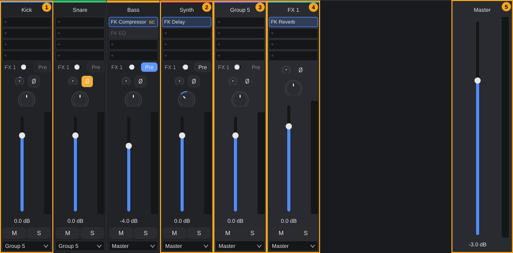
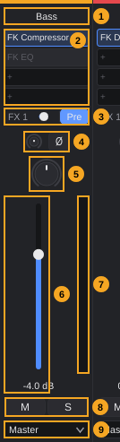
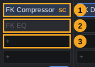

# MixConsole

The MixConsole is where you mix: every track has a channel strip with effect slots, sends, trim, phase, pan, a volume fader with level meter, mute, solo and its output, and the master channel sits on the right. This chapter explains every element of a channel strip, how inserts, sends and plugin windows work, how to route tracks into groups, FX tracks, direct outputs and sidechains, and what can be undone.

The Inspector shows the same settings for the selected track ([Tracks §5](tracks.md#5-the-track-in-the-inspector)). Both change the same values: what you set in one appears in the other at once. The differences are listed in [§16](#16-mixconsole-and-inspector-compared).

**In this chapter**

1. [Opening the MixConsole](#1-opening-the-mixconsole)
2. [The MixConsole at a glance](#2-the-mixconsole-at-a-glance)
3. [The channel strip](#3-the-channel-strip)
4. [Insert slots](#4-insert-slots)
5. [Plugin windows](#5-plugin-windows)
6. [Sends](#6-sends)
7. [Trim and phase](#7-trim-and-phase)
8. [Pan](#8-pan)
9. [Volume fader](#9-volume-fader)
10. [Level meters](#10-level-meters)
11. [Mute and solo](#11-mute-and-solo)
12. [Output routing](#12-output-routing)
13. [Sidechain](#13-sidechain)
14. [The master channel](#14-the-master-channel)
15. [Group and FX channels in practice](#15-group-and-fx-channels-in-practice)
16. [MixConsole and Inspector compared](#16-mixconsole-and-inspector-compared)
17. [Undo and messages](#17-undo-and-messages)
18. [Quick reference](#18-quick-reference)

---

## 1. Opening the MixConsole

The MixConsole is the first tab of the **lower zone**, the area below the arrangement ([The project window §8](project-window.md#8-lower-zone)).

**To show the MixConsole,** use any of these:

- Press **F3**.
- Choose **View › MixConsole**.
- Click the **MixConsole** tab in the lower zone.

If the lower zone is hidden, **F3** and **View › MixConsole** open it. **MixConsole** is also the tab that shows when the project window opens.

<!-- FIX F-209: F3 may toggle the lower zone (or a separate command may close it) -->
> **Note:** **F3** only shows the MixConsole; pressing it again does not close the lower zone. To hide the lower zone, use the lower-zone button in the toolbar or **View › Lower zone** ([The project window §9](project-window.md#9-showing-hiding-and-resizing-zones)).

**To make the MixConsole taller,** drag the splitter between the arrangement and the lower zone; double-click it for the default height of 360 pixels. The channel strips always fill the full height of the lower zone: a taller lower zone gives the faders more travel ([§9](#9-volume-fader)).

---

## 2. The MixConsole at a glance

The picture shows a small mix: *Kick* and *Snare* go to the group *Group 5*, *Bass* has two inserts and a send, *Synth* has an insert and a send, *FX 1* is an FX track with a reverb.

| # | Element | What it is | Details |
|---|---|---|---|
| 1 | Channel strip of an audio track (*Kick*) | One strip per track, in track order | [§3](#3-the-channel-strip) |
| 2 | Channel strip of an instrument track (*Synth*) | Same strip; the instrument itself is not shown in the strip | [§3](#3-the-channel-strip) |
| 3 | Channel strip of a group track (*Group 5*) | Lighter background than track strips | [§15](#15-group-and-fx-channels-in-practice) |
| 4 | Channel strip of an FX track (*FX 1*) | Lighter background; no send rows | [§15](#15-group-and-fx-channels-in-practice) |
| 5 | Master | Label **Master**, master fader and master meter, always at the right edge | [§14](#14-the-master-channel) |

**Which tracks get a strip.** Every track of the project gets a strip: audio, instrument, group and FX tracks, MIDI tracks for an external device, the MIDI tracks of a rack instrument and each switched-on output of a rack instrument ([Tracks §3.3](tracks.md#33-rack-instruments-several-midi-tracks-one-instrument)). Two exceptions:

- **Folder tracks** have no strip. A folder has no sound of its own ([Tracks §11](tracks.md#11-folder-tracks)); the tracks inside it do have strips, also while the folder is collapsed.
- **Hidden tracks** have no strip ([Tracks §8.2](tracks.md#82-hiding-and-showing-tracks)). They keep playing; show them again to mix them.

**Order.** The strips appear from left to right in the order of the tracks in the arrangement, from top to bottom (tracks in folders included). To change the order, move the tracks in the arrangement ([Tracks §9](tracks.md#9-changing-the-track-order)); the MixConsole follows at once. The strips themselves cannot be dragged.

**Colours.** A thin bar at the top of each strip has the track colour. Group and FX strips have a slightly lighter background than the other strips.

**Width and scrolling.** Every strip is 104 pixels wide; the master area is 120 pixels wide. If the strips do not fit, a horizontal scroll bar appears below them; the master always stays visible at the right. There is no vertical scroll bar: the strips are as tall as the lower zone.

**Updating.** The MixConsole always shows the current state. Adding, deleting, renaming, recolouring, hiding or reordering tracks, undo and redo, and automation during playback update the strips immediately.

---

## 3. The channel strip

The picture shows the strip of the audio track *Bass*: two inserts (a compressor with a sidechain and a bypassed EQ), one send to *FX 1* switched to pre-fader, the fader at −4 dB.

| # | Element | What it does | Details |
|---|---|---|---|
| — | Colour bar | Thin bar in the track colour at the very top | [§2](#2-the-mixconsole-at-a-glance) |
| 1 | Name | Name of the track. Long names are squeezed; the name cannot be edited here. | [Tracks §7](tracks.md#7-renaming-and-colouring-tracks) |
| 2 | Insert slots | Four effect slots, processed from top to bottom | [§4](#4-insert-slots) |
| 3 | Send rows | One row per FX track: name, send level, **Pre** | [§6](#6-sends) |
| 4 | Trim and phase | Small knob: trim before the inserts; **Ø**: invert phase | [§7](#7-trim-and-phase) |
| 5 | Pan | Knob from left to right | [§8](#8-pan) |
| 6 | Volume fader | Track volume in dB; the value is shown below the fader | [§9](#9-volume-fader) |
| 7 | Level meter | Left and right level after the fader | [§10](#10-level-meters) |
| 8 | **M**, **S** | Mute and solo | [§11](#11-mute-and-solo) |
| 9 | Output | Where the track goes: master, a group, another output pair or a MIDI output | [§12](#12-output-routing) |

<!-- FIX F-1401: the strip may show eight insert slots like the Inspector -->
<!-- FIX F-1407: the strip may scroll or shrink the send rows instead of the fader -->
**From top to bottom** the strip always shows the same order: name, four insert slots, the send rows (if the project has FX tracks), trim and phase, pan, then the fader with its meter, **M**/**S** and the output at the bottom. The fader gets the height that is left. Each send row takes height away from the fader: with several FX tracks and the default height of the lower zone, the fader becomes very short. Make the lower zone taller ([§1](#1-opening-the-mixconsole)) or use the Inspector, which scrolls.

<!-- FIX F-1403: the elements of the strip may get tooltips; pan may show its value -->
**Tooltips.** In the strip only the trim knob, the **Ø** button, the send level and the **Pre** button have tooltips. Name, insert slots, pan, fader, **M**, **S** and output have none.

**What the strip does not have.** The strip has no input field, no record button (**R**) and no instrument slot. Choose the input and arm the track in the track header or in the Inspector ([Tracks §12.1](tracks.md#121-choosing-an-input), [§13](tracks.md#13-mute-solo-and-record-enable)); open or replace the instrument in the Inspector ([Tracks §5.1](tracks.md#51-instrument-tracks)).

<!-- FIX F-1408: clicking a strip may select its track (arrangement and Inspector) -->
> **Note:** Clicking a channel strip does not select the track. The arrangement selection and the Inspector stay as they are. To show a track in the Inspector, click its header in the arrangement.

---

## 4. Insert slots

Inserts are effects that the whole signal of the track runs through, for example an EQ, a compressor or a delay. Each strip shows four insert slots. The signal runs through them from top to bottom: slot 1 first.

<!-- FIX F-1402: no text change; a click into the top-left corner of a slot must not crash -->
| # | State | How it looks | Click | Right-click |
|---|---|---|---|---|
| 1 | Active insert | Plugin name in bright text on a blue-tinted slot with a blue border. **SC** on the right: a sidechain source is set ([§13](#13-sidechain)). | Opens the plugin window ([§5](#5-plugin-windows)) | Context menu (below) |
| 2 | Bypassed insert | Name greyed out, grey slot without blue border | Opens the plugin window | Context menu (**Activate** instead of **Bypass**) |
| 3 | Empty slot | **+** | Opens the plugin menu to add an effect | nothing |
| — | Baked insert | Name greyed out, a lock on the right | Error message (see [Baked inserts](#baked-inserts)) | Context menu without **Presets** |

**Gain reduction.** On an active **FK Compressor** or **FK Limiter**, an orange bar at the bottom edge of the slot shows how much the plugin currently lowers the level. The bar grows from right to left; the full slot width is 20 dB. Other plugins show no bar.

### 4.1 Adding an effect

1. Click an empty slot (**+**).
2. In the menu, choose an effect.

The menu lists the effects that FK Audio Suite knows; instruments are not listed.

| Part of the menu | Content |
|---|---|
| **Favorites** | Your favourite effects, at the top (only if you have marked favourites) |
| Category submenus | **MIDI effects**, **Dynamics**, **EQ**, **Filter**, **Reverb and delay**, **Modulation**, **Distortion**, **Tools**, **Other**; empty categories are left out |
| **By vendor** | All effects, one submenu per manufacturer; plugins without a manufacturer under **No vendor** |

FK effects appear with their name only (**FK Compressor**); other plugins show their format after the name, for example *Name  (VST3)*. Plugins you hid in the Plugin Manager do not appear. If no effect is known at all, the menu only shows the greyed-out entry **No plugins found (Plugin Manager: Search and Scan)**. Favourites, categories, hiding and scanning: see the chapter [Instruments and effects](instruments-and-effects.md).

**Where the new effect goes.** A new effect always goes **behind the last insert** of the track, no matter which empty slot you click. The slots fill from the top without gaps. Special cases:

- **MIDI effects** (**FK Transpose**, **FK Chord**, **FK Arpeggiator** and other plugins of the MIDI category) go in front of the instrument, behind any MIDI effects already there. In the slots they therefore appear above the audio effects.
- On an **FX track**, effects go behind the return that collects the sends, so they process the sum of all sends ([§6](#6-sends)).
- On a **baked** track, new effects go behind the baked ones and stay live.

Adding an effect is an editing step (*Insert plugin*).

### 4.2 The context menu of an insert

Right-click a used slot:

| Entry | What it does |
|---|---|
| **Bypass** | Switches the effect off; the signal passes unchanged. Shown when the effect is active. |
| **Activate** | Switches a bypassed effect on again. Shown instead of **Bypass**. |
| **Remove** | Removes the effect from the track. Its plugin window closes. The slots below move up. |
| **Sidechain source** › **None**, *track names* | Only for plugins with a sidechain input. The current source has a tick. See [§13](#13-sidechain). |
| **Presets** › … | Save and load settings of the plugin (below). Not shown for baked inserts. |

**Presets submenu:**

| Entry | What it does |
|---|---|
| **Save current settings as preset...** | Asks for a name (window **Save preset**, text *Name of the preset for* *plugin name*:, buttons **Save** and **Cancel**) and saves the current settings. A preset with the same name is replaced. |
| **Own presets** | Heading, followed by your saved presets of this plugin; click one to load it. Your presets belong to the plugin, not to the track: every instance of the same plugin, in every project, offers them. |
| **Delete preset** › *name* | Deletes one of your presets at once, without asking. |
| **Factory presets of the plugin** › … | Programs the plugin brings itself (many VST3 plugins). Programs without a name are listed as **Program** *n*. |

Loading a preset (*Load preset*) or a program (*Load program*) is an editing step. Saving and deleting presets change files only and cannot be undone. Presets in depth: see the chapter [Instruments and effects](instruments-and-effects.md).

### 4.3 Changing the order or replacing an effect

<!-- FIX F-1409: inserts may be reordered by dragging and replaced via the context menu -->
Inserts cannot be dragged to another slot, and there is no **Replace** entry. To change the order, remove the effects below the new position and add them again in the desired order. To replace an effect, remove it and add the new one; it goes to the end of the chain.

### 4.4 More than four inserts

<!-- FIX F-1401: the strip may show eight insert slots like the Inspector -->
A track can have up to eight inserts: the Inspector shows eight slots. The channel strip shows only the **first four**. The fifth to eighth insert work normally but are not visible in the MixConsole, and nothing in the strip shows that they exist. Use the Inspector to see, open, bypass or remove them.

### Baked inserts

When a track is baked ([Tracks §14](tracks.md#14-baking-a-track-overview)), its baked inserts are locked: the slot shows a lock and greyed text. Clicking such a slot, or choosing **Bypass**, **Remove** or **Sidechain source**, shows an **Error** window instead:

<!-- FIX F-1406: the strip may show the same message as the Inspector -->
- *"*Track*" is baked. To edit it, unbake it first (track header or inspector).*
- If the track feeds a baked group: *"*Track*" is baked into the group "*Group*". To edit it, unbake it there.*

Inserts can be marked for baking only in the Inspector (the small box at the left of a slot); the slots in the MixConsole have no such box.

---

## 5. Plugin windows

Clicking a used insert slot opens the plugin's own window.

- The window title is the plugin name (for example **FK Compressor**). The window has the system's title bar with a close button only.
- It opens in the middle of the screen. You can resize it if the plugin allows it.
- If the plugin has no window of its own, FK Audio Suite shows a plain window with one control per parameter.
- Each insert has at most one window. Clicking the slot again brings the open window to the front instead of opening a second one.
- You can keep several plugin windows open at the same time. Close a window with its close button.

The windows of instruments are the same kind of window; they open from the Inspector or the track header ([Tracks §5.1](tracks.md#51-instrument-tracks)).

**Windows close by themselves** when their plugin disappears: when you remove the insert, when an undo removes it, when you delete the track, and when you open another project or close the project.

**If a window cannot open,** an **Error** window explains why:

| Message | Cause |
|---|---|
| *Plugin is not loaded:* *name* | The plugin could not be loaded (for example, it is not installed on this computer). |
| *Could not create the plugin window.* | The plugin failed to create its window. |
| *Insert not found.* | The insert was removed in the meantime. |
| *"*Track*" is baked. …* | The insert is baked ([Baked inserts](#baked-inserts)). |

---

## 6. Sends

A send copies the signal of a track to an FX track, for example to a shared reverb. The level of the send decides how much of the track goes there. FX tracks: [Tracks §3.6](tracks.md#36-fx-tracks).

As soon as the project has an FX track, **every** strip except FX strips shows one send row per FX track, in the order of the FX tracks. Group strips have send rows too. FX tracks have no sends.

| Part of the row | What it does |
|---|---|
| Name | The FX track the send goes to |
| Level slider | Send level from −60 dB to +6 dB in 0.1 dB steps. Fully left = off. Tooltip *Send level; fully left = off*. Double-click: off. |
| **Pre** | Lit: the send is taken **before** the fader and pan, so it does not follow the track fader. Off (default): the send is taken after the fader. Tooltip *Pre fader: send independent of the track fader*. |

**To send a track to an FX track:**

1. Drag the level slider of the FX track's row to the right.
2. Optional: click **Pre** to make the send independent of the track fader.

- A send only exists once you move its slider. Until then **Pre** is greyed out.
- A new send is always post-fader.
- Moving the slider fully left silences the send; the send itself stays, and so does its **Pre** setting. There is no way to remove a send in the MixConsole.
- The slider has more travel around the useful range near 0 dB than at the bottom.

<!-- FIX F-1404: dragging a send slider may produce a single undo step -->
Changing a send level is an editing step (*Send level*); switching **Pre** is *Send pre-fader* or *Send post-fader*.

> **Note:** While you drag a send slider, every intermediate value becomes its own editing step. To undo a send move completely you may need to press **Ctrl+Z** many times. **Edit › History...** lets you jump back several steps at once.

---

## 7. Trim and phase

Between the sends and the pan knob sit the trim knob and the **Ø** button. Both work at the very beginning of the channel, **before the inserts** (on instrument tracks right after the instrument).

| Element | Range, function | Default | Double-click |
|---|---|---|---|
| Trim knob | −24 dB to +24 dB in 0.1 dB steps. Raises or lowers the level before the inserts, so that effects such as compressors get a suitable level (gain staging). The value appears next to the knob while you drag. Tooltip *Trim: level before the inserts. Double-click: 0 dB* | 0 dB | 0 dB |
| **Ø** (phase) | Inverts the phase (polarity) of the signal. Lights orange when on. Tooltip *Invert phase* | off | — |

<!-- FIX F-1405: trim may change the sound while dragging -->
> **Note:** The trim value is applied when you **release** the mouse. While you drag, the knob and its value move, but you hear the old level.

Trim and phase do not take an insert slot and never appear among the inserts. Changing the trim is an editing step (*Trim*), switching the phase too (*Phase*). On a baked track, both are refused with the baked message ([Baked inserts](#baked-inserts)).

**Example:** A snare is recorded with two microphones, one above and one below. Click **Ø** on the lower microphone's track: the two signals add up instead of cancelling each other.

---

## 8. Pan

The round knob below trim and phase places the track between left and right.

- Drag up or right to move the signal right, down or left to move it left.
- Range: fully left to fully right, in 1 % steps. Default and double-click: centre.
- The knob shows no number; its pointer shows the position.
- During playback with automation, the knob follows the automation as long as you do not hold it.

<!-- FIX F-1403: the pan knob may show its value -->
Pan changes are undoable; see [§17](#17-undo-and-messages). Automation of pan: see the chapter [Automation](automation.md).

---

## 9. Volume fader

The vertical fader sets the volume of the track.

| Property | Value |
|---|---|
| Range | −60 dB to +6 dB, in 0.1 dB steps |
| Bottom position | Silence (the track is fully off, not just at −60 dB) |
| Default | 0 dB |
| Value display | Below the fader, for example *-4.0 dB* |

**Handling the fader (and the other knobs and sliders of the strip):**

| Action | Result |
|---|---|
| Drag | Moves the fader. It has more travel around 0 dB than near the bottom (the middle of its travel is −12 dB). |
| Click on the fader track | The fader jumps to that position. |
| Double-click | Back to 0 dB (send sliders: off; pan: centre; trim: 0 dB). |
| **Ctrl**+drag or **Alt**+drag | Fine mode: the fader moves with the speed of the mouse, so slow movements make small steps. |
| Mouse wheel over the fader | Moves it in small steps. |
| Click the value below the fader | Type a value in dB and press **Enter**. |

During playback with automation, the fader follows the automation as long as you do not hold it. Automation of the volume: see the chapter [Automation](automation.md).

Volume changes are undoable; see [§17](#17-undo-and-messages).

---

## 10. Level meters

The meter to the right of the fader shows the level of the track **after** the fader and pan.

| Property | Behaviour |
|---|---|
| Channels | Two bars, left and right. Mono tracks show the same level in both. |
| Scale | −60 dB (bottom) to 0 dB (top) |
| Colours | Green up to −18 dB, yellow from −18 dB to −6 dB, orange above −6 dB |
| Peak line | A short line marks the highest recent level. It is white, and **red** while the peak reaches 0 dB. It falls back slowly (about 12 dB per second). |
| Refresh | 30 times per second, only while the MixConsole is visible |

<!-- FIX F-1411: the meter may get a clip indicator that holds until clicked -->
> **Note:** There is no clip indicator that stays lit. A peak at or above 0 dB is only shown by the red peak line until it falls back. Watch the master meter during loud passages.

The master meter works the same way ([§14](#14-the-master-channel)). The track headers in the arrangement have small meters as well ([Tracks §4](tracks.md#4-the-track-header)).

---

## 11. Mute and solo

| Button | What it does | Lit colour |
|---|---|---|
| **M** | Mutes the track. | grey |
| **S** | Solos the track: while any track is soloed, only soloed tracks are heard. Several tracks can be soloed. | orange |

**M** and **S** in the strip, the track header and the Inspector are the same switches. Mute and solo are not editing steps. Details, including mute and solo of folders: [Tracks §13](tracks.md#13-mute-solo-and-record-enable).

- There is no solo-safe (solo defeat) function. When you solo a track that feeds a group or an FX track, solo that group or FX track as well if you want to hear it.
- A muted track still feeds a sidechain ([§13](#13-sidechain)).

---

## 12. Output routing

The field at the bottom of each strip chooses where the track goes. It is the same setting as **Output** in the Inspector ([Tracks §12.2](tracks.md#122-choosing-an-output-groups-and-direct-outs)).

**To route a track:** click the output field at the bottom of the strip and choose an entry.

| Entry | Meaning |
|---|---|
| **Master** | The master channel (default for every new track) |
| *group name* | A group track. Only groups that do not (also indirectly) feed back into this track are offered. |
| *output pair* (for example **Output 3+4**) | Another output pair of your audio interface: the track goes there directly, past the master (direct out). Only switched-on outputs are listed; the main pair is not. |

- Group and FX tracks have an output field too. Groups can go into other groups, and FX tracks into groups.
- **MIDI tracks for an external device** show the switched-on MIDI outputs instead. The track's MIDI goes to the chosen device ([Tracks §5.3](tracks.md#53-midi-tracks-for-an-external-device)). If no MIDI output is switched on, the list is empty.
- A routing that would create a loop is refused with *Routing loop:* *name* *already feeds into this track.*

Changing the output is an editing step (*Assign output*).

---

## 13. Sidechain

With a sidechain, an effect on one track listens to another track. The classic example: a compressor on the bass lowers the bass whenever the kick drum plays.

Only plugins with a sidechain input offer it, for example **FK Compressor**, **FK Gate** and many VST3 plugins. For other plugins the menu entry does not appear.

**To set a sidechain source:**

1. Insert the effect, for example **FK Compressor**, on the track to be controlled (here: *Bass*).
2. Right-click the slot and choose **Sidechain source** › the controlling track (here: *Kick*).

- The menu offers every other track of the project, including group and FX tracks; never the track itself.
- The slot shows **SC** on the right while a source is set. The current source has a tick in the menu.
- On FK plugins, the plugin's **Ext. Sidechain** switch is turned on and off together with the source, so the plugin really listens to it.
- To remove the source, choose **Sidechain source** › **None**.

**Tip:** The source track may be muted: it still feeds the sidechain. Use this for a "ghost" trigger track you do not want to hear.

Setting or removing the source is an editing step (*Sidechain source*). Messages: *This plugin has no sidechain input.*, *This track cannot be a sidechain source.*

---

## 14. The master channel

The master area at the right edge of the MixConsole is always visible, even when the strips scroll.

| Element | What it does |
|---|---|
| **Master** | Label |
| Master fader | Volume of the whole mix: −60 dB to +6 dB in 0.1 dB steps, bottom = silence, double-click = 0 dB. Value below the fader. Handles like a track fader ([§9](#9-volume-fader)). |
| Master meter | Level of the whole mix, as the track meters ([§10](#10-level-meters)) |

All tracks whose output is **Master** end up here. The master goes to the main output pair of your audio device (Getting started: [audio setup](getting-started.md)).

<!-- FIX F-1410: the master may get insert slots, mute and an output field -->
The master channel has no insert slots, no mute and no output field. To process the whole mix (for example with a limiter), create a group track, route all tracks into it ([§15](#15-group-and-fx-channels-in-practice)) and insert the effects there.

Master volume changes are undoable; see [§17](#17-undo-and-messages).

---

## 15. Group and FX channels in practice

### 15.1 A group for the drums

A group track sums several tracks so that they share effects and one fader ([Tracks §3.5](tracks.md#35-group-tracks)).

1. Create a group track (toolbar button **Group** or **Track › Group track**). It gets its own strip.
2. In the strip of each drum track, open the output field and choose the group.
3. Insert effects for the whole drum kit (for example **FK Compressor**) in the group's strip.
4. Use the group fader to set the level of all drums together.

The group strip has inserts, sends, trim, phase, pan, fader, meter, **M**, **S** and an output, like every strip. A group has no input; its signal comes from the tracks routed into it. Groups can go into other groups (for example *Drums* into *Band*), and the last one into **Master**.

### 15.2 A shared reverb on an FX track

An FX track receives the sends of the other tracks ([Tracks §3.6](tracks.md#36-fx-tracks)).

<!-- FIX F-501: Track › FX track (sends) may also create the FX track -->
1. Create an FX track with the toolbar button **FX**. Every other strip now shows a send row with its name.
2. Click the first slot of the FX strip and insert a reverb (for example **FK Reverb**). It processes the sum of all sends.
3. In the strips of the tracks that should get reverb, drag the send slider of the FX track to the right.
4. Use the FX fader for the overall reverb level.

**Pre or post?** Leave **Pre** off for normal effect sends: the reverb follows the track fader. Switch **Pre** on if the send level should stay the same when you pull the track fader down, for example to hear the reverb alone.

### 15.3 Sends from a group

Group strips have send rows as well. Send a whole group (for example all background vocals) to one FX track with a single slider, instead of sending each track.

---

## 16. MixConsole and Inspector compared

Both show the same values. Elements that exist in both are always in sync.

| Element | MixConsole strip | Inspector |
|---|---|---|
| Insert slots | 4 visible | 8 |
| Bake marks at the slots | no | yes |
| Input, **R** | no | yes |
| Instrument | no | yes (name, open, replace) |
| Pan | Round knob | Horizontal slider |
| Trim tooltip | *Trim: level before the inserts. Double-click: 0 dB* | *Trim: adjust the level before the inserts (gain staging). Double-click: 0 dB* |
| Phase tooltip | *Invert phase* | *Invert phase (polarity), e.g. snare top against snare bottom* |
| Clicking a baked insert | Message *"*Track*" is baked. To edit it, unbake it first (track header or inspector).* | Message *This insert is baked. To edit it, first use "Unbake" (Inspector or track header).* |
| Shows | all tracks at once | the selected track |

<!-- FIX F-1401: both may show eight slots -->
<!-- FIX F-1406: both may show the same message for a baked insert -->

---

## 17. Undo and messages

**Editing steps.** These MixConsole actions are editing steps that **Ctrl+Z** undoes and **Edit › History...** lists:

| Step | Created by |
|---|---|
| *Insert plugin* | Adding an effect |
| *Remove plugin* | **Remove** |
| *Sidechain source* | Setting or removing a sidechain source |
| *Load preset*, *Load program* | Loading an own preset or a factory program |
| *Trim*, *Phase* | Trim knob, **Ø** |
| *Send level* | Moving a send slider (each intermediate value, see [§6](#6-sends)) |
| *Send pre-fader*, *Send post-fader* | **Pre** |
| *Assign output* | Output field |
| *Change* | Volume fader, pan knob, master fader, **Bypass** / **Activate** |

<!-- FIX F-1404: a send drag may be a single step -->
Fader, pan, master and bypass changes have no name of their own; they appear in the history as *Change*. A fader or pan movement becomes one step once you release the mouse and pause briefly.

Not undoable: mute and solo, saving and deleting presets, opening and closing plugin windows.

**Messages.** When an action fails, a window titled **Error** explains why ([The project window §10](project-window.md#10-messages-and-status)):

| Message | When |
|---|---|
| *"*Track*" is baked. To edit it, unbake it first (track header or inspector).* | Opening, bypassing, removing or changing the sidechain of a baked insert; trim or phase on a baked track |
| *"*Track*" is baked into the group "*Group*". To edit it, unbake it there.* | The same on a track that feeds a baked group; also adding an effect there |
| *Plugin not found:* *id* | The chosen effect is no longer known |
| *Could not insert the plugin:* *name* | The plugin failed to load |
| *Plugin is not loaded:* *name*, *Could not create the plugin window.* | Opening a plugin window ([§5](#5-plugin-windows)) |
| *This plugin has no sidechain input.*, *This track cannot be a sidechain source.* | Sidechain ([§13](#13-sidechain)) |
| *Routing loop:* *name* *already feeds into this track.* | Output ([§12](#12-output-routing)) |
| *The preset needs a name.* | Saving a preset with an empty name |
| *The preset belongs to a different plugin.*, *The preset is damaged.*, *Preset not found.* | Loading or deleting a preset |
| *FK Trim is not registered.* | Trim or phase when the built-in trim plugin is missing (damaged installation) |

---

## 18. Quick reference

| What | How |
|---|---|
| Show the MixConsole | **F3**, **View › MixConsole**, or the **MixConsole** tab |
| Add an effect | Click an empty slot (**+**), choose from the menu |
| Open a plugin window | Click a used slot |
| Bypass / activate, remove | Right-click a slot › **Bypass** / **Activate**, **Remove** |
| Sidechain | Right-click a slot › **Sidechain source** › track |
| Presets | Right-click a slot › **Presets** |
| Send to an FX track | Drag the send slider right; **Pre** for pre-fader |
| Send off | Send slider fully left, or double-click it |
| Trim, phase | Small knob (release to apply), **Ø** |
| Reset fader / pan / trim | Double-click (0 dB / centre / 0 dB) |
| Fine adjustment | **Ctrl**+drag or **Alt**+drag |
| Type a fader value | Click the value below the fader |
| Route to a group or output | Output field at the bottom of the strip |
| Reorder strips | Move the tracks in the arrangement |
| Process the whole mix | Route all tracks to a group, insert effects there |
