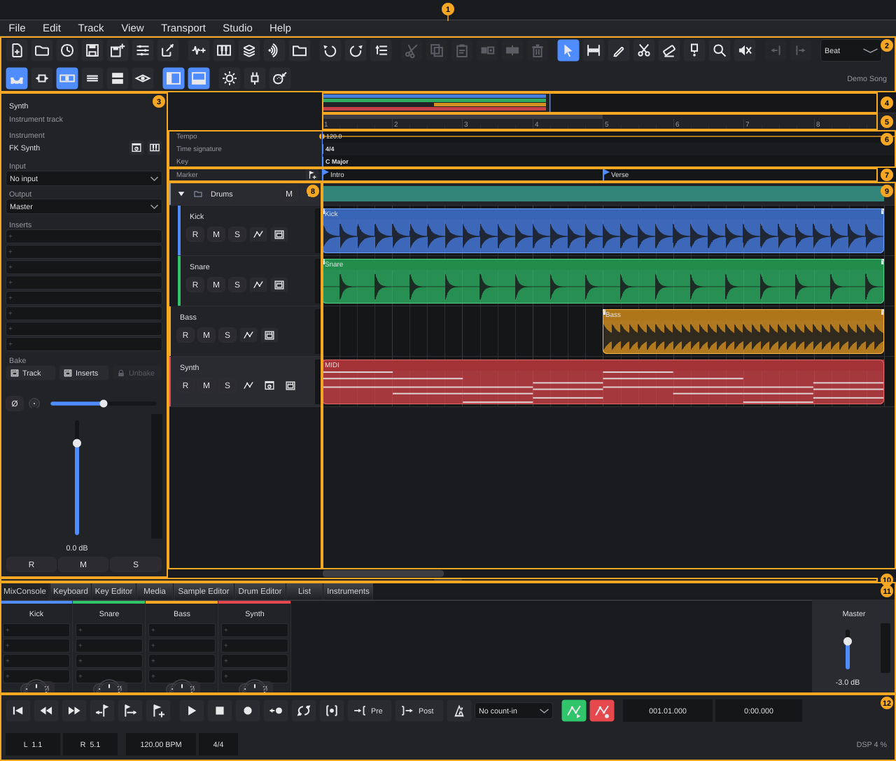
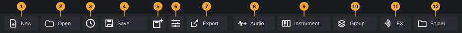
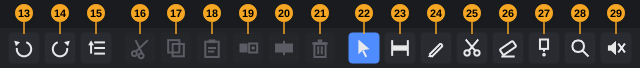
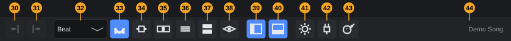
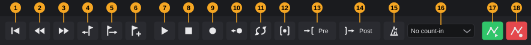
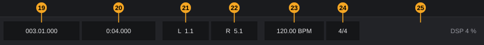
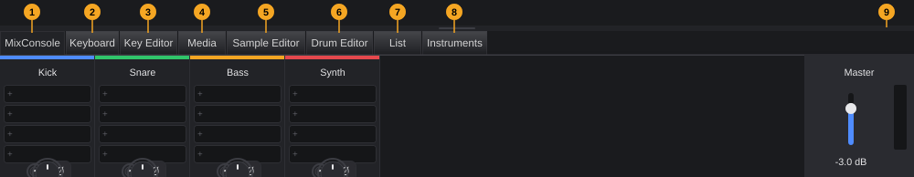

# The project window

The project window is the main window of FK Audio Suite. Everything you do with a project happens here: the menu bar and toolbar at the top, the tracks and clips in the middle, the editors and the MixConsole in the lower zone, and the transport at the bottom. This chapter shows what each area is, how the areas fit together and how to show, hide and resize them. Later chapters describe each area in depth.

**In this chapter**

1. [Opening and closing the window](#1-opening-and-closing-the-window)
2. [The window at a glance](#2-the-window-at-a-glance)
3. [Menu bar](#3-menu-bar)
4. [Toolbar](#4-toolbar)
5. [Transport bar](#5-transport-bar)
6. [Inspector](#6-inspector)
7. [Arrangement area](#7-arrangement-area)
8. [Lower zone](#8-lower-zone)
9. [Showing, hiding and resizing zones](#9-showing-hiding-and-resizing-zones)
10. [Messages and status](#10-messages-and-status)
11. [Keyboard shortcuts in the project window](#11-keyboard-shortcuts-in-the-project-window)
12. [Quick reference](#12-quick-reference)

---

## 1. Opening and closing the window

The project window opens when FK Audio Suite starts. There is only one project window, and it shows one project at a time. Opening or creating another project closes the current one first.

<!-- FIX F-208: window size and position may be remembered -->
- The window opens **1280 × 720** pixels large, centred on the screen. Resize it by dragging its edges; maximise it with the button in the title bar.
- The window uses the title bar of your operating system.

<!-- FIX F-207: title may show the project name and an unsaved-changes mark -->
The title bar always reads **FK Audio Suite**. The name of the open project is shown at the right end of the toolbar ([§4](#4-toolbar)); without a project it says **No project: New or Open**.

**To close the window** (and quit FK Audio Suite), click the close button in the title bar or choose **File › Quit**. If the project has unsaved changes, you are asked:

> The project "*name*" has unsaved changes. Save first?

| Button | Effect |
|---|---|
| **Save** | Saves the project, then quits. If saving fails, an error message appears and FK Audio Suite stays open. |
| **Don't save** | Quits without saving. |
| **Cancel** | Nothing happens; the window stays open. |

The same question appears whenever you open or create another project while the current one has unsaved changes.

---

## 2. The window at a glance

| # | Area | What it is | Details |
|---|---|---|---|
| 1 | **Menu bar** | Menus **File**, **Edit**, **Track**, **View**, **Transport**, **Studio**, **Help** | [§3](#3-menu-bar) |
| 2 | **Toolbar** | Buttons for project, tracks, editing, tools, grid, zoom and view; project name on the right | [§4](#4-toolbar) |
| 3 | **Inspector** | All settings of the selected track | [§6](#6-inspector) |
| 4 | **Overview bar** | The whole project in miniature with a frame for the visible section (off by default) | [§7](#7-arrangement-area) |
| 5 | **Ruler** | Bars and beats; click to move the playhead, drag to set the loop range | [§7](#7-arrangement-area) |
| 6 | **Signature track** | Tempo, time signature and key | [§7](#7-arrangement-area) |
| 7 | **Marker track** | Named positions such as *Intro* and *Verse* | [§7](#7-arrangement-area) |
| 8 | **Track list** | One header per track and folder: name, buttons, input | [§7](#7-arrangement-area) |
| 9 | **Event display** | The clips of every track along the timeline | [§7](#7-arrangement-area) |
| 10 | **Zone splitter** | Drag to change the height of the lower zone | [§9](#9-showing-hiding-and-resizing-zones) |
| 11 | **Lower zone** | Tabs for MixConsole, keyboard, editors, media and instruments | [§8](#8-lower-zone) |
| 12 | **Transport bar** | Play, record, loop, metronome, position, locators, tempo, audio load | [§5](#5-transport-bar) |

How the areas share the window:

- The menu bar and toolbar always span the full width at the top. The transport bar always spans the full width at the bottom.
- The **lower zone** sits directly above the transport bar and also spans the full width, under the Inspector and the arrangement.
- The **Inspector** takes a fixed width of 240 pixels on the left, next to the arrangement area.
- The **arrangement area** (numbers 4–9) gets all remaining space.

> **Tip:** On a small screen, hide the Inspector (**F2**) or the lower zone to give the arrangement more room ([§9](#9-showing-hiding-and-resizing-zones)).

---

## 3. Menu bar

The menu bar holds every function of the project window, including those that also have a button or a key. Shortcuts are shown at the right of each menu entry; they are the defaults and follow your own key assignments ([§11](#11-keyboard-shortcuts-in-the-project-window)). Entries that need an open project are greyed out while no project is open.

<!-- FIX F-203: menu entry names may be aligned with the command names in the shortcut editor -->

### 3.1 File

<!-- FIX F-209: New, Open and Quit may get default shortcuts -->
| Entry | Shortcut | What it does |
|---|---|---|
| **New empty project...** | — | Asks for the name and location of the new project (dialog *New project: name and location*), then closes the current project and creates the new one. If you cancel the dialog, your current project stays open. |
| **Open project...** | — | Opens a project file (`.tracktionedit`). If the project was not closed properly and an automatic backup is newer than the saved version, you are asked whether to restore it. |
| **Save** | **Ctrl+S** | Saves the project. |
| **Save as...** | **Ctrl+Shift+S** | Saves the project under a new name in a new folder; the audio files are copied along. The suggested name is *name copy*. |
| **Recently opened** › | — | The recently opened projects, each with its folder. *No projects yet* if the list is empty. |
| **Restore backup...** | — | Lists the backups of the open project, newest first, and restores the one you choose. The current version is kept as a backup. |
| **Project settings...** | **Shift+S** | Sample rate, record format, bit depth, auto-save. |
| **Save as template...** | — | Saves tracks, instruments, effects, routing, tempo and settings as a template (audio clips are not included). A template with the same name is replaced. |
| **New from template** › | — | Creates a new project from one of your templates. *No templates yet* if there are none. |
| **Export (mixdown, stems, MIDI)...** | — | Opens the export dialog. |
| **Import audio or MIDI file...** | — | Imports one or more WAV, AIFF, FLAC, OGG, MP3 or MIDI files at the playhead on the selected track (otherwise onto a new track). |
| **Quit** | — | Quits FK Audio Suite (with the unsaved-changes question, see [§1](#1-opening-and-closing-the-window)). |

Projects, templates, auto-save and backups: see the chapter *Projects*. Exporting: see the chapter *Exporting*.

### 3.2 Edit

| Entry | Shortcut | What it does |
|---|---|---|
| **Undo** | **Ctrl+Z** | Undoes the last editing step. Greyed out if there is nothing to undo. |
| **Redo** | **Ctrl+Y** (also **Ctrl+Shift+Z**) | Redoes the last undone step. |
| **History...** | — | Opens the list of all editing steps; click a step to jump there. |
| **Keyboard shortcuts...** | — | Opens the shortcut editor ([§11](#11-keyboard-shortcuts-in-the-project-window)). |
| **Cut** | **Ctrl+X** | Cuts the selected clips. |
| **Copy** | **Ctrl+C** | Copies the selected clips. |
| **Paste at playhead** | **Ctrl+V** | Pastes the clips at the playhead on the selected track. |
| **Duplicate** | **Ctrl+D** | Places a copy of the selected clips right after themselves. |
| **Glue** | **Ctrl+J** | Joins the selected clips of a track into one. |
| **Delete clips** | **Del** (also **Backspace**) | Deletes the selected clips. |
| **Mute / unmute** | **Shift+M** | Mutes the selected clips, or makes them audible again. |
| **Range (range tool, key 2)** › | | Functions for a time range drawn with the Range tool (see below). Greyed out without a range. |
| **Audio** › | | **Normalize (peak 0 dBFS)**, **Reverse (backwards) on/off**, **Invert phase** for the selected audio clips. |
| **One grid step left** | **Ctrl+Left Arrow** | Moves the selected clips one grid step to the left. |
| **One grid step right** | **Ctrl+Right Arrow** | Moves the selected clips one grid step to the right. |
| **Select all clips** | **Ctrl+A** | Selects every clip in the project. |

The clip entries are greyed out when they cannot be used, for example **Paste at playhead** with an empty clipboard.

<!-- FIX F-201: the submenu title may show the current key instead of "key 2" -->
<!-- FIX F-211: "Loop the range" and the arrangement's "Loop to the range" may get one wording -->
**Range** submenu:

| Entry | Shortcut | What it does |
|---|---|---|
| **Delete (leave gap)** | **Del** | Deletes the material in the range; later clips stay where they are. |
| **Remove (close gap)** | **Shift+Del** | Deletes the material and moves everything after it to the left. |
| **Insert silence** | — | Inserts silence as long as the range; later material moves right. |
| **Split at the boundaries** | — | Splits the clips at the start and end of the range. |
| **Loop the range** | — | Sets the left and right locators to the range. |

> **Note:** **Del** works on the range when there is one, and on the selected clips otherwise.

Editing clips and ranges in depth: see the chapter *Arranging*. Undo and history: see the chapter *Projects*.

### 3.3 Track

| Entry | What it does |
|---|---|
| **Audio track mono** | Adds a mono audio track (one input channel). |
| **Audio track stereo** | Adds a stereo audio track (channel pair). |
| **Instrument track** › | Adds an instrument track with the instrument you pick (installed plugins and FK instruments). |
| **Instrument from library** › | Adds a track with an instrument from an installed library, one submenu per library. Without a library: *No library installed yet (Studio > Content Manager)*. |
| **Rack instrument (multi-out, several MIDI tracks)** › | Adds a rack instrument: one instrument with several outputs, played by several MIDI tracks. |
| **MIDI track (external device)** | Adds a MIDI track that plays an external MIDI device. |
| **Sampler track from audio file...** | Asks for an audio file and adds a sampler track that plays it. |
| **Sampler track (empty drum kit)** | Adds a sampler track with an empty drum kit. |
| **Group track** | Adds a group track (target for other tracks). |
| **FX track (sends)** | Meant to add an FX track, fed by sends. Currently does nothing; use the **FX** button in the toolbar. <!-- FIX F-501: menu entry will add an FX track --> |
| **Folder track** | Adds a folder track. |
| **Duplicate track** | Copies the selected track with plugins, settings, clips and automation. |
| **Hide track** | Hides the selected track. Hidden tracks keep playing. |
| **Delete track** | Deletes the selected track (undoable). |
| **Show/hide tracks** › | Every track with a tick when visible; click to hide or show it. **Show all** shows all hidden tracks. |
| **Insert empty MIDI clip at playhead** | Inserts an empty one-bar MIDI clip at the playhead on the selected instrument or MIDI track and opens it in the editor. Otherwise: *Please select an instrument or MIDI track first.* |
| **Read automation** | Ticked when automation curves control the faders. |
| **Write automation** | Ticked when fader movements during playback are recorded. |

**Duplicate track**, **Hide track** and **Delete track** need a selected track.

<!-- FIX F-206: numbering of new tracks may count per track type -->
New tracks get a numbered name: **Audio** *n*, the instrument's name plus *n*, **Group** *n* and **MIDI** *n* count all tracks of the project, **FX** *n* counts only FX tracks and **Folder** *n* only folders. Rename a track by double-clicking its name.

Track types in depth: see the chapter *Tracks*. Automation: see the chapter *Automation*.

### 3.4 View

| Entry | Shortcut | What it does |
|---|---|---|
| **Inspector** | **F2** | Shows or hides the Inspector (ticked when visible). |
| **Lower zone** | — | Shows or hides the lower zone (ticked when visible). |
| **MixConsole** | **F3** | Shows the lower zone with the **MixConsole** tab. |
| **On-screen keyboard** | **F4** | Shows the **Keyboard** tab. |
| **Key Editor** | **F5** | Shows the **Key Editor** tab. |
| **Media browser** | **F6** | Shows the **Media** tab. |
| **Sample Editor** | **F7** | Shows the **Sample Editor** tab. |
| **Drum Editor** | **F8** | Shows the **Drum Editor** tab. |
| **List Editor** | **F9** | Shows the **List** tab. |
| **Instrument browser** | **F10** | Shows the **Instruments** tab. |
| **Overview bar** | — | Shows or hides the overview bar above the ruler. |
| **Show whole project** | **Shift+F** | Zooms so that all clips fit the width (with a little space after the last clip). An empty project shows the first 16 bars. |
| **Zoom to selection** | **Alt+S** | Zooms to the range, or to the selected clips. Without a selection: *Nothing selected: select clips or a range first.* |
| **Zoom in** | **H** | Zooms in one step around the playhead. |
| **Zoom out** | **G** | Zooms out one step around the playhead. |

The tab entries are ticked when their tab is the one showing. They open the lower zone if it is hidden ([§8](#8-lower-zone)).

### 3.5 Transport

<!-- FIX F-209: Loop, Metronome and Retrospective record may get menu entries -->
| Entry | Shortcut | What it does |
|---|---|---|
| **Play / Stop** | **Space** | Starts playback, or stops it if it is running. |
| **Record** | **Num \*** | Starts recording on the armed tracks. |
| **Go to start** | **Home** | Moves the playhead to the project start. |
| **Rewind (one bar)** | **Num -** | Moves the playhead to the previous bar line. |
| **Forward (one bar)** | **Num +** | Moves the playhead to the next bar line. |
| **Go to left locator** | **Num 1** | Moves the playhead to the left locator. |
| **Go to right locator** | **Num 2** | Moves the playhead to the right locator. |
| **Set left locator to playhead** | **Ctrl+Num 1** | Moves the left locator to the playhead. |
| **Set right locator to playhead** | **Ctrl+Num 2** | Moves the right locator to the playhead. |
| **Punch In/Out** | **I** | Records only between the locators (ticked when on). |
| **Previous marker** | **Shift+B** | Moves the playhead to the previous marker. |
| **Next marker** | **Shift+N** | Moves the playhead to the next marker. |
| **Add marker** | **Insert** | Adds a marker at the playhead. |

If you set a locator so that the left one would be after the right one, the two are swapped.

Loop (**Num /**), metronome (**C**) and retrospective record (**Shift+Num \***) have keys and buttons in the transport bar but no entry in this menu. Transport functions in depth: see the chapter *Transport*.

### 3.6 Studio

| Entry | What it does |
|---|---|
| **Audio and MIDI settings...** | Opens the window *Audio settings*: device, buffer, test tone. |
| **Studio connections...** | Opens the studio connections dialog. Needs an open project. |
| **Content Manager (free libraries)...** | Downloads and manages free instrument libraries. |
| **Plugin manager...** | Opens the plugin manager to scan and manage plugins. If it is already open, it comes to the front. |
| **MIDI Learn** | Switches MIDI Learn on or off (ticked when on), same as the toolbar button. |
| **MIDI mappings...** | Lists every learned MIDI mapping, each with a button to remove it, plus **Remove all**. Without mappings it explains how to create one. |
| **Language** › | The user-interface language. Each language is written in its own language, so you always find your way back. The new language takes effect the next time FK Audio Suite starts; FK plugins switch the next time their window opens. |

Audio settings and studio connections: see the chapter *Studio connections and settings*. Plugins and the Content Manager: see the chapter *Instruments and effects*.

### 3.7 Help

| Entry | What it does |
|---|---|
| **Export diagnostic report...** | Saves a ZIP file (default name *FK-Diagnose* with date and time, on the desktop) with a system description, the latest logs and hang or crash reports. Nothing is sent automatically. |
| **Show log folder** | Opens the folder with the log files. |
| **Check for updates...** | Asks the update server whether a newer version exists and offers **Download** or **Later**. In builds without an update address the entry reads **Check for updates (developer build without update address)** and is greyed out. |
| **Check for updates at startup** | When ticked, FK Audio Suite checks for updates in the background at every start and only speaks up when there is a new version. |
| **FK plugins: buy Pro...** | Opens the pricing page of the website in your browser. |
| **Activate Pro key (instructions)...** | Opens the activation instructions on the website. |
| **Open download page...** | Opens the download page on the website. |
| **About FK Audio Suite** | Version, release channel, build, platform and licence. |

The website pages open in the language you chose under **Studio › Language**.

---

## 4. Toolbar

The toolbar sits below the menu bar. Every button has an icon and a tooltip; hover over a button to see what it does and its key. Buttons are grouped: project, tracks, undo, clip editing, tools, nudge, grid and view, zones, studio.

<!-- FIX F-201: tooltips of Zoom (34) and Lower zone (40) may show the current keys -->
<!-- FIX F-204: tool order (22–29) may follow the keys 1–8 -->
<!-- FIX F-205: Undo and Redo (13, 14) may be greyed out when there is nothing to undo -->
| # | Button | What it does | Key |
|---|---|---|---|
| 1 | **New** | Menu: **Empty project...**, your templates under **From template**, **Save current project as template...**, **Open templates folder (rename, delete)** | — |
| 2 | **Open** | Open a project | — |
| 3 | Recent | Menu **Recently opened** with **Restore backup...** | — |
| 4 | **Save** | Save the project | **Ctrl+S** |
| 5 | Save as | Save to a new folder, audio is copied along | **Ctrl+Shift+S** |
| 6 | Project settings | Sample rate, record format, bit depth, auto-save | **Shift+S** |
| 7 | **Export** | Mixdown (WAV, FLAC, AIFF, OGG, MP3), stems or MIDI file | — |
| 8 | **Audio** | Add an audio track: menu **Audio track mono (one input channel)** or **Audio track stereo (channel pair)** | — |
| 9 | **Instrument** | Add an instrument track: menu of instruments | — |
| 10 | **Group** | Add a group track (target for other tracks) | — |
| 11 | **FX** | Add an FX track (reverb, delay via sends) | — |
| 12 | **Folder** | Add a folder track: drag or right-click tracks into it, collapse, mute together | — |
| 13 | Undo | Undo the last step | **Ctrl+Z** |
| 14 | Redo | Redo the last undone step | **Ctrl+Y** |
| 15 | History | All editing steps; click to jump to a step | — |
| 16 | Cut | Cut selected clips | **Ctrl+X** |
| 17 | Copy | Copy selected clips | **Ctrl+C** |
| 18 | Paste | Paste clips at the playhead on the selected track | **Ctrl+V** |
| 19 | Duplicate | Duplicate selected clips right after themselves | **Ctrl+D** |
| 20 | Glue | Glue selected clips of a track into one | **Ctrl+J** |
| 21 | Delete | Delete selected clips | **Del** |
| 22 | Select tool | Select and drag clips | **1** |
| 23 | Range tool | Drag a time range across tracks; **Del** deletes, **Shift+Del** closes the gap, right-click: insert silence, split, loop | **2** |
| 24 | Pencil | Draw a MIDI clip on an instrument track; a click makes one bar | **8** |
| 25 | Split tool | Cut a clip at the click | **3** |
| 26 | Eraser | Remove a clip | **5** |
| 27 | Glue tool | Join a clip with the one following on the right | **4** |
| 28 | Zoom tool | Click zooms in, **Alt**+click zooms out | **6** |
| 29 | Mute tool | Mute a clip and make it audible again | **7** |
| 30 | Nudge left | Move selected clips one grid step left | **Ctrl+Left Arrow** |
| 31 | Nudge right | Move selected clips one grid step right | **Ctrl+Right Arrow** |
| 32 | **Grid** | Grid for snap, nudge and display: **Bar**, **Beat** (default), note values (*.* = dotted, *T* = triplet), **Seconds**, **Samples** | — |
| 33 | Snap | Lock to the grid; on by default | — |
| 34 | Zoom | Menu: **Whole project**, **To selection**, **Zoom in**, **Zoom out**, **Bars** (1, 4, 16, 64 bars), **Custom presets**, **Save current zoom...**, **Delete preset** | — |
| 35 | Overview bar | Overview bar on/off: whole project with the visible section | — |
| 36 | Tracks smaller | Track height −16 pixels | — |
| 37 | Tracks larger | Track height +16 pixels | — |
| 38 | Show/hide tracks | Menu **Visible tracks (tick = visible)** with every track and **Show all**; hidden tracks keep playing | — |
| 39 | Inspector | Inspector on/off; on by default | **F2** |
| 40 | Lower zone | Lower zone on/off; on by default. The tooltip lists the keys of the tabs | — |
| 41 | Audio settings | Device, buffer, test tone | — |
| 42 | Plugin manager | Scan and manage plugins | — |
| 43 | MIDI Learn | Switch on, then touch a control in the DAW and move the hardware control; red while on | — |
| 44 | Project name | Name of the open project, or **No project: New or Open** | — |

Notes on the toolbar:

- **Tools (22–29)** work like radio buttons: exactly one is active. **Select** is active when the window opens. The tools are described in the chapter *Arranging*.
- **Clip buttons (16–21) and Nudge (30, 31)** are greyed out when they cannot be used, for example without selected clips. All project buttons except New, Open and Recent are greyed out while no project is open.
- **Track height (36, 37):** from 56 to 160 pixels, default 72.
- **Zoom presets (34):** **Save current zoom...** asks for a name (suggested: *Zoom n s*) and stores how many seconds are visible. A preset changes only the scale; the position stays. Presets are available in all projects.
- **Keys in tooltips:** the tooltips of buttons 4–6, 13–31 and 39 show the key that is currently assigned, also after you change it.

**Narrow windows.** If the window is too narrow for all buttons with their labels, the labels disappear one at a time, in this order: **Folder**, **FX**, **Group**, **Instrument**, **Audio**, **Export**, **Save**, **Open**, **New**. Only when all labels are gone does the toolbar wrap into a second (or third) row. Every function stays visible as an icon with its tooltip. The project name needs at least 160 pixels; if there is less room, it moves to the next row.

While **MIDI Learn** is on, a red hint appears in the toolbar before the project name and tells you what to do next. MIDI Learn: see the chapter *Studio connections and settings*.

---

## 5. Transport bar

The transport bar at the bottom of the window controls playback and recording and shows the position, locators, tempo and audio load. This section names each element; the chapter *Transport* explains them in depth.

<!-- FIX F-201: the keys named in the transport tooltips may follow your own key assignments -->
| # | Element | What it does | Key |
|---|---|---|---|
| 1 | Go to start | Playhead to the project start | **Home** |
| 2 | Rewind | One bar back; hold to repeat | **Num -** |
| 3 | Forward | One bar ahead; hold to repeat | **Num +** |
| 4 | Previous marker | Playhead to the previous marker | **Shift+B** |
| 5 | Next marker | Playhead to the next marker | **Shift+N** |
| 6 | Add marker | Marker at the playhead | **Insert** |
| 7 | Play | Start playback; green while playing | **Space** |
| 8 | Stop | Stop playback | **Space** |
| 9 | Record | Record on armed tracks; red while recording | **Num \*** |
| 10 | Retrospective record | Bring MIDI played without recording in the last 30 seconds onto the armed tracks | **Shift+Num \*** |
| 11 | Loop | Loop on/off; drag a range in the ruler to set it | **Num /** |
| 12 | Punch | Record only between locators L and R; turns loop off | **I** |
| 13 | **Pre** | Pre-roll: **off**, 0.5, 1, 2 or 4 s before the left locator (with punch) | — |
| 14 | **Post** | Post-roll: **off**, 0.5, 1, 2 or 4 s after the right locator, then stop (with punch) | — |
| 15 | Metronome | Metronome on/off | **C** |
| 16 | Count-in | **No count-in**, **1 bar** or **2 bars** before recording | — |
| 17 | Automation read | Automation curves control the faders | — |
| 18 | Automation write | Record fader movements during playback | — |
| 19 | Bars display | Position as bar.beat.ticks | — |
| 20 | Time display | Position in time; click to choose the format: seconds, timecode (with frame rate) or samples | — |
| 21 | Left locator **L** | Start of loop and punch, as bar.beat. Click: jump there. Right-click: **Jump there** or **Set to cursor** | **Num 1** |
| 22 | Right locator **R** | End of loop and punch. Same clicks as L | **Num 2** |
| 23 | Tempo | Tempo in BPM; double-click to type a new value | — |
| 24 | Time signature | For example 4/4 or 6/8; double-click to type a new one | — |
| 25 | Audio load | **DSP** *n* **%**: share of the time the audio engine needs. Turns orange from 70 %; red with **Overload: sound muted** when the engine had to mute | — |

Loop and punch exclude each other: switching loop on switches punch off, and the other way round.

**Narrow windows.** The elements form groups: navigation (1–6), transport (7–16), automation (17–18), position (19–20), locators (21–22), tempo and time signature (23–24). If the window is too narrow, whole groups move to a second row; the audio load display stays at the right end of the last row and gets its own row if needed. In a window of 1280 pixels the bar has two rows, from about 1620 pixels it has one.

> **Tip:** If the audio load is often red, bake tracks you are not editing, choose a larger buffer in **Studio › Audio and MIDI settings...**, or use a release build instead of a debug build. The tooltip of the display says the same.

---

## 6. Inspector

The Inspector on the left shows all settings of the **selected track**: name and type, input, output (master or a group), the eight insert slots, sends, trim and phase, pan, volume fader with level meter, record, mute and solo, and the bake functions. Instrument tracks also show their instrument; MIDI tracks for external devices show program and bank, MIDI tracks of a rack instrument their MIDI channel.

- **To fill the Inspector,** click a track in the track list. If the selected track is deleted, or no track is selected, the Inspector shows the last track.
- In a project without tracks, the Inspector explains: *Click a track in the arrangement to edit its input, output, inserts, volume and level here.*
- The Inspector is 240 pixels wide. If the window is lower than the Inspector's content (660 pixels), a scroll bar appears.
- Show or hide it with **F2**, the Inspector button (39) or **View › Inspector**.

The Inspector in depth: see the chapters *Tracks* and *MixConsole*.

---

## 7. Arrangement area

The arrangement area is where you build the song. From top to bottom:

| Part | What it shows | You can |
|---|---|---|
| **Overview bar** (4) | The whole project in miniature: one thin row per track, clips as blocks in the track colour, and a frame for the visible section | Drag the frame to scroll, drag its edges to zoom, click beside it to jump there. Off by default; switch it on with button 35 or **View › Overview bar**. 30 pixels high. |
| **Ruler** (5) | Bars and beats, the loop range | Click: move the playhead. Drag: set the loop range. Both snap to the grid. |
| **Signature track** (6) | Three lanes: **Tempo**, **Time signature**, **Key** | Click on the grid to set a tempo, time signature or key; see the chapter *Signature track*. |
| **Marker track** (7) | Named positions; **+** adds a marker at the playhead | Click a marker to jump there, drag it to move it, double-click to rename it, double-click on empty space to add one, right-click for loop, rename and delete. |
| **Track list** (8) | One header per track: name, buttons, input; folders with their tracks indented | Click to select a track, drag to reorder, right-click for colour, duplicate, hide and delete. |
| **Event display** (9) | The clips of each track along the timeline, and the playhead | Edit clips with the tools from the toolbar ([§4](#4-toolbar)). |

The ruler, signature and marker tracks always stay at the top while you scroll the tracks.

**Scrolling and zooming in the arrangement:**

| Action | Result |
|---|---|
| Mouse wheel | Scroll the tracks up and down |
| **Shift**+mouse wheel, or horizontal wheel | Scroll left and right |
| **Ctrl**+mouse wheel | Zoom horizontally around the mouse position |
| **H** / **G** | Zoom in / out around the playhead |
| **Shift+F** | Show the whole project |
| Scroll bar below the clips | Scroll left and right |

You can also drop audio and MIDI files from your file manager or from the **Media** tab onto the arrangement.

Tracks, clips and editing in depth: see the chapters *Tracks* and *Arranging*.

---

## 8. Lower zone

The lower zone below the arrangement holds the MixConsole, the on-screen keyboard, the editors, the media browser and the instrument browser. It shows one tab at a time.

<!-- FIX F-202: tab names may change to match the View menu (e.g. "List Editor") -->
| # | Tab | Key | Content | Details |
|---|---|---|---|---|
| 1 | **MixConsole** | **F3** | Channel strips of all tracks and the master | see the chapter *MixConsole* |
| 2 | **Keyboard** | **F4** | On-screen keyboard to play notes with the mouse; octave buttons | see the chapter *Recording audio and MIDI* |
| 3 | **Key Editor** | **F5** | Notes of a MIDI clip | [Key Editor](key-editor.md) |
| 4 | **Media** | **F6** | File browser with audition; drag files into the arrangement | see the chapter *Media browser and content* |
| 5 | **Sample Editor** | **F7** | Waveform of an audio clip | see the chapter *Sample Editor* |
| 6 | **Drum Editor** | **F8** | MIDI clips of tracks with a drum map | see the chapter *Drum Editor* |
| 7 | **List** | **F9** | The List Editor: the notes of a MIDI clip as a table <!-- FIX F-1005: may also show controllers and other events --> | [List Editor](list-editor.md) |
| 8 | **Instruments** | **F10** | Instrument browser: instruments, libraries and presets; double-click makes a new track | see the chapter *Instruments and effects* |
| 9 | Zone splitter | — | Drag to resize the lower zone, double-click for the default height | [§9](#9-showing-hiding-and-resizing-zones) |

**Ways to switch tabs:**

- Click a tab.
- Press its key **F3**–**F10**, or choose it in the **View** menu. If the lower zone is hidden, it opens.
- Double-click a clip in the arrangement: a MIDI clip opens in the **Key Editor**, or in the **Drum Editor** if its track uses a drum map; an audio clip opens in the **Sample Editor**. Opening a MIDI clip also loads it into the **List** tab.

**MixConsole** is the tab that shows when the window opens.

---

## 9. Showing, hiding and resizing zones

| Zone | Show / hide | Size |
|---|---|---|
| Inspector | **F2**, button 39, **View › Inspector** | Fixed width (240 pixels) |
| Lower zone | Button 40, **View › Lower zone**; **F3**–**F10** and **View** tab entries only show it | Drag the zone splitter |
| Overview bar | Button 35, **View › Overview bar** | Fixed height |
| Toolbar, transport bar | Always visible | Grow by a row when the window is narrow |

<!-- FIX F-209: the lower zone may get its own command with a key to toggle it -->
> **Note:** The keys **F3**–**F10** never close the lower zone, even if their tab is already showing. To close it, use button 40 or **View › Lower zone**.

**To resize the lower zone:**

1. Point at the zone splitter, the thin bar between the arrangement and the lower zone (the pointer becomes an up-down arrow, the grip in the middle lights up).
2. Drag up to make the lower zone taller, down to make it smaller.
3. Double-click the splitter to return to the default height of **360 pixels**.

The lower zone is never smaller than 160 pixels, and at least 120 pixels always stay for the arrangement. If the window gets smaller, the lower zone shrinks to keep these limits.

<!-- FIX F-208: layout may be remembered between sessions -->
The layout is not saved: after a restart, the window has its default size, the Inspector and lower zone are visible, the lower zone is 360 pixels high and shows the MixConsole, the overview bar is off and tracks are 72 pixels high.

---

## 10. Messages and status

FK Audio Suite tells you in these places what is going on:

| Where | What |
|---|---|
| **Error** window | When an action fails (a file cannot be read, a track cannot be created, a change is refused because a track is baked …), a window titled **Error** explains why. |
| Toolbar, right end | Project name, or **No project: New or Open**. |
| Toolbar, red hint | Next step while **MIDI Learn** is on. |
| Transport bar, audio load | **DSP** *n* **%**, orange from 70 %, red with **Overload: sound muted** for two seconds after an overload. |
| Question windows | Before closing a project with unsaved changes ([§1](#1-opening-and-closing-the-window)), when restoring an automatic backup, when importing a MIDI file with its own tempo, and when project and audio device use different sample rates. |

**Sample rate question.** When you open a project whose sample rate differs from the audio device, FK Audio Suite asks once per project:

- If the device can switch: **Switch device** (the device runs at the project rate) or **Leave as is** (the engine converts during playback; new recordings use the device rate).
- If the device cannot switch (under PipeWire or JACK the server decides the rate): **Switch project** (the project takes the device rate; existing recordings stay unchanged) or **Leave as is**.

<!-- FIX F-210: adding a marker without a project may show a message -->
Some actions do nothing without an open project and show no message, for example **Add marker** (**Insert**).

---

## 11. Keyboard shortcuts in the project window

Every key in this chapter is a default. Change keys in **Edit › Keyboard shortcuts...**: the window *Keyboard Commands* lists every command by category (**Transport**, **File**, **Edit**, **Tools**, **Zoom**, **View**). Menus and most toolbar tooltips show your own keys right away. A key belongs to at most one command: assigning it to another command removes it from the first.

<!-- FIX F-203: command names in the shortcut editor may be aligned with the menus -->
- Keys work while the project window is active. When you type into a text field (for example the tempo display), the key goes to the field.
- Punctuation keys such as **\*** and **/** also work when your keyboard layout needs **Shift** for them.
- Inside an editor in the lower zone, the editor's own keys take priority while it has the keyboard focus (for the Key Editor see [Key Editor §9](key-editor.md#9-keyboard-commands-in-the-note-grid)).

<!-- FIX F-209: New, Open, Quit, Import and Lower zone may get commands -->
**New project**, **Open project**, **Quit**, **Import** and **Lower zone** have no command and cannot get a key. **Export Project**, **History**, **Overview Bar On/Off** and **Keyboard Commands** are commands without a default key; you can assign one.

The complete list of commands: see the chapter *Keyboard shortcuts*.

---

## 12. Quick reference

| What | How |
|---|---|
| Inspector on/off | **F2** |
| MixConsole, Keyboard, Key Editor, Media | **F3**, **F4**, **F5**, **F6** |
| Sample Editor, Drum Editor, List Editor, Instruments | **F7**, **F8**, **F9**, **F10** |
| Lower zone on/off | Button 40 or **View › Lower zone** |
| Lower zone height | Drag the zone splitter; double-click for 360 pixels |
| Overview bar | Button 35 or **View › Overview bar** |
| Play / Stop | **Space** |
| Record | **Num \*** |
| Save | **Ctrl+S** |
| Undo / Redo | **Ctrl+Z** / **Ctrl+Y** |
| Tools | **1** Select, **2** Range, **3** Split, **4** Glue, **5** Eraser, **6** Zoom, **7** Mute, **8** Pencil |
| Whole project / zoom to selection | **Shift+F** / **Alt+S** |
| Zoom in / out | **H** / **G**, or **Ctrl**+mouse wheel |
| Track height | Buttons 36 and 37 |
| Change keys | **Edit › Keyboard shortcuts...** |
