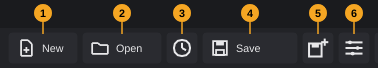
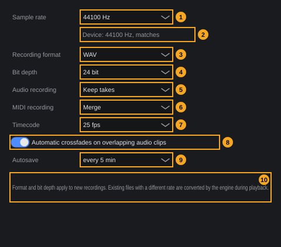

# Projects

A project is one song or piece of work: its tracks, clips, instruments, mixer settings, tempo and markers, together with the audio files it uses. This chapter explains how to create, open, save and copy projects, how templates work, how FK Audio Suite protects your work with backups and automatic backups, and what the project settings do.

**In this chapter**

1. [Where to find the project functions](#1-where-to-find-the-project-functions)
2. [The project folder](#2-the-project-folder)
3. [Creating a project](#3-creating-a-project)
4. [Opening a project](#4-opening-a-project)
5. [Recently opened projects](#5-recently-opened-projects)
6. [Saving](#6-saving)
7. [Save as: copying a project](#7-save-as-copying-a-project)
8. [Closing a project and quitting](#8-closing-a-project-and-quitting)
9. [Templates](#9-templates)
10. [Backups](#10-backups)
11. [Automatic backup (autosave)](#11-automatic-backup-autosave)
12. [Restoring a backup](#12-restoring-a-backup)
13. [Project settings](#13-project-settings)
14. [Project sample rate and audio device](#14-project-sample-rate-and-audio-device)
15. [Importing audio and MIDI files](#15-importing-audio-and-midi-files)
16. [Undo and error messages](#16-undo-and-error-messages)
17. [Quick reference](#17-quick-reference)

---

## 1. Where to find the project functions

FK Audio Suite starts without a project. The right end of the toolbar then reads **No project: New or Open**; once a project is open, it shows the project's name. There is always at most one open project: creating or opening another one closes the current one first.

All project functions are in the **File** menu, and the most frequent ones also have a toolbar button at the left end of the toolbar.



| # | Button | Tooltip | What it does | Key |
|---|---|---|---|---|
| 1 | **New** | *New project: empty or from a template* | Menu with **Empty project...**, your templates and the template functions ([§3](#3-creating-a-project), [§9](#9-templates)) | — |
| 2 | **Open** | *Open project* | Opens a project file ([§4](#4-opening-a-project)) | — |
| 3 | Recent | *Recent projects and restore backups* | Menu **Recently opened** and **Restore backup...** ([§5](#5-recently-opened-projects), [§12](#12-restoring-a-backup)) | — |
| 4 | **Save** | *Save project* | Saves the project ([§6](#6-saving)) | **Ctrl+S** |
| 5 | Save as | *Save as: save the project to a new folder, audio is copied along* | Saves a copy in a new folder and continues there ([§7](#7-save-as-copying-a-project)) | **Ctrl+Shift+S** |
| 6 | Project settings | *Project settings: sample rate, record format, bit depth, auto-save* | Opens the **Project Settings** window ([§13](#13-project-settings)) | **Shift+S** |

Buttons 4–6 are greyed out while no project is open. The tooltips of buttons 4–6 end with the key in brackets, for example *Save project (Ctrl+S)*; they show your own key if you changed it.

<!-- FIX F-209: New, Open and Quit may get default shortcuts -->
**File** menu entries for projects:

| Entry | Shortcut | Section |
|---|---|---|
| **New empty project...** | — | [§3](#3-creating-a-project) |
| **Open project...** | — | [§4](#4-opening-a-project) |
| **Save** | **Ctrl+S** | [§6](#6-saving) |
| **Save as...** | **Ctrl+Shift+S** | [§7](#7-save-as-copying-a-project) |
| **Recently opened** › | — | [§5](#5-recently-opened-projects) |
| **Restore backup...** | — | [§12](#12-restoring-a-backup) |
| **Project settings...** | **Shift+S** | [§13](#13-project-settings) |
| **Save as template...** | — | [§9](#9-templates) |
| **New from template** › | — | [§9](#9-templates) |
| **Export (mixdown, stems, MIDI)...** | — | see the chapter *Exporting* |
| **Import audio or MIDI file...** | — | [§15](#15-importing-audio-and-midi-files) |
| **Quit** | — | [§8](#8-closing-a-project-and-quitting) |

**Save**, **Save as...**, **Restore backup...**, **Project settings...**, **Save as template...**, **Export** and **Import** are greyed out while no project is open.

<!-- FIX F-309: menu and button wording for templates may be aligned; the templates folder may get a File menu entry -->
The **New** button (1) opens this menu:

| Entry | What it does |
|---|---|
| **Empty project...** | Same as **File › New empty project...** |
| **From template** | Heading, followed by one entry per template. Only shown if you have templates. |
| **Save current project as template...** | Same as **File › Save as template...**. Greyed out without a project. |
| **Open templates folder (rename, delete)** | Opens the folder with your templates in the file manager ([§9.4](#94-renaming-and-deleting-templates)). |

---

## 2. The project folder

Every project is a folder on your disk. The folder and the project file inside it have the same name, which is the project's name:

```
My Song/
  My Song.tracktionedit     the project file
  Audio/                    recordings and imported audio files
  Backups/                  earlier versions and the automatic backup
  Sampler/                  sample maps of sampler tracks (only if the project has one)
  Export/                   suggested place for exports (only after exporting there)
```

| Item | Content | Created |
|---|---|---|
| **<name>.tracktionedit** | The project itself: tracks, clips, MIDI notes, plugins and their settings, mixer, routing, automation, tempo and signature track, markers, project settings. A text file in XML format (Tracktion Engine format). | When the project is created |
| **Audio/** | Every audio file of the project: recordings, takes, imported files (copied in, see [§15](#15-importing-audio-and-midi-files)), samples of sampler tracks and audio that FK Audio Suite renders, for example when gluing clips or normalizing. | When the project is created |
| **Backups/** | Earlier versions of the project file ([§10](#10-backups)) and the automatic backup ([§11](#11-automatic-backup-autosave)). | At the first save with changes or the first automatic backup |
| **Sampler/** | One sample map (`.sfz` file) per sampler track. | When a sampler track gets samples |
| **Export/** | The export dialog suggests this folder for mixdowns, stems and MIDI files. | When you export there |
| **project_info.json** | Internal information of the audio engine (project identity). Leave it alone. | When the project is opened |

Because audio files are copied into **Audio/**, the project folder contains the audio it needs. To back up a project or take it to another computer, copy the whole folder. Plugins are not part of the project; the other computer needs the same plugins installed.

<!-- FIX F-305: sampler tracks may keep working after moving or copying the project folder -->
> **Note:** Sampler tracks remember their sample map in **Sampler/** with its full path on disk. If you move or rename the project folder, or use **Save as**, these tracks still load the map from the original location, and fail to load it once it is no longer there.

> **Tip:** Don't open files inside **Backups/** directly with **Open project...**. Use **Restore backup...** instead ([§12](#12-restoring-a-backup)); it puts the backup back into the project file where it belongs.

There is no command to rename a project. To give a project a new name, use **Save as** ([§7](#7-save-as-copying-a-project)).

---

## 3. Creating a project

**To create an empty project:**

1. Choose **File › New empty project...**, or click **New** (1) and choose **Empty project...**.
2. The file dialog *New project: name and location* opens, starting in your **Music** folder. Choose the folder in which the project folder should be created, type the project name as the file name and confirm.
3. If the current project has unsaved changes, you are asked whether to save them first ([§8](#8-closing-a-project-and-quitting)).
4. FK Audio Suite creates the folder *<name>* with the project file *<name>.tracktionedit* and the **Audio/** folder, saves the project right away and opens it.

A new project is completely empty: no tracks, tempo 120 BPM and 4/4 (the defaults of the audio engine). Its sample rate is the rate of the audio device at that moment, or 48000 Hz if no audio device is active ([§13](#13-project-settings)).

If you cancel the file dialog, nothing happens and your current project stays open.

<!-- FIX F-304: names containing a dot may be kept in full -->
> **Note:** The name is everything you type before the last dot. Typing *Song v1.2* creates a project called *Song v1*. Avoid dots in project names.

<!-- FIX F-302: the current project may stay open if the new one cannot be created -->
> **Note:** If a folder with that name already exists at that place, the project is not created and the message *A folder "…" already exists.* appears. At that point the previous project has already been closed, so no project is open. Open it again via **Recently opened** ([§5](#5-recently-opened-projects)).

To create a project from a template, see [§9.2](#92-creating-a-project-from-a-template).

---

## 4. Opening a project

**To open a project:**

1. Choose **File › Open project...** or click **Open** (2).
2. The file dialog *Open project* opens, starting in your **Music** folder. It shows project files (`*.tracktionedit`). Select the project file inside the project folder and confirm.
3. If the current project has unsaved changes, you are asked whether to save them first ([§8](#8-closing-a-project-and-quitting)).
4. The project opens.

While opening, FK Audio Suite checks two things:

- **Automatic backup.** If the project was not closed properly last time (for example after a crash) and its automatic backup is newer than the saved project file, you are asked whether to restore it. See [§11.2](#112-after-a-crash).
- **Sample rate.** If the project's sample rate differs from the rate of the audio device, you are asked how to resolve it. See [§14](#14-project-sample-rate-and-audio-device).

Opening a project also adds it to the top of **Recently opened** ([§5](#5-recently-opened-projects)).

<!-- FIX F-302: the current project may stay open if the other one cannot be opened -->
If the file cannot be read, an **Error** window says *Could not read the project file: …*. The previous project has already been closed at that point.

<!-- FIX F-307: missing audio files and plugins may be reported when opening -->
### 4.1 Missing files and plugins

FK Audio Suite does not check whether all audio files and plugins of a project are available, and it shows no warning when something is missing. This can happen when you open a project on another computer, after moving audio files out of the project folder, or after uninstalling a plugin. Listen to every track after opening such a project. To avoid missing audio files, keep all of them in the project folder (FK Audio Suite does this for you when you import, see [§2](#2-the-project-folder)).

---

## 5. Recently opened projects

FK Audio Suite remembers the last **10** projects you opened, created or saved under a new name, newest first. The list is the same for all projects and survives a restart.

**To open a recent project:**

1. Choose **File › Recently opened**, or click the Recent button (3).
2. Click the project.

Each entry shows the project name and, in brackets, the folder that contains the project folder, for example *My Song   (/home/anna/Music)*. Projects whose file no longer exists are left out. If the list is empty, it shows **No projects yet**.

The Recent button's menu has the heading **Recently opened** above the list and **Restore backup...** below it ([§12](#12-restoring-a-backup)).

Opening a recent project works like **Open project...**: the unsaved-changes question, the automatic-backup check and the sample-rate check all apply.

---

## 6. Saving

**To save the project:** press **Ctrl+S**, click **Save** (4) or choose **File › Save**.

What happens:

1. If the project has changed since it was last saved, the previously saved project file is first copied to **Backups/** ([§10](#10-backups)).
2. The project file is written. FK Audio Suite writes a temporary file first and then replaces the project file with it, so the file is never left half-written.
3. The automatic backup of the project is deleted; it is no longer needed ([§11](#11-automatic-backup-autosave)).
4. Old backups beyond the 10 newest are deleted.

**Save** always writes the file, even if nothing has changed; in that case no backup is made.

<!-- FIX F-207: the window title may show the project name and an unsaved-changes mark -->
> **Note:** FK Audio Suite does not show whether a project has unsaved changes. The question when closing ([§8](#8-closing-a-project-and-quitting)) is the only place that tells you.

The undo history is not saved with the project: after closing and reopening, **Undo** starts fresh.

If saving fails, the **Error** window shows *Could not save the project: …* or *Could not create the backup: …*, followed by the path. The project then stays unsaved.

---

## 7. Save as: copying a project

**Save as** saves the project under a new name in a new project folder and continues working in the new one. Use it to make a version of a song, to rename a project or to move it to another place.

**To save a project under a new name:**

1. Press **Ctrl+Shift+S**, click Save as (5) or choose **File › Save as...**.
2. The file dialog *Save as: new project name and location* opens in the folder that contains the current project folder. The suggested name is *<name> copy*, for example *My Song copy*.
3. Choose a place, change the name if you like, and confirm.
4. FK Audio Suite creates the folder *<new name>* with the project file *<new name>.tracktionedit*, copies the complete **Audio/** folder into it, and opens the new project.

<!-- FIX F-305: Save as may copy Sampler/ and relink sampler tracks -->
What to know about the copy:

- The new project contains your current state, including changes you have not saved. The original project folder is not touched: unsaved changes go only into the copy.
- Audio files from the old project's folder are referenced in the new folder; audio files outside the old folder keep their original location.
- Only **Audio/** is copied. **Backups/**, **Export/** and **Sampler/** stay in the old folder; the new project starts without backups.
- Sampler tracks keep loading their sample map from the old project's **Sampler/** folder (see the note in [§2](#2-the-project-folder)).
- The undo history starts fresh.
- If a folder with the new name already exists, nothing is saved and the message *A folder "…" already exists.* appears. Your current project stays open.

> **Note:** As with a new project, the name ends at the last dot ([§3](#3-creating-a-project)).

---

## 8. Closing a project and quitting

There is no separate **Close** command. A project is closed when you create or open another project, restore a backup, or quit FK Audio Suite.

**To quit FK Audio Suite:** choose **File › Quit**, or click the close button in the window's title bar.

If the project has unsaved changes, a window titled **Unsaved changes** asks first:

> The project "*name*" has unsaved changes. Save first?

| Button | Effect |
|---|---|
| **Save** | Saves the project ([§6](#6-saving)), then continues (quits, or opens the other project). If saving fails, an **Error** window appears and nothing else happens: the project stays open. |
| **Don't save** | Discards the unsaved changes and continues. |
| **Cancel** | Nothing happens; the project stays open. |

When a project is closed this way (with **Save** or **Don't save**), its automatic backup is deleted: you have decided what happens with the changes. Only if FK Audio Suite ends without closing the project, for example in a crash, does the automatic backup remain ([§11.2](#112-after-a-crash)).

FK Audio Suite does not reopen the last project at the next start; use **Recently opened** ([§5](#5-recently-opened-projects)).

---

## 9. Templates

A template is a project without audio that you start new projects from: your usual tracks, instruments, effects, routing and settings, ready to go.

### 9.1 Saving a template

**To save the current project as a template:**

1. Choose **File › Save as template...**, or click **New** (1) and choose **Save current project as template...**.
2. A window **Save as template** opens with the text *Tracks, instruments, effects, routing, tempo and settings go into the template, audio clips do not. A template with the same name is replaced.*
3. Type the name in the **Name** field. It is filled with the project's name.
4. Click **Save** (or press **Return**). **Cancel** (or **Esc**) closes the window without saving.

What goes into a template:

| Included | Not included |
|---|---|
| All tracks with their names, order, folders and colours | Audio clips (their files belong to the project folder) |
| Instruments and effects with their settings, sends, groups and routing | The project's folder, backups and audio files |
| MIDI clips with their notes | |
| Tempo, time signature and key (signature track), markers | |
| Automation, mixer settings | |
| Project settings ([§13](#13-project-settings)), MIDI mappings | |

In short, a template is a copy of the whole project file without the audio clips.

<!-- FIX F-305: sampler tracks in templates may get their own sample map -->
Rules:

- A template with the same name is replaced without asking.
- Characters that are not allowed in file names are removed from the name. An empty name gives the message *The template needs a name.*
- Projects with baked tracks cannot be saved as a template: *Track "…" is baked. Unbake it first, then save as a template.* (Baking: see the chapter *Track bake (freeze)*.)
- Sampler tracks in a template still load their sample map from the original project's **Sampler/** folder.

Templates are stored in your user settings folder, one file per template (`<name>.tracktionedit`):

<!-- FIX F-306: the templates folder may get an English name -->
| System | Templates folder |
|---|---|
| Linux | `~/.config/FKAudioSuite/Vorlagen` |
| Windows | `%APPDATA%\FKAudioSuite\Vorlagen` |

### 9.2 Creating a project from a template

**To create a project from a template:**

1. Choose **File › New from template** and click the template, or click **New** (1) and click the template below **From template**. Templates are sorted by name. If there are none, the submenu shows **No templates yet**.
2. The file dialog *New project: name and location* opens. Choose the place and type the name of the new project, as in [§3](#3-creating-a-project).
3. If the current project has unsaved changes, you are asked whether to save them first.
4. FK Audio Suite creates the project folder with **Audio/**, copies the template in as the project file and opens it.

The new project has the template's project settings, including its sample rate. If that differs from your audio device, the sample-rate question appears ([§14](#14-project-sample-rate-and-audio-device)).

The notes in [§3](#3-creating-a-project) about dots in names and existing folders apply here too.

### 9.3 Updating a template

To change a template, create a project from it, make your changes and save it as a template again under the same name. The old template is replaced.

### 9.4 Renaming and deleting templates

Click **New** (1) and choose **Open templates folder (rename, delete)**. The templates folder opens in your file manager (it is created if it does not exist yet). There:

- **Rename** a template by renaming its file. The file name without `.tracktionedit` is the template's name in the menus.
- **Delete** a template by deleting its file.

The menus read the folder each time they open, so changes show up right away.

---

## 10. Backups

Every time you save a project that has changed, the previous version of the project file is kept as a backup. You can go back to any of the kept versions ([§12](#12-restoring-a-backup)).

- Backups are in the project's **Backups/** folder.
- A backup is named after the project and the date and time of the save that replaced it, for example *My Song 2026-10-12 14-03-55.tracktionedit*. It contains the version **before** that save.
- FK Audio Suite keeps the **10** newest backups per project and deletes older ones. This happens when you save, when you restore a backup and when an automatic backup is set aside ([§11.2](#112-after-a-crash)).
- Backups are copies of the project file only. Audio files are not backed up; they stay in **Audio/**.

<!-- FIX F-306: these file names may be English -->
Two more kinds of files appear in **Backups/** and count towards the 10:

| File name | Created when |
|---|---|
| *<name>* **vor Wiederherstellung** *<date> <time>* | You restore a backup: this is the project file as it was before the restore ([§12](#12-restoring-a-backup)). |
| *<name>* **Autosave** *<date> <time>* | You open a project after a crash and choose **Open saved version**: this is the automatic backup that you did not restore ([§11.2](#112-after-a-crash)). |

---

## 11. Automatic backup (autosave)

The automatic backup protects work you have not saved yet, for example in a crash or a power failure.

### 11.1 How it works

- At a fixed interval (default: every **5 minutes**), FK Audio Suite checks whether the open project has unsaved changes. If it does, it writes the current state to **Backups/***<name>***.autosave.tracktionedit**, replacing the previous automatic backup.
- The automatic backup does not touch your project file and does not count as saving: the project still has unsaved changes afterwards.
- It is deleted when you save the project and when the project is closed normally (including **Don't save**).
- It does not appear in the list of **Restore backup...**.

**To change the interval:** open the project settings (**Shift+S**) and choose a value under **Autosave**: **off**, **every 1 min**, **every 2 min**, **every 5 min**, **every 10 min**, **every 15 min** or **every 30 min** ([§13](#13-project-settings)). The interval applies to all projects and is remembered for the next start. **off** switches the automatic backup off.

<!-- FIX F-308: a failed automatic backup may be reported -->
> **Note:** If the automatic backup cannot be written (for example because the disk is full), there is no message; FK Audio Suite tries again at the next interval.

### 11.2 After a crash

If FK Audio Suite ended without closing the project, the automatic backup is still there the next time you open the project. If it is newer than the saved project file, a window titled **Restore?** asks:

> The project was not closed properly. There is an automatic backup from *date time*, newer than the saved version.
>
> The saved version is kept in the Backups folder in any case.

| Button | Effect |
|---|---|
| **Restore backup** | The automatic backup becomes the project file and the project opens with your unsaved work. The previous project file is kept as a *vor Wiederherstellung* backup. The automatic backup file is removed. |
| **Open saved version** | The project opens as last saved. The automatic backup is moved to the backups as an *Autosave* backup, so you can still restore it later with **Restore backup...**. |

Closing the window without choosing (**Esc**) also opens the saved version.

After **Restore backup**, the restored state is the project file on disk, so the project has no unsaved changes.

---

## 12. Restoring a backup

**To go back to an earlier version of the open project:**

1. Choose **File › Restore backup...**, or click the Recent button (3) and choose **Restore backup...**. Both need an open project.
2. A menu opens below the Recent button with the heading **Choose backup (the current version is kept as a backup)**. Each entry shows the date and time of the backup file and its name, newest first.
3. Click the backup you want.
4. If the project has unsaved changes, you are asked whether to save them first ([§8](#8-closing-a-project-and-quitting)).
5. The current project file is kept as a *vor Wiederherstellung* backup ([§10](#10-backups)), the chosen backup becomes the project file, and the project opens.

If the project has no backups yet, a window **Backups** says *This project has no backups yet. Every save with changes creates one.*

A restore cannot be undone with **Undo**. To go back, restore the *vor Wiederherstellung* backup that the restore created.

<!-- FIX F-303: choosing Save before restoring may no longer delete the chosen backup -->
> **Note:** If the project already has 10 backups, you choose the oldest one and then answer **Save** to the unsaved-changes question, that save deletes the oldest backup. The restore then fails with *Backup is not readable: …* and no project is open. Choose **Don't save** in this case, or save first and then restore.

---

## 13. Project settings

The project settings belong to the project and are saved with it. The autosave interval is the exception: it applies to all projects.

**To open the project settings:** press **Shift+S**, click Project settings (6) or choose **File › Project settings...**. This needs an open project.

The window **Project Settings** opens. While it is open, you cannot work in the project window. Close it with its close button or **Esc**. There is no OK button: every change takes effect immediately.



| # | Field | Choices (default in bold) | What it does |
|---|---|---|---|
| 1 | **Sample rate** | 44100, **48000**, 88200, 96000, 176400, 192000 Hz | The sample rate the project is meant to run at. A new project gets the rate of the audio device at that moment; 48000 Hz only if no device is active. A project with a rate not in this list shows its rate as an extra entry. Changing the rate does not convert any files and does not switch the audio device. |
| 2 | Device line | — | Shows the audio device's rate: *Device: 48000 Hz, matches* (grey) or *Device: 44100 Hz, differs* (red). If it differs, the button **Switch device** appears next to it: it switches the audio device to the project rate. Without an audio device: *No audio device active*. |
| 3 | **Recording format** | **WAV**, FLAC, AIFF | File format of new recordings. FLAC is lossless and needs about half the space. |
| 4 | **Bit depth** | 16 bit, **24 bit**, 32 bit float | Bit depth of new recordings. **32 bit float** is only available for WAV. If you switch to a format that does not offer the current depth, the highest available depth is chosen. |
| 5 | **Audio recording** | **Keep takes**, Replace | What a new audio recording does with existing clips in the same place. **Keep takes**: the new recording is on top, earlier ones stay selectable as takes. **Replace**: clips in the recorded range are replaced. |
| 6 | **MIDI recording** | New clip, **Merge**, Replace | What a new MIDI recording does. **New clip**: each recording is its own clip. **Merge**: notes go into the existing clip (overdub). **Replace**: notes in the range are replaced. |
| 7 | **Timecode** | 24 fps, **25 fps**, 30 fps | Frames per second for the timecode display in the transport bar. |
| 8 | **Automatic crossfades on overlapping audio clips** | **on** | When two audio clips overlap, they fade into each other in the overlapping area instead of cutting hard. Applies to all audio clips of the project at once. |
| 9 | **Autosave** | off, every 1 min, every 2 min, **every 5 min**, every 10 min, every 15 min, every 30 min | Interval of the automatic backup ([§11](#11-automatic-backup-autosave)). Applies to all projects. |
| 10 | Hint | — | *Format and bit depth apply to new recordings. Existing files with a different rate are converted by the engine during playback.* |

<!-- FIX F-301: the crossfade setting may be remembered -->
> **Note:** The checkbox **Automatic crossfades on overlapping audio clips** is always ticked when the window opens, even if you unticked it before. Unticking it removes the automatic crossfades from the audio clips that exist at that moment, but audio clips added later, and all clips after the project is reopened, get automatic crossfades again.

Changes to fields 1 and 3–8 are undo steps named **Project settings** and count as unsaved changes. The autosave interval (9) is not part of the project and cannot be undone.

<!-- FIX F-310: undoing a settings change may also update the recording inputs -->
> **Note:** Undoing a **Project settings** step restores the stored values, but recording format, bit depth and recording modes take effect on the inputs only the next time you change a field or open the project.

Recording format, bit depth and the two recording modes apply to all audio and MIDI inputs while the project is open; FK Audio Suite applies them again whenever the project is opened. Recording in depth: see the chapter *Recording audio and MIDI*.

The transport bar's second time display (seconds, timecode or samples) is also stored with the project; you change it in the transport bar, not here. See the chapter *Transport*.

---

## 14. Project sample rate and audio device

The sample rate of the project is a setting of the project; the sample rate that actually runs is the one of your audio device. If they differ, the audio engine converts during playback, and new recordings are made at the device rate.

When you open or create a project whose sample rate differs from the audio device, a window titled **Sample rate** asks how to resolve it. It does not ask again if you open the same project right after.

**If the audio device can switch to the project rate:**

> The project runs at *48000* Hz, the audio device at *44100* Hz.
>
> Switch the audio device? Otherwise the engine converts during playback, and new recordings use the device rate.

| Button | Effect |
|---|---|
| **Switch device** | The audio device switches to the project rate. |
| **Leave as is** | Nothing changes. |

**If the audio device cannot switch** (under PipeWire or JACK the server decides the rate):

> The project runs at *48000* Hz, the audio device at *44100* Hz. The device cannot be switched (under PipeWire/JACK the server decides the rate).
>
> Switch the project to *44100* Hz? Existing recordings stay unchanged, the engine converts them during playback.

| Button | Effect |
|---|---|
| **Switch project** | The project's sample rate is set to the device rate (an undo step **Project settings**). |
| **Leave as is** | Nothing changes. |

You can also compare and switch later in the project settings (field 2, **Switch device**). If the device does not support the rate, a window **Sample rate** says *The audio device "…" does not support … Hz.* Under JACK, the message adds how to set the server's rate, for example with `pw-metadata -n settings 0 clock.force-rate 48000`. Without an active device the message is *No audio device is active (Studio > Audio settings).*

Audio device settings: see the chapter *Studio connections and settings*.

---

## 15. Importing audio and MIDI files

**To import files into the project:**

1. Select the track that should receive the files (optional).
2. Choose **File › Import audio or MIDI file...** (needs an open project).
3. In the dialog *Import audio or MIDI file*, select one or more files: WAV, AIFF, FLAC, OGG, MP3 or MIDI (`.mid`, `.midi`).
4. The files are placed at the playhead on the selected track; without a selected track, on a new track.

Audio files from outside the project folder are copied into **Audio/** first ([§2](#2-the-project-folder)); if a file with that name exists there, the copy gets a new name. A MIDI file with several tracks gives one part per track. If a MIDI file contains its own tempo, you are asked how to handle it.

You can also drag files from your file manager or from the media browser into the arrangement. Importing, placing and the MIDI tempo question in depth: see the chapter *Arranging*. Media browser: see the chapter *Media browser and content*.

Exporting a mixdown, stems or a MIDI file: see the chapter *Exporting*.

---

## 16. Undo and error messages

- **Undo** covers changes to the project, including project settings changes. Creating, opening, saving, **Save as**, templates and restoring backups are file operations; they cannot be undone. For an earlier saved version, use **Restore backup...** ([§12](#12-restoring-a-backup)).
- Creating, opening, **Save as** and restoring start a new undo history.

When a file operation fails, a window titled **Error** shows the reason. `…` stands for the path:

| Message | When |
|---|---|
| *The project name must not be empty.* | New project or **Save as** with an empty name |
| *A folder "…" already exists.* | New project or **Save as** into an existing folder |
| *Could not create the project folder: …* | New project; no write access or disk full |
| *Could not create the project: …* | New project from a template; folder or file could not be created |
| *Template not found: …* | The template file was deleted after the menu was opened |
| *Project file not found: …* | Open a project whose file no longer exists |
| *Could not read the project file: …* | The project file is damaged or not a project |
| *Could not create the backup: …* | Save; the previous version could not be copied to **Backups/** |
| *Could not save the project: …* | Save; the project file could not be written |
| *Could not copy the audio files to: …* | **Save as**; copying **Audio/** failed |
| *Could not write the project: …* | **Save as**; the new project file could not be written |
| *The template needs a name.* | Save as template with an empty name |
| *Track "…" is baked. Unbake it first, then save as a template.* | Save as template with a baked track |
| *Template folder is missing: …* | The templates folder could not be created |
| *Could not write the template: …* | The template file could not be written |
| *Backup is not readable: …* | Restore a backup that no longer exists or cannot be read |
| *Could not back up the previous version: …* | Restore; the current project file could not be kept as a backup |
| *Could not write the project file: …* | Restore; the project file could not be replaced |

Sample-rate messages: see [§14](#14-project-sample-rate-and-audio-device).

---

## 17. Quick reference

| What | How |
|---|---|
| New empty project | **File › New empty project...** or **New** › **Empty project...** |
| New project from a template | **File › New from template** › template |
| Open | **File › Open project...** or **Open** |
| Open a recent project | **File › Recently opened** or the Recent button |
| Save | **Ctrl+S** |
| Save as (copy, rename, move) | **Ctrl+Shift+S** |
| Project settings | **Shift+S** |
| Save as template | **File › Save as template...** |
| Rename or delete templates | **New** › **Open templates folder (rename, delete)** |
| Restore an earlier version | **File › Restore backup...** |
| Autosave interval | **Shift+S** › **Autosave** (default every 5 min) |
| Backups kept per project | 10, in **Backups/** |
| Recent projects remembered | 10 |
| Import audio or MIDI | **File › Import audio or MIDI file...** |
| Quit | **File › Quit** or the window's close button |
