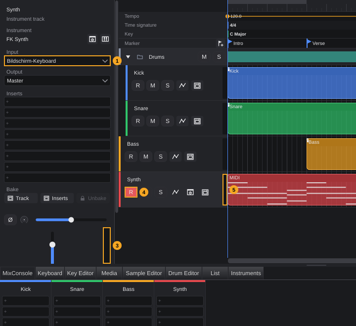
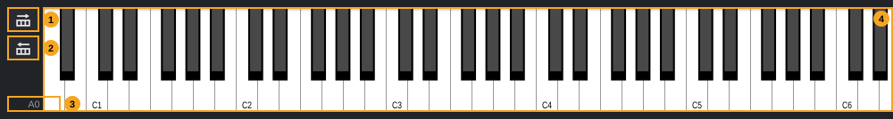
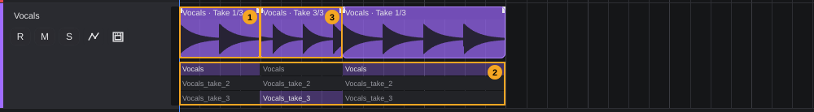

# Recording audio and MIDI

Recording puts what you play into the project: audio from a microphone or instrument becomes an audio clip with a new audio file, notes and controllers from a MIDI keyboard become a MIDI clip. This chapter explains how to prepare tracks (inputs, record enable, monitoring), which settings decide what a recording does with existing clips, where the files go, and how to work with loop recordings and takes.

The transport side of recording (the **Record** button, count-in, punch, pre-roll and post-roll, retrospective record) is explained in the chapter [Transport](transport.md); this chapter links there instead of repeating it.

**In this chapter**

1. [Before you record](#1-before-you-record)
2. [Choosing a track's input](#2-choosing-a-tracks-input)
3. [Arming tracks](#3-arming-tracks)
4. [Hearing your input and watching levels](#4-hearing-your-input-and-watching-levels)
5. [The on-screen keyboard](#5-the-on-screen-keyboard)
6. [Recording settings](#6-recording-settings)
7. [Where recordings are stored and how they are named](#7-where-recordings-are-stored-and-how-they-are-named)
8. [Recording audio](#8-recording-audio)
9. [Recording MIDI](#9-recording-midi)
10. [Recording several tracks at once](#10-recording-several-tracks-at-once)
11. [Loop recording and takes](#11-loop-recording-and-takes)
12. [Punch recording in practice](#12-punch-recording-in-practice)
13. [Retrospective record](#13-retrospective-record)
14. [Latency](#14-latency)
15. [Undo, and what is saved](#15-undo-and-what-is-saved)
16. [Common problems](#16-common-problems)
17. [Quick reference](#17-quick-reference)

---

## 1. Before you record

A recording needs four things:

| What | Where | Details |
|---|---|---|
| A working audio device, and for MIDI a switched-on MIDI input | **Studio › Audio and MIDI settings...** | [Getting started §5](getting-started.md#5-audio-and-midi-setup) |
| A track of the right kind | Toolbar or **Track** menu | Audio track (mono or stereo) for audio; instrument track or MIDI track for MIDI. See the chapter [Tracks](tracks.md). |
| An input on that track | Inspector, field **Input** | [§2](#2-choosing-a-tracks-input) |
| The track armed for recording | **R** in the track header or the Inspector | [§3](#3-arming-tracks) |

Group tracks, FX tracks and the output channels of a rack instrument cannot record: they have no input and no **R** button.

Then press **Record** in the transport bar (**Num \***, [Transport §7](transport.md#7-recording-from-the-transport)) and stop with **Space**.

---

## 2. Choosing a track's input

Every audio, instrument and MIDI track has exactly one input, or none. You choose it in the **Inspector** (the zone on the left, **F2**; see [The project window §6](project-window.md#6-inspector)):

1. Click the track in the track list. The Inspector shows its settings.
2. Open the list below **Input**.
3. Choose an input, or **No input**.

Each change is a step in the history, named **Assign input**.

<!-- FIX F-603: the input field may also appear in the track header -->
> **Note:** The track header also contains an input field, but it is only shown when there is room for it next to the buttons. With the fixed width of the track list, this never happens, so the Inspector is the place to choose inputs.

What the list offers depends on the kind of track.

### 2.1 Audio inputs (audio tracks)

Audio tracks list the input channels of your audio device that are ticked under **Active input channels:** in the audio settings ([Getting started §5.2](getting-started.md#52-the-window-at-a-glance)). FK Audio Suite offers each channel on its own and each pair of neighbouring channels:

| Track | Inputs offered | Example names |
|---|---|---|
| **Audio track mono** | Single channels | **Input 1**, **Input 2**, **Input 3** |
| **Audio track stereo** | Pairs of neighbouring channels: 1+2, 3+4, ... | **Input 1+2**, **Input 3+4** |

Whether a track is mono or stereo is decided when you create it (**Audio track mono** or **Audio track stereo**, see the chapter [Tracks](tracks.md)) and cannot be changed later. A mono track never shows stereo pairs, and the other way round. A stereo pair is only formed from two neighbouring active channels.

If you gave a channel your own name in **Studio › Studio connections...**, that name appears instead, for example *Guitar DI* ([Getting started §5.8](getting-started.md#58-naming-inputs-and-outputs)).

Without an audio device, or with no input channel ticked, the list contains only **No input**.

New audio tracks start with **No input**.

### 2.2 MIDI inputs (instrument and MIDI tracks)

Instrument tracks and MIDI tracks list the MIDI inputs that are switched on in the audio settings ([Getting started §5.7](getting-started.md#57-midi-inputs)):

<!-- FIX F-103: the on-screen keyboard may appear under an English name -->
| Entry | What the track receives |
|---|---|
| **All MIDI inputs** | Everything that arrives on any switched-on MIDI input. New instrument tracks start with this input. |
| A device, for example your keyboard's name | Only this device. |
| **Bildschirm-Keyboard** | The on-screen keyboard in the lower zone ([§5](#5-the-on-screen-keyboard)). |

If **All MIDI inputs** is switched off in the audio settings, a new instrument track starts with **No input**.

One input can serve several tracks at the same time. For audio this means you can record the same microphone on two tracks; for MIDI it means every track with that input reacts to your keyboard ([§4](#4-hearing-your-input-and-watching-levels)).

When you plug a MIDI device in or out, the lists update themselves.

---

## 3. Arming tracks

A track records only when it is **armed** (record enabled). Every armed track records when you press **Record**; tracks that are not armed keep playing as usual.

<!-- FIX F-609: Input, R, M and S in the Inspector may get tooltips -->
| # | Element | What it does | Details |
|---|---|---|---|
| 1 | **Input** (Inspector) | Chooses the track's input | [§2](#2-choosing-a-tracks-input). In the picture the on-screen keyboard. |
| 2 | **R** (Inspector) | Arms the selected track or disarms it | Red while armed. Same as 4. |
| 3 | Level meter (Inspector) | Level of the selected track | [§4](#4-hearing-your-input-and-watching-levels) |
| 4 | **R** (track header) | Arms this track or disarms it | Red while armed. |
| 5 | Level meter (track header) | Level of this track, at the right edge of the header | [§4](#4-hearing-your-input-and-watching-levels) |

**To arm a track:** click **R** in its track header or, with the track selected, in the Inspector. The button turns red. Click again to disarm it.

- The **R** buttons only exist on audio, instrument and MIDI tracks.
- Arming needs an input. Choose the input first ([§2](#2-choosing-a-tracks-input)).
- You can arm any number of tracks ([§10](#10-recording-several-tracks-at-once)).
- There is no key and no menu entry for arming.
- Arming is not a step in the history; it is saved with the project.

<!-- FIX F-602: R may stay off (or explain why) on a track without input -->
> **Note:** On a track with **No input**, clicking **R** turns the button red, but the track is **not** armed. **Record** then reports that no input is assigned ([§16](#16-common-problems)). The button shows the true state again after the next change to the track (for example choosing an input).

<!-- FIX F-105: the R, M and S buttons and the input field in the track header may get tooltips -->
The **R**, **M** and **S** buttons have no tooltips: **R** is record enable, **M** mute and **S** solo.

---

## 4. Hearing your input and watching levels

### Monitoring

There is no separate monitor button. What you hear follows the kind of track:

| Track | You hear the input ... |
|---|---|
| Audio track | ... while the track is **armed**, through the track: its inserts, fader, pan and output apply. Disarm the track to stop hearing it. This works while the song is stopped as well. |
| Instrument track, MIDI track | ... **always**, as soon as the input is assigned, armed or not. Your playing reaches the track's instrument or MIDI device right away. |

<!-- FIX F-607: only the selected or armed track may react to a MIDI input -->
> **Note:** Every instrument and MIDI track whose input is **All MIDI inputs** (or the same device) plays when you play your keyboard, not only the selected one. New instrument tracks start with **All MIDI inputs**, so with three instrument tracks you hear three instruments at once. To play just one, set the **Input** of the others to **No input**, or to a different device.

What you hear while recording audio is delayed by the audio buffer. If the delay disturbs you, choose a smaller buffer ([Getting started §5.5](getting-started.md#55-buffer-size-and-latency)).

### Level meters

Each track has a level meter at the right edge of its header (5 in the picture) and, for the selected track, one next to the fader in the Inspector (3). The MixConsole shows the same per channel.

| Meter part | Meaning |
|---|---|
| Two bars | Left and right channel |
| Scale | From −60 dB (bottom) to 0 dB (top) |
| Green | Up to −18 dB |
| Yellow | From −18 dB to −6 dB |
| Orange | Above −6 dB |
| Thin line | The recent peak; it falls back slowly. It turns **red** when the peak reached 0 dB. |

The track meters measure the track's signal **after** its inserts and fader. A recording, however, is taken directly from the input, before trim, inserts and fader: turning the track's fader down makes the meter smaller but not the recording. Set the recording level at your audio interface (its gain control). The input level itself is shown by the meter next to **Input:** in **Studio › Audio and MIDI settings...** ([Getting started §5.2](getting-started.md#52-the-window-at-a-glance)).

> **Tip:** Aim for peaks well below 0 dB, for example around −12 dB to −6 dB. A recording that hits 0 dB at the input is clipped and cannot be repaired later.

---

## 5. The on-screen keyboard

The on-screen keyboard lets you play and record notes with the mouse, without a MIDI keyboard. It sends its notes to a MIDI input of its own; every track whose input is the on-screen keyboard or **All MIDI inputs** receives them.

**To open it:** press **F4**, choose **View › On-screen keyboard**, or click the **Keyboard** tab in the lower zone ([The project window §8](project-window.md#8-lower-zone)).

<!-- FIX F-001: the octave naming (middle C = C4) may change -->
| # | Element | What it does |
|---|---|---|
| 1 | Shift up one octave | Scrolls the keyboard one octave up. |
| 2 | Shift down one octave | Scrolls the keyboard one octave down. |
| 3 | Range display | The lowest visible key, for example **C3**. Middle C (MIDI note 60) is **C4**. |
| 4 | Keys | Click or hold a key to play the note. The arrows at both ends scroll the keyboard as well. |

- The keyboard spans the piano range from **A0** to **C8** (MIDI notes 21–108). When it first opens, middle C is roughly in the middle.
- **Velocity** depends on where you click: the lower on the key, the louder the note.
- The notes go out on MIDI channel 1.

<!-- FIX F-608: the range display may follow every way of scrolling -->
> **Note:** The range display (3) changes only with the octave buttons (1, 2). After scrolling with the arrows at the ends of the keyboard, it shows the old value until you use an octave button again.

To record from the on-screen keyboard, choose it (or **All MIDI inputs**) as the track's input, arm the track and record as described in [§9](#9-recording-midi).

---

## 6. Recording settings

Four settings decide how recordings are made. They belong to the project and are in **File › Project settings...** (**Shift+S**); the window is described in [Projects §13](projects.md#13-project-settings). Every change takes effect right away and is a history step named **Project settings**.

| Setting | Choices (default in bold) | Effect |
|---|---|---|
| **Recording format** | **WAV**, FLAC, AIFF | File format of new audio recordings. FLAC is lossless and needs about half the space. |
| **Bit depth** | 16 bit, **24 bit**, 32 bit float | Resolution of new audio recordings. **32 bit float** is only offered for WAV; switching to FLAC or AIFF while it is set changes the depth to **24 bit**. |
| **Audio recording** | **Keep takes**, Replace | What a new audio recording does with clips already on the track. [§8](#8-recording-audio) |
| **MIDI recording** | New clip, **Merge**, Replace | What a new MIDI recording does with MIDI clips already on the track. [§9](#9-recording-midi) |

Format and bit depth only apply to **new** recordings; existing files stay as they are. The sample rate of a recording is always the rate the audio device runs at ([Projects §14](projects.md#14-project-sample-rate-and-audio-device)).

### Audio recording modes

<!-- FIX F-601: "Keep takes" may create takes, or be renamed to match what it does -->
| Mode | Normal recording | Loop recording |
|---|---|---|
| **Keep takes** | The new clip is placed on top. Clips already in that place stay on the track as separate clips underneath; nothing is deleted. | One new clip with one take per loop pass; older clips stay. [§11](#11-loop-recording-and-takes) |
| **Replace** | Clips (and parts of clips) in the recorded range are removed and the new clip takes their place. | One new clip with one take per pass; older clips in the loop range are removed. |

The tooltip of **Keep takes** says *the new recording is on top, earlier ones stay selectable as takes*. In a normal (not looped) recording, however, the earlier recording does **not** become a take of the new clip: it remains a clip of its own underneath. Real takes come from loop recordings ([§11](#11-loop-recording-and-takes)) and from **Add take from file...** ([§11.4](#114-more-take-functions)).

### MIDI recording modes

| Mode | Normal recording | Loop recording |
|---|---|---|
| **New clip** | The notes become a new clip, on top of any clip in the same place. | One clip over the loop range with one take per pass ([§11](#11-loop-recording-and-takes)). |
| **Merge** (default) | The notes are added to the MIDI clip already in that place (overdub); the clip grows if the notes reach beyond it. Without such a clip, a new clip is created. | Every pass is added into the same clip, so you can build a part layer by layer (for example a drum pattern). |
| **Replace** | Everything in the recorded range on the track is removed, then the notes become a new clip. | Only the last pass in which you played is kept; everything in the loop range is replaced by it. |

> **Note:** In **New clip** and **Replace** mode, the track's existing clips are silent while the recording runs, so you do not hear the old part while playing the new one. In **Merge** mode they keep playing.

<!-- FIX F-310: undoing a settings change may also update the recording inputs -->
> **Note:** These settings are applied to all audio and MIDI inputs when the project opens and whenever you change a field. After undoing a **Project settings** step, the inputs keep the last chosen values until you change a field again or reopen the project.

---

## 7. Where recordings are stored and how they are named

Audio recordings are written into the **Audio** folder inside the project folder ([Projects §2](projects.md#2-the-project-folder)). Nothing is written to a system folder.

**File names** come from the track name:

| Recording | File name (example for a track *Vocals*, WAV) |
|---|---|
| First recording on the track | `Audio/Vocals.wav` |
| Next recordings on the same track | `Audio/Vocals(2).wav`, `Audio/Vocals(3).wav`, ... |
| Loop recording, passes 2, 3, ... | `Audio/Vocals_take_2.wav`, `Audio/Vocals_take_3.wav`, ... (pass 1 stays in the recording's own file) |

- The extension follows the recording format: `.wav`, `.flac` or `.aiff`.
- Characters that are not allowed in file names are removed from the track name.
<!-- FIX F-306: German file names may be replaced by English ones -->
- If nothing is left of the name, the file is called `Aufnahme`.
- An existing file is never overwritten; the number in brackets grows instead.

**Clip names.** A new recorded clip is named after the track, the word *Recording* and a running number, for example **Vocals Recording 1**, **Vocals Recording 2**. This applies to audio and MIDI clips.

MIDI recordings create no files: the notes are stored in the project file.

Undoing a recording removes the clip but **not** the audio file ([§15](#15-undo-and-what-is-saved)).

---

## 8. Recording audio

**To record audio:**

1. Create an audio track: mono for one microphone or a mono instrument, stereo for a stereo source (see the chapter [Tracks](tracks.md)).
2. Choose the **Input** in the Inspector, for example **Input 1** ([§2.1](#21-audio-inputs-audio-tracks)).
3. Arm the track with **R** ([§3](#3-arming-tracks)). You now hear the input through the track.
4. Play or sing a few bars and set the level at your interface ([§4](#4-hearing-your-input-and-watching-levels)).
5. Place the playhead where the recording should start, and switch on the metronome or a count-in if you want ([Transport §9](transport.md#9-metronome-and-count-in)).
6. Press **Num \*** or click **Record**. The **Record** button turns red.
7. Press **Space** to stop.

**While recording**, a red area labelled **Recording...** grows on each armed track from the start of the recording to the playhead. The clip itself appears when you stop: with its waveform, its name ([§7](#7-where-recordings-are-stored-and-how-they-are-named)) and placed where the recording began.

What happens to clips already on the track depends on **Audio recording** in the project settings ([§6](#6-recording-settings)):

- **Keep takes** (default): the new clip lies on top of the old ones. The old clips stay as they are. If you no longer need them, delete them or mute them (see the chapter [Arranging](arranging.md)).
- **Replace**: the old clips are cut out of the recorded range. Parts of them outside the range remain.

> **Tip:** To record again over the same place while keeping every attempt as a take, use loop recording ([§11](#11-loop-recording-and-takes)).

---

## 9. Recording MIDI

**To record MIDI:**

1. Use an instrument track (it plays an instrument) or a MIDI track (it plays an external device); see the chapter [Tracks](tracks.md).
2. Check the **Input** in the Inspector: **All MIDI inputs**, your keyboard or the on-screen keyboard ([§2.2](#22-midi-inputs-instrument-and-midi-tracks)). You hear the instrument as soon as you play.
3. Arm the track with **R**.
4. Press **Num \*** or click **Record**, play, and press **Space** to stop.

The new MIDI clip appears when you stop. Double-click it to edit the notes in the [Key Editor](key-editor.md).

**What is recorded.** Notes with their velocity and length, and the other MIDI data you send while recording, for example sustain pedal, modulation wheel and pitch bend. Controller data appears in the controller lanes of the Key Editor ([Key Editor §16](key-editor.md#16-controller-lanes)).

- Notes still held when recording stops are ended at that point.
- If you play nothing during the recording, no clip is created.
- There is no input quantize: notes are recorded exactly as played. Quantize them afterwards in the Key Editor ([Key Editor §12](key-editor.md#12-quantizing)).

**What happens to existing clips** depends on **MIDI recording** in the project settings ([§6](#6-recording-settings)): with **Merge** (default) the notes join the clip that is already there, **New clip** puts a new clip on top, **Replace** clears the recorded range first.

> **Example:** You recorded a bass drum and a snare in a 4-bar clip. With **Merge**, record again over the same 4 bars and play the hi-hat: it is added to the same clip, the bass drum and snare stay.

---

## 10. Recording several tracks at once

Arm every track you want to record; **Record** records on all of them at the same time.

- Each armed audio track writes its own file, named after its track ([§7](#7-where-recordings-are-stored-and-how-they-are-named)).
- Different tracks can use different inputs, for example **Input 1** for a microphone and **Input 2** for a guitar, plus an instrument track with **All MIDI inputs**.
- The same input can feed several armed tracks: each of them records it.
- A count-in, loop or punch applies to all armed tracks together.

When you stop, all new clips appear at once.

---

## 11. Loop recording and takes

### 11.1 What a loop recording creates

When loop is on, recording runs between the left and right locators and starts again at the left locator after every pass, until you stop ([Transport §6](transport.md#6-locators-and-loop), [§7](transport.md#7-recording-from-the-transport)). The loop range must be longer than 2 seconds.

| Track | Mode | Result after stopping |
|---|---|---|
| Audio | either mode | **One clip** over the loop range with **one take per pass**. Each pass longer than 0.1 seconds becomes a take, the last pass also if you stopped in the middle of it. |
| MIDI | **New clip** | One clip over the loop range with one take per pass in which you played. |
| MIDI | **Merge** | All passes in one clip, added on top of each other (no takes). |
| MIDI | **Replace** | Only the last pass in which you played. |

<!-- FIX F-606: audio and MIDI may start with the same take after a loop recording -->
After a loop recording, an **audio** clip plays the **first** pass, a **MIDI** clip the **last** pass. Choose another take as described below.

A clip with takes shows the current take in its title, for example **Vocals Recording 1 · Take 1/3**: take 1 of 3.

### 11.2 Choosing a take

1. Right-click the clip.
2. Open **Takes**. The submenu lists all takes by name; the current one is ticked.
3. Choose a take. The whole clip now plays it.

This is a step in the history, named **Select take**.

### 11.3 Take lanes and comping

*Comping* means combining the best parts of several takes into one performance. FK Audio Suite does this without rendering: it cuts the clip and lets each piece play a different take.

**To show the take lanes:** right-click the clip and choose **Takes › Show take lanes (drag a range = comping)**. The entry is ticked while the lanes are shown; choose it again to hide them. It is only available if the clip has at least two takes.

The lanes appear below the clip, one row per take, and the track becomes taller.

| # | Element | What it shows |
|---|---|---|
| 1 | Clip title | Name and current take, here **· Take 1/3** |
| 2 | Take lanes | One lane per take with the take's name, 18 pixels high. The lane of the current take is tinted in the track colour. |
| 3 | Comped piece | A piece of the clip that plays a different take (here take 3, see its title and lanes) |

**To use a take for the whole clip:** click once in that take's lane. (History: **Select take**.)

**To use a take for part of the clip:**

1. In the take's lane, press the mouse button at the start of the part and drag to its end. The range is highlighted while you drag.
2. Release the mouse button.

FK Audio Suite cuts the clip at both ends of the range. The middle piece plays the chosen take; the pieces before and after keep their take. History: **Take for range**.

- With **Snap** on, both ends snap to the grid. A drag shorter than one grid step therefore counts as a click and switches the whole clip.
- A range that reaches beyond the clip is limited to the clip.
- The middle piece reaches 10 milliseconds into its neighbours at each cut. With **Automatic crossfades on overlapping audio clips** on (project settings, default), the overlap becomes a short crossfade instead of a click.
- Every piece keeps **all** takes, and its own lanes. You can change any piece again later, or comp inside a piece.

> **Tip:** To comp a phrase, first click the lane of the take that is best overall, then drag over the phrases where another take is better.

### 11.4 More take functions

All in the **Takes** submenu of the clip's right-click menu:

| Entry | Available | What it does | History |
|---|---|---|---|
| (take names) | Clip has takes | Plays this take in the whole clip ([§11.2](#112-choosing-a-take)) | **Select take** |
| **Show take lanes (drag a range = comping)** | 2 or more takes | Shows or hides the lanes ([§11.3](#113-take-lanes-and-comping)) | — |
| **Distribute takes to the tracks below** | 2 or more takes | Copies each take as a clip of its own onto the tracks below; the clip itself stays with its current take | **Distribute takes** |
| **Delete unused takes** | 2 or more takes, audio clips only | Removes every take except the current one from the clip. The audio files stay in the **Audio** folder. | **Clean up takes** |
| **Add take from file...** | Audio clips only | Opens *Add audio file as take*; the chosen file (WAV, FLAC, AIF/AIFF, OGG or MP3) becomes an additional take. A file from outside the project is copied into the **Audio** folder first. If the clip had no takes yet, its current audio becomes take 1. | **Add take** |

<!-- FIX F-605: distributing takes may put MIDI takes on tracks below and only use matching tracks -->
**Distribute takes to the tracks below** works differently for audio and MIDI:

- **Audio:** take 1 goes to the next track below, take 2 to the track below that, and so on. These are whatever tracks follow, whatever their kind. Where no further track exists, a new audio track is created.
- **MIDI:** every take is placed as a new clip named **Take #1**, **Take #2**, ... on the **same** track as the original clip, on top of it.

Takes of tracks that are baked cannot be changed; unbake the track first (see the chapter [Track bake](track-bake.md)).

<!-- FIX F-701: errors of take functions may be shown in the project window -->
> **Note:** If a take function cannot be carried out (for example on a baked track), nothing happens and no message is shown.

---

## 12. Punch recording in practice

Punch recording replaces a section in the middle of an existing recording, for example one wrong bar, while you play along from before. The controls (**Punch**, **I**, **Pre**, **Post**) are described in [Transport §8](transport.md#8-punch-inout-pre-roll-and-post-roll).

**To fix bars 9 and 10 of a vocal recording:**

1. Set the left locator to bar 9 and the right locator to bar 11 ([Transport §6.2](transport.md#62-setting-the-locators)).
2. Switch punch on with **I**. Loop switches off.
3. Choose a pre-roll, for example **2 s**, so you can hear the song before bar 9. Choose a post-roll if the transport should stop by itself after bar 11.
4. Arm the vocal track and press **Num \***.
5. Sing along. Only bars 9 and 10 are recorded.

The result depends on **Audio recording** ([§6](#6-recording-settings)):

- **Replace:** the old recording is cut out between the locators and the new clip fills the gap. While the recording runs, the old recording on the track is silent between the locators.
- **Keep takes:** the new clip lies on top of the old recording between the locators; the old clip stays complete underneath.

For MIDI, the same applies to **MIDI recording**: **Replace** clears the notes between the locators, **Merge** adds the new notes to the existing clip.

If you stop before the playhead reaches the left locator, nothing is recorded.

---

## 13. Retrospective record

Retrospective record brings back MIDI you played on armed tracks during the last 30 seconds while the transport was **not** recording. Click **Retrospective record** in the transport bar or press **Shift+Num \***. Details: [Transport §10](transport.md#10-retrospective-record).

---

## 14. Latency

Every audio interface delays the signal a little on the way in and out. FK Audio Suite corrects recordings for the latency the audio driver reports, so new audio and MIDI clips line up with what you heard while recording. There is no setting for a manual recording offset.

The delay you **hear** while monitoring an audio input depends on the buffer size ([Getting started §5.5](getting-started.md#55-buffer-size-and-latency)). It is not part of the recording.

---

## 15. Undo, and what is saved

<!-- FIX F-604: a recording may appear under its own name in the history -->
| Action | Saved | History (Undo) |
|---|---|---|
| A recording (all clips of one **Record** run) | With the project | **Change** |
| Choosing an input | With the project | **Assign input** |
| Arming a track | With the project | — |
| Recording format, bit depth, recording modes | With the project | **Project settings** |
| Choosing a take | With the project | **Select take** |
| Using a take for a range | With the project | **Take for range** |
| Distributing takes | With the project | **Distribute takes** |
| Deleting unused takes | With the project | **Clean up takes** |
| Adding a take from a file | With the project | **Add take** |
| Retrospective record | With the project | **Retrospective recording** |

The names are the entries in **Edit › History...**. A recording has no name of its own there and is listed as **Change**.

**To undo a recording:** press **Ctrl+Z** after stopping. The new clips disappear; with **Replace**, the clips that were cut out come back.

> **Note:** Undoing a recording does not delete its audio file: it stays in the **Audio** folder. The same is true for **Delete unused takes**.

---

## 16. Common problems

| Problem | Cause | Solution |
|---|---|---|
| *Recording is only possible when at least one active input device is assigned to a track* appears next to the mouse pointer | No track is armed, or the armed track has **No input** | Choose an input ([§2](#2-choosing-a-tracks-input)), then arm the track ([§3](#3-arming-tracks)). See also [Transport §7](transport.md#7-recording-from-the-transport). |
| **R** is red, but nothing is recorded | The track has no input; the red button is misleading | Choose an input and click **R** again ([§3](#3-arming-tracks)). |
| The **Input** list of an audio track shows only **No input** | No audio device, no input channel ticked, or a stereo track on an interface with a single input | Check **Active input channels:** in the audio settings ([Getting started §5.2](getting-started.md#52-the-window-at-a-glance)); use a mono track for a single channel. |
| The **Input** list of an instrument track does not show your keyboard | The device is switched off in the audio settings, or not connected | Switch it on under **MIDI inputs**, or click **Rescan** ([Getting started §5.7](getting-started.md#57-midi-inputs)). |
| You don't hear the microphone | The audio track is not armed | Arm it; audio is only monitored while armed ([§4](#4-hearing-your-input-and-watching-levels)). |
| Several instruments play when you play the keyboard | Several tracks listen to **All MIDI inputs** | Set the others to **No input** ([§4](#4-hearing-your-input-and-watching-levels)). |
| Loop recording does not start: *To record in loop mode, the length of loop must be greater than 2 seconds.* | Locator range too short | Set a longer range. |
| *Recording can be done in either loop mode or punch in/out mode, but not both at the same time!* | Loop and punch are both on | Switch one off ([Transport §6.3](transport.md#63-loop-on-and-off)). |
| The new audio clip lies over the old one instead of replacing it | **Audio recording** is **Keep takes** | Delete the old clip, or switch to **Replace** before recording ([§6](#6-recording-settings)). |
| New MIDI notes ended up in an existing clip | **MIDI recording** is **Merge** | Choose **New clip** or **Replace** ([§6](#6-recording-settings)). |
| The recording is distorted | The input level reached 0 dB | Turn down the gain at your interface; the track fader does not affect the recording ([§4](#4-hearing-your-input-and-watching-levels)). |
| The **Audio** folder keeps growing | Undone recordings and deleted takes leave their files | The files are not removed automatically. |

<!-- FIX F-403: recording messages may appear in the project window like other messages -->
Messages about recording that come from the audio engine appear only briefly as a bubble next to the mouse pointer ([Transport §7](transport.md#7-recording-from-the-transport)).

---

## 17. Quick reference

| What | How |
|---|---|
| Choose a track's input | Select the track, Inspector › **Input** |
| Arm / disarm a track | **R** in the track header or Inspector |
| Record / stop | **Num \*** / **Space** |
| Bring back MIDI just played | **Shift+Num \*** |
| On-screen keyboard | **F4** |
| Recording format, bit depth, recording modes | **File › Project settings...** (**Shift+S**) |
| Where recordings go | Project folder › **Audio** |
| Choose a take | Right-click the clip › **Takes** › take name |
| Show take lanes | Right-click the clip › **Takes › Show take lanes (drag a range = comping)** |
| Comp a part | Drag over the range in a take lane |
| Take for the whole clip | Click in a take lane |
| Distribute takes | Right-click › **Takes › Distribute takes to the tracks below** |
| Undo a recording | **Ctrl+Z** |
