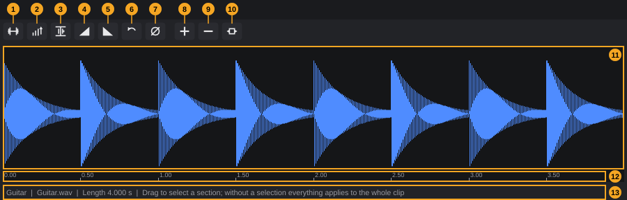
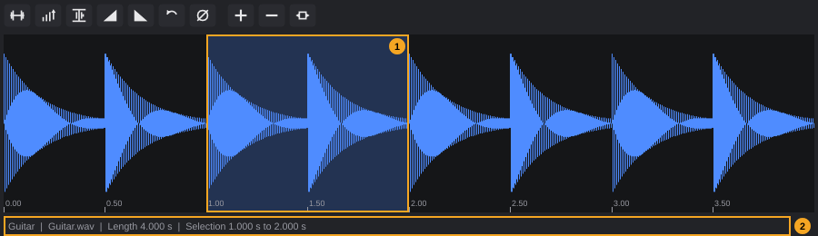
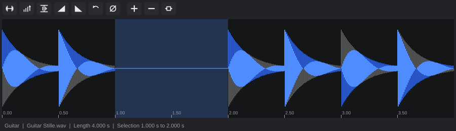
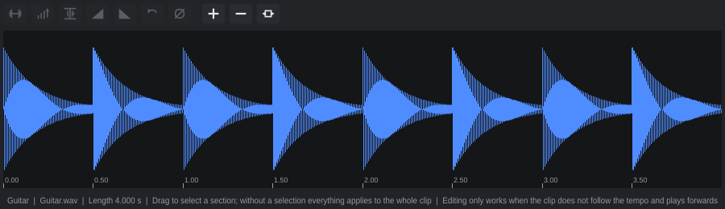

# Sample Editor

The Sample Editor shows one audio clip large, as a waveform, and changes its audio material: you can silence, amplify, normalize, fade, reverse or phase-invert the whole clip or a section of it that you select with the mouse.

**In this chapter**

1. [Opening the Sample Editor](#1-opening-the-sample-editor)
2. [The editor at a glance](#2-the-editor-at-a-glance)
3. [Zooming and scrolling](#3-zooming-and-scrolling)
4. [Selecting a section](#4-selecting-a-section)
5. [Processing functions](#5-processing-functions)
6. [What happens to the clip and its files](#6-what-happens-to-the-clip-and-its-files)
7. [When processing is not possible](#7-when-processing-is-not-possible)
8. [What the Sample Editor does not do](#8-what-the-sample-editor-does-not-do)
9. [Undo and error messages](#9-undo-and-error-messages)
10. [Quick reference](#10-quick-reference)

---

## 1. Opening the Sample Editor

The Sample Editor lives in the **lower zone** of the project window, the area below the arrangement (see [The project window §8](project-window.md#8-lower-zone)). Its tab is called **Sample Editor**.

**To edit an audio clip:**

1. In the arrangement, double-click the audio clip (this works with any tool).
2. The lower zone opens (if it was hidden) and switches to the **Sample Editor** tab with the clip loaded. The whole clip is visible, and no section is selected.

**To show the Sample Editor without loading a clip,** use any of these:

- Press **F7**.
- Choose **View › Sample Editor**.
- Click the **Sample Editor** tab in the lower zone.

These only switch to the tab; the editor keeps showing the clip it showed last. **F7** does not hide the lower zone again when the tab is already showing.

As long as no clip is loaded, the editor shows a hint instead of a waveform:

*Double-click an audio clip in the arrangement to edit it here.*

The editor always shows one clip. It follows changes to that clip in the arrangement (for example a new length after trimming). If you delete the clip, delete its track or open another project, the editor empties itself and shows the hint again.

> **Note:** The editor does not follow the clip selection in the arrangement. Only a double-click loads another clip.

---

## 2. The editor at a glance

| # | Element | What it does | Details |
|---|---|---|---|
| 1 | **Silence** | Replaces the section with silence | [§5.1](#51-silence) |
| 2 | **Amplify** | Opens a menu with gain steps from +6 dB to −12 dB | [§5.2](#52-amplify) |
| 3 | **Normalize** | Raises or lowers the section so its peak is at 0 dBFS | [§5.3](#53-normalize) |
| 4 | **Fade in** | Linear fade-in over the section | [§5.4](#54-fade-in-and-fade-out) |
| 5 | **Fade out** | Linear fade-out over the section | [§5.4](#54-fade-in-and-fade-out) |
| 6 | **Reverse** | Turns the section backwards | [§5.5](#55-reverse) |
| 7 | **Invert phase** | Inverts the polarity of the section | [§5.6](#56-invert-phase) |
| 8 | **Zoom in** | Shows half as much time | [§3](#3-zooming-and-scrolling) |
| 9 | **Zoom out** | Shows twice as much time | [§3](#3-zooming-and-scrolling) |
| 10 | **Show the whole clip** | Zooms so the whole clip fits | [§3](#3-zooming-and-scrolling) |
| 11 | Waveform | The audio of the clip; drag here to select a section | [§4](#4-selecting-a-section) |
| 12 | Time marks | Seconds from the start of the clip | below |
| 13 | Info line | Clip name, file name, length, selection and hints | below |

The buttons show only symbols. Their tooltips:

<!-- FIX F-1106: tooltips may become consistent (section or whole clip) -->
| # | Tooltip |
|---|---|
| 1 | *Silence: mute a section (or the whole clip)* |
| 2 | *Amplify or attenuate (selection in dB)* |
| 3 | *Normalize: set the peak of the section to 0 dBFS* |
| 4 | *Fade in over the section* |
| 5 | *Fade out over the section* |
| 6 | *Reverse the section* |
| 7 | *Invert phase* |
| 8 | *Zoom in (Ctrl+wheel)* |
| 9 | *Zoom out (Ctrl+wheel)* |
| 10 | *Show the whole clip* |

All seven processing buttons (1–7) work on the selected section, or on the **whole clip** when nothing is selected.

**The waveform (11)**

<!-- FIX F-1107: clip gain, clip fades and reverse may become visible in the waveform -->
- The waveform shows the part of the audio file that the clip plays, from the clip start to the clip end. Material that is hidden because the clip was trimmed in the arrangement is not shown.
- Every channel of the file gets its own waveform, one above the other: a stereo file shows two.
- If the clip was stretched in the arrangement (see [Arranging §15](arranging.md#15-tempo-and-pitch-time-stretch)), the waveform is stretched with it, so it lines up with the clip's own time.
- The waveform shows the material **as it is in the file**. The clip gain, the clip's fade-in and fade-out from the arrangement and the **Reverse** switch of the arrangement are not shown.
- The waveform is calculated in the background. Directly after opening a long file it can take a moment until it appears.

**The time marks (12)** run along the bottom edge of the waveform. Each mark is a short line with the time in **seconds from the start of the clip** (not the project position, not the position in the file). The spacing adapts to the zoom: steps of 1, 2 or 5 times a power of ten, at least 60 pixels apart. With steps below one second, the labels have two decimals (for example **0.50**), otherwise none (for example **2**).

**The info line (13)** at the bottom shows, separated by **|**:

1. the clip name,
2. the name of the audio file the clip plays,
3. the clip length, for example **Length 4.000 s**,
4. either the selection, for example **Selection 1.000 s to 2.000 s**, or, without a selection, the hint **Drag to select a section; without a selection everything applies to the whole clip**,
5. only when processing is not possible: **Editing only works when the clip does not follow the tempo and plays forwards** ([§7](#7-when-processing-is-not-possible)).

All times in the info line are in seconds with three decimals.

---

## 3. Zooming and scrolling

When a clip is loaded, the editor shows the whole clip. You can zoom in to see details:

| Action | Result |
|---|---|
| Click **Zoom in** (8) | Half as much time is visible; the middle of the view stays in place |
| Click **Zoom out** (9) | Twice as much time is visible; the middle of the view stays in place |
| Click **Show the whole clip** (10) | The whole clip fits the width again |
| **Ctrl**+mouse wheel over the waveform | Zooms in (wheel up) or out (wheel down) by a factor of 1.25 per step; the time under the mouse pointer stays in place |
| Mouse wheel (without **Ctrl**) | Scrolls left (wheel up) or right (wheel down); the step grows with the visible time, so it feels the same at every zoom |
| Horizontal wheel or trackpad swipe | Scrolls left or right |

- You can zoom in until 5 milliseconds fill the width, and zoom out until the whole clip is visible; you cannot zoom out further than the clip.
- Scrolling stops at the start and at the end of the clip.
- There is no scrollbar and no overview strip; scroll with the wheel.
- Zooming and scrolling do not change the project and are not undo steps. The selection stays when you zoom or scroll.

<!-- FIX F-1104: the view may adapt itself when the clip length changes -->
> **Tip:** The view keeps its zoom when the clip changes its length in the arrangement. After trimming the clip, click **Show the whole clip** (10) so that the view matches the new length again.

---

## 4. Selecting a section

A section limits the processing functions to part of the clip.

**To select a section:**

1. Point into the waveform at one end of the section.
2. Hold the left mouse button and drag to the other end (left or right). From the first 3 pixels of movement on, the section (1) is shown as a light coloured area behind the waveform.
3. Release the mouse button. The info line (2) shows the section, for example **Selection 1.000 s to 2.000 s**.

- The section always lies within the clip: dragging beyond the start or end of the clip stops at the clip edge.
- The section does not snap to a grid or to zero crossings; it follows the mouse exactly.
- The view does not scroll while you drag. To select more than is visible, zoom out first.
- A section shorter than 1 millisecond is discarded.

**To remove the selection,** click once into the waveform without dragging. The info line shows the hint again, and the next processing function works on the whole clip.

> **Note:** Every click into the waveform removes the selection. If you click into the waveform and then click a processing button, the **whole clip** is processed.

The selection stays after processing, so you can apply several functions to the same section one after the other. It is removed when you load another clip by double-clicking.

---

## 5. Processing functions

**To process audio:**

1. Select a section ([§4](#4-selecting-a-section)), or remove the selection to process the whole clip.
2. Click the button of the function. **Amplify** first shows a menu ([§5.2](#52-amplify)).
3. The change is applied at once and the waveform shows the result.

Every function writes a **new audio file** and lets the clip play it; the old file is kept, and **Undo** returns to it. See [§6](#6-what-happens-to-the-clip-and-its-files).

The functions work on all channels of the clip at once.

| Function | What it does to the section | Undo step |
|---|---|---|
| **Silence** | Sets every sample to zero | *Silence* |
| **Amplify** | Multiplies by the chosen gain | *Amplify* |
| **Normalize** | Scales so the loudest sample reaches 0 dBFS | *Normalize section* |
| **Fade in** | Linear ramp from silence to full level | *Fade-in* |
| **Fade out** | Linear ramp from full level to silence | *Fade-out* |
| **Reverse** | Plays the section backwards | *Reverse section* |
| **Invert phase** | Inverts the polarity (multiplies by −1) | *Invert phase* |

The material outside the section is not changed.

### 5.1 Silence

**Silence** (1) replaces the section with digital silence. The clip keeps its length; the silent part simply plays nothing.

Example: to remove a cough between two phrases, select the cough and click **Silence**.

### 5.2 Amplify

**Amplify** (2) raises or lowers the level of the section by a fixed amount.

1. Click **Amplify**. A menu opens at the button. Its heading reads **Amplify section** when a section is selected, or **Amplify whole clip** without a selection.
2. Choose one of **+6 dB**, **+3 dB**, **+1 dB**, **-1 dB**, **-3 dB**, **-6 dB** or **-12 dB**.

- Click outside the menu to close it without a change.
- There is no free value. For other amounts, apply several steps one after the other (for example +3 dB and +1 dB for +4 dB); each step is its own undo step.
- Amplifying does not protect against overload: the new file stores floating-point values, so the level is not clipped in the file, but a level above 0 dBFS can still overload later in the mix.

> **Tip:** To change the volume of the whole clip without writing a new file, use the clip gain in the arrangement instead ([Arranging §13](arranging.md#13-clip-gain-and-normalizing)).

### 5.3 Normalize

**Normalize** (3) scales the section so that its loudest sample is exactly at **0 dBFS**. A section that is louder than that is turned down, a quieter one turned up.

<!-- FIX F-1101: the two Normalize functions may get distinct names or work together with the clip gain -->
> **Note:** This is not the same as **Normalize (peak 0 dBFS)** in the arrangement ([Arranging §13](arranging.md#13-clip-gain-and-normalizing)). That one sets the clip gain and leaves the file unchanged. The Sample Editor's **Normalize** changes the file and does **not** take the clip gain into account: if the clip gain is, for example, +6 dB, the normalized clip plays 6 dB above 0 dBFS.

- Normalizing only a section changes the level of that section relative to the rest of the clip.
- A completely silent section stays silent; nothing is changed, but a new file and an undo step are still created.

### 5.4 Fade in and fade out

**Fade in** (4) lets the section rise linearly from silence to its full level. **Fade out** (5) lets it fall linearly from full level to silence.

1. Select the section the fade should cover: for a fade-in from the clip start, drag from the very start of the clip; for a fade-out, drag to the very end.
2. Click **Fade in** or **Fade out**.

- Without a selection, the fade covers the whole clip.
- The fade shape is always linear; there are no other curves.
- A fade on a section in the middle of the clip is possible: the level then jumps back to full level (after a fade-out) or starts from silence (before a fade-in) at the section edges.

> **Note:** These fades are written into the audio file. They are independent of the fade handles of the clip in the arrangement ([Arranging §12.1](arranging.md#121-fade-in-and-fade-out)), which change nothing in the file and can be adjusted at any time. Both act together: a clip with a written fade-in and a fade-in from the handle fades in twice. The Sample Editor does not show the handle fades.

### 5.5 Reverse

**Reverse** (6) turns the section around in the file: the end of the section plays first.

> **Note:** This is different from **Reverse** in the arrangement ([Arranging §14](arranging.md#14-reverse-and-invert-phase)). There, the whole clip plays backwards as a switch, and the file stays unchanged. A clip that is reversed in the arrangement cannot be processed in the Sample Editor at all ([§7](#7-when-processing-is-not-possible)).

### 5.6 Invert phase

**Invert phase** (7) inverts the polarity of the section: positive samples become negative and vice versa. You hear no difference on its own; it matters when the clip is played together with another recording of the same source (for example two microphones on one instrument).

**Edit › Audio › Invert phase** and the clip context menu in the arrangement do the same for the whole of each selected clip ([Arranging §14](arranging.md#14-reverse-and-invert-phase)). Only the Sample Editor can invert a section.

---

## 6. What happens to the clip and its files

Processing in the Sample Editor is **destructive** for the clip, but not for your recordings:

1. The audio the clip plays is read from its file, from the clip start to the clip end.
2. The function is applied to the section (or to all of it).
3. The result is written as a **new WAV file** (32-bit floating point, same sample rate and number of channels as the original) into the **Audio/** folder of the project.
4. The clip now plays the new file. Its position in the arrangement, its length, clip gain, fades, tempo and pitch settings stay as they were.

The old file stays untouched in the project folder. **Undo** lets the clip play the old file again ([§9](#9-undo-and-error-messages)).

**File names.** The new file is called after the clip name plus a word for the function. If such a file already exists, a number is added (for example *Guitar Stille2.wav*):

<!-- FIX F-306: these file names may be English -->
| Function | File name |
|---|---|
| **Silence** | *clip name* Stille.wav |
| **Amplify** | *clip name* Gain.wav |
| **Normalize** | *clip name* Normalisiert.wav |
| **Fade in** | *clip name* FadeIn.wav |
| **Fade out** | *clip name* FadeOut.wav |
| **Reverse** | *clip name* Rueckwaerts.wav |
| **Invert phase** | *clip name* Phase.wav |

The info line ([§2](#2-the-editor-at-a-glance)) shows the name of the file the clip currently plays. The clip name itself does not change, so after several steps you see files like *Guitar Stille.wav*, *Guitar FadeOut.wav* and so on in **Audio/**.

> **Note:** Every processing step adds a file, and files are never removed automatically, not even by **Undo**. Long editing sessions can fill the **Audio/** folder.

> **Note:** The new file contains only the part that the clip played. Material that was hidden by trimming the clip in the arrangement is not in the new file: after processing, you can no longer drag the clip edges outwards to reveal it. **Undo** brings the old file, and with it the hidden material, back. The same applies to **Invert phase** in the arrangement ([Arranging §14](arranging.md#14-reverse-and-invert-phase)).

<!-- FIX F-1105: processing a clip with takes may keep the take list consistent -->
> **Note:** On a clip with takes (see [Recording §11](recording.md#11-loop-recording-and-takes)), processing changes only what the clip plays now; the new file does not become a take. If you then choose a take, the clip plays that take's original recording, without the processing.

---

## 7. When processing is not possible

The seven processing buttons are greyed out when

- no clip is loaded,
- the clip **follows the project tempo** (**Tempo and Pitch...** window, see [Arranging §15.2](arranging.md#152-the-tempo-and-pitch-window)), or
- the clip is **reversed** in the arrangement (see [Arranging §14](arranging.md#14-reverse-and-invert-phase)).

In the last two cases, the info line adds **Editing only works when the clip does not follow the tempo and plays forwards**. Turn off **Follow tempo** or **Reverse** in the arrangement; the buttons become available at once.

The zoom buttons always stay available.

**Baked tracks.** On a baked track (see [Arranging §21](arranging.md#21-baked-tracks)) the buttons look available, but clicking one shows an error window instead of processing:

- *"name" is baked. To edit it, unbake it first (track header or inspector).*
- *"name" is baked into the group "group". To edit it, unbake it there.*

---

## 8. What the Sample Editor does not do

So that you do not search for them, these functions are **not** part of the Sample Editor:

<!-- FIX F-1103: playback of the selection, a playhead and bars/beats may be added -->
- **Playback and audition.** The editor has no play button and shows no playhead. To listen, play the project with the transport (see [Transport](transport.md)); the editor's times are in seconds from the clip start, so find the position in the arrangement.
- **Bars and beats, grid.** The time marks show seconds only; selections do not snap.
- **Hitpoints, slicing, tempo detection.** There are none in the Sample Editor. The tempo of an audio clip is detected in the **Tempo and Pitch...** window of the arrangement ([Arranging §15.2](arranging.md#152-the-tempo-and-pitch-window)).
- **Cutting, copying, pasting or deleting audio.** The clip length cannot be changed here. Trim, split and glue clips in the arrangement ([Arranging](arranging.md)). To make a section quiet, use **Silence**.
- **Drawing samples, free gain values, fade curves, time stretch and pitch** for a section.
- **Takes.** The editor shows only the take the clip plays now; choose takes in the arrangement ([Recording §11.2](recording.md#112-choosing-a-take)).

<!-- FIX F-1102: keys may act on the Sample Editor (for example Del silences or deletes the section) -->
**Keyboard.** The Sample Editor has no keyboard commands of its own. Keys you press while working in it go to the project window and act **on the arrangement**, as described in [The project window §11](project-window.md#11-keyboard-shortcuts-in-the-project-window). For example:

- **Del** or **Backspace** deletes the selected **clips** in the arrangement (or the range, if a range is drawn). With the Select tool, double-clicking a clip also selects it, so **Del** then deletes the clip you are looking at in the Sample Editor. **Undo** brings it back.
- **Ctrl+A** selects all clips in the arrangement, not the whole audio in the editor.
- **Space** starts and stops playback of the project.
- **Ctrl+Z** / **Ctrl+Y** undo and redo ([§9](#9-undo-and-error-messages)).

---

## 9. Undo and error messages

Every processing step is one undo step, named after the function: *Silence*, *Amplify*, *Normalize section*, *Fade-in*, *Fade-out*, *Reverse section*, *Invert phase*. The names are the same whether you processed a section or the whole clip.

- Undo with **Edit › Undo** (**Ctrl+Z**), redo with **Edit › Redo** (**Ctrl+Y** or **Ctrl+Shift+Z**). **Edit › History...** lists the steps by name.
- Undo lets the clip play the file it played before; the waveform and the file name in the info line change back. The selection in the editor stays.
- Selecting, zooming and scrolling are not undo steps.

**Error messages.** When processing is refused, a window titled **Error** explains why:

| Message | When |
|---|---|
| *"name" is baked. To edit it, unbake it first (track header or inspector).* | The clip lies on a baked track |
| *"name" is baked into the group "group". To edit it, unbake it there.* | The clip's track feeds a baked group |
| *The audio file is not readable: …* | The clip's audio file is missing or damaged |
| *Could not read the audio file.* | Reading the file failed part-way |
| *The section is empty.* | The section lies outside the audio material (for example beyond the end of a file that is shorter than the clip) |
| *Could not write the file: …* | The new file could not be written into **Audio/** (disk full, no write permission) |
| *The Audio/ folder is missing.* | The **Audio/** folder of the project could not be created |
| *Not possible on reversed clips. Turn off "Reverse" first.* | The clip is reversed (normally the buttons are greyed out before this can happen) |
| *Not possible while the clip follows the project tempo. Turn off "Follow tempo" first.* | The clip follows the project tempo (normally the buttons are greyed out before this can happen) |

---

## 10. Quick reference

| What | How |
|---|---|
| Open a clip | Double-click an audio clip in the arrangement |
| Show the tab | **F7**, **View › Sample Editor**, or the **Sample Editor** tab |
| Select a section | Drag in the waveform |
| Remove the selection | Click into the waveform without dragging |
| Process the whole clip | Remove the selection, then click a function |
| Silence / amplify / normalize | Buttons 1 / 2 (menu: +6 to −12 dB) / 3 |
| Fade in / fade out (linear) | Buttons 4 / 5 |
| Reverse / invert phase | Buttons 6 / 7 |
| Zoom | **Ctrl**+wheel; **Zoom in** / **Zoom out** buttons (factor 2) |
| Whole clip | **Show the whole clip** button |
| Scroll | Mouse wheel |
| Undo / redo | **Ctrl+Z** / **Ctrl+Y** |
| Processed files | New WAV files in **Audio/**; the old file stays |
| Not possible when | The clip follows the tempo, plays backwards, or lies on a baked track |
