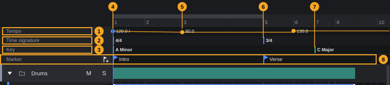

# Signature track: tempo, time signature, key

The signature track holds the musical frame of the song: the tempo and its changes, the time signature and its changes, and the key and its changes. Everything that counts in bars and beats follows it: the ruler, the grid, the bar and beat display, rewind and forward, and the clips, which keep their place in the bar when you change the tempo.

**In this chapter**

1. [Where to find the signature track](#1-where-to-find-the-signature-track)
2. [The signature track at a glance](#2-the-signature-track-at-a-glance)
3. [Tempo](#3-tempo)
4. [What tempo changes do to clips](#4-what-tempo-changes-do-to-clips)
5. [Time signature](#5-time-signature)
6. [Key](#6-key)
7. [Tempo and time signature in the transport bar](#7-tempo-and-time-signature-in-the-transport-bar)
8. [MIDI files, export and tempo detection](#8-midi-files-export-and-tempo-detection)
9. [Undo](#9-undo)
10. [Quick reference](#10-quick-reference)

---

## 1. Where to find the signature track

The signature track sits at the top of the arrangement, directly below the ruler and above the marker track ([The project window §7](project-window.md#7-arrangement-area)). It has three rows, called **Tempo**, **Time signature** and **Key**; each row is 18 pixels high.

- The signature track is always shown while a project is open. It cannot be hidden, moved or deleted, and it stays at the top while you scroll the tracks ([Tracks](tracks.md)).
- It scrolls and zooms horizontally together with the arrangement ([The project window §7](project-window.md#7-arrangement-area)).
- The left part, as wide as the track headers, shows the row names. Clicks there do nothing.
- There is no menu entry and no key for the signature track; you work in it with the mouse. The tempo and time signature at the project start can also be typed in the transport bar ([§7](#7-tempo-and-time-signature-in-the-transport-bar)).

Hover over the signature track to see its tooltip: *Signature track: click sets tempo, time signature or key on the grid. Tempo point: drag (time/BPM), double-click jump/ramp, right-click removes*.

**Markers** are not part of the signature track. They live in the marker track directly below it and are explained in [Transport §11](transport.md#11-markers).

---

## 2. The signature track at a glance

In the example the song starts at 120 BPM and slows down evenly to 90 BPM at bar 3 (a ramp). From bar 3 it stays at 90 BPM, and at bar 6 it jumps to 130 BPM. The time signature changes from 4/4 to 3/4 at bar 5. The key is A Minor and changes to C Major at bar 7.

| # | Element | What it does | Details |
|---|---|---|---|
| 1 | **Tempo** row | Tempo points and the tempo curve (orange line). The higher the line, the faster | [§3](#3-tempo) |
| 2 | **Time signature** row | Time signature at the start (**4/4**) and every change, each with a blue line | [§5](#5-time-signature) |
| 3 | **Key** row | Key at the start (**A Minor**) and every change, each with a green line | [§6](#6-key) |
| 4 | Ramp point, **120.0 /** | Blue point: the tempo runs in a straight line from here to the next point | [§3.5](#35-jump-or-ramp) |
| 5 | Jump point, **90.0** | Orange point: the tempo jumps to this value and holds it up to the next point | [§3.5](#35-jump-or-ramp) |
| 6 | Time signature change, **3/4** | 3/4 from bar 5 | [§5](#5-time-signature) |
| 7 | Key change, **C Major** | C Major from bar 7 | [§6](#6-key) |
| 8 | Marker track | Named positions (*Intro*, *Verse*); not part of the signature track | [Transport §11](transport.md#11-markers) |

The first point of each row (here **120.0 /**, **4/4** and **A Minor** at the project start) is always there. It is the tempo, time signature and key of the project and cannot be removed or moved away from the start.

A new project starts with **120 BPM**, **4/4** and **C Major**.

---

## 3. Tempo

### 3.1 Fixed tempo and tempo changes

A song with a single tempo has only the first tempo point. Its value is the project tempo, shown in the transport bar as well ([§7](#7-tempo-and-time-signature-in-the-transport-bar)).

For a song whose tempo changes, add more **tempo points**. Each point has a position, a tempo in BPM and a type: **jump** or **ramp** ([§3.5](#35-jump-or-ramp)). The tempo row draws the resulting tempo as an orange line: a jump as a step, a ramp as a slope.

**BPM** always counts quarter notes per minute, in every time signature. At 120 BPM a quarter note lasts half a second, also in 6/8.

**Reading the tempo row:**

- Each point shows its tempo with one decimal, for example **90.0**. A ramp point adds **/**, for example **120.0 /**.
- Jump points are orange, ramp points are blue.
- The height of the row covers at least 40 to 200 BPM. If a point is slower or faster, the range grows so that it reaches 20 BPM beyond the slowest and the fastest point.

### 3.2 Inserting a tempo point

1. Click an empty place in the **Tempo** row.
2. A jump point appears at the nearest grid position (when **Snap** is on, see [Arranging §3](arranging.md#3-grid-and-snap)). It then moves to the nearest whole beat of the time signature (a quarter note in 4/4, an eighth note in 6/8), also when **Snap** is off or the grid is finer.
3. The new point gets the tempo that applies at that place, so the song does not change yet. Drag it up or down to set its tempo ([§3.3](#33-changing-the-tempo-of-a-point)).

<!-- FIX F-1210: a click on the beat of an existing point may select that point instead of adding a second one -->
- A click within about 8 pixels of an existing point grabs that point instead of adding one. A click a little further away, but on the same beat, adds a second point on exactly the same place; it covers the first one. Remove it with a right-click ([§3.6](#36-removing-a-tempo-point)).
- If you click inside a ramp, the ramp from the previous point now ends at the new point, and the new point holds its tempo up to the next point, so the song after it plays slightly differently. Double-click the new point to let the ramp continue through it ([§3.5](#35-jump-or-ramp)).

History: **Set tempo point**.

### 3.3 Changing the tempo of a point

<!-- FIX F-1204: tempo points may get a field to type the tempo, and finer dragging -->
1. Point at the tempo point and press the mouse button.
2. Drag up for a faster tempo, down for a slower one. While you drag, the point and its value show the new tempo.
3. Release the mouse button. The tempo is set.

- The tempo of a point can only be set by dragging; there is no field to type it. Only the first point can be typed exactly, in the transport bar ([§7](#7-tempo-and-time-signature-in-the-transport-bar)).
- The row is only 18 pixels high, so one pixel of mouse movement changes the tempo by several BPM (about 16 BPM at the standard range of 40 to 200 BPM). Check the value after releasing.
- You can drag only within the current range of the row. To go beyond it, release the mouse button: the range grows by 20 BPM beyond the new value, and you can drag further.
- The first point can be dragged up and down, but not sideways.

History: **Change tempo**.

### 3.4 Moving a tempo point

<!-- FIX F-1203: a sideways drag may keep the tempo of the point -->
1. Drag a tempo point (not the first one) to the left or right.
2. Release the mouse button.

- The point snaps to the grid when **Snap** is on; with Snap off it moves freely.
- A point cannot pass its neighbours: it stops at the previous or next tempo point.
- **The tempo follows the height of the mouse while you drag**, also when you only move sideways. Since the row is so narrow, a sideways drag usually changes the tempo of the point as well. Check the value after releasing and drag it back up or down if needed.
- The first point always stays at the project start.

History: **Move tempo point**, and **Change tempo** if the tempo changed as well ([§9](#9-undo)).

### 3.5 Jump or ramp

| Type | Tempo between this point and the next | Shown as |
|---|---|---|
| **Jump** | Jumps to the value of the point and holds it until the next point | Orange point, a step in the line |
| **Ramp** | Changes evenly from the value of this point to the value of the next point | Blue point with **/**, a sloping line |

**To switch a point between jump and ramp:** double-click it. The first point can be a ramp too; in the example it is (number 4).

- New points are always jumps.
- A ramp needs a following point. On the last point a ramp has nothing to run to, and the tempo stays constant after it.

History: **Change tempo**.

> **Example:** For a slow-down at the end of a song, insert a point where the slow-down begins and another where it ends. Drag the second point down to the end tempo, then double-click the first point. The tempo now falls evenly between the two points.

### 3.6 Removing a tempo point

Right-click a tempo point. It is removed at once, without a question. History: **Remove tempo point**.

The first point cannot be removed; a right-click on it does nothing. A right-click on an empty place in the row does nothing either.

### 3.7 Value range

<!-- FIX F-1202: the upper limit may become 400 BPM as stated in the code, or the text names 300 BPM consistently -->
The tempo can be between **20** and **300 BPM**. Values outside are set to the nearest limit, without a message.

---

## 4. What tempo changes do to clips

When you change the tempo or the type (jump or ramp) of a tempo point, the arrangement keeps its musical positions:

- **MIDI clips** keep their start and end in bars and beats and play faster or slower with the tempo.
- **Audio clips** keep their start in bars and beats. A clip that does not follow the tempo keeps its length and plays its material at the original speed. A clip with **Follow tempo** switched on stretches along with the tempo ([Arranging §15.2](arranging.md#152-the-tempo-and-pitch-window)).
- **Automation**, **markers** and the **locators** keep their bar and beat positions too.

<!-- FIX F-1206: moving or removing a tempo point may keep the clips in their bars as well -->
> **Note:** **Moving** or **removing** a tempo point does not move anything: clips, automation, markers and locators keep their position in *time*. Because the bar lines move, they may afterwards start at a different bar or beat than before. Check the arrangement after moving or removing a tempo point, or use **Edit › Undo**.

Inserting a tempo point does not change anything by itself, because the new point gets the tempo that already applies there ([§3.2](#32-inserting-a-tempo-point)).

The bar lines in the ruler and in the arrangement, the bar numbers, the bar and beat display, **Rewind** and **Forward** ([Transport §4](transport.md#4-moving-the-playhead)) and the grid all follow the tempo changes.

---

## 5. Time signature

The **Time signature** row shows the time signature at the project start and every change. A change always applies from the **start of a bar**.

### Inserting or changing a time signature

<!-- FIX F-1205: the signature track may offer more time signatures or a field to type one -->
1. Click in the **Time signature** row, in the bar where the new time signature should begin.
2. A menu opens with **4/4**, **3/4**, **2/4**, **6/8**, **5/4**, **7/8**, **12/8** and **9/8**.
3. Choose a time signature. The change is placed at the start of the bar you clicked, also when you clicked in the middle of the bar. Press **Esc** or click elsewhere to close the menu without a change.

- To change an existing change, click on it: on its line or up to 60 pixels to the right of it, where its name is. The menu then changes that time signature instead of adding one.
- If the bar you clicked already starts with a change, that change gets the new time signature.
- A click in bar 1 (outside of the first entry) changes the project time signature.
- The menu offers only the eight time signatures listed. Other time signatures, for example 5/8 or 7/4, can only be set for the project start, in the transport bar ([§7](#7-tempo-and-time-signature-in-the-transport-bar)).

History: **Set time signature** (new change) or **Change time signature** (existing change).

<!-- FIX F-1207: time signature and key changes may be moved by dragging -->
**Moving:** time signature changes cannot be dragged. Remove the change and insert it again in the new bar.

### Removing a time signature change

Right-click the change (its line or its name). It is removed at once. The first time signature cannot be removed. History: **Remove time signature change**.

### What a time signature change does

- The bar lines and bar numbers in the ruler and the arrangement follow it: in the example, bars 5 and later have three beats.
- The grid value **Bar** is one bar of the time signature at that position, **Beat** one beat ([Arranging §3](arranging.md#3-grid-and-snap)). New MIDI clips that are one bar long use the time signature at their position ([Arranging §18](arranging.md#18-creating-midi-clips)).
- The bar and beat display in the transport bar and **Rewind** and **Forward** count the bars correctly after the change.
- Clips are not moved when you add, change or remove a time signature change. They keep their position in time, so after the change they may begin at a different bar or beat. Check the arrangement afterwards.

<!-- FIX F-1209: the Key Editor may follow time signature changes -->
> **Note:** The Key Editor draws its bar lines with the time signature of the **project start**, also for clips after a time signature change. Chords inserted there are one bar of that time signature long ([Key Editor §15](key-editor.md#15-key-and-chords)).

---

## 6. Key

The **Key** row shows the key at the project start and every key change. A key consists of a root note and a scale, for example **A Minor** or **D Dorian**.

**Root notes:** **C**, **C#**, **D**, **D#**, **E**, **F**, **F#**, **G**, **G#**, **A**, **Bb**, **B**.

**Scales:** **Major**, **Minor**, **Dorian**, **Phrygian**, **Lydian**, **Mixolydian**, **Locrian**, **Harmonic minor**, **Melodic minor**.

### Inserting a key change

<!-- FIX F-1208: a key change may be created only after you choose a key -->
<!-- FIX F-1201: the window may show the key of the new change -->
1. Click in the **Key** row where the new key should begin. The position snaps to the grid when **Snap** is on; a key change does not have to sit at the start of a bar.
2. A key change is created **at once**, with the key that applied at that place, and a small window opens next to the mouse with two lists: the root note (tooltip **Root note**) and the scale (tooltip **Scale**).
3. Choose the root note and the scale. Each choice takes effect immediately.
4. Click outside the window to close it.

- If you close the window without choosing anything, the key change stays, with the same key as before it. It changes nothing; remove it with a right-click if you do not need it.
- If a later key change already exists, the window may show the key of that later change at first, although the new change has the key that applied at the click position. Look at the name in the **Key** row after choosing.

History: **Set key**, and **Change key** for every choice in the window.

### Changing a key

Click an existing key change (its line or up to 60 pixels to the right of it, where its name is). The window opens with its root note and scale. Choose new ones; the name in the row changes at once. Click outside to close. History: **Change key**.

The first entry is the project key. Change it the same way.

**Moving:** key changes cannot be dragged. Remove the change and insert it again at the new position.

### Removing a key change

Right-click the key change. It is removed at once. The project key cannot be removed. History: **Remove key change**.

### What the key does

The key does not change how anything sounds and does not transpose notes. It is used by the Key Editor ([Key Editor §15](key-editor.md#15-key-and-chords)):

- The **Key** label in the Key Editor toolbar shows the key at the **start of the clip**.
- Rows of notes that are not in that key are dimmed in the note grid.
- The chord section offers the chords of that key, for example *ii  Dm* in C Major, and **Chord** and **Alt**+click insert them.

When you change the key, the open Key Editor updates at once.

<!-- FIX F-1209: the Key Editor may follow key changes inside the clip -->
> **Note:** Only the key at the start of a clip counts. A key change in the middle of a clip has no effect on the Key Editor for that clip. To work with a new key, start a new clip at the key change.

---

## 7. Tempo and time signature in the transport bar

The transport bar shows the tempo (for example **120.00 BPM**) and the time signature (for example **4/4**) of the **project start**, that is, of the first tempo point and the first time signature in the signature track. They do not show the tempo at the playhead.

- Double-click a field to type a new value. The tempo field changes the first tempo point; a ramp stays a ramp. The time signature field changes the first time signature and accepts 1 to 32 beats with the note values 2, 4, 8 and 16. Details: [Transport §12](transport.md#12-tempo-and-time-signature).
- Changes in the signature track to the first point appear in the transport bar at once, and the other way round.
- Tooltips: *Tempo in BPM, double-click to edit* and *Time signature, e.g. 4/4 or 6/8, double-click to edit*.

---

## 8. MIDI files, export and tempo detection

- **Importing a MIDI file with its own tempo:** FK Audio Suite asks whether to adopt the tempo. **Adopt tempo** removes all tempo points and time signature changes from the insert position onwards and writes those of the file in their place, as jumps ([Arranging §19.5](arranging.md#195-midi-files-with-their-own-tempo)). History: **Tempo from MIDI file**.
- **Exporting a MIDI file:** tempo points and time signatures are written into the file. A ramp is written as a jump to the tempo at its start.
- **Tempo detection:** there is no tempo detection for the whole project. The tempo of an audio clip can be detected in its **Tempo and Pitch...** window ([Arranging §15.2](arranging.md#152-the-tempo-and-pitch-window)); type the result into the signature track or the transport bar yourself if the project should run at that tempo.
- Tempo, time signature and key are saved with the project and in templates.

---

## 9. Undo

Every change in the signature track is an undo step. Use **Edit › Undo** (**Ctrl+Z**) and **Edit › Redo** (**Ctrl+Y** or **Ctrl+Shift+Z**), or the **History** window.

| History entry | Action |
|---|---|
| **Set tempo point** | Inserting a tempo point |
| **Change tempo** | Dragging a tempo point up or down, switching jump/ramp, typing the tempo in the transport bar |
| **Move tempo point** | Dragging a tempo point sideways |
| **Remove tempo point** | Right-click on a tempo point |
| **Set time signature** | New time signature change from the menu |
| **Change time signature** | Existing change from the menu, or typing in the transport bar |
| **Remove time signature change** | Right-click on a time signature change |
| **Set key** | Click in the **Key** row (the key change is created) |
| **Change key** | Every choice in the key window |
| **Remove key change** | Right-click on a key change |
| **Tempo from MIDI file** | **Adopt tempo** when importing a MIDI file |

<!-- FIX F-1211: dragging a tempo point may become one undo step -->
- Dragging a tempo point both sideways and up or down gives **two** steps, **Change tempo** and **Move tempo point**. Undo twice to undo the whole drag.
- A new key change with a new key gives at least two steps: **Set key** and **Change key**.

Errors in the signature track are not shown as a message; the action simply does not happen.

---

## 10. Quick reference

| What | How |
|---|---|
| Insert a tempo point | Click an empty place in the **Tempo** row |
| Change the tempo of a point | Drag the point up or down |
| Move a tempo point | Drag it sideways (not the first point) |
| Jump ↔ ramp | Double-click the tempo point |
| Remove a tempo point | Right-click it (not the first point) |
| Project tempo, exact value | Double-click the tempo in the transport bar and type it |
| Tempo range | 20–300 BPM |
| Insert or change a time signature | Click in the **Time signature** row, choose from the menu |
| Time signatures in the menu | 4/4, 3/4, 2/4, 6/8, 5/4, 7/8, 12/8, 9/8 |
| Remove a time signature change | Right-click it (not the first) |
| Project time signature, any value | Double-click the time signature in the transport bar (1–32 beats; 2, 4, 8, 16) |
| Insert a key change | Click in the **Key** row, choose root note and scale |
| Change a key | Click the key name, choose root note and scale |
| Remove a key change | Right-click it (not the project key) |
| Markers | Marker track below the signature track ([Transport §11](transport.md#11-markers)) |
| Undo | **Ctrl+Z**; redo **Ctrl+Y** or **Ctrl+Shift+Z** |
