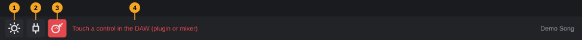
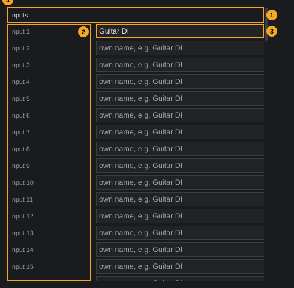
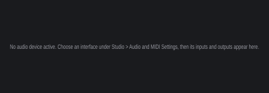

# Studio connections and settings

This chapter is the complete reference for everything that belongs to your computer rather than to a single project: the audio interface and MIDI devices, the names of your inputs and outputs, hardware controllers (MIDI Learn), the user-interface language, the update check, the diagnostic tools in the **Help** menu, the files in which FK Audio Suite keeps all of this, and the command-line option. For a short first-time walkthrough of the audio setup, see [Getting started §5](getting-started.md#5-audio-and-midi-setup). Settings that belong to one project (sample rate, recording format, autosave) are described in [Projects §13](projects.md#13-project-settings).

**In this chapter**

1. [The Studio menu](#1-the-studio-menu)
2. [The Studio buttons in the toolbar](#2-the-studio-buttons-in-the-toolbar)
3. [Audio and MIDI settings](#3-audio-and-midi-settings)
4. [Studio connections: naming inputs and outputs](#4-studio-connections-naming-inputs-and-outputs)
5. [MIDI Learn and MIDI mappings](#5-midi-learn-and-midi-mappings)
6. [Language](#6-language)
7. [Update check](#7-update-check)
8. [Logs and the diagnostic report](#8-logs-and-the-diagnostic-report)
9. [The Help menu and the About box](#9-the-help-menu-and-the-about-box)
10. [Where settings are stored, and how to reset them](#10-where-settings-are-stored-and-how-to-reset-them)
11. [Command-line option](#11-command-line-option)
12. [Quick reference](#12-quick-reference)

---

## 1. The Studio menu

The **Studio** menu in the menu bar collects everything that concerns your equipment and the program as a whole. Entries that need an open project are greyed out until you create or open one.

| Entry | Needs a project | What it does | More |
|---|---|---|---|
| **Audio and MIDI settings...** | No | Opens the window **Audio settings**: audio driver, device, channels, sample rate, buffer size, test tone and MIDI inputs. | [§3](#3-audio-and-midi-settings) |
| **Studio connections...** | Yes | Opens the window **Studio Connections**, where you give the inputs and outputs of your interface your own names. | [§4](#4-studio-connections-naming-inputs-and-outputs) |
| **Content Manager (free libraries)...** | No | Downloads and manages free instrument libraries for the built-in FK Sampler. | [Media browser and content §9](media-browser.md#9-the-content-manager) |
| **Plugin manager...** | No | Opens the plugin manager to scan and manage plugins. If it is already open, it comes to the front. | [Instruments and effects §2](instruments-and-effects.md#2-opening-the-plugin-manager) |
| **MIDI Learn** | Yes | Switches MIDI Learn on or off; ticked while it is on. Same as the MIDI Learn button in the toolbar. | [§5](#5-midi-learn-and-midi-mappings) |
| **MIDI mappings...** | Yes | Opens the list of all hardware controls linked in this project, with buttons to remove them. | [§5.3](#53-the-midi-mappings-window) |
| **Language** › | No | **English** or **Deutsch**. The tick marks the language that is set. | [§6](#6-language) |

Separator lines divide the menu into three groups: devices and plugins, MIDI Learn, and language. **Studio connections...** and **Content Manager (free libraries)...** show an icon.

None of these entries has a keyboard shortcut, and they are not listed under **Edit › Keyboard shortcuts…**. Open them with the mouse, or with the keyboard through the menu bar.

The windows **Audio settings**, **Studio Connections** and **MIDI mappings** are centred on the screen and stay in front of the project window: while one of them is open, the project window does not react to the mouse or the keyboard. Close the window with the close button in its title bar or with **Esc** to continue working.

---

## 2. The Studio buttons in the toolbar

Three toolbar buttons at the right end of the toolbar give direct access to the most used Studio functions:



| # | Element | Tooltip | What it does |
|---|---|---|---|
| 1 | Audio settings | *Audio settings: device, buffer, test tone* | Opens the window **Audio settings**, like **Studio › Audio and MIDI settings...** ([§3](#3-audio-and-midi-settings)). Works without a project. |
| 2 | Plugin manager | *Plugin manager: scan and manage plugins* | Opens the plugin manager, like **Studio › Plugin manager...**. |
| 3 | MIDI Learn | *MIDI Learn: switch on, then touch a control in the DAW and move the hardware control* | Switches MIDI Learn on or off ([§5](#5-midi-learn-and-midi-mappings)). Red while it is on. |
| 4 | MIDI Learn hint | — | Only while MIDI Learn is on: red text that tells you the next step, in front of the project name. |

<!-- FIX F-1904: the MIDI Learn button may be greyed out without a project, like the menu entry -->
> **Note:** The MIDI Learn button can be clicked even when no project is open, although the menu entry **Studio › MIDI Learn** is greyed out then. Without a project there is nothing to link; when you then create or open a project, MIDI Learn is switched off again.

The rest of the toolbar is described in [The project window §4](project-window.md#4-toolbar).

---

## 3. Audio and MIDI settings

The window **Audio settings** decides which audio interface FK Audio Suite plays through and records from, how it runs, and which MIDI devices it listens to. The settings apply to all projects and are kept between starts ([§10](#10-where-settings-are-stored-and-how-to-reset-them)).

### 3.1 Opening and closing

Use any of these:

- Choose **Studio › Audio and MIDI settings...**.
- Click the Audio settings button in the toolbar (number 1 in [§2](#2-the-studio-buttons-in-the-toolbar)).

<!-- FIX F-203: the window title may match the menu entry ("Audio and MIDI settings") -->
A window titled **Audio settings** opens, 560 × 760 pixels, centred on the screen. It works without an open project and can be resized. Every change takes effect at once; there is no OK or Cancel button. Close the window with the close button in its title bar or with **Esc**. Closing also stops the test tone ([§3.9](#39-test-tone)).

### 3.2 The window at a glance


The picture was taken on a Linux computer with the ALSA driver; device names, channel names and the available fields depend on your computer.

<!-- FIX F-104: the two test-tone controls (2 and 10) may be merged into one -->
| # | Element | What it does | Details |
|---|---|---|---|
| 1 | **Audio device type:** | The driver family | Only shown if your system offers more than one ([§3.3](#33-audio-device-type)) |
| 2 | **Output:** (or **Device:**) and **Test** | The device that plays the sound; **Test** plays a short test sound on it | [§3.4](#34-output-and-input-device) |
| 3 | **Input:** with level meter | The device you record from; the meter shows its incoming level | [§3.4](#34-output-and-input-device) |
| 4 | **Active output channels:** | One tick box per output channel | [§3.5](#35-active-channels) |
| 5 | **Active input channels:** | One tick box per input channel | [§3.5](#35-active-channels) |
| 6 | **Sample rate:** | Samples per second | [§3.6](#36-sample-rate) |
| 7 | **Audio buffer size:** | Samples per processing block, with the time in milliseconds | [§3.7](#37-buffer-size-and-latency) |
| 8 | **MIDI inputs** | One switch per MIDI input | [§3.10](#310-midi-inputs) |
| 9 | **Rescan** | Looks for MIDI devices right away | [§3.10](#310-midi-inputs) |
| 10 | **Test tone** and **Frequency** | A continuous sine tone to check the outputs, with adjustable pitch | [§3.9](#39-test-tone) |

Fields 1–7 come from the device selector; which of them you see depends on the driver and on whether a device is open. Without an open device, only **Audio device type:** and **Output:** with **<< none >>** are shown. Devices with their own control program add two buttons ([§3.8](#38-control-panel-and-reset-device)).

### 3.3 Audio device type

**Audio device type:** chooses the driver family. The list contains the types your system offers:

| System | Types FK Audio Suite supports | Notes |
|---|---|---|
| Linux | **ALSA**, **JACK** | **JACK** works with a running JACK server or with PipeWire's JACK interface; the server decides the sample rate. **ALSA** talks to the sound card directly. See [Getting started §5.3](getting-started.md#53-choosing-the-driver-and-the-device). |
| Windows | **Windows Audio**, **DirectSound**, **ASIO** | **Windows Audio** (WASAPI) may also be listed as **Windows Audio (Exclusive Mode)** and **Windows Audio (Low Latency Mode)**. **ASIO** appears when an ASIO driver is installed, usually the one of your audio interface. |

Changing the type closes the current device and opens the default device of the new type.

### 3.4 Output and input device

- **Output:** chooses the device that plays the sound. For driver types that use one device for both directions, the field is called **Device:** and there is no **Input:** field.
- **Test** (right of the output) plays a short test sound on the chosen output. Tooltip: *Plays a test tone*.
- **Input:** chooses the device you record from. The level meter right of it shows the signal arriving at this device.
- **<< none >>** in either list switches that direction off.

If a device cannot be opened, the window **Error when trying to open audio device!** explains why; click **OK**.

### 3.5 Active channels

**Active output channels:** and **Active input channels:** list every channel of the chosen device, one tick box each (up to 64 per direction). Click a channel to switch it on or off.

- **Outputs:** FK Audio Suite uses outputs in pairs (1+2, 3+4, …). The first pair carries the **Master**; further pairs can be chosen as direct outputs of a track ([MixConsole §12](mixconsole.md#12-output-routing)). At least one output channel always stays ticked.
- **Inputs:** every ticked input channel is offered to tracks on its own (**Input 1**, **Input 2**, … for mono audio tracks), and every two neighbouring ticked channels as a pair (**Input 1+2**, **Input 3+4**, … for stereo audio tracks). See [Recording §2.1](recording.md#21-audio-inputs-audio-tracks). All channels can be unticked; then audio tracks offer only **No input**.
- Under PipeWire, the extra *monitor* channels that PipeWire reports as inputs are left out of the track inputs.

If the device has no channels in one direction, the list says **(no audio output channels found)** or **(no audio input channels found)**.

### 3.6 Sample rate

**Sample rate:** lists the rates the device supports, for example **44100 Hz** or **48000 Hz**. The device runs at the chosen rate for every project.

Each project also remembers its own rate. When you open a project whose rate differs from the device, FK Audio Suite asks whether to switch; see [Projects §14](projects.md#14-project-sample-rate-and-audio-device). Under **JACK** the JACK server (or PipeWire) decides the rate; FK Audio Suite cannot change it.

### 3.7 Buffer size and latency

**Audio buffer size:** lists the buffer sizes the device supports, each with the time one buffer lasts at the current sample rate, for example **256 samples (5.3 ms)**.

- A **smaller** buffer makes the sound follow your playing faster. It needs more processing power.
- A **larger** buffer gives more headroom for many tracks and plugins, at the cost of a longer delay.

The window has no separate latency display. The time in brackets is the delay of one buffer; the audio driver may add its own delay on the way in and out. FK Audio Suite corrects recordings for the latency the driver reports ([Recording §14](recording.md#14-latency)). Watch the audio load display at the right end of the transport bar to find the smallest buffer that runs without dropouts ([Getting started §5.5](getting-started.md#55-buffer-size-and-latency)).

### 3.8 Control Panel and Reset Device

For devices with their own settings program (typically ASIO on Windows), two more buttons appear:

| Button | Tooltip | What it does |
|---|---|---|
| **Control Panel** | *Opens the device's own control panel* | Opens the settings program of the interface (for example its buffer and clock settings). |
| **Reset Device** | *Resets the audio interface - sometimes needed after changing a device's properties in its custom control panel* | Closes and reopens the device so FK Audio Suite picks up changes made in the control panel. |

### 3.9 Test tone

The row at the bottom of the window plays a continuous sine tone on every active output channel, to check that you hear the chosen outputs.

1. Click **Test tone**. The button stays pressed and the tone plays.
2. Drag **Frequency** to change the pitch: from **50 Hz** to **2000 Hz**, default **440 Hz**. The middle of the slider is 440 Hz.
3. Click **Test tone** again to stop it.

The tone is deliberately quiet (one fifth of full scale). It plays in addition to the project, which keeps running. Closing the window stops the tone; the next time you open the window, **Frequency** is back at 440 Hz.

<!-- FIX F-1905: the frequency display may show whole numbers ("440 Hz") -->
> **Note:** The value next to the slider is shown with seven decimal places, for example **440.0000000 Hz**.

<!-- FIX F-104: the two test-tone controls may be merged into one -->
**Test** next to the output ([§3.4](#34-output-and-input-device)) does something similar: it plays a short test sound once instead of a continuous tone.

### 3.10 MIDI inputs

The list **MIDI inputs** shows every MIDI input FK Audio Suite knows, each with a switch:

| Entry | Tooltip | What it is |
|---|---|---|
| Your MIDI devices, by name (on Linux also **Midi Through Port-0**) | *Hardware input: on = tracks can choose it* | Keyboards, controllers and MIDI interfaces connected to the computer |
| **All MIDI inputs** | *Virtual device of the DAW* | Everything that arrives on any switched-on hardware input. New instrument tracks listen to it. |
| **Bildschirm-Keyboard** | *Virtual device of the DAW* | The on-screen keyboard ([§3.12](#312-the-on-screen-keyboard-as-a-midi-input)) |

- **On** (the default for new devices): tracks can choose the input in their **Input** list, and the device can be used for MIDI Learn ([§5](#5-midi-learn-and-midi-mappings)).
- **Off**: the device is closed and disappears from the input lists of the tracks. Tracks that used it receive nothing until you switch it on again.
- If **All MIDI inputs** is off, new instrument tracks start with **No input** ([Recording §2.2](recording.md#22-midi-inputs-instrument-and-midi-tracks)).

**Plugging devices in and out.** FK Audio Suite notices when you connect or disconnect a MIDI device, and the list rebuilds itself. **Rescan** (tooltip *Rescan hardware right away (the DAW also detects plugging in and out by itself)*) looks for devices at once, for example when a device was switched on after it was plugged in.

Without any MIDI input, the list says: *No MIDI device found. Connect a keyboard or interface, then click "Rescan".*

Whether a device is on or off is remembered for the next start.

### 3.11 MIDI outputs

<!-- FIX F-1901: MIDI outputs may get their own list with switches in the audio settings -->
The audio settings have no list of MIDI outputs. FK Audio Suite switches on every MIDI output it finds and remembers that state. The switched-on MIDI outputs are what **MIDI tracks for an external device** offer in their **Output** list ([Tracks §3.4](tracks.md#34-midi-tracks-for-an-external-device)). If a MIDI output cannot be opened, it is switched off and no longer offered; there is currently no way to switch it on again from the user interface.

### 3.12 The on-screen keyboard as a MIDI input

The on-screen keyboard in the lower zone (tab **Keyboard**, **F4**) plays through a virtual MIDI input that FK Audio Suite creates at every start. Tracks choose it like a hardware input ([Recording §5](recording.md#5-the-on-screen-keyboard)).

- If you switch it off in **MIDI inputs**, it switches itself on again the next time you play a note on the on-screen keyboard.
- It is not part of **All MIDI inputs**, which bundles only hardware inputs: to record the on-screen keyboard, choose it as the track's input.

<!-- FIX F-103: the on-screen keyboard device may get an English (translated) name -->
> **Note:** The device is called **Bildschirm-Keyboard** in this list and in the track inputs, also in the English user interface.

---

## 4. Studio connections: naming inputs and outputs

In the window **Studio Connections** you give the audio inputs and outputs of your interface your own names, for example *Guitar DI* instead of *Input 3* or *Monitors* instead of *Output 3+4*. The names then appear wherever you choose an input or output.

### 4.1 Opening

<!-- FIX F-107: Studio connections may also open without a project -->
Choose **Studio › Studio connections...**. The entry needs an open project; without one it is greyed out.

<!-- FIX F-106: dialog title and hint may use the same wording as the Studio menu -->
A window titled **Studio Connections** opens, 460 × 480 pixels, centred on the screen. It can be resized; the list scrolls vertically if it is longer than the window. Close it with the close button in its title bar or with **Esc**.

The window reads the ports when it opens. After you change the device or the active channels in the audio settings, open it again to see the new ports.

### 4.2 Studio connections at a glance



The ports in the picture belong to the computer the picture was taken on (four input and four output channels).

<!-- FIX F-1902: MIDI inputs and outputs may get rows of their own -->
<!-- FIX F-1903: the tooltip may say what an empty field really shows ("Input 3") -->
| # | Element | What it does |
|---|---|---|
| 1 | **Inputs** | Heading of the input ports: first every input channel on its own (**Input 1**, **Input 2**, …), then every pair of neighbouring channels (**Input 1+2**, **Input 3+4**, …). |
| 2 | Port names | The standard name of each port, numbered from 1, in grey. Your own name never changes this column. |
| 3 | Own name | Text field for your name. Empty fields show the grey placeholder *own name, e.g. Guitar DI*. Tooltip: *Own name for this port. Leave empty for the name from the driver. Applies to all projects.* |
| 4 | **Outputs** | Heading of the output ports, one row per pair of output channels (**Output 1+2**, **Output 3+4**, …). |

The list contains only **audio** ports. MIDI inputs and outputs cannot be renamed.

### 4.3 Naming a port

1. Click into the field right of the port.
2. Type the name.
3. Press **Return**, or click into another field. The name is applied at once.

**To remove a name:** delete the text in the field and press **Return**. The port shows its standard name again (**Input 3**, **Output 3+4**).

**Rules:**

- Spaces at the start and end are removed; names longer than 50 characters are cut to 50.
- A mono input and the pair it belongs to are separate ports: naming **Input 1** does not name **Input 1+2**. Name both if you use both.
- Names are not checked for duplicates. Two ports with the same name are hard to tell apart in the input lists.

If a name cannot be applied, a window titled **Studio Connections** shows why, for example **No project is open.** or **Connection not found.**

### 4.4 Where names appear, and what they affect

| Place | Effect of your name |
|---|---|
| **Input** list of audio tracks (track header, Inspector) | The port is listed under your name, for example *Guitar DI* instead of **Input 3** ([Recording §2.1](recording.md#21-audio-inputs-audio-tracks)). |
| **Output** list of tracks (Inspector, MixConsole) | Direct outputs (all pairs except the master pair) are listed under your name ([MixConsole §12](mixconsole.md#12-output-routing)). |
| Output label of a track sent to a direct output | Shows your name. |

What names do **not** do:

- They change no routing and no sound. Projects store which port a track uses, not its name; a renamed input stays assigned.
- The pair that carries the master (normally **Output 1+2**) never appears in output lists; tracks show **Master** for it, whatever you name it.
- Naming is not an editing step: it cannot be undone with **Ctrl+Z**, and it does not mark the project as changed.

**Scope.** The names belong to your computer, not to a project: they apply to every project you open on it and are kept between starts ([§10](#10-where-settings-are-stored-and-how-to-reset-them)). The window needs an open project only to read the list of ports.

### 4.5 Without an audio device

If no audio device is active, the window shows only this hint:



> *No audio device active. Choose an interface under Studio > Audio and MIDI Settings, then its inputs and outputs appear here.*

Open the audio settings ([§3](#3-audio-and-midi-settings)), choose a device, then open **Studio connections...** again.

---

## 5. MIDI Learn and MIDI mappings

With MIDI Learn you link a knob, fader, button or pad of a MIDI controller to a control in FK Audio Suite: a plugin parameter or a mixer control. Moving the hardware control then moves the linked control, and with automation write on, the movements are recorded ([Automation §10](automation.md#10-midi-learn-and-automation)). For plugin parameters, see also [Instruments and effects §12](instruments-and-effects.md#12-midi-learn-for-plugin-parameters).

### 5.1 Linking a hardware control

Before you start, make sure the controller's MIDI input is switched on in the audio settings ([§3.10](#310-midi-inputs)).

1. Switch MIDI Learn on: choose **Studio › MIDI Learn**, or click the MIDI Learn button in the toolbar. The button turns red and the hint reads *Touch a control in the DAW (plugin or mixer)*.
2. Touch the control in FK Audio Suite, for example a fader in the MixConsole or a knob in a plugin window. The hint changes to *Now move the hardware knob or pad*.
3. Move the hardware control. The link is made, and the hint returns to *Touch a control in the DAW (plugin or mixer)*.
4. To link more controls, repeat steps 2 and 3. MIDI Learn stays on until you switch it off.
5. Switch MIDI Learn off with the same button or menu entry.

> **Note:** While MIDI Learn is on, moving a hardware control does not move the linked controls; it only makes new links. Switch MIDI Learn off to use your links.

**Good to know:**

- Hardware controls act on the project in the foreground only.
- Opening or creating another project switches MIDI Learn off.
- If you link a control that is already linked, the new hardware control replaces the old one; the control keeps a single link.

### 5.2 What can be linked

FK Audio Suite recognises these MIDI messages and names them in the list of mappings as follows:

| Message | Name in the list |
|---|---|
| Control change (CC) with a standard name | **CC** *number* *name* **(channel** *n***)**, for example **CC 74 Sound Brightness (channel 1)** or **CC 1 Modulation Wheel (coarse) (channel 1)** |
| Control change without a standard name | **CC** *number* **(channel** *n***)**, for example **CC 20 (channel 1)** |
| NRPN | **NRPN** *number* **(channel** *n***)** |
| RPN | **RPN** *number* **(channel** *n***)** |
| Channel pressure (aftertouch) | **Aftertouch (channel** *n***)** |
| Anything else | **Controller** *number* **(channel** *n***)** |

The standard CC names are the names of the MIDI specification as FK Audio Suite knows them, in English.

### 5.3 The MIDI mappings window

Choose **Studio › MIDI mappings...** (needs an open project). The window **MIDI mappings** (460 × 320 pixels, fixed size) lists every link of the current project, one per row:

*controller*  →  *parameter*, for example **CC 74 Sound Brightness (channel 1)  →  FK Synth: Cutoff**.

The parameter is shown with its full name, for plugin parameters including the plugin name.

| Element | What it does |
|---|---|
| Rubbish-bin button at the end of a row | Removes this link. Tooltip: *Remove this mapping*. |
| **Remove all** | Removes every link of the project at once, without asking. Greyed out when there are none. |

Without links, the window explains the steps: *No mappings yet. Switch on MIDI Learn in the toolbar, touch a control in the DAW (plugin window or mixer), then move the control or pad on your controller. The mapping is saved with the project.*

<!-- FIX F-1906: the list may scroll or the window may be resizable -->
> **Note:** The window cannot be resized and does not scroll. It shows at most nine links; further links exist and work, but are not visible. To reach them, remove links you no longer need or use **Remove all**.

### 5.4 What is saved, and undo

| What | Saved | Undo |
|---|---|---|
| Links | With the project, when you save it | Removing is an editing step: **Remove MIDI mapping**, **Remove all MIDI mappings** (**Edit › Undo**, **Ctrl+Z**) |
| MIDI Learn on/off | Not saved | Not an editing step |

Links belong to the project: another project has its own links. To use the same controller layout in new projects, save a project with the links as a template ([Projects §9](projects.md#9-templates)).

---

## 6. Language

FK Audio Suite shows its user interface in **English** or **German**.

**Which language is used:**

- If you have chosen a language under **Studio › Language**, that one.
- Otherwise the language of your operating system: **German** if your system language is German, **English** for every other system language.

**To change the language:**

1. Choose **Studio › Language** and then **English** or **Deutsch**. Each language is written in its own language, so you can always find your way back.
2. A message (titled with the language you chose) says: *The new language takes effect the next time FK Audio Suite starts. FK plugins switch the next time their window opens.*
3. Quit FK Audio Suite and start it again.

The tick in the submenu moves to the new language at once, while menus and windows stay in the old language until the next start. Choosing the language that is already ticked does nothing.

**One setting for all FK programs.** The language is shared by FK Audio Suite, the FK plugins (in any host program) and their standalone versions. If you choose a language in an FK plugin, FK Audio Suite uses it at its next start, and the other way round.

**Where else the language matters.** The website pages that the **Help** menu opens ([§9](#9-the-help-menu-and-the-about-box)) open in the chosen language.

If the setting cannot be saved, an error window shows *Could not save settings:* followed by the file path ([§10](#10-where-settings-are-stored-and-how-to-reset-them)).

To go back to "follow the system language", see [§10.3](#103-resetting-settings): the menu always stores an explicit choice.

---

## 7. Update check

FK Audio Suite can tell you when a newer version has been released. It never downloads or installs anything by itself.

### 7.1 Automatic check at startup

When **Help › Check for updates at startup** is ticked (the default), FK Audio Suite asks the update server in the background at every start whether a newer version exists for your system (Linux or Windows).

- If there is one, the window **New version** appears ([§7.3](#73-when-a-new-version-is-available)).
- If you are up to date, or the server cannot be reached, nothing is shown.

**To switch the automatic check off or on:** choose **Help › Check for updates at startup**. The tick shows the current state; the choice is kept between starts.

### 7.2 Checking by hand

Choose **Help › Check for updates...**. The check runs in the background; you can keep working.

| Result | Window |
|---|---|
| A newer version exists | **New version** ([§7.3](#73-when-a-new-version-is-available)) |
| You have the newest version | **Updates**: *FK Audio Suite is up to date.* |
| The server cannot be reached (no internet, server down, waiting longer than 8 seconds for the connection) | **Error**: *Update server not reachable.* |
| The server's answer is incomplete or unusable | **Error**: *Update manifest incomplete (version and url expected).* or *Update manifest names no https download address.* |

Only versions with a higher version number count as new.

In builds without an update address (developer builds), the entry reads **Check for updates (developer build without update address)** and is greyed out, and **Check for updates at startup** is greyed out as well.

### 7.3 When a new version is available

> **New version**
> FK Audio Suite *version* is available (from *date*). Installed version: *installed version*.

| Button | Effect |
|---|---|
| **Download** | Opens the download of the new version in your web browser. Install it as described in [Getting started §2](getting-started.md#2-installing-on-linux) or [§3](getting-started.md#3-installing-on-windows). |
| **Later** | Closes the window. With the automatic check on, you are reminded at the next start. |

---

## 8. Logs and the diagnostic report

FK Audio Suite records what happens, so that problems can be explained afterwards. Nothing is sent anywhere automatically. What the reports are and when they are written: [Getting started §8](getting-started.md#8-when-something-goes-wrong).

### 8.1 Log files

Every start writes its own log file, named **FK Audio Suite** plus the date and time of the start, for example `FK Audio Suite 2026-10-29 09-15-02.log`. The first line names the version, release channel, build and operating system. The 20 newest log files are kept; older ones are deleted at the next start.

**To open the log folder:** choose **Help › Show log folder**. The folder opens in your file manager.

### 8.2 Exporting a diagnostic report

1. Choose **Help › Export diagnostic report...**.
2. A save dialog titled **Save diagnostic report** opens. The suggested file is **FK-Diagnose** plus date and time, on your desktop, for example `FK-Diagnose 2026-10-29 09-30.zip`. Choose another name or folder if you like. If the file exists, you are asked whether to replace it.
3. Click **Save**. The file always gets the extension `.zip`.
4. The window **Diagnostic report** confirms: *Saved to* followed by the path, and *Contains a system description, the latest logs and hang or crash reports. Nothing is sent automatically.*
5. Attach the ZIP file to your message.

<!-- FIX F-1907: file names and the system description may become English -->
**What the ZIP contains:**

| Entry | Content |
|---|---|
| `System.txt` | A description of the program and computer (in German): version and build, time of the report, JUCE version, operating system, processor and number of cores, memory; the audio device with driver type, sample rate, buffer size, input and output latency, number of active channels and current audio load; the number of known plugins; the open project with its file path, number of tracks and whether it has unsaved changes. |
| `Logs/` | The 5 newest log files |
| `Haenger/` | The 5 newest hang reports |
| `Absturz/` | The 5 newest crash reports |

> **Note:** `System.txt` contains the full path of the open project, which may include your user name. The logs contain the paths of files you opened.

If the report cannot be written, an error window says *Could not write the diagnostics report:* or *Could not save the diagnostics report:* followed by the path. Choose another folder, for example your desktop.

---

## 9. The Help menu and the About box

### 9.1 The Help menu

| Entry | What it does | More |
|---|---|---|
| **Export diagnostic report...** | Saves a ZIP file with a system description, logs and hang and crash reports. | [§8.2](#82-exporting-a-diagnostic-report) |
| **Show log folder** | Opens the folder with the log files. | [§8.1](#81-log-files) |
| **Check for updates...** | Asks the update server whether a newer version exists. Shows an icon. In developer builds: **Check for updates (developer build without update address)**, greyed out. | [§7.2](#72-checking-by-hand) |
| **Check for updates at startup** | Ticked: check automatically at every start (default). Greyed out in developer builds. | [§7.1](#71-automatic-check-at-startup) |
| **FK plugins: buy Pro...** | Opens the pricing page of the FK plugins on the website, in your web browser. Shows an icon. | — |
| **Activate Pro key (instructions)...** | Opens the instructions for activating an FK plugin Pro key on the website. Shows an icon. | — |
| **Open download page...** | Opens the download page on the website. | — |
| **About FK Audio Suite** | Shows version, build and licence. | [§9.2](#92-the-about-box) |

Separator lines divide the menu into diagnostics, updates, website and About. None of the entries needs a project, and none has a keyboard shortcut. The website pages open in the language set under **Studio › Language** ([§6](#6-language)).

FK Audio Suite itself is free and needs no activation; **buy Pro** and **Activate Pro key** concern only the separately sold FK plugins.

### 9.2 The About box

**Help › About FK Audio Suite** opens a window titled **FK Audio Suite**:

> Open DAW for Linux and Windows.
>
> Version *version* (*channel*)
> Build *build* from *date*, *platform*
>
> GPLv3 - source code on GitHub: FelixKempin/fk-audiosuite
>
> VST is a registered trademark of Steinberg Media Technologies GmbH.

| Value | Meaning |
|---|---|
| *version* | The version number, for example 0.5.0 |
| *channel* | **dev** (developer build), **beta** or **stable** |
| *build* | The source-code revision the program was built from |
| *date* | The date of the build |
| *platform* | **linux-x64** or **windows-x64** |

On Windows, one more line follows: *ASIO is a trademark of Steinberg Media Technologies GmbH, registered in Europe and other countries.* The two trademark lines are always in English. Click **OK** to close the window.

Include version, channel and build when you report a problem; the diagnostic report contains them as well.

---

## 10. Where settings are stored, and how to reset them

### 10.1 The settings folders

<!-- FIX F-101: all settings may move into one folder -->
<!-- FIX F-102: folder and file names may become English -->
FK Audio Suite keeps its settings in two folders of your user profile:

| Folder | Linux | Windows |
|---|---|---|
| **FKAudioSuite** (program data) | `~/.config/FKAudioSuite/` | `%APPDATA%\FKAudioSuite\` |
| **FK Audio Suite** (audio engine settings) | `~/.config/FK Audio Suite/` | `%APPDATA%\FK Audio Suite\` |

`%APPDATA%` is the folder `C:\Users\<your name>\AppData\Roaming`. The folders are created at the first start.

### 10.2 What is stored where

**Folder FK Audio Suite:**

| File or folder | What it holds | Set in |
|---|---|---|
| `Settings.xml` | Audio device type, device, active channels, sample rate and buffer size | [§3](#3-audio-and-midi-settings) |
| | MIDI inputs and outputs switched on or off | [§3.10](#310-midi-inputs), [§3.11](#311-midi-outputs) |
| | Your names for inputs and outputs | [§4](#4-studio-connections-naming-inputs-and-outputs) |
| | The list of known plugins, plugin favourites, hidden plugins and categories | [Instruments and effects §1](instruments-and-effects.md#1-plugin-formats-and-plugin-folders) |
| | Your keyboard shortcuts | **Edit › Keyboard shortcuts…** |
| | Your zoom presets | [The project window §4](project-window.md#4-toolbar) |
| | The autosave interval | [Projects §11](projects.md#11-automatic-backup-autosave) |
| | The recently opened projects | [Projects §5](projects.md#5-recently-opened-projects) |
| `Presets/` | Your plugin presets | [Instruments and effects §11](instruments-and-effects.md#11-presets) |

**Folder FKAudioSuite:**

| File or folder | What it holds | Set in |
|---|---|---|
| `common.json` | Settings shared by all FK programs and plugins: the language (`"language": "en"` or `"de"`) | [§6](#6-language) |
| `Updates.txt` | Whether the update check at startup is on. Missing file = on. | [§7.1](#71-automatic-check-at-startup) |
| `Logs/` | Log files | [§8.1](#81-log-files) |
| `Haenger/`, `Absturz/` | Hang and crash reports | [Getting started §8](getting-started.md#8-when-something-goes-wrong) |
| `Vorlagen/` | Your project templates | [Projects §9](projects.md#9-templates) |
| `DrumMaps/`, `ExpressionMaps/` | Your drum maps and expression maps | chapters *Drum Editor*, *Key Editor* |
| `Content/` | Libraries installed with the Content Manager | [Media browser and content §9.5](media-browser.md#95-where-content-is-stored) |
| `Bibliothek.json` | Tags and favourites in the instrument browser | [Instruments and effects §6.4](instruments-and-effects.md#64-favourites-and-tags) |

Settings that belong to a project (sample rate of the project, recording format, MIDI Learn links) are stored in the project file, not here.

### 10.3 Resetting settings

There is no reset command in the program. Reset by removing files, **with FK Audio Suite closed**; it creates fresh ones with the defaults at the next start. Rename instead of deleting if you may want the old state back.

| To reset | Remove | What you lose besides |
|---|---|---|
| Audio and MIDI device settings, port names, plugin list, keyboard shortcuts, zoom presets, autosave interval, recent projects | `Settings.xml` in **FK Audio Suite** | All of these together. The plugin list is rebuilt: the included plugins are found again, other plugins need a new scan ([Instruments and effects §4.2](instruments-and-effects.md#42-scanning-for-new-plugins)). |
| Language back to "follow the system language" | `common.json` in **FKAudioSuite** | Nothing else from FK Audio Suite. The FK plugins use the same file, so they follow the system language as well. |
| Update check at startup back to on | `Updates.txt` in **FKAudioSuite** | Nothing |

> **Caution:** Do not delete the whole folder **FKAudioSuite** to reset settings: it also holds your templates, drum maps, expression maps and downloaded libraries (which can be several gigabytes). Likewise, the folder **FK Audio Suite** holds your plugin presets in `Presets/`.

**Moving to another computer:** copy `Presets/`, `Vorlagen/`, `DrumMaps/`, `ExpressionMaps/` and, if you like, `Bibliothek.json`. `Settings.xml` describes the devices of one computer; on another computer, set up the audio and MIDI devices anew.

---

## 11. Command-line option

FK Audio Suite is normally started from the application menu or the desktop. It knows one command-line option, meant for troubleshooting and scripts:

| Option | What it does |
|---|---|
| `--scan-plugins` | Scans the standard plugin folders of every supported plugin format without opening a window, adds what it finds to the plugin list, prints the result in the terminal and quits. |

Example on Linux, with the AppImage in the current folder:

```
./FK-Audio-Suite-<version>-linux-x64.AppImage --scan-plugins
```

<!-- FIX F-1908: the output may be English and list instruments too -->
What you see in the terminal:

- one line per file while it is examined (`scan:` followed by format and path),
- a summary of the number of plugins before and after (in German: `Plugins vorher:` *n*`, nachher:` *m*),
- every file that could not be loaded (`fehlgeschlagen:` followed by the path),
- the effects that are now available, one per line: *format* `|` *vendor* `|` *name*. Instruments are not listed.

Good to know:

- This scan runs inside the one process, unlike the scan in the plugin manager. A plugin that crashes ends the scan; the next scan skips that plugin.
- Plugins already in the list are not examined again.
- No log file is written for this run.
- The result is the same plugin list the program uses: at the next normal start, the plugins found are available.

Any other text on the command line is ignored.

**Other copies of the program.** You may see a second FK Audio Suite process while the plugin manager scans: FK Audio Suite starts a copy of itself without a window to examine plugins, so that a crashing plugin cannot take the program down. It ends by itself when the scan is done. FK Audio Suite can also be started more than once on purpose; each copy then uses the same settings and competes for the same audio device, so this is not recommended.

---

## 12. Quick reference

| What | How |
|---|---|
| Audio and MIDI settings | **Studio › Audio and MIDI settings...** or the Audio settings button |
| Driver, device, channels, sample rate, buffer | Audio settings, fields 1–7 ([§3](#3-audio-and-midi-settings)) |
| Check the outputs | **Test tone** in the audio settings (50–2000 Hz, default 440 Hz) |
| Switch a MIDI input on or off | Switch under **MIDI inputs** in the audio settings |
| Look for new MIDI devices now | **Rescan** in the audio settings |
| Name inputs and outputs | **Studio › Studio connections...** (needs a project) |
| Link a hardware control | **Studio › MIDI Learn** or the MIDI Learn button, touch the control, move the hardware control |
| List or remove links | **Studio › MIDI mappings...** |
| Plugin manager | **Studio › Plugin manager...** or the plugin manager button |
| Free libraries | **Studio › Content Manager (free libraries)...** |
| Language | **Studio › Language** (takes effect at the next start) |
| Check for updates | **Help › Check for updates...** |
| Automatic update check on/off | **Help › Check for updates at startup** |
| Log files | **Help › Show log folder** |
| Problem report | **Help › Export diagnostic report...** |
| Version and build | **Help › About FK Audio Suite** |
| Close a settings window | Close button or **Esc** |
| Reset audio and MIDI settings | Quit, remove `Settings.xml` in **FK Audio Suite** ([§10.3](#103-resetting-settings)) |
| Scan plugins from the terminal | `--scan-plugins` |
