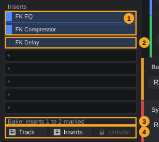
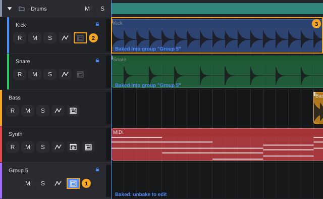
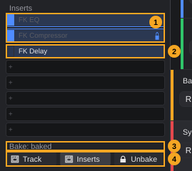

# Track bake (freeze)

Baking (in other programs: *freeze*) renders a track to an audio file, so that its instrument and effects no longer need processing power. The baked track plays the file instead. Baked parts are locked until you **unbake** the track; then everything is live and editable again.

**In this chapter**

1. [What baking does](#1-what-baking-does)
2. [The bake controls at a glance](#2-the-bake-controls-at-a-glance)
3. [Which tracks can be baked](#3-which-tracks-can-be-baked)
4. [Bake Track: only the instrument](#4-bake-track-only-the-instrument)
5. [Bake Inserts: the instrument and the effects](#5-bake-inserts-the-instrument-and-the-effects)
6. [Baking a group track](#6-baking-a-group-track)
7. [What happens while baking](#7-what-happens-while-baking)
8. [How a baked track looks](#8-how-a-baked-track-looks)
9. [What is locked](#9-what-is-locked)
10. [What stays live](#10-what-stays-live)
11. [Unbaking](#11-unbaking)
12. [Baking again after changes](#12-baking-again-after-changes)
13. [Automation, sends and sidechain](#13-automation-sends-and-sidechain)
14. [Saving, templates and export](#14-saving-templates-and-export)
15. [Undo](#15-undo)
16. [Limitations](#16-limitations)
17. [Messages](#17-messages)
18. [Quick reference](#18-quick-reference)

---

## 1. What baking does

Every instrument and every effect is calculated live while the project plays. Large sample libraries, synthesizers and reverbs can use so much processing power that the audio starts to crackle (the audio load in the transport bar turns red, see [The project window §5](project-window.md#5-transport-bar)). Baking solves this for tracks you are not working on at the moment:

1. FK Audio Suite plays the track once in the background, from the project start to the end of its last clip, and writes the result to an audio file.
2. From then on the track plays this file. The baked instrument and the baked effects are no longer processed.
3. The baked parts and the clips of the track are locked, because changes to them would not be heard ([§9](#9-what-is-locked)).
4. **Unbake** deletes the file and makes everything live and editable again ([§11](#11-unbaking)).

There are three ways to bake, depending on how much of the track should become audio:

| Kind | What becomes audio | What stays live | Track types |
|---|---|---|---|
| **Bake Track** | The instrument | All inserts | Instrument tracks |
| **Bake Inserts** | The instrument (if any) and the inserts from slot 1 up to a slot you choose, or all inserts | The inserts after the chosen slot | Instrument and audio tracks |
| **Bake group** | Everything that flows into the group (all feeding tracks with their clips, instruments, inserts and faders) plus the group's inserts up to a slot you choose, or all of them | The group's inserts after the chosen slot | Group tracks |

The track's own fader, pan, mute, solo, sends and output are never part of the file; they always stay live ([§10](#10-what-stays-live)).

> **Note:** Baking is not an editing step in the history. It cannot be undone with **Ctrl+Z**; **Unbake** is the way back ([§15](#15-undo)).

---

## 2. The bake controls at a glance

You start a bake in two places. There is no menu command and no keyboard shortcut for baking.

- **The bake button in the track header** (the oven symbol, [Tracks §4](tracks.md#4-the-track-header), number 7) opens the **bake menu**. It always bakes *all* inserts.
- **The bake row in the Inspector** has the buttons **Track**, **Inserts** (**Group** on group tracks) and **Unbake**. Together with the **bake marks** at the insert slots, it can bake the inserts *up to a chosen slot*.

The picture shows the Inspector of the instrument track *Synth* with three inserts. The box of slot 2 was clicked, so slots 1 and 2 are marked:

| # | Element | What it does | Details |
|---|---|---|---|
| 1 | Bake marks, filled | The small box at the left of a used slot. Filled = this slot is baked by **Inserts** | [§5.2](#52-baking-up-to-a-chosen-slot) |
| 2 | Bake mark, empty | This slot and the slots after it stay live | [§5.2](#52-baking-up-to-a-chosen-slot) |
| 3 | Bake label | **Bake** without marks; **Bake: inserts 1 to** *n* **marked** with marks; **Bake: baked** on a baked track; **Bake: baked into group "Group 5"** (with the group's name) on a track that feeds a baked group | [§8](#8-how-a-baked-track-looks) |
| 4 | Bake buttons | **Track**, **Inserts** (or **Group**) and **Unbake**; see the table below | [§4](#4-bake-track-only-the-instrument)–[§6](#6-baking-a-group-track), [§11](#11-unbaking) |

<!-- FIX F-507: the tooltip of the Inserts/Group button may fit audio and group tracks -->
| Button | Tooltip | Shown on | Clickable |
|---|---|---|---|
| **Track** | *Bake Track: render the instrument to audio, inserts stay live* | Instrument tracks | Unless the track feeds a baked group |
| **Inserts** / **Group** | *Bake Inserts: render the instrument and the marked inserts (box left of the slot); all without a mark. Always from slot 1 on* | Instrument, audio and group tracks | Unless the track feeds a baked group |
| **Unbake** | *Unbake: everything live and editable again* | Instrument, audio and group tracks | Only while the track is baked |

On FX tracks, MIDI tracks to external devices and tracks of a rack instrument, the bake label and the buttons are not shown at all.

**The bake menu in the track header.** Click the bake button. Its tooltip is *Bake: render the track to audio and save CPU*. The menu depends on the track type:

| Track type | Bake entries |
|---|---|
| Instrument track | **Bake Track: instrument to audio (inserts stay live)**, **Bake Inserts: instrument and all inserts** |
| Audio track | **Bake Inserts: clips through all inserts** |
| Group track | **Bake group (with all feeding tracks)** |

Below the bake entries, on every track type:

- **Unbake: live and editable again**, greyed out unless the track is baked.
- The greyed-out hint **Choose individual insert slots: in the Inspector (mark at the slot)**. It reminds you that the menu always bakes all inserts.

The bake button has no menu on FX tracks, MIDI tracks to external devices and tracks of a rack instrument: it is not shown there. On a track that feeds a baked group it is greyed out ([§6](#6-baking-a-group-track)).

---

## 3. Which tracks can be baked

| Track type | Bake Track | Bake Inserts | Bake group | Why not |
|---|---|---|---|---|
| Instrument track | yes | yes | — | |
| Audio track | — | yes | — | Bake Track needs an instrument |
| Group track | — | — | yes (button **Group**) | |
| FX track | — | — | — | Not offered |
| MIDI track to an external device | — | — | — | Not offered: the sound comes from the external device |
| MIDI track or output channel of a rack instrument | — | — | — | Not offered: several tracks share one instrument |
| Folder track | — | — | — | A folder has no signal of its own |

A track that feeds a baked group cannot be baked itself while the group is baked: its bake button and the Inspector buttons **Track** and **Inserts** are greyed out.

A track whose output goes to a group can be baked on its own as long as the group is not baked. During the rendering the track is sent to the master output for a moment and then back to its group; its output setting is unchanged afterwards.

---

## 4. Bake Track: only the instrument

**Bake Track** renders the instrument of an instrument track with its current settings. The inserts stay live: you can still change, bypass, remove and add effects while the instrument costs no processing power.

**To bake the instrument:**

1. Select the instrument track.
2. Click **Track** in the bake row of the Inspector, or click the bake button in the track header and choose **Bake Track: instrument to audio (inserts stay live)**.
3. Wait until the progress window closes ([§7](#7-what-happens-while-baking)).

- The file contains the MIDI clips of the track played by the instrument, without any insert. The trim and phase of the track are not part of the file.
- Bake marks at the insert slots do not matter for **Track**.

**Use it when** the instrument is heavy (a large sample library, a complex synthesizer) but you still want to adjust the effects.

---

## 5. Bake Inserts: the instrument and the effects

**Bake Inserts** renders the inserts from slot 1 on. On an instrument track the instrument is always baked as well, because the inserts process its sound. On an audio track the clips are rendered through the inserts.

### 5.1 Baking all inserts

1. Select the track. Make sure no slot is marked (the label reads **Bake**).
2. Click **Inserts** in the bake row of the Inspector, or click the bake button in the track header and choose **Bake Inserts: instrument and all inserts** (instrument track) or **Bake Inserts: clips through all inserts** (audio track).

All inserts that are on the track at this moment are baked. Inserts you add later stay live ([§10](#10-what-stays-live)).

- On an instrument track **without** inserts, **Inserts** bakes only the instrument, like **Track**.
- On an audio track without inserts there is nothing to bake: *Nothing to bake: the track has neither an instrument nor inserts.*

### 5.2 Baking up to a chosen slot

Effects work one after the other, from slot 1 down. A bake therefore always starts at slot 1 and ends at a slot you choose; you cannot bake slot 3 alone and leave slot 1 live. The **bake marks** make this choice in the Inspector:

1. Select the track.
2. Click the small box at the left of the **last** slot that should be baked. All slots from 1 up to this one are marked (filled box), and the label reads **Bake: inserts 1 to** *n* **marked** (picture in [§2](#2-the-bake-controls-at-a-glance)).
3. Click **Inserts** in the bake row.

Slots 1 to *n* (and on an instrument track the instrument) are baked; the slots after *n* stay live.

<!-- FIX F-1701: with a trim or phase set on the track, the marks may bake exactly the marked slots -->
> **Note:** If you have ever changed the **trim** or the **phase** ([MixConsole §7](mixconsole.md#7-trim-and-phase)) of the track, baking with marks currently bakes **one slot fewer** than marked: with slots 1 to 2 marked, only slot 1 is baked and slot 2 stays live. The slots show what was really baked (lock, see [§8](#8-how-a-baked-track-looks)). Baking all inserts (no marks) is not affected.

**How the marks behave:**

- Clicking an empty box marks this slot and all slots above it. Clicking a box that is already marked removes the mark from this slot and all slots below it; clicking the box of slot 1 removes all marks.
- Marks exist only on used slots. Empty slots (**+**) have no box.
<!-- FIX F-1711: the bake box may get a tooltip, and the marks may stay visible on a baked track -->
- The box has no tooltip of its own; the tooltip of the **Inserts** button mentions it (*box left of the slot*).
- The marks belong to the selected track while it stays selected. When you select another track, they are cleared. They are not saved with the project.
- The marks stay after baking and unbaking as long as the track stays selected. On a baked track, the boxes of the baked slots are filled to show the bake instead; the marks are not visible there, but clicking a box still changes them and the next **Inserts** uses them.
- **Track** ignores the marks. The bake menu in the track header ignores them too and always bakes all inserts.
- Only the Inspector has bake marks. The insert slots in the MixConsole have no box ([MixConsole §16](mixconsole.md#16-mixconsole-and-inspector-compared)).

**Example:** *Synth* has **FK EQ**, **FK Compressor** and **FK Delay**. You want to keep experimenting with the delay. Click the box of slot 2 (**FK Compressor**), then **Inserts**: the instrument, **FK EQ** and **FK Compressor** are baked, **FK Delay** stays live.

> **Tip:** Bypassed inserts within the baked range are not part of the file, and they cannot be switched on again until you unbake. Switch on everything you want to hear before baking.

---

## 6. Baking a group track

A group bake renders the group **together with every track that flows into it**, also through other groups in between (for example *Kick* › *Drums* › *Band*). It is the most effective bake: one file replaces a whole section of the project.

**To bake a group:**

1. Select the group track.
2. Click **Group** in the bake row of the Inspector, or click the bake button in the group's header and choose **Bake group (with all feeding tracks)**.

- Without marks, all inserts of the group are baked as well. With marks at the group's insert slots, the group's inserts up to the marked slot are baked and the rest stay live ([§5.2](#52-baking-up-to-a-chosen-slot)). A group without inserts bakes just the sum of its feeding tracks.
- The file contains what the feeding tracks send into the group at the moment of baking: their clips, instruments, inserts, fader, pan and mute settings.
- The feeding tracks are not baked themselves, but they are **locked** as long as the group is baked: no clip, note, instrument or insert of them can be changed, and no insert can be added to them ([§9](#9-what-is-locked)).

The picture shows the group *Group 5* with the feeding tracks *Kick* and *Snare*, after the group was baked:

| # | Element | What it shows |
|---|---|---|
| 1 | Bake button of the group | Lit: the group is baked. Tooltip *Baked: instrument/inserts run as audio. Click: unbake* |
| 2 | Bake button of a feeding track | Greyed out, tooltip *Baked into group "Group 5": unbake it there to edit this track*. Both headers show the lock at the top right. |
| 3 | Clips of a feeding track | Darkened, with the text **Baked into group "Group 5"** |

On a feeding track the Inspector shows **Bake: baked into group "Group 5"** (with the group's name), and its buttons **Track** and **Inserts** are greyed out.

**Nested groups.** If group *A* feeds group *B* and *B* is baked, *A* counts as a feeding track: it is locked and cannot be baked until *B* is unbaked. While *B* is not baked, you can bake *A* on its own.

> **Note:** While a group is baked, the feeding tracks are not played at all; you hear the group's file. Their faders, pan, mute and solo buttons can still be moved, but have no effect until you unbake the group. The same applies to their sends, see [§13](#13-automation-sends-and-sidechain).

---

## 7. What happens while baking

1. A window titled **"Synth" is being baked...** (with the name of the track) appears with a progress bar and a **Cancel** button. The rest of the program waits until the bake is finished.
2. FK Audio Suite plays the track offline and writes the file.
3. The window closes. The track now plays the file, and the header, the clips and the Inspector show the baked state ([§8](#8-how-a-baked-track-looks)).

**What the rendering includes:**

- The time from the **project start** to the **end of the last clip** of the track (for a group: of all feeding tracks), plus a short extra time for the tails of the effects.
- Every clip of the track (for a group: of all feeding tracks), with clip gain, fades and the other clip settings.
- The automation of the baked instrument and effects, as it is at the moment of baking.
- The sample rate and buffer size of the audio device at the moment of baking.

**What the rendering ignores:**

- **Mute** and **solo** of the baked track: a muted track is rendered anyway, and solo buttons elsewhere in the project do not matter. After baking, the track's mute and solo work as usual.
- Bypassed plugins within the baked range.
- The track's own fader, pan, sends and the master output.

**Cancel.** Click **Cancel** in the progress window to stop. The track is live again, as if you had not started. No message appears.

If the bake fails, a window titled **Error** explains why, and the track stays live (messages in [§17](#17-messages)).

**Where the file is stored.** The file lies in the **Audio/** folder of the project ([Projects §2](projects.md#2-the-project-folder)). Its name begins with `trackFreeze_` and ends with `.freeze`; the part in between identifies the track, so each track has exactly one bake file. It is uncompressed audio. Leave these files alone: FK Audio Suite deletes the file itself when you unbake ([§11](#11-unbaking)).

> **Note:** If the bake file of a track is missing when you open the project (for example because it was deleted by hand), the track opens unbaked and live.

---

## 8. How a baked track looks

The picture shows the instrument track *Synth* after **Inserts** with slots 1 and 2 marked:

| # | Element | What it shows |
|---|---|---|
| 1 | Bake button | Lit (accent colour). Tooltip *Baked: instrument/inserts run as audio. Click: unbake* |
| 2 | Lock | At the top right of the header, on baked tracks and on tracks that feed a baked group |
| 3 | Clips | Darkened, with the text **Baked: unbake to edit** at the bottom left (on a feeding track: **Baked into group "Group 5"**, with the group's name) |

<!-- FIX F-1710: the tooltip may describe what a click does (it opens the bake menu) -->
> **Note:** Despite the tooltip, a click on the lit bake button does not unbake at once. It opens the bake menu, where **Unbake: live and editable again** is now available.

The Inspector of the same track:

| # | Element | What it shows |
|---|---|---|
| 1 | Baked slots | Filled box, a lock at the right, greyed-out name |
| 2 | Live slot | Normal; this effect still works and can be edited |
| 3 | Bake label | **Bake: baked** |
| 4 | Bake buttons | **Unbake** is now clickable. **Track** and **Inserts** stay clickable: they bake again ([§12](#12-baking-again-after-changes)). |

Also on a baked instrument track, the Inspector's **Replace instrument** button is greyed out.

In the MixConsole, baked inserts show the lock and the greyed name as well ([MixConsole §4](mixconsole.md#baked-inserts)).

---

## 9. What is locked

"Baked parts" are: the instrument (Bake Track and Bake Inserts on instrument tracks), the baked inserts, and the clips of the track. On a track that feeds a baked group, **everything** of the track is locked in the same way: its instrument, all its inserts and its clips.

| What you try | Baked track | Track feeding a baked group |
|---|---|---|
| Move, trim, split, glue, delete, mute, fade or process clips; paste, import or draw clips onto the track ([Arranging §21](arranging.md#21-baked-tracks)) | refused | refused |
| Move a clip from another track onto it | refused | refused |
| Edit notes and controllers (Key Editor, Drum Editor, List Editor) | refused | refused |
| Take functions (choose a take, comping) | refused, no message | refused, no message |
| Open the window of the instrument or of a baked insert | refused | refused (all inserts) |
| Bypass, activate, remove a baked insert; change its sidechain source; load a preset into it | refused | refused (all inserts) |
| Replace the instrument | refused (button greyed out) | refused (button greyed out) |
| Add an insert | **allowed**: it goes behind the baked inserts and stays live | refused |
| Change trim or phase | refused | refused |
| Duplicate the track | refused | allowed |
| Bake the track | bakes again ([§12](#12-baking-again-after-changes)) | refused (buttons greyed out) |
| Save the project as a template | refused | allowed |

When an action is refused, a window titled **Error** shows one of these messages:

- *"*Track*" is baked. To edit it, unbake it first (track header or inspector).*
- *"*Track*" is baked into the group "*Group*". To edit it, unbake it there.*

<!-- FIX F-1406: the Inspector may show the same message as the MixConsole -->
A click on a baked insert slot **in the Inspector** shows a different text: *This insert is baked. To edit it, first use "Unbake" (Inspector or track header).* For the presets of a baked insert there is no menu entry at all: the **Presets** submenu is missing from the slot's context menu.

<!-- FIX F-701: refused mouse edits may show the same message -->
> **Note:** Mouse edits directly on the clips (trimming, fading, stretching, and the Split, Eraser, Mute and Glue tools) and the take functions are refused silently: nothing happens and no message appears.

Duplicating shows *Baked tracks cannot be duplicated. Please unbake the track first.*; saving a template shows *Track "*name*" is baked. Unbake it first, then save as a template.*

<!-- FIX F-1708: plugin windows may close (or lock) when baking -->
> **Note:** A plugin window that was **already open** before baking stays open, and its controls can still be moved. Changes there have no audible effect while the plugin is baked; they apply after unbaking. Close the windows of the plugins you bake.

---

## 10. What stays live

These parts are never in the file and can be changed while the track is baked:

- **Fader, pan, mute and solo** of the baked track ([Tracks §13](tracks.md#13-mute-solo-and-record-enable), [MixConsole §8](mixconsole.md#8-pan)–[§11](mixconsole.md#11-mute-and-solo)).
- **Sends** of the baked track to FX tracks, with level and **Pre** ([MixConsole §6](mixconsole.md#6-sends)).
- The **output** of the track ([Tracks §12.2](tracks.md#122-choosing-an-output-groups-and-direct-outs)).
- After **Bake Track**: all inserts. After **Bake Inserts** up to a slot: the inserts after this slot.
- **New inserts** added to a baked track: they go behind the baked ones and work normally.
- Name, colour, track order, folder, hiding, deleting the track.

<!-- FIX F-1706: record enable may be locked on baked tracks -->
> **Note:** **R** (record enable) is not locked on a baked track. A recording made there is not part of the bake file and is not heard until you unbake and bake again. Unbake before you record on a track.

---

## 11. Unbaking

**To unbake a track:**

- Click **Unbake** in the bake row of the Inspector, or
- click the bake button in the track header and choose **Unbake: live and editable again**.

What happens:

1. The instrument and all baked inserts run live again; everything is editable.
2. The clips are no longer darkened, the lock disappears, the bake button is no longer lit and the label reads **Bake** again.
3. The bake file is **deleted** from the **Audio/** folder.

For a group, unbaking also unlocks all feeding tracks; they play live again.

- **Unbake** is greyed out unless the track itself is baked. On a track that feeds a baked group, unbake the **group**: the bake button of the feeding track is greyed out and its tooltip names the group.
- Unbaking does not need to render and is immediate.
- Unbaking is not an editing step ([§15](#15-undo)).

> **Note:** If you delete a baked track, its bake file stays in the **Audio/** folder; FK Audio Suite deletes bake files only when unbaking.

---

## 12. Baking again after changes

A bake file does not follow later changes. To hear a change to a baked part:

1. Unbake the track ([§11](#11-unbaking)).
2. Make the changes.
3. Bake again.

You can also bake a baked track again directly: click **Track** or **Inserts** (**Group**), or choose a bake entry from the bake menu. FK Audio Suite then unbakes the track first (the old file is deleted) and renders a new file. Use this to change the bake kind or the last baked slot, for example from **Track** to **Inserts**.

> **Note:** If you cancel such a new bake, or it fails, the track is afterwards **live**: the previous bake is gone as well.

<!-- FIX F-1709: a tempo change may warn about baked tracks -->
**Tempo and time signature.** Changes on the signature track are not locked by a bake. MIDI clips and clips that follow the tempo would change with the tempo, but the bake file keeps the old timing and does not tell you. After a tempo change, unbake and bake again.

---

## 13. Automation, sends and sidechain

**Automation.** The automation of the baked instrument and inserts is part of the file, as it was at the moment of baking. Volume, pan and send automation of the track stay live.

<!-- FIX F-1707: automation of baked plugins may be locked or marked -->
> **Note:** The automation lanes of baked plugin parameters can still be edited while the track is baked, but changes are not heard until you unbake and bake again.

**Sends.** The sends of a baked track lie behind the inserts and stay live ([§10](#10-what-stays-live)). The FX tracks themselves cannot be baked.

<!-- FIX F-1703: the sends (and sidechain signals) of feeding tracks may keep working while their group is baked -->
> **Note:** While a **group** is baked, its feeding tracks are not played ([§6](#6-baking-a-group-track)). Their sends to FX tracks are therefore silent, and they are not in the group's file either: a reverb fed from *Kick* and *Snare* stops while their group is baked. The same applies if a feeding track serves as sidechain source for an effect elsewhere.

**Sidechain.**

- The sidechain source of a **baked** insert cannot be changed ([§9](#9-what-is-locked)); a live insert keeps working with its source.
- A baked track can still be the sidechain source for effects on other tracks. They then listen to the track's file and its live inserts.

<!-- FIX F-1712: whether a baked insert with a sidechain source hears its source during the rendering is to be checked -->
> **Tip:** Before baking an insert that listens to a sidechain (for example **FK Compressor** keyed from *Kick*), compare the result with the live sound once. If the compression is missing in the file, keep this insert live: mark only the slots above it ([§5.2](#52-baking-up-to-a-chosen-slot)).

---

## 14. Saving, templates and export

**Saving.** The bake state is part of the project: which tracks are baked, how (Track, Inserts or group) and up to which slot. The bake file lies in the project's **Audio/** folder. After reopening the project, baked tracks are baked again at once, without rendering.

**Save as.** **File › Save as...** copies the whole **Audio/** folder, including the bake files ([Projects §7](projects.md#7-save-as-copying-a-project)). The baked tracks stay baked in the copy.

**Templates.** A project with a baked track cannot be saved as a template: *Track "*name*" is baked. Unbake it first, then save as a template.* ([Projects §9.1](projects.md#91-saving-a-template)). Feeding tracks of a baked group do not count; the group itself does.

**Export.** When you export a mixdown or stems, baked tracks are calculated live from their instruments and effects, not taken from the bake file. The export therefore sounds like the unbaked project. The export chapter is planned (*Exporting*).

---

## 15. Undo

Baking and unbaking are not named editing steps. **Edit › Undo** (**Ctrl+Z**) does not unbake a track; use **Unbake** for that.

<!-- FIX F-1702: baking and unbaking may leave no unnamed undo step -->
> **Note:** In the current version, baking and unbaking each leave an unnamed step **Change** in the history (**Edit › History...**). Undoing the step right after a bake makes the track live again, but the bake file stays on disk, and **Redo** does not bake it again. Do not use **Ctrl+Z** to undo a bake; use **Unbake**.

Changes that a bake refused never reach the history.

---

## 16. Limitations

- **No partial range.** A bake always covers the whole track from the project start to the end of its last clip. You cannot bake only a section.
<!-- FIX F-1704: the tail after the last clip may be played as well -->
- **Tail after the last clip.** The tail of the effects after the last clip is rendered, but the baked track plays its file only up to the end of the last clip. A long reverb or delay tail at the very end of a track is cut off while the track is baked.
- **Plugins stay loaded.** Baked plugins are not removed from memory; they only stop processing. Baking saves processing power, not memory.
<!-- FIX F-1705: the output of feeding tracks may be locked while their group is baked -->
- **Routing into and out of a baked group** is not locked. If you route a feeding track away from the baked group, it plays live again *and* is still in the group's file (you hear it twice). A track you route into a baked group is locked at once but is not in the file (you do not hear it). Change the routing only while the group is unbaked.
- **Rack instruments, FX tracks and MIDI tracks to external devices** cannot be baked ([§3](#3-which-tracks-can-be-baked)). For a rack instrument, export its outputs as stems instead.
- **No shortcut.** Bake and Unbake are not commands and cannot get a key in **Edit › Keyboard shortcuts...**.
- **Export** does not use the bake files ([§14](#14-saving-templates-and-export)).

---

## 17. Messages

| Message | When |
|---|---|
| *"*Track*" is baked. To edit it, unbake it first (track header or inspector).* | A change to a baked part was refused ([§9](#9-what-is-locked)) |
| *"*Track*" is baked into the group "*Group*". To edit it, unbake it there.* | The same on a track that feeds a baked group; also adding an insert there |
| *This insert is baked. To edit it, first use "Unbake" (Inspector or track header).* | Click on a baked insert slot in the Inspector |
| *Baked tracks cannot be duplicated. Please unbake the track first.* | Duplicating a baked track |
| *Track "*name*" is baked. Unbake it first, then save as a template.* | Saving a template with a baked track |
| *Nothing to bake: the track has neither an instrument nor inserts.* | **Inserts** on an audio track without inserts |
| *Bake failed:* … | The rendering failed; the text after the colon names the reason (it comes from the audio engine and is in English), for example when the track has nothing to render or a plugin before the bake point is connected to another track. The track stays live. |
| *Bake failed: no audio data was produced.* | The rendering produced no file. The track stays live. |

The messages *Bake Track is only available on instrument tracks. On audio tracks, use Bake Inserts.* and *Tracks of a rack instrument cannot be baked. Export the outputs as stems instead.* exist as well, but the buttons that would lead to them are not offered on these tracks.

All messages appear in a window titled **Error**. Cancelling the progress window shows no message.

---

## 18. Quick reference

| What | How |
|---|---|
| Bake the instrument only | Inspector **Track**, or bake button › **Bake Track: instrument to audio (inserts stay live)** |
| Bake instrument and all inserts | No marks, Inspector **Inserts**, or bake button › **Bake Inserts: instrument and all inserts** |
| Bake an audio track's inserts | Inspector **Inserts**, or bake button › **Bake Inserts: clips through all inserts** |
| Bake up to slot *n* | Inspector: click the box left of slot *n*, then **Inserts** (**Group**) |
| Remove marks | Click the box of slot 1 (or of the first slot to unmark) |
| Bake a group with all feeding tracks | Inspector **Group**, or bake button › **Bake group (with all feeding tracks)** |
| Cancel a bake | **Cancel** in the progress window |
| Unbake | Inspector **Unbake**, or bake button › **Unbake: live and editable again** |
| Bake again with other settings | Click **Track** / **Inserts** on the baked track |
| Edit a track that feeds a baked group | Unbake the group |
| Recognise a baked track | Lit bake button, lock in the header, darkened clips, **Bake: baked** |
| Where the file is | Project folder › **Audio/**, `trackFreeze_….freeze` |
| Keyboard shortcut | none |
