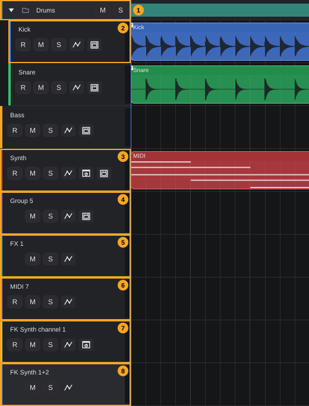
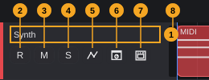
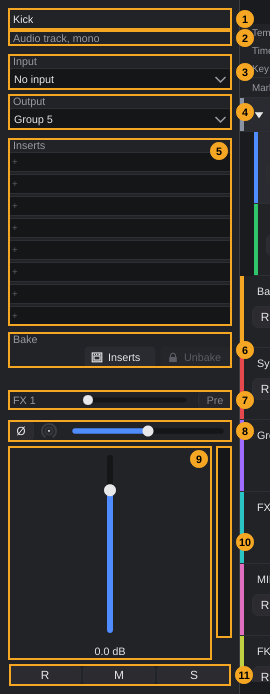
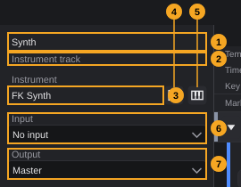
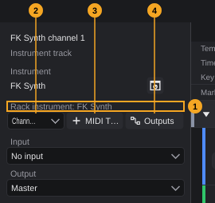
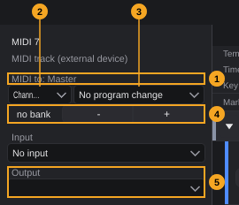
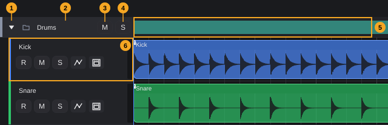
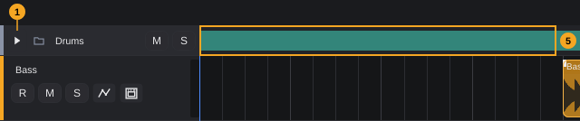

# Tracks

Tracks hold the clips of your song and carry the signal from an input or an instrument through effects to an output. This chapter explains every track type, how to create, name, colour, reorder, hide and delete tracks, every element of the track header, the track settings in the Inspector, folder tracks and the basics of routing.

**In this chapter**

1. [Where to find the track functions](#1-where-to-find-the-track-functions)
2. [Track types at a glance](#2-track-types-at-a-glance)
3. [Adding tracks](#3-adding-tracks)
4. [The track header](#4-the-track-header)
5. [The track in the Inspector](#5-the-track-in-the-inspector)
6. [Selecting tracks](#6-selecting-tracks)
7. [Renaming and colouring tracks](#7-renaming-and-colouring-tracks)
8. [Duplicating, hiding and deleting tracks](#8-duplicating-hiding-and-deleting-tracks)
9. [Changing the track order](#9-changing-the-track-order)
10. [Track height](#10-track-height)
11. [Folder tracks](#11-folder-tracks)
12. [Inputs, outputs and routing](#12-inputs-outputs-and-routing)
13. [Mute, solo and record enable](#13-mute-solo-and-record-enable)
14. [Baking a track (overview)](#14-baking-a-track-overview)
15. [Undo and messages](#15-undo-and-messages)
16. [Quick reference](#16-quick-reference)

---

## 1. Where to find the track functions

| Where | What you find there |
|---|---|
| **Toolbar**, buttons **Audio**, **Instrument**, **Group**, **FX**, **Folder** | Add the five most common track types ([The project window §4](project-window.md#4-toolbar), buttons 8–12) |
| **Track** menu | Every track type, plus **Duplicate track**, **Hide track**, **Delete track** and **Show/hide tracks** for the selected track ([The project window §3.3](project-window.md#33-track)) |
| **Track header** in the track list | Name, record enable, mute, solo, automation, instrument, bake, level; right-click for the track menu ([§4](#4-the-track-header)) |
| **Folder header** | Collapse, name, mute and solo for a whole folder; right-click for the folder menu ([§11](#11-folder-tracks)) |
| **Inspector** on the left (**F2**) | All settings of the selected track: input, output, inserts, sends, fader, pan ([§5](#5-the-track-in-the-inspector)) |
| **Toolbar**, buttons **Tracks smaller**, **Tracks larger** and the eye | Track height and hidden tracks ([§10](#10-track-height), [§8.2](#82-hiding-and-showing-tracks)) |

All of these need an open project. Without a project, the **Track** menu entries and the toolbar buttons are greyed out.

<!-- FIX F-504: tracks may get keyboard commands (add, delete, mute, solo, record enable of the selected track) -->
> **Note:** There are no default keys for track functions, and none can be assigned: the shortcut editor (**Edit › Keyboard shortcuts...**) has no commands for adding, deleting, muting, soloing or arming tracks. Use the buttons and menus.

---

## 2. Track types at a glance

The picture shows one track of every type, as FK Audio Suite names them when you create them. The track list on the left shows one header per track; the event display on the right shows their clips.

| # | Track type | What it is for | Plays | Created with | Details |
|---|---|---|---|---|---|
| 1 | **Folder track** (*Drums*) | Groups tracks in the list. Collapse, mute and solo its contents together. Has no sound of its own. | — | **Folder** button, **Track › Folder track** | [§11](#11-folder-tracks) |
| 2 | **Audio track** (*Kick*, mono) | Records and plays audio. Mono (one input channel) or stereo (channel pair), chosen when you create it. | Audio clips | **Audio** button, **Track › Audio track mono** / **Audio track stereo** | [§3.1](#31-audio-tracks) |
| 3 | **Instrument track** (*Synth*) | Plays an instrument plugin with MIDI clips or live from a MIDI keyboard. | MIDI clips | **Instrument** button, **Track › Instrument track**, **Instrument from library**, **Sampler track...** | [§3.2](#32-instrument-tracks) |
| 4 | **Group track** (*Group 5*) | Sums the tracks whose output you set to it, for common effects and one fader. Has no input. | Signal of other tracks | **Group** button, **Track › Group track** | [§3.5](#35-group-tracks) |
| 5 | **FX track** (*FX 1*) | Return for effects such as reverb or delay. Other tracks feed it through their sends. | Sends of other tracks | **FX** button | [§3.6](#36-fx-tracks) |
| 6 | **MIDI track to an external device** (*MIDI 7*) | Sends MIDI to a hardware synthesizer or drum machine through a MIDI output. | MIDI clips | **Track › MIDI track (external device)** | [§3.4](#34-midi-tracks-for-an-external-device) |
| 7 | **MIDI track of a rack instrument** (*FK Synth channel 1*) | Plays one MIDI channel of a rack instrument: one instrument, several MIDI tracks. | MIDI clips | **Track › Rack instrument (multi-out, several MIDI tracks)** | [§3.3](#33-rack-instruments-several-midi-tracks-one-instrument) |
| 8 | **Output of a rack instrument** (*FK Synth 1+2*) | One output pair of a rack instrument as its own channel in the mixer. Has no input and no clips. | Output of the rack instrument | Created with the rack instrument; more with **Outputs** in the Inspector | [§3.3](#33-rack-instruments-several-midi-tracks-one-instrument) |

Sampler tracks (**Track › Sampler track from audio file...**, **Sampler track (empty drum kit)**) and tracks from a library (**Track › Instrument from library**) are instrument tracks that play the built-in FK Sampler.

The Inspector names the type of the selected track under its name: **Audio track, mono**, **Audio track, stereo**, **Instrument track** (also for the MIDI tracks of a rack instrument), **Group track**, **FX track (aux return)**, **Output of a rack instrument** or **MIDI track (external device)**.

The ruler, the signature track (tempo, time signature, key) and the marker track are not tracks in this sense: they always stay at the top of the arrangement, cannot be moved, hidden or deleted and have no header in the track list ([The project window §7](project-window.md#7-arrangement-area)). Markers: [Transport §11](transport.md#11-markers). Tempo, time signature and key: see the chapter *Signature track*.

---

## 3. Adding tracks

**Where new tracks appear.** Every new track, folder included, is added at the **end of the track list, on the top level**, never inside a folder and never next to the selected track. Move it afterwards by dragging ([§9](#9-changing-the-track-order)).

<!-- FIX F-505: new tracks may be inserted below the selected track and become selected -->
**Selection.** Adding a track does not change the selected track: the Inspector keeps showing the track that was selected before. Only in a project without tracks does the new track become the selected one. Click the new track's header to work on it ([§6](#6-selecting-tracks)).

<!-- FIX F-506: creating a track may become a single editing step -->
Adding a track is an editing step that **Ctrl+Z** undoes. Some track types currently produce two steps ([§15](#15-undo-and-messages)).

### 3.1 Audio tracks

**To add an audio track:**

1. Click **Audio** in the toolbar.
2. Choose **Audio track mono (one input channel)** or **Audio track stereo (channel pair)**.

Or choose **Track › Audio track mono** or **Track › Audio track stereo**.

The new track is called **Audio** *n* and has **no input**. Choose an input in the Inspector before you record ([§12.1](#121-choosing-an-input)).

- A **mono** track offers each active input channel of your audio interface on its own (**Input 1**, **Input 2** …), a **stereo** track offers channel pairs (**Input 1+2** …). Names you gave in **Studio › Studio connections...** replace these names.
- Mono or stereo is fixed when you create the track. To change it, create a new track of the other kind and move the clips.

Recording audio: see the chapter *Recording audio and MIDI*.

### 3.2 Instrument tracks

**To add an instrument track:**

1. Click **Instrument** in the toolbar, or open **Track › Instrument track**.
2. Choose an instrument in the menu.

The instrument menu lists your favourites first (section **Favorites**), then one submenu per category, then **By vendor** with one submenu per manufacturer. FK instruments appear with their name only, other plugins with their format in brackets, for example *Name  (VST3)*. If no instrument is known, the menu only says *No plugins found (Plugin Manager: Search and Scan)*; scan your plugins in the plugin manager (see the chapter *Instruments and effects*).

The new track is named after the instrument plus a number, for example **FK Synth 5**. It listens to **All MIDI inputs**, so any switched-on MIDI keyboard plays it right away, without arming the track ([Getting started §5.7](getting-started.md#57-midi-inputs)). If the collective device *All MIDI inputs* is switched off, the track starts without an input.

If the instrument cannot be loaded, the track is not created and a window titled **Error** says *Instrument not found: …* or *Could not load the instrument: …*.

**Other ways to create an instrument track:**

| Menu entry | Result |
|---|---|
| **Track › Instrument from library** › *library* › *instrument* | A track that plays the chosen instrument of an installed library with FK Sampler. The track gets the instrument's name. Entries read *category / name*. Without a library: *No library installed yet (Studio > Content Manager)*. |
| **Track › Sampler track from audio file...** | Asks for an audio file (*Sample for the sampler track*; WAV, AIFF, FLAC, OGG, MP3), copies it into the project folder and creates an FK Sampler track that plays it. The track is named after the file. |
| **Track › Sampler track (empty drum kit)** | An FK Sampler track called **Drum kit** with an empty kit and the GM drum map, ready for the Drum Editor. |
| Double-click an instrument in the **Instruments** tab (**F10**) | A new track with this instrument (see the chapter *Instruments and effects*). |
| Dropping a MIDI file where no instrument track fits | A new instrument track with FK Synth ([Projects §15](projects.md#15-importing-audio-and-midi-files)). |

If FK Sampler is missing, the sampler entries show *FK Sampler is not registered.*

To give an instrument track its first clip, use **Track › Insert empty MIDI clip at playhead**: it inserts a one-bar MIDI clip at the playhead on the selected instrument or MIDI track and opens it in the editor. Writing notes: [Key Editor](key-editor.md).

### 3.3 Rack instruments: several MIDI tracks, one instrument

A rack instrument is one instance of an instrument that several MIDI tracks play, each on its own MIDI channel. Instruments with several outputs (for example a drum sampler) can send each output pair to its own mixer channel. The instrument runs once, no matter how many tracks play it.

**To create a rack instrument:**

1. Open **Track › Rack instrument (multi-out, several MIDI tracks)**.
2. Choose an instrument (same menu as in [§3.2](#32-instrument-tracks)).

FK Audio Suite creates two tracks:

- the **MIDI track** *instrument* **channel 1** (for example **FK Synth channel 1**) on MIDI channel 1, listening to **All MIDI inputs**;
- the **output channel** *instrument* **1+2** (for example **FK Synth 1+2**), which carries outputs 1+2 of the instrument to the mixer.

More MIDI tracks and more outputs are added in the Inspector of a rack track ([§5.2](#52-rack-instruments)). The instrument of a rack cannot be replaced, and rack tracks cannot be baked.

### 3.4 MIDI tracks for an external device

**To add a MIDI track for a hardware device:** choose **Track › MIDI track (external device)**.

The track is called **MIDI** *n*. It has no instrument; its output is a MIDI output port:

- Output: the **first switched-on MIDI output**. If there is none, the track stays without a device and plays nothing until you choose one.
- Input: **All MIDI inputs**.
- MIDI channel **1**, no program change, no bank.

Channel, program and bank are set in the Inspector ([§5.3](#53-midi-tracks-for-an-external-device)).

### 3.5 Group tracks

**To add a group track:** click **Group** in the toolbar, or choose **Track › Group track**.

The track is called **Group** *n*. A group track is always stereo and has no input: it receives the sum of every track whose **Output** you set to it ([§12.2](#122-choosing-an-output-groups-and-direct-outs)). Groups can feed other groups and the master.

### 3.6 FX tracks

**To add an FX track:** click **FX** in the toolbar.

<!-- FIX F-501: Track › FX track (sends) may create an FX track like the toolbar button -->
> **Note:** The menu entry **Track › FX track (sends)** currently does nothing. Use the **FX** button in the toolbar.

The track is called **FX** *n* (numbered among the FX tracks only). It receives the sends of all other tracks. The sum of the sends enters the FX track before its inserts, so the effects you insert (reverb, delay) process the sum of all sends. The return itself does not take an insert slot. As soon as an FX track exists, every other track shows a send to it in the Inspector ([§5](#5-the-track-in-the-inspector), number 7). FX tracks have no input, no sends of their own and cannot be baked.

Sends in depth: see the chapter *MixConsole*.

### 3.7 Folder tracks

**To add a folder track:** click **Folder** in the toolbar, or choose **Track › Folder track**.

The folder is called **Folder** *n* (numbered among the folders only) and is grey. It starts empty. Putting tracks into it: [§11.2](#112-putting-tracks-into-a-folder).

<!-- FIX F-509: the folder created with "New folder with this track" may get a number like the other new folders -->
To create a folder around an existing track in one go, right-click the track's name and choose **Move to folder › New folder with this track**. This folder is called just **Folder**, takes the place of the track, and the track moves into it.

### 3.8 Names, numbers and colours of new tracks

<!-- FIX F-206: numbering of new tracks may count per track type -->
| Track | Name | Number *n* counts |
|---|---|---|
| Audio | **Audio** *n* | all tracks of the project (not folders) |
| Instrument | *instrument name* *n* | all tracks |
| Group | **Group** *n* | all tracks |
| MIDI (external device) | **MIDI** *n* | all tracks |
| FX | **FX** *n* | FX tracks only |
| Folder | **Folder** *n* | folders only |
| Rack instrument | *instrument* **channel** *c*, *instrument* *pair* | MIDI channel and output pair |
| Sampler | file name, or **Drum kit** | — |
| Library instrument | name of the instrument | — |

Example: in a project with three tracks, the first group is called **Group 4**, but the first FX track **FX 1**. Rename tracks freely ([§7](#7-renaming-and-colouring-tracks)); names do not have to be unique.

**Colours.** Every new track gets the next colour of the 16-colour palette, in the order the tracks were created; after the 16th colour the palette starts again. The colour belongs to the track and moves with it when you reorder. Folders start grey. Change colours with the right-click menu ([§7](#7-renaming-and-colouring-tracks)).

---

## 4. The track header

Every track has a header in the track list, left of its clips. The picture shows the header of an instrument track:

<!-- FIX F-105: R, M, S (and the input field) may get tooltips -->
| # | Element | What it does | Details |
|---|---|---|---|
| 1 | **Name** | Name of the track. Double-click to rename. Drag to move the track. Right-click for the track menu. Tooltip: *Double-click: rename. Drag: move track. Right-click: color, duplicate, hide, delete* | [§7](#7-renaming-and-colouring-tracks), [§9](#9-changing-the-track-order), [§4.2](#42-the-track-menu-right-click) |
| 2 | **R** (record enable) | Arms the track for recording; red while armed | [§13](#13-mute-solo-and-record-enable) |
| 3 | **M** (mute) | Silences the track | [§13](#13-mute-solo-and-record-enable) |
| 4 | **S** (solo) | Plays only the soloed tracks | [§13](#13-mute-solo-and-record-enable) |
| 5 | Automation (curve) | Tooltip *Automation track on/off*: shows or hides the automation lanes below the track | below |
| 6 | Open instrument | Tooltip *Open instrument:* *name*: opens the window of the track's instrument. Only on instrument tracks and rack MIDI tracks. | below |
| 7 | Bake | Tooltip *Bake: render the track to audio and save CPU*: opens the bake menu. Lit while the track is baked. | [§14](#14-baking-a-track-overview) |
| 8 | Level meter | Output level of the track, left and right | — |

More in the header:

- **Colour bar.** The narrow bar at the left edge has the track colour.
- **Selection.** The header of the selected track is lighter than the others ([§6](#6-selecting-tracks)).
- **Lock.** A baked track, or a track that feeds a baked group, shows a lock at the top right ([§14](#14-baking-a-track-overview)).
- **Indent.** Tracks inside a folder are indented by one step per folder level ([§11](#11-folder-tracks)).

**Automation button (5).** Click it to show the automation lanes of the track below its header, click again to hide them. If the track has no automation lane yet, an empty lane is created (an editing step, *Add automation lane*); choose its parameter in the lane header. Whether the lanes are shown is not saved with the project. Automation in depth: see the chapter *Automation*.

**Open instrument (6).** Opens the plugin window of the instrument. If the track has no instrument, a window says *This track has no instrument.* The Inspector has the same button, and double-clicking the instrument name there does the same ([§5.1](#51-instrument-tracks)).

<!-- FIX F-603: the input field may appear in the header (or be removed from it) -->
> **Note:** The header has no input field at the standard width: there is not enough room next to the buttons, so the input is chosen in the Inspector only ([§12.1](#121-choosing-an-input)).

**Clicks in the header.** A click anywhere in the header, also on a button, selects the track. Right-click and drag only work on the header background and on the name, not on the buttons.

### 4.1 Which buttons each track type shows

Every header has the name, **M**, **S**, the automation button and the level meter. The other elements depend on the type:

| Track type | **R** | Open instrument | Bake |
|---|---|---|---|
| Audio track | yes | — | yes |
| Instrument track (also sampler and library tracks) | yes | yes | yes |
| Group track | — | — | yes (bakes the group with all feeding tracks) |
| FX track | — | — | — |
| MIDI track (external device) | yes | — | — |
| MIDI track of a rack instrument | yes | yes | — |
| Output of a rack instrument | — | — | — |

Where **R** is missing, the place stays empty, so **M** and **S** line up in all headers.

### 4.2 The track menu (right-click)

Right-click the name or the background of a track header:

| Entry | What it does |
|---|---|
| **Rename** | Opens the name for editing, as a double-click does |
| **Color** › **Color 1** … **Color 16** | Sets the track colour; the current colour is ticked |
| **Duplicate** | Copies the track directly below itself ([§8.1](#81-duplicating-a-track)) |
| **Move up** / **Move down** | Moves the track one place up or down within its folder (or the top level) |
| **Move to folder** › | Every folder of the project; the folder the track is in is ticked and greyed out. **New folder with this track** creates a folder around the track ([§3.7](#37-folder-tracks)). |
| **Take out of folder** | Moves the track out of its folder, directly below the folder. Greyed out if the track is not in a folder. |
| **Hide (toolbar: eye to show again)** | Hides the track ([§8.2](#82-hiding-and-showing-tracks)) |
| **Delete track** | Deletes the track ([§8.3](#83-deleting-a-track)) |

Folders have their own menu ([§11.5](#115-the-folder-menu-right-click)).

---

## 5. The track in the Inspector

The Inspector on the left shows all settings of the selected track. Show or hide it with **F2**, the Inspector button in the toolbar or **View › Inspector** ([The project window §6](project-window.md#6-inspector)). The picture shows the mono audio track *Kick*, whose output goes to a group and which has a send to an FX track:

<!-- FIX F-609: Input, R, M and S in the Inspector may get tooltips -->

| # | Element | What it does | Details |
|---|---|---|---|
| 1 | **Name** | Name of the track; double-click to rename | [§7](#7-renaming-and-colouring-tracks) |
| 2 | Track type | For example **Audio track, mono** | [§2](#2-track-types-at-a-glance) |
| 3 | **Input** | Audio input (audio tracks) or MIDI input (instrument and MIDI tracks); **No input** = none | [§12.1](#121-choosing-an-input) |
| 4 | **Output** | **Master**, a group track, or another output pair of your interface | [§12.2](#122-choosing-an-output-groups-and-direct-outs) |
| 5 | **Inserts** | Eight effect slots, processed from top to bottom | below |
| 6 | **Bake** | **Track** (instrument tracks only), **Inserts**, **Unbake** | [§14](#14-baking-a-track-overview) |
| 7 | **Sends** | One row per FX track: name, send level, **Pre** | below |
| 8 | Phase, trim, pan | **Ø** inverts the phase, the small knob is the trim, the slider is the pan | below |
| 9 | Volume fader | Track volume in dB | below |
| 10 | Level meter | Output level, left and right | — |
| 11 | **R**, **M**, **S** | Record enable, mute, solo, the same as in the header | [§13](#13-mute-solo-and-record-enable) |

**Inserts (5).** Click an empty slot (**+**) to choose an effect (favourites, categories, **By vendor**). Click a used slot to open the effect's window. Right-click a used slot for **Bypass** / **Activate**, **Remove**, **Sidechain source** (only for plugins with a sidechain input) and **Presets**. A coloured bar at the bottom of a slot shows how much a compressor reduces the level; **SC** marks a slot with a sidechain source. The small box at the left of a used slot marks it for baking ([§14](#14-baking-a-track-overview)). Inserts in depth: see the chapters *MixConsole* and *Instruments and effects*.

<!-- FIX F-510: the section will get its heading "Sends" -->
**Sends (7).** The section appears as soon as the project has an FX track, with one row per FX track (FX tracks themselves have no sends). The rows currently appear without a heading: they sit directly below the **Bake** buttons.

| Element | What it does |
|---|---|
| Name | The FX track the send goes to |
| Level slider | Send level; tooltip *Send level; fully left = off*. Range −60 dB to +6 dB, fully left = off. Double-click: off. |
| **Pre** | Tooltip *Pre fader: send independent of the track fader*. Greyed out until the track has a send to this FX track: move the level slider first. |

**Phase, trim and pan (8).**

| Element | Range | Default | Double-click |
|---|---|---|---|
| **Ø** (phase) | on / off; tooltip *Invert phase (polarity), e.g. snare top against snare bottom* | off | — |
| Trim knob | −24 dB to +24 dB in 0.1 dB steps; adjusts the level before the inserts. Tooltip *Trim: adjust the level before the inserts (gain staging). Double-click: 0 dB*. The value appears while you drag. | 0 dB | 0 dB |
| Pan slider | fully left to fully right | centre | centre |

**Volume fader (9).** Range −60 dB to +6 dB; the value is shown below the fader. At the bottom (−60 dB) the track is silent. Double-click returns to 0 dB. While automation plays, the fader and the pan slider follow it.

**Without a track.** In a project without tracks the Inspector says: *Click a track in the arrangement to edit its input, output, inserts, volume and level here. No track yet? Create an audio, instrument or group track above.*

### 5.1 Instrument tracks

Instrument tracks have an extra **Instrument** section above the input:

| # | Element | What it does |
|---|---|---|
| 1 | **Name** | Name of the track |
| 2 | Track type | **Instrument track** |
| 3 | Instrument name | Name of the instrument plugin. Double-click opens the plugin window (tooltip *Double-click opens the plugin window*). |
| 4 | Open instrument | Opens the plugin window (tooltip *Open instrument: plugin window of the track instrument*) |
| 5 | Replace instrument | Tooltip *Replace instrument: another instrument on this track*: choose another instrument from the instrument menu. Greyed out while the track is baked. |
| 6 | **Input** | MIDI inputs: **No input**, **All MIDI inputs** and every MIDI device, including the on-screen keyboard |
| 7 | **Output** | As for audio tracks |

Below follow inserts, bake (with the additional **Track** button), sends, pan and fader as in [§5](#5-the-track-in-the-inspector). The instrument itself is not one of the eight insert slots.

### 5.2 Rack instruments

The MIDI tracks and output channels of a rack instrument show a rack section:

| # | Element | What it does |
|---|---|---|
| 1 | Rack label | **Rack instrument:** *name* on a MIDI track, **Output** *pair* **of** *name* on an output channel |
| 2 | MIDI channel | **Channel 1** … **Channel 16**: the channel on which this track plays the rack instrument, for clips and live playing. Only on MIDI tracks. |
| 3 | **MIDI Track** | Tooltip *Another MIDI track for this rack instrument (next free channel)*: adds a MIDI track named *name* **channel** *c* on the next channel that no MIDI track of this rack uses. Only on MIDI tracks. |
| 4 | **Outputs** | Tooltip *Enable outputs: each active output is its own channel in the mixer*. Opens the menu **Outputs of** *name* with one entry **Output** *pair* per output pair (**Output 1+2**, **Output 3+4** …); active outputs are ticked. |

- **Switching an output on** adds an output channel *name* *pair* at the end of the track list. **Switching it off** deletes that channel.
- The instrument row shows the open button only: the instrument of a rack cannot be replaced.
- Rack tracks have no bake section.
- An output channel has no input; its **Input** field reads *Signal comes from the rack instrument* and is greyed out.

### 5.3 MIDI tracks for an external device

| # | Element | What it does |
|---|---|---|
| 1 | Device label | **MIDI to:** *output* |
| 2 | MIDI channel | **Channel 1** … **Channel 16**. Clips and live playing go out on this channel. |
| 3 | Program | **No program change** or **Program 1** … **Program 128** (tooltip *Program change to the device: when changed and at every playback start*) |
| 4 | Bank | **no bank** or **Bank** 0–16383, sent as CC 0 and CC 32 before the program (tooltip *Bank (CC 0 and CC 32), 0-16383; "no bank" sends only the program*). Click the arrows or type a number. |
| 5 | **Output** | The switched-on MIDI outputs of your computer |

Program and bank are sent to the device when you change them, when you change the channel, and every time playback starts, so the device has the right sound even after it was switched off. With **No program change**, nothing is sent.

<!-- FIX F-502: without a MIDI output, the Output field may explain what to do instead of staying empty -->
If your computer has no switched-on MIDI output, the **Output** field is empty and the label reads **MIDI to: Master**: the track plays nothing. Switch on a MIDI output in **Studio › Audio and MIDI settings...** ([Getting started §5](getting-started.md#5-audio-and-midi-setup)), then choose it under **Output**.

These tracks have no bake section.

### 5.4 Group, FX and output channels

| Track | **Input** field (greyed out) | Bake section | Sends |
|---|---|---|---|
| Group track | *Groups have no input* | **Group** and **Unbake** | yes |
| FX track | *FX track: signal comes from the sends* | — | — |
| Output of a rack instrument | *Signal comes from the rack instrument* | — | yes |

---

## 6. Selecting tracks

Exactly one track is selected at a time. Its header is lighter, and the Inspector shows its settings.

**To select a track,** click anywhere in its header (also on a button), or in its lane in the event display (on a clip or on empty space), or in one of its automation lanes.

- Folders cannot be selected. Clicking a folder header leaves the selection as it is.
- When a project opens, the last track in the list is selected.
- If the selected track is deleted, hidden or disappears into a collapsed folder, the last track shown in the list becomes the selected one. In a project without tracks, nothing is selected.

The selected track is the target of:

| Function | Uses the selected track |
|---|---|
| **Track › Duplicate track**, **Hide track**, **Delete track** | the track to duplicate, hide or delete |
| **Edit › Paste at playhead** (**Ctrl+V**) | the track to paste on |
| **File › Import audio or MIDI file...** | the track to import onto (if the file fits) |
| **Track › Insert empty MIDI clip at playhead** | the instrument or MIDI track for the clip; otherwise *Please select an instrument or MIDI track first.* |

---

## 7. Renaming and colouring tracks

**To rename a track:**

1. Double-click the name in the track header, or the name at the top of the Inspector, or choose **Rename** in the right-click menu.
2. Type the new name.
3. Press **Return**, or click elsewhere. **Esc** keeps the old name.

Folders are renamed the same way, in the folder header.

**To change the colour of a track:**

1. Right-click the track name.
2. Open **Color** and choose **Color 1** … **Color 16**. The current colour is ticked.

The colour shows in the colour bar of the header, on the clips of the track and in the folder overview. Folder colours: [§11.5](#115-the-folder-menu-right-click).

Renaming and colouring are editing steps (*Rename track*, *Track color*).

---

## 8. Duplicating, hiding and deleting tracks

### 8.1 Duplicating a track

**To duplicate a track,** select it and choose **Track › Duplicate track**, or right-click its name and choose **Duplicate**.

The copy appears directly below the original, in the same folder, and is called *name* **copy**. It has the same plugins and settings, the same clips and the same automation.

Baked tracks cannot be duplicated: *Baked tracks cannot be duplicated. Please unbake the track first.* Folders cannot be duplicated.

### 8.2 Hiding and showing tracks

Hidden tracks **keep playing**. They only disappear from the arrangement and the MixConsole, for example to tidy up a large project.

**To hide a track,** do one of these:

- Select it and choose **Track › Hide track**.
- Right-click its name and choose **Hide (toolbar: eye to show again)**.
- Remove its tick in the visibility menu (below).

**To show hidden tracks:**

1. Click the eye in the toolbar (tooltip *Show and hide tracks (hidden ones keep playing)*), or open **Track › Show/hide tracks**.
2. The menu (**Visible tracks (tick = visible)** on the toolbar button) lists every track of the project in list order, folders not included. Visible tracks are ticked.
3. Click a track to show or hide it, or click **Show all** (greyed out when nothing is hidden).

Without tracks the menu says *No tracks*. Hiding and showing are editing steps (*Hide track*, *Show track*). Collapsing a folder is not the same as hiding: the tracks of a collapsed folder stay ticked in this menu ([§11.3](#113-collapsing-and-expanding)).

### 8.3 Deleting a track

**To delete a track,** select it and choose **Track › Delete track**, or right-click its name and choose **Delete track**.

The track is deleted with its clips and plugins at once, without a question. **Ctrl+Z** brings it back. The **Del** key deletes selected clips, not tracks.

Deleting folders: [§11.5](#115-the-folder-menu-right-click). The output channels of a rack instrument can also be switched off with **Outputs** in the Inspector ([§5.2](#52-rack-instruments)).

---

## 9. Changing the track order

**To move a track or a folder by dragging:**

1. Point at the name or the empty background of its header.
2. Hold the mouse button and drag up or down. After a few pixels the pointer becomes a hand.
3. A line between two headers shows where the track will land. Over the middle of a folder header, the whole folder header is framed instead: the track goes into that folder, as its last track.
4. Release the mouse button.

| Where you release | Result |
|---|---|
| Upper half of a track header, or upper quarter of a folder header | Before that track or folder, in the same folder as it |
| Lower half of a track header, or lower quarter of a folder header | Before the next track or folder in the list (below an expanded folder header: as the first track of that folder) |
| Middle half of a folder header | Into that folder, at the end |
| Lower half of the last header, or below it | At the end of the list, on the top level (also out of a folder) |

A folder moves with all its contents. A folder cannot be moved into itself or into one of its subfolders: *A folder cannot be placed inside itself.*

**To move one place at a time,** right-click the name and choose **Move up** or **Move down**. The track or folder moves within its own folder only; at the first or last place nothing happens.

Every move is an editing step (*Move track*, *Move into folder*, *Move out of folder*). The track keeps its colour.

---

## 10. Track height

All tracks have the same height. Change it with the two toolbar buttons:

| Button | Tooltip | Effect |
|---|---|---|
| Tracks smaller | *Tracks smaller* | −16 pixels |
| Tracks larger | *Tracks larger* | +16 pixels |

- The height ranges from **56** to **160** pixels; the default is **72**.
- Folder rows always stay 34 pixels high, automation lanes 60 pixels.
- A track with open take lanes is taller by the take lanes (see the chapter *Recording audio and MIDI*).

<!-- FIX F-208: the track height may be remembered -->
The track height is not saved: after a restart the tracks are 72 pixels high again.

Zooming the timeline (horizontal): [The project window §7](project-window.md#7-arrangement-area).

---

## 11. Folder tracks

A folder track keeps related tracks together, for example all drums. It is pure organisation: a folder has no sound of its own, no inserts and no fader. Its mute and solo buttons work on everything inside. To mix several tracks together, use a group track ([§3.5](#35-group-tracks)); a folder and a group can of course hold the same tracks.

### 11.1 The folder header

| # | Element | What it does |
|---|---|---|
| 1 | Collapse / expand | Tooltip *Collapse folder*, or *Expand folder (*n* tracks)* when collapsed |
| 2 | Folder icon and **name** | Double-click the name to rename. Drag to move the folder with its contents. Right-click for the folder menu. |
| 3 | **M** | Tooltip *Mute all tracks in the folder* |
| 4 | **S** | Tooltip *Solo all tracks in the folder* |
| 5 | Clip overview | The clips of all tracks in the folder as flat blocks in their track colours |
| 6 | Track in the folder | Indented below the folder header |

The folder header is lower than a track header (34 pixels) and has a colour bar like tracks. Tooltip of the name: *Folder. Double-click: rename. Drag: move. Right-click: color, dissolve, delete. Tracks go in via right-click on the track header.*

**Clip overview (5).** The lane of the folder shows where something happens in its tracks, also in subfolders and in hidden tracks. It is most useful when the folder is collapsed:

The clip overview cannot be edited; to edit clips, expand the folder.

### 11.2 Putting tracks into a folder

<!-- FIX F-503: the folder tooltip may also mention dragging -->
| Way | How |
|---|---|
| Drag | Drag the track header onto the middle of the folder header ([§9](#9-changing-the-track-order)). The track becomes the last one in the folder. |
| Drag between tracks | Drop the track between two tracks of an expanded folder. |
| Menu | Right-click the track name, **Move to folder** › *folder*. |
| New folder | Right-click the track name, **Move to folder › New folder with this track** ([§3.7](#37-folder-tracks)). |

**To take a track out of a folder,** right-click its name and choose **Take out of folder** (the track lands directly below the folder), or drag it outside the folder.

**Nesting.** Folders can contain folders: drag a folder header onto the middle of another folder header. Each level is indented by 14 pixels. The **Move to folder** menu of a track lists all folders, also nested ones.

### 11.3 Collapsing and expanding

**To collapse or expand a folder,** do one of these:

- Click the triangle at the left of the folder header.
- Double-click the empty background of the folder header.
- Right-click the name and choose **Collapse** or **Expand**.

A collapsed folder shows only its header and clip overview; its tracks keep playing. The tooltip of the triangle then tells how many tracks and folders are directly inside, for example *Expand folder (2 tracks)*.

Collapsing is not an editing step (Undo does not change it), but it is saved with the project.

### 11.4 Mute and solo of the contents

- **M** in the folder header mutes every track in the folder, also in subfolders.
- **S** solos every track in the folder.
- The **M** and **S** buttons of the tracks inside keep showing their own state: a track in a muted folder is silent although its own **M** is not lit.

### 11.5 The folder menu (right-click)

Right-click the name or the background of a folder header:

| Entry | What it does |
|---|---|
| **Rename** | Opens the name for editing |
| **Color** › **Color 1** … **Color 16** | Sets the folder colour (colour bar and icon) |
| **Collapse** / **Expand** | As the triangle |
| **Move up** / **Move down** | One place up or down within the parent folder or the top level |
| **Dissolve folder (tracks stay)** | Removes the folder; its tracks and subfolders move to its place, in the same order |
| **Delete folder with all tracks** | Deletes the folder and everything in it, without a question. **Ctrl+Z** brings it back. |

<!-- FIX F-508: the folder colour menu may tick the current colour like the track menu -->
Unlike the track menu, the folder's **Color** menu does not tick the current colour. Folders cannot be duplicated or hidden.

---

## 12. Inputs, outputs and routing

### 12.1 Choosing an input

**To choose the input of a track:**

1. Select the track.
2. In the Inspector, open **Input** and choose an entry.

| Track type | Offered inputs |
|---|---|
| Audio track, mono | **No input** and every active input channel (**Input 1**, **Input 2** …) |
| Audio track, stereo | **No input** and every active channel pair (**Input 1+2** …) |
| Instrument track, MIDI track (also rack and external device) | **No input**, **All MIDI inputs** and every switched-on MIDI device |
| Group, FX, rack output | none (field greyed out, see [§5.4](#54-group-fx-and-output-channels)) |

- Only channels you switched on in **Studio › Audio and MIDI settings...** appear ([Getting started §5.3](getting-started.md#53-choosing-the-driver-and-the-device)). Your own names from **Studio › Studio connections...** replace the default names.
- One input can feed several tracks at the same time.
- A MIDI input plays the instrument immediately, without arming the track.
- If you plug devices in or out, the lists update by themselves.

Changing the input is an editing step (*Assign input*).

### 12.2 Choosing an output: groups and direct outs

**To route a track into a group:**

1. Create a group track ([§3.5](#35-group-tracks)).
2. Select the track you want to route.
3. In the Inspector, open **Output** and choose the group.

| Entry | Meaning |
|---|---|
| **Master** | The master output (default for every new track) |
| *group name* | A group track. Only groups that do not (also indirectly) feed back into this track are offered, so you cannot build a loop. |
| **Output 3+4** … | Another output pair of your interface: the track goes there directly, past the master (direct out). The master pair itself is not listed. |

For MIDI tracks to an external device, the list shows the MIDI outputs instead ([§5.3](#53-midi-tracks-for-an-external-device)).

Groups can be routed into other groups, and those into the master. If a routing would create a loop, it is refused with *Routing loop:* *name* *already feeds into this track.* Changing the output is an editing step (*Assign output*).

Sends to FX tracks: [§5](#5-the-track-in-the-inspector) (number 7). Routing in depth: see the chapter *MixConsole*.

---

## 13. Mute, solo and record enable

| Button | Where | What it does |
|---|---|---|
| **M** | Header, Inspector, folder header | Mutes the track (or the folder contents). The button lights up. |
| **S** | Header, Inspector, folder header | Solos the track. While any track is soloed, only soloed tracks are heard. Several tracks can be soloed at once. |
| **R** | Header, Inspector | Record enable (arm): the next recording records on this track. Red while armed. Only on audio, instrument and MIDI tracks. |

- Header and Inspector show the same state; changing one updates the other.
- Mute and solo are not editing steps; **Ctrl+Z** does not undo them.

<!-- FIX F-602: R may stay off (with an explanation) when the track has no input -->
**Record enable needs an input.** Arming only works when the track has an input ([§12.1](#121-choosing-an-input)). New audio tracks have no input. On a track without input, **R** still lights up when you click it, but the track is **not** armed and nothing is recorded; the button goes dark again with the next change in the project. Choose an input first, then click **R**.

Recording: [Transport §7](transport.md#7-recording-from-the-transport) and the chapter *Recording audio and MIDI*.

---

## 14. Baking a track (overview)

Baking (in other programs: *freeze*) renders a track to audio so that its instrument and effects no longer need CPU. A baked track plays the rendered file; its instrument and baked inserts cannot be edited until you unbake it. This section shows where the bake functions are; the chapter *Track bake (freeze)* explains them in depth.

**Bake button in the header** ([§4](#4-the-track-header), number 7) opens a menu:

| Track type | Menu entries |
|---|---|
| Instrument track | **Bake Track: instrument to audio (inserts stay live)**, **Bake Inserts: instrument and all inserts** |
| Group track | **Bake group (with all feeding tracks)** |
| Audio track | **Bake Inserts: clips through all inserts** |

Below the entries: **Unbake: live and editable again** (greyed out unless the track is baked) and the hint *Choose individual insert slots: in the Inspector (mark at the slot)*.

**Bake row in the Inspector** ([§5](#5-the-track-in-the-inspector), number 6):

<!-- FIX F-507: the tooltip of the Inserts/Group button may fit audio and group tracks -->
| Button | Tooltip |
|---|---|
| **Track** (instrument tracks only) | *Bake Track: render the instrument to audio, inserts stay live* |
| **Inserts** (**Group** on group tracks) | *Bake Inserts: render the instrument and the marked inserts (box left of the slot); all without a mark. Always from slot 1 on* |
| **Unbake** | *Unbake: everything live and editable again* (greyed out unless baked) |

To bake only the first inserts, click the small box at the left of an insert slot: the slots from 1 up to this one are marked, and the label reads **Bake: inserts 1 to** *n* **marked**. Click a marked box again to remove the mark from it and all slots after it.

**How a baked track looks:** the bake button is lit (tooltip *Baked: instrument/inserts run as audio. Click: unbake*; a click opens the menu with **Unbake**), a lock appears at the top right of the header, the clips are darkened with the text *Baked: unbake to edit*, and the Inspector label reads **Bake: baked**. Tracks that feed a baked group show *Baked into group "*name*"* in their lane; their bake button is greyed out with the tooltip *Baked into group "*name*": unbake it there to edit this track*.

Baking is not available on FX tracks, MIDI tracks to external devices and rack tracks. While rendering, a progress window with a cancel button appears.

---

## 15. Undo and messages

<!-- FIX F-506: creating a track may become a single editing step -->
Track functions are editing steps that **Ctrl+Z** undoes and **Edit › History...** lists:

| Step | Created by |
|---|---|
| *Add track* | Adding an audio, instrument, group or FX track |
| *Add MIDI track* | **Track › MIDI track (external device)** |
| *Add rack instrument* | **Track › Rack instrument** |
| *Add folder track* | Adding a folder |
| *Assign input*, *Assign output* | Changing input or output; also added automatically right after creating an instrument track, a MIDI track or a rack instrument |
| *Rename track*, *Rename folder* | Renaming |
| *Track color*, *Folder color* | Changing a colour |
| *Duplicate track* | Duplicating |
| *Hide track*, *Show track* | Hiding and showing |
| *Delete track* | Deleting a track |
| *Move track*, *Move into folder*, *Move out of folder* | Reordering and folder moves |
| *Dissolve folder*, *Delete folder with contents* | Folder menu |
| *MIDI channel*, *Program change*, *MIDI track to rack*, *Enable output* | Rack and external MIDI settings |

> **Note:** Creating an instrument track, a MIDI track for an external device or a rack instrument currently produces **two** steps (the track, then *Assign input*), and **New folder with this track** produces three (*Add folder track*, *Move track*, *Move into folder*). To remove such a track with Undo, press **Ctrl+Z** once per step.

Not undoable: mute, solo, record enable, collapsing folders, showing automation lanes, track height.

**Messages.** When a track action fails, a window titled **Error** explains why:

| Message | Cause |
|---|---|
| *Baked tracks cannot be duplicated. Please unbake the track first.* | **Duplicate** on a baked track |
| *A folder cannot be placed inside itself.* | Dragging a folder into itself or a subfolder |
| *Routing loop:* *name* *already feeds into this track.* | An output that would create a loop |
| *This track has no instrument.* | Open instrument on a track without instrument |
| *Please select an instrument or MIDI track first.* | **Insert empty MIDI clip at playhead** with another track type selected |
| *Instrument not found: …*, *Could not load the instrument: …* | The chosen instrument plugin is missing or fails to load |
| *FK Sampler is not registered.* | Sampler or library track without FK Sampler |
| *This insert is baked. To edit it, first use "Unbake" (Inspector or track header).* | Clicking a baked insert slot |

---

## 16. Quick reference

| What | How |
|---|---|
| Add audio track | Toolbar **Audio** › mono or stereo; **Track › Audio track mono/stereo** |
| Add instrument track | Toolbar **Instrument**; **Track › Instrument track** |
| Add group track | Toolbar **Group**; **Track › Group track** |
| Add FX track | Toolbar **FX** |
| Add folder | Toolbar **Folder**; **Track › Folder track** |
| MIDI track for hardware | **Track › MIDI track (external device)** |
| Rack instrument | **Track › Rack instrument (multi-out, several MIDI tracks)** |
| Select a track | Click its header or its lane |
| Rename | Double-click the name (header or Inspector) |
| Colour | Right-click the name › **Color** |
| Duplicate | **Track › Duplicate track**; right-click › **Duplicate** |
| Hide / show | **Track › Hide track**; toolbar eye or **Track › Show/hide tracks** |
| Delete | **Track › Delete track**; right-click › **Delete track** |
| Reorder | Drag the header; right-click › **Move up** / **Move down** |
| Into a folder | Drag onto the folder header; right-click › **Move to folder** |
| Collapse a folder | Triangle, or double-click the folder header background |
| Track height | Toolbar **Tracks smaller** / **Tracks larger** (56–160 px, default 72) |
| Input, output | Inspector **Input**, **Output** |
| Route into a group | Inspector **Output** › group name |
| Automation lanes | Curve button in the header |
| Bake | Bake button in the header; **Bake** row in the Inspector |
| Inspector on/off | **F2** |
