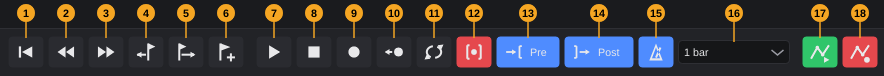
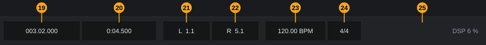
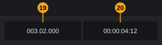
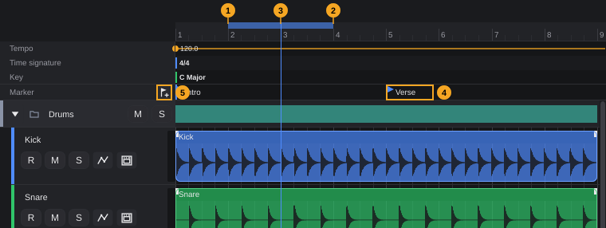

# Transport

The transport controls playback and recording: it starts and stops the song, moves the playhead, loops a section, punches in and out, plays the metronome and counts in. This chapter explains every element of the transport bar at the bottom of the project window, the ruler and locators, markers, and all transport keys.

**In this chapter**

1. [Where to find the transport](#1-where-to-find-the-transport)
2. [The transport bar at a glance](#2-the-transport-bar-at-a-glance)
3. [Playing and stopping](#3-playing-and-stopping)
4. [Moving the playhead](#4-moving-the-playhead)
5. [Position displays](#5-position-displays)
6. [Locators and loop](#6-locators-and-loop)
7. [Recording from the transport](#7-recording-from-the-transport)
8. [Punch in/out, pre-roll and post-roll](#8-punch-inout-pre-roll-and-post-roll)
9. [Metronome and count-in](#9-metronome-and-count-in)
10. [Retrospective record](#10-retrospective-record)
11. [Markers](#11-markers)
12. [Tempo and time signature](#12-tempo-and-time-signature)
13. [Automation read and write](#13-automation-read-and-write)
14. [Audio load (DSP)](#14-audio-load-dsp)
15. [Keyboard shortcuts](#15-keyboard-shortcuts)
16. [What is saved, and undo](#16-what-is-saved-and-undo)
17. [Quick reference](#17-quick-reference)

---

## 1. Where to find the transport

You reach every transport function in at least one of these places:

- **Transport bar**: the bar at the bottom of the project window ([The project window §5](project-window.md#5-transport-bar)). It is always visible while a project is open.
- **Transport menu** in the menu bar ([The project window §3.5](project-window.md#35-transport)): play, record, go to start, rewind, forward, locators, punch and markers.
- **Keys**: every transport function has a default key except pre-roll, post-roll, count-in and the automation buttons ([§15](#15-keyboard-shortcuts)).
- **Ruler** above the tracks: click to move the playhead, drag to set the loop range ([§6](#6-locators-and-loop)).
- **Marker track** below the ruler: jump to, add, move and loop markers ([§11](#11-markers)).

<!-- FIX F-209: Loop, Metronome and Retrospective record may get entries in the Transport menu -->
> **Note:** Loop, metronome and retrospective record have buttons and keys, but no entry in the **Transport** menu.

All transport functions need an open project. Without a project, the menu entries are greyed out and the buttons and keys do nothing.

---

## 2. The transport bar at a glance

The pictures show the transport bar of a window wide enough for one row. In the example, punch is on, pre-roll is 1 second, post-roll 2 seconds, the metronome is on and the count-in is one bar. The playhead is at bar 3, beat 2.

The numbers are the same as in [The project window §5](project-window.md#5-transport-bar).

<!-- FIX F-201: the keys named in the transport tooltips may follow your own key assignments -->
| # | Element | What it does | Details |
|---|---|---|---|
| 1 | Go to start | Moves the playhead to the project start | **Home**. [§4](#4-moving-the-playhead) |
| 2 | Rewind | Moves the playhead to the previous bar line | Hold to repeat. **Num -**. [§4](#4-moving-the-playhead) |
| 3 | Forward | Moves the playhead to the next bar line | Hold to repeat. **Num +**. [§4](#4-moving-the-playhead) |
| 4 | Previous marker | Moves the playhead to the previous marker | **Shift+B**. [§11](#11-markers) |
| 5 | Next marker | Moves the playhead to the next marker | **Shift+N**. [§11](#11-markers) |
| 6 | Add marker | Adds a marker at the playhead | **Insert**. [§11](#11-markers) |
| 7 | Play | Starts playback | Green while playing. **Space**. [§3](#3-playing-and-stopping) |
| 8 | Stop | Stops playback and recording | **Space**. [§3](#3-playing-and-stopping) |
| 9 | Record | Starts recording on the armed tracks | Red while recording. **Num \***. [§7](#7-recording-from-the-transport) |
| 10 | Retrospective record | Turns MIDI you played without recording into clips | **Shift+Num \***. [§10](#10-retrospective-record) |
| 11 | Loop | Loop on/off | Blue when on. **Num /**. [§6](#6-locators-and-loop) |
| 12 | Punch | Punch in/out on/off | Red when on. **I**. [§8](#8-punch-inout-pre-roll-and-post-roll) |
| 13 | **Pre** | Pre-roll: click to choose **off**, **0.5 s**, **1 s**, **2 s** or **4 s** | Blue when not off. [§8](#8-punch-inout-pre-roll-and-post-roll) |
| 14 | **Post** | Post-roll: same choices | Blue when not off. [§8](#8-punch-inout-pre-roll-and-post-roll) |
| 15 | Metronome | Metronome on/off | Blue when on. **C**. [§9](#9-metronome-and-count-in) |
| 16 | Count-in | **No count-in**, **1 bar** or **2 bars** before recording | [§9](#9-metronome-and-count-in) |
| 17 | Automation read | Automation curves control faders and parameters | Green when on. [§13](#13-automation-read-and-write) |
| 18 | Automation write | Records fader and parameter movements | Red when on. [§13](#13-automation-read-and-write) |
| 19 | Bars display | Position as bar.beat.ticks, for example **003.02.000** | [§5](#5-position-displays) |
| 20 | Time display | Position in time; click to choose the format | [§5](#5-position-displays) |
| 21 | Left locator **L** | Start of loop and punch, for example **L  1.1** | Click: jump there. Right-click: menu. **Num 1**. [§6](#6-locators-and-loop) |
| 22 | Right locator **R** | End of loop and punch | Same as L. **Num 2**. [§6](#6-locators-and-loop) |
| 23 | Tempo | Tempo at the project start, for example **120.00 BPM** | Double-click to type. [§12](#12-tempo-and-time-signature) |
| 24 | Time signature | Time signature at the project start, for example **4/4** | Double-click to type. [§12](#12-tempo-and-time-signature) |
| 25 | Audio load | **DSP** *n* **%** | [§14](#14-audio-load-dsp) |

Hover over any element to see its tooltip. The tooltips of **Pre** and **Post** show the current value, for example *Pre-roll: 1 s. With punch, playback starts this long before the left locator. Click: change*.

**Groups and narrow windows.** The elements form groups: navigation (1–6), transport (7–16), automation (17–18), position (19–20), locators (21–22), tempo and time signature (23–24). When the window is too narrow, whole groups move to a second row. The audio load display stays at the right end of the last row and gets a row of its own if there is no room. From about 1620 pixels of window width the bar fits in one row.

---

## 3. Playing and stopping

**To start playback:** click **Play** (7), press **Space**, or choose **Transport › Play / Stop**. Playback starts at the playhead. The **Play** button turns green while the song plays.

**To stop:** click **Stop** (8), press **Space** again, or choose **Transport › Play / Stop** again.

- **Space** and **Play / Stop** switch between playing and stopped. The **Play** button only starts and the **Stop** button only stops: clicking **Play** while the song plays, or **Stop** while it is stopped, changes nothing.
- When you stop, the playhead stays where playback stopped. It does **not** return to the position where you started, and pressing **Stop** a second time does not move it to the project start either. To get back, press **Home** (project start), **Num 1** (left locator) or use the markers.
- Stopping also ends a running recording ([§7](#7-recording-from-the-transport)).

**The playhead in the arrangement.** The playhead is a thin blue vertical line through the ruler and all tracks. It is redrawn 30 times per second.

<!-- FIX F-404: the arrangement may follow the playhead during playback -->
> **Note:** The arrangement does not scroll along during playback. When the playhead runs past the right edge of the visible area, it disappears from view while the song keeps playing. Scroll or zoom out to see it again (for example **Shift+F** shows the whole project; see [The project window §7](project-window.md#7-arrangement-area)).

---

## 4. Moving the playhead

You can move the playhead while the song is stopped or while it plays. During playback, the song continues from the new position.

| Action | How | Details |
|---|---|---|
| Go to the project start | **Go to start** (1), **Home**, **Transport › Go to start** | Position 0, bar 1. |
| One bar back | **Rewind** (2), **Num -**, **Transport › Rewind (one bar)** | Jumps to the previous bar line. If the playhead is less than 0.05 seconds after a bar line (for example during playback), it jumps to the bar line before that one, so pressing repeatedly keeps moving back. Never goes before the project start. |
| One bar ahead | **Forward** (3), **Num +**, **Transport › Forward (one bar)** | Jumps to the next bar line. |
| Repeat | Hold **Rewind** or **Forward** with the mouse | After 400 milliseconds it steps one bar every 120 milliseconds until you release the button. Held keys repeat at the speed of your keyboard. |
| To the left or right locator | **Num 1** / **Num 2**, click **L** (21) / **R** (22), **Transport › Go to left locator** / **Go to right locator** | [§6](#6-locators-and-loop) |
| To the previous or next marker | **Shift+B** / **Shift+N**, buttons 4 and 5, **Transport › Previous marker** / **Next marker**, or click a marker | [§11](#11-markers) |
| Anywhere | Click in the ruler | Snaps to the grid when **Snap** is on in the toolbar. |

Rewind and forward follow the bar lines of the signature track, so they also work correctly after tempo and time signature changes.

<!-- FIX F-405: a "Go to end" command may be added -->
> **Note:** There is no **Go to end** function and no key for it; **End** is not assigned. The keys **Ctrl+Left Arrow** and **Ctrl+Right Arrow** move the selected *clips* by one grid step, not the playhead ([The project window §3.2](project-window.md#32-edit)).

---

## 5. Position displays

The transport bar has two position displays next to each other. Both follow the playhead 30 times per second.

**Bars display (19)** shows the position as *bar.beat.ticks* with leading zeros: **003.02.000** is bar 3, beat 2, tick 0. A beat has 480 ticks. This display has no other format and does not react to clicks.

**Time display (20)** shows the same position in time. It has three formats:

| Format | Menu entry | Example (bar 3, beat 2 at 120 BPM) | Reads as |
|---|---|---|---|
| Time | **Time (min:sec)** | **0:04.500** | minutes : seconds . milliseconds (default) |
| Timecode | **Timecode (25 fps)** | **00:00:04:12** | hours : minutes : seconds : frames |
| Samples | **Samples** | **216 000** (at 48 kHz) | samples since the project start, in groups of three digits |

**To change the format:**

1. Click the time display (20). A menu headed **Time display** opens; the current format is ticked.
2. Choose **Time (min:sec)**, **Timecode (…)** or **Samples**.

The format belongs to the project: it is saved with it, and the change appears in the history as **Project settings**.

**Timecode frame rate.** The timecode entry shows the frame rate in brackets, for example **Timecode (25 fps)**. To change it, open **File › Project settings...** (**Shift+S**) and choose **24 fps**, **25 fps** or **30 fps** in the **Timecode** row (default **25 fps**). The frames count up within each second; frame 12 lasts until frame 13 begins.

<!-- FIX F-407: without an audio device the samples display may use the project sample rate -->
**Samples** are counted at the sample rate of the running audio device. Without an audio device, the samples display shows the number of seconds instead.

---

## 6. Locators and loop

The **left locator (L)** and the **right locator (R)** mark a section of the song. They are used for two things:

- **Loop:** playback repeats between L and R.
- **Punch in/out:** recording only takes place between L and R ([§8](#8-punch-inout-pre-roll-and-post-roll)).

| # | Element | What it shows |
|---|---|---|
| 1 | Left locator | Start of the locator range: the left end of the band in the top third of the ruler |
| 2 | Right locator | End of the locator range: the right end of the band |
| 3 | Playhead | The current position; click in the ruler to move it |
| 4 | Marker | A named position ([§11](#11-markers)) |
| 5 | **+** | Adds a marker at the playhead ([§11](#11-markers)) |

The band between the locators is **blue** while loop is on and **grey** while loop is off. You always see where the locators are.

### 6.1 The locator displays

The displays **L** (21) and **R** (22) in the transport bar show the locators as *bar.beat*, for example **L  1.1** and **R  5.1**.

- **Click** a locator display: the playhead jumps to that locator (same as **Num 1** / **Num 2**).
<!-- FIX F-408: the locator tooltip may describe the right-click menu -->
- **Right-click** a locator display: a menu opens with **Jump there** and **Set to cursor**. **Set to cursor** moves that locator to the playhead.

### 6.2 Setting the locators

| Way | What happens |
|---|---|
| Drag in the ruler | Drag left or right from where you press the mouse button. The range you drag becomes the locator range, and **loop is switched on**. Both ends snap to the grid when **Snap** is on in the toolbar. A movement of less than 4 pixels counts as a click (moves the playhead). |
| **Ctrl+Num 1** / **Ctrl+Num 2** | Sets the left / right locator to the playhead (also **Transport › Set left locator to playhead** / **Set right locator to playhead**, or **Set to cursor** in the locator menu). Uses the exact playhead position, without snapping. |
| Range tool | Draw a range with the Range tool (**2**), then choose **Loop the range** in **Edit › Range** or **Loop to the range** in the right-click menu. The locators take the range and loop is switched on. See [The project window §3.2](project-window.md#32-edit). |
| Marker track | Right-click a marker, choose **Loop this section (up to the next marker)**. Loop is switched on ([§11](#11-markers)). |

If setting a locator would put the left locator after the right one, the two are swapped, so L is always the earlier position. Locators never go before the project start.

### 6.3 Loop on and off

**To switch loop on or off:** click **Loop** (11) or press **Num /** (on keyboards without a number pad, **/** works as well). The button is blue while loop is on.

While loop is on, playback runs to the right locator and then continues at the left locator, until you stop.

<!-- FIX F-401: every way of switching loop on may also switch punch off -->
**Loop and punch exclude each other.** Clicking the **Loop** button to switch loop on switches punch off; switching punch on switches loop off. The other ways of switching loop on (**Num /**, dragging in the ruler, **Loop the range**, **Loop this section**) do not switch punch off. If both are on, recording is refused ([§7](#7-recording-from-the-transport)); switch punch off with **I** or the **Punch** button first.

---

## 7. Recording from the transport

This section covers only the transport side of recording: how to start and stop it and how loop, punch and count-in affect it. Inputs, arming tracks, takes and recording modes: see the chapter [Recording](recording.md).

**To record:**

1. Arm at least one track for recording (see the chapter [Recording](recording.md)).
2. Click **Record** (9), press **Num \*** (on keyboards without a number pad, **\*** works as well), or choose **Transport › Record**.
3. Recording starts. The **Record** button turns red and the **Play** button green. On every armed track a red block labelled **Recording...** grows from the start point to the playhead. The clip itself appears when you stop.
4. Stop with **Stop** (8) or **Space**.

Where recording starts depends on the settings:

| Situation | Recording starts | Playback starts |
|---|---|---|
| Stopped, loop off, punch off | At the playhead | At the playhead (earlier with count-in) |
| Stopped, loop on | At the left locator; each pass of the loop is recorded | At the left locator (earlier with count-in) |
| Stopped, punch on | At the left locator, and ends at the right locator | At the left locator minus the pre-roll (earlier with count-in); [§8](#8-punch-inout-pre-roll-and-post-roll) |
| Already playing, punch off | Immediately, at the current position | Keeps running |
| Already playing, punch on | Between the locators | Keeps running |

When you stop, the playhead stays where recording ended.

**When recording does not start**, a short message appears next to the mouse pointer:

<!-- FIX F-403: recording messages may appear in the project window like other messages -->
| Message | Reason |
|---|---|
| *Recording is only possible when at least one active input device is assigned to a track* | No track is armed. |
| *To record in loop mode, the length of loop must be greater than 2 seconds.* | Loop is on and the locator range is 2 seconds or shorter. |
| *Recording can be done in either loop mode or punch in/out mode, but not both at the same time!* | Loop and punch are both on ([§6.3](#63-loop-on-and-off)). |

---

## 8. Punch in/out, pre-roll and post-roll

With **punch in/out**, only the section between the left and right locator is recorded, even if the transport runs before and after it. Use it to replace a part in the middle of a take.

**To switch punch on or off:** click **Punch** (12), press **I**, or choose **Transport › Punch In/Out** (ticked when on). The button is red while punch is on. Switching punch on switches loop off ([§6.3](#63-loop-on-and-off)).

**To record with punch:**

1. Set the locators around the section ([§6.2](#62-setting-the-locators)).
2. Switch punch on.
3. Arm the track and press **Record**. Playback starts at the left locator minus the pre-roll; recording starts at the left locator and ends at the right locator by itself.
4. Without post-roll, playback keeps running after the right locator until you stop. With post-roll, it stops by itself.

If the song is already playing when you press **Record**, recording takes place between the locators; pre-roll and post-roll do not apply in this case.

### Pre-roll

The pre-roll lets you hear the song before the recording starts.

1. Click **Pre** (13). A menu opens, headed *Pre-roll: playback starts before the left locator (with punch)*.
2. Choose **off**, **0.5 s**, **1 s**, **2 s** or **4 s**. The current value is ticked.

The default is **off**. While the value is not **off**, the **Pre** button is blue. The pre-roll never starts before the project start: with the left locator at 0:01.000 and 2 seconds of pre-roll, playback starts at the project start.

### Post-roll

The post-roll keeps the song playing after the right locator and then stops the transport.

1. Click **Post** (14). A menu opens, headed *Post-roll: keep playing after the right locator, then stop (with punch)*.
2. Choose **off**, **0.5 s**, **1 s**, **2 s** or **4 s**.

The default is **off**. While the value is not **off**, the **Post** button is blue.

> **Note:** Pre-roll and post-roll only take effect when you start a recording from the stopped state with punch on. They do nothing for plain playback, for recordings without punch and for loop recordings.

---

## 9. Metronome and count-in

### Metronome

**To switch the metronome on or off:** click **Metronome** (15) or press **C**. The button is blue while the metronome is on. When it is on, it clicks on every beat during playback and during recording, following the tempo and time signature of the signature track.

<!-- FIX F-410: the metronome may get settings for sound, level, accent and "only while recording" -->
The metronome has no settings of its own: you cannot change its sound, its level, the accent on the first beat of a bar, or limit it to recording.

### Count-in

The count-in plays the metronome for one or two bars before a recording starts, so you can find the tempo.

**To choose the count-in:** open the list next to the metronome button (16) and choose:

| Entry | Effect |
|---|---|
| **No count-in** | Recording starts right away (default). |
| **1 bar** | One bar of clicks before the start. |
| **2 bars** | Two bars of clicks before the start. |

- The count-in applies only when you start a **recording** from the stopped state. Plain playback and a recording started while the song is already playing have no count-in.
- The count-in clicks even if the metronome is off. After the count-in, the metronome follows its own button.
- The count-in runs before the point where playback would otherwise start: before the playhead, before the left locator (loop), or before the pre-roll (punch).
- The length of a count-in bar follows the time signature at the project start.

> **Note:** The count-in setting applies to **all projects**: it is a working habit, not part of the song. Metronome on/off is saved with each project ([§16](#16-what-is-saved-and-undo)).

---

## 10. Retrospective record

Retrospective record catches what you played while the transport was not recording. FK Audio Suite keeps the last 30 seconds of MIDI arriving on the tracks' inputs; retrospective record turns it into clips afterwards.

**To use it:**

1. Arm the instrument track (see the chapter [Recording](recording.md)).
2. Play on your MIDI keyboard; the song may be stopped or playing, but not recording.
3. Click **Retrospective record** (10) or press **Shift+Num \***.
4. The notes from the last 30 seconds appear as new clips on the armed tracks.

This is one step in the history (**Retrospective recording**); **Ctrl+Z** removes the clips again.

If there is nothing to bring back (no armed track, or no MIDI on an armed track in the last 30 seconds), a window titled **Error** says:

<!-- FIX F-406: the hint may appear as a hint instead of an error window -->
*Nothing to retrieve: no MIDI arrived on an armed track in the last 30 seconds (arm a track, then play).*

<!-- FIX F-209: Retrospective record may get an entry in the Transport menu -->
Retrospective record has no entry in the **Transport** menu.

---

## 11. Markers

Markers are named positions in the song, for example *Intro*, *Verse* or *Solo*. They appear as blue flags with their name in the **marker track** below the ruler and signature track ([The project window §7](project-window.md#7-arrangement-area)). A section reaches from one marker to the next.

### Adding markers

| Way | Where the marker goes |
|---|---|
| **Add marker** button (6) in the transport bar | At the playhead |
| **Insert** or **Transport › Add marker** | At the playhead |
| **+** at the left of the marker track (5 in the ruler picture) | At the playhead |
| Double-click on empty space in the marker track | Where you click, snapped to the grid when **Snap** is on |

A new marker is called **Marker** plus a running number, for example **Marker 3**. Each new marker is a step in the history (**Add marker**).

<!-- FIX F-210: adding a marker without a project may show a message -->
Without an open project, the **+** in the marker track shows an error message; the transport button and **Insert** do nothing.

### Jumping to markers

- **Previous marker** (4), **Shift+B** or **Transport › Previous marker**: jumps to the closest marker before the playhead. If the playhead is less than 0.25 seconds after a marker (for example because the song is playing), it jumps to the marker before that one, so pressing repeatedly keeps moving back.
- **Next marker** (5), **Shift+N** or **Transport › Next marker**: jumps to the closest marker after the playhead.
- Click a marker flag in the marker track: the playhead jumps there.

If there is no marker in that direction, nothing happens.

### Editing markers in the marker track

| Action | Result |
|---|---|
| Drag a marker | Moves it. Snaps to the grid when **Snap** is on; hold **Shift** while dragging to move it freely. History: **Move marker**. |
| Double-click a marker | Opens **Rename marker** with a **Name** field. **OK** (**Enter**) renames, **Cancel** (**Esc**) keeps the name. An empty name is refused with *The marker needs a name.* History: **Rename marker**. |
| Right-click a marker | Menu with the marker name as heading: **Jump here**, **Loop this section (up to the next marker)**, **Rename...**, **Delete**. |

**Loop this section** sets the locators from the marker to the next marker and switches loop on. For the last marker, the section is one bar long. **Delete** removes the marker (history: **Delete marker**).

Markers stay on their bar and beat when you change the tempo.

---

## 12. Tempo and time signature

The transport bar shows the tempo (23) and the time signature (24) at the **project start**. You can change them here quickly; tempo and time signature changes later in the song are made in the signature track (see the chapter [Signature track](signature-track.md)).

**To change the tempo:**

1. Double-click the tempo display, for example **120.00 BPM**.
2. Type the new tempo, for example `128` or `92.5` (a decimal comma also works; the unit **BPM** may stay in the text).
3. Press **Enter**.

<!-- FIX F-1202: limit and message may change -->
The tempo is limited to 20–300 BPM: a larger or smaller value is set to the limit without a message. An entry without a number, or 0, is ignored and the old value comes back. History: **Change tempo**.

**To change the time signature:**

1. Double-click the time signature display, for example **4/4**.
2. Type the new signature as *beats/note value*, for example `6/8` or `7/8`.
3. Press **Enter**.

Allowed are 1 to 32 beats and the note values 2, 4, 8 and 16. Anything else is ignored and the old value comes back. History: **Change time signature**.

> **Note:** While you type in one of these fields, keys go to the field. **Space** does not start playback until you press **Enter** or click elsewhere.

---

## 13. Automation read and write

The two automation buttons switch automation on and off for the whole project. How each track handles automation is set per track (see the chapter [Automation](automation.md)).

| # | Button | When on (lit) | When off |
|---|---|---|---|
| 17 | **Automation read** (green) | Automation curves move the faders, pans and plugin parameters during playback. | All curves are ignored; faders stay where you put them. |
| 18 | **Automation write** (red) | Fader and parameter movements during playback are recorded as curves, on every track whose automation mode is **Touch**, **Latch** or **Write**. | Nothing is recorded, whatever the track modes are. |

The track modes: **Read** only plays curves and never records; **Touch** records while you hold a control; **Latch** records from the first touch until stop; **Write** records from the start of playback.

<!-- FIX F-409: automation write may be off in a new project -->
In a new project both buttons are on. Since new tracks are in **Read** mode, nothing is recorded until you set a track to **Touch**, **Latch** or **Write**.

The same switches are in the **Track** menu as **Read automation** and **Write automation** (ticked when on; [The project window §3.3](project-window.md#33-track)).

---

## 14. Audio load (DSP)

At the right end of the transport bar, **DSP** *n* **%** shows how much of the available time the audio engine needs to compute the sound.

| Display | Meaning |
|---|---|
| Grey **DSP 23 %** | Normal. |
| Orange, from 70 % | The load is high; dropouts may follow. |
| Red **DSP 95 %  Overload: sound muted** | From 90 %. The hint stays for two seconds after the load falls again. |

<!-- FIX F-402: the overload hint may appear only when the engine actually mutes -->
The tooltip says: *Audio load: share of the time the audio callback computes. From 98 % the engine mutes so nothing hangs. Remedies: bake tracks, a larger buffer in the audio settings, a release build instead of a debug build.* The sound is muted only from 98 %; between 90 % and 98 % the display already shows the overload hint.

> **Tip:** If the display is often orange or red, bake tracks you are not editing (see the chapter [Track bake](track-bake.md)) or choose a larger buffer in **Studio › Audio and MIDI settings...**.

---

## 15. Keyboard shortcuts

All transport keys are defaults. You can change them in **Edit › Keyboard shortcuts...**, category **Transport**. The **Transport** menu always shows your current keys.

<!-- FIX F-201: the transport tooltips may show your own keys instead of the defaults -->
<!-- FIX F-203: command names in the shortcut editor may be aligned with the menus -->
| Command (name in the shortcut editor) | Default key | Also |
|---|---|---|
| Play / Stop | **Space** | |
| Record | **Num \*** | **\*** |
| Retrospective Record | **Shift+Num \*** | |
| Loop On/Off | **Num /** | **/** |
| Rewind (One Bar) | **Num -** | |
| Forward (One Bar) | **Num +** | |
| Go to Start | **Home** | |
| Go to Left Locator | **Num 1** | |
| Go to Right Locator | **Num 2** | |
| Left Locator to Cursor | **Ctrl+Num 1** | |
| Right Locator to Cursor | **Ctrl+Num 2** | |
| Punch In/Out | **I** | |
| Add Marker | **Insert** | |
| Previous Marker | **Shift+B** | |
| Next Marker | **Shift+N** | |
| Metronome On/Off | **C** | |

- **\*** and **/** work on the main keyboard too, also on layouts where they need **Shift**.
- Pre-roll, post-roll, count-in, the time display format and the automation buttons have no command and cannot get a key.
- The tooltips in the transport bar always name the default keys, even after you change them.
- While a text field has the keyboard focus (tempo, time signature, a name), keys go to the field. Inside an editor in the lower zone, the editor's own keys come first (see [The project window §11](project-window.md#11-keyboard-shortcuts-in-the-project-window)).

---

## 16. What is saved, and undo

| Setting | Saved | Undo |
|---|---|---|
| Locators, loop on/off | With the project | |
| Punch on/off, metronome on/off | With the project | |
| Pre-roll, post-roll | With the project | **Pre-roll**, **Post-roll** |
| Time display format | With the project | **Project settings** |
| Timecode frame rate | With the project (**File › Project settings...**) | **Project settings** |
| Automation read/write | With the project | |
| Tempo, time signature | With the project | **Change tempo**, **Change time signature** |
| Markers | With the project | **Add marker**, **Move marker**, **Rename marker**, **Delete marker** |
| Retrospective record | — | **Retrospective recording** |
| Count-in | For all projects | |

The names in the *Undo* column are the entries in **Edit › History...**.

---

## 17. Quick reference

| What | How |
|---|---|
| Play / stop | **Space** |
| Record | **Num \*** |
| Bring back what you just played (MIDI) | **Shift+Num \*** |
| Project start | **Home** |
| One bar back / ahead | **Num -** / **Num +** (hold the buttons to repeat) |
| Move the playhead | Click in the ruler |
| Loop on/off | **Num /** or button 11 |
| Set loop range | Drag in the ruler |
| Jump to L / R | **Num 1** / **Num 2**, or click **L** / **R** |
| Set L / R to the playhead | **Ctrl+Num 1** / **Ctrl+Num 2**, or right-click **L** / **R** › **Set to cursor** |
| Punch on/off | **I** |
| Pre-roll / post-roll | Click **Pre** / **Post** |
| Metronome on/off | **C** |
| Count-in | List next to the metronome: **No count-in**, **1 bar**, **2 bars** |
| Time format | Click the time display |
| Add marker | **Insert** |
| Previous / next marker | **Shift+B** / **Shift+N** |
| Tempo / time signature | Double-click the display, type, **Enter** |
| Change keys | **Edit › Keyboard shortcuts...** |
